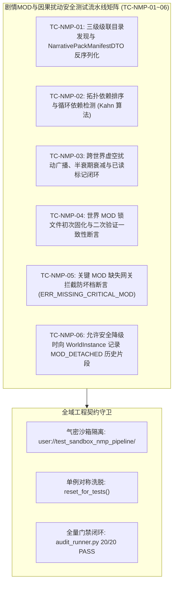

# 施工细则：剧情MOD库相对加载因果扰动与世界绑定引擎施工细则 —— 阶段4：无头安全测试矩阵与全域门禁验收

> [!NOTE]
> **【施工目标】**：构建剧情 MOD 相对加载、因果扰动与世界绑定全链路自动化集成测试套件（`test_narrative_mod_and_perturbation_pipeline.gd`），全面覆盖 6 大核心用例（TC-NMP-01~06）；实现测试沙箱环境气密隔离与单例生命周期对称洗脱；验证三级级联发现与 DTO 反序列化、Kahn 拓扑排序与循环依赖检测、虚空共鸣广播衰减与标记、世界 MOD 锁文件固化与一致性、关键包缺失网关拦截防坏档及安全降级历史片段记录；确保全域 20 项工程门禁与文档审查 100% 绿色闭环。
> **施工开始日期**：2026-10-11

---

## 📌 第一性原理溯源指针

* **精准上游规范指针**：[AGENTS.md 工作区全局刚性公理](../../../../../AGENTS.md) §二.1、§三、§四.1
* **核心不变量约束断言**：
  - `Inv-TEST-PIPELINE-COVERAGE-1 (流水线端到端全域覆盖公理)`：集成测试流水线 `test_narrative_mod_and_perturbation_pipeline.gd` 必须覆盖 6 项核心用例（TC-NMP-01~06），涵盖级联发现、Kahn 依赖排序、虚空扰动半衰期衰减、锁文件亲和绑定、关键 MOD 缺失网关拦截防坏档与安全降级；
  - `Inv-TEST-SANDBOX-ISOLATION-2 (测试沙箱气密隔离公理)`：每个测试用例独立运行于隔离沙箱路径（如 `user://test_sandbox_nmp_pipeline/`），运行前后严格执行对称重置与资源洗脱，零测试数据残留，零全局单例状态泄露；
  - `Inv-GATES-FULL-PASS-3 (全域质量门禁零红线公理)`：必须 100% 通过 `audit_docs.py` 与全域门禁 `audit_runner.py`（20/20 PASS），无硬编码、圈复杂度 CC <= 15、循环内零瞬态堆分配。
* **验收闭环最高指示**：严禁伪造断言或跳过核心校验逻辑；测试代码必须直接继承 TestCase 并接入 TestRegistry；无头测试全量通过且门禁零错误零警告为唯一达标标准。

---

## 一、 第一性原理与架构解耦契约

### 1. 无头端到端测试矩阵架构设计

为确保剧情 MOD 相对加载系统与因果扰动在多包拓扑、并发共鸣及世界状态切换下的绝对稳定性与安全性，构建包含 6 大专项维度的端到端集成流水线矩阵：

### 2. 六大核心测试用例因果链与断言模型

1. **TC-NMP-01: 三级级联目录发现与 NarrativePackManifestDTO 反序列化**：
   - 在测试沙箱构造具备 `pack.json` 的包目录结构，覆盖核心元数据（`pack_id`, `version`, `priority`, `dependencies`）；
   - 验证 `ModPackageDiscoverySolver.scan_installed_packs` 成功读取并解析为强类型 `NarrativePackManifestDTO` 实例。
2. **TC-NMP-02: 拓扑依赖排序与循环依赖检测 (Kahn 算法)**：
   - 构造无环依赖多包集合，断言按照前置依赖先后拓扑展开，同层级按优先级降序排序；
   - 构造自环与相互依赖的有环集合，断言解算器准确识别并阻断，返回 `ERR_CYCLIC_DEPENDENCY` 与环路节点列表。
3. **TC-NMP-03: 跨世界虚空扰动广播、半衰期衰减与已读标记闭环**：
   - 源世界通过 `CrossWorldPerturbationBroker` 发射因果共鸣；
   - 目标世界成功拉取该扰动，源世界不可见自身扰动；计算半衰期衰减衰竭；目标世界访问后标记已读，二次拉取为空。
4. **TC-NMP-04: 世界 MOD 锁文件初次固化与二次验证一致性断言**：
   - 在空世界目录下调用 `WorldModAffinityManager.verify_and_bind_world_mods`，断言磁盘生成 `world_mod_lock.json`，返回 `INITIALIZED`；
   - 再次调用且安装包一致时，断言返回 `VERIFIED`。
5. **TC-NMP-05: 关键 MOD 缺失网关拦截防坏档断言 (ERR_MISSING_CRITICAL_MOD)**：
   - 模拟世界锁定了关键 MOD 但当前环境未安装且 `allow_safe_degrade = false`；
   - 调用网关 `enter_world()`，断言被安全守卫坚决拦截返回 `ERR_MISSING_CRITICAL_MOD`，网关禁止跃迁至 `IN_WORLD`。
6. **TC-NMP-06: 允许安全降级时向 WorldInstance 记录 MOD_DETACHED 历史片段**：
   - 缺少 MOD 但传入 `allow_safe_degrade = true`，调用 `enter_world()`；
   - 断言返回降级成功，从世界仓储加载世界实例，断言其历史片段末尾成功追加 `MOD_DETACHED` 历史片段，时空历史单调连续。

---

## 二、 命令式施工执行清单 (Agent Execution Checklist)

- [x] Step 4.1: 创建集成测试流水线 `test_narrative_mod_and_perturbation_pipeline.gd` 骨架
- [x] Step 4.2: 实现 TC-NMP-01 三级级联目录发现与清单 DTO 反序列化测试
- [x] Step 4.3: 实现 TC-NMP-02 拓扑依赖排序与循环依赖检测测试 (Kahn 算法)
- [x] Step 4.4: 实现 TC-NMP-03 跨世界虚空扰动广播、半衰期衰减与已读标记测试
- [x] Step 4.5: 实现 TC-NMP-04 世界 MOD 锁文件初次固化与二次验证一致性测试
- [x] Step 4.6: 实现 TC-NMP-05 关键 MOD 缺失网关拦截防坏档断言测试
- [x] Step 4.7: 实现 TC-NMP-06 允许安全降级时向 WorldInstance 记录 MOD_DETACHED 历史片段测试
- [x] Step 4.8: 在 `test_registry.gd` 中注册流水线套件
- [x] Step 4.9: 执行本地 `audit_docs.py` 与 `audit_runner.py` 全域门禁验证

---

## 三、 DoD 验收矩阵 (DoD Matrix)

| 检验项 ID | 校验目标 | 验证输入 | 预期输出断言 |
| :--- | :--- | :--- | :--- |
| TC-NMP-01 | 三级级联目录发现与清单元数据反序列化 | 沙箱目录存在合法 `pack.json` | 成功发现并解析为 `NarrativePackManifestDTO`，字段强类型等价 |
| TC-NMP-02 | 依赖拓扑排序与循环依赖拦截 (Kahn) | 输入 DAG 依赖包与环路依赖包 | 正常包按依赖先后正确排序；环路包返回 `ERR_CYCLIC_DEPENDENCY` |
| TC-NMP-03 | 虚空扰动广播、半衰期衰减与已读标记 | 跨世界发射扰动，目标世界拉取并标记 | 源世界自旋隔离，衰减方程符合物理指数，标记已读后二次轮询被幂等剔除 |
| TC-NMP-04 | 世界 MOD 锁文件初次固化与一致性验证 | 初次与二次进入世界验证锁文件 | 初次进入生成锁文件返回 `INITIALIZED`，二次进入匹配返回 `VERIFIED` |
| TC-NMP-05 | 关键 MOD 缺失网关拦截防坏档 | 缺失锁定 MOD 且 `allow_safe_degrade = false` | 返回 `ERR_MISSING_CRITICAL_MOD`，网关阻止跃迁至 `IN_WORLD` |
| TC-NMP-06 | 允许安全降级时记录脱落历史片段 | 缺失锁定 MOD 且 `allow_safe_degrade = true` | 返回 `DEGRADED`，世界实例历史片段成功追加 `MOD_DETACHED`，成功进界 |
| GATE-PASS-07 | 全域门禁无警告零错误通过 | 执行 `audit_runner.py` 调度 20 项门禁 | 20 / 20 PASS，0 Error / 0 Warn，文档与代码 100% 达标 |
