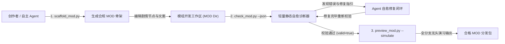

# 施工细则：MOD开发者SDK自动同步与联机安全净化引擎施工细则 —— 阶段2：面向Agent友好型的创作者DevKit工具链与自愈诊断器

> [!NOTE]
> **【施工目标】**：打造完全解耦于 Godot 宿主、专为外部 MOD 创作者与自主编码 Agent 设计的轻量级 DevKit 工具链与自愈诊断中枢。提供骨架脚手架 `scaffold_mod.py` 快速生成合规 MOD 骨架；构建纯静态轻量自愈诊断器 `check_mod.py`，支持清单规范性校验、DAG 图拓扑连通性审查与占位符白名单校验，输出机器可读的结构化 `--json` 自愈指引；构建无头剧情演习器 `preview_mod.py`，通过全分支确定性遍历与文本占位符水化实现剧情无头推演；交付官方标准启蒙剧情包 `starter_story` 模板作为参考基准。
> **施工开始日期**：2026-10-11

---

## 📌 第一性原理溯源指针

* **精准上游规范指针**：[AGENTS.md 工作区全局刚性公理](../../../../../AGENTS.md) §二.1、§二.2、§三、§四.1
* **核心不变量约束断言**：
  - `Inv-DEVKIT-SCAFFOLD-1 (骨架生成结构规范性公理)`：脚手架生成的 MOD 目录必须严格契约化，包含 `pack.json`、`routing_rules.json`、`dag_graphs/DAG_<id>.json` 与 `i18n/zh-CN.json`，且生成后立即可通过诊断器校验；
  - `Inv-DEVKIT-DIAGNOSE-2 (纯静态自愈诊断机器可读公理)`：诊断器不得依赖 Godot 运行时与外部图形界面；支持 `--json` 输出结构化诊断对象 `{"valid": bool, "error_count": int, "diagnostics": [{"code": ..., "file": ..., "detail": ..., "fix_suggestion": ...}]}`，向 Agent 提供明确的修复建议；
  - `Inv-DEVKIT-HEADLESS-3 (无头演习全分支确定性穷举公理)`：无头演习器必须支持纯 Python 离线无头运行，使用深度优先遍历穷举 DAG 的所有合规可达叙事分支，注入模拟上下文并完整水化占位符文本；
  - `Inv-DEVKIT-TEMPLATE-4 (官方标准模板真源契约公理)`：官方模板 `starter_story` 必须作为开箱即用的基准实现，其清单配置、因果 DAG 与语言包 100% 遵从引擎契约，零校验错误。
* **防漂移最高指示**：严禁在检查器与演习器中引入对 Godot 引擎运行时的硬依赖；严禁弱化 DAG 拓扑连通性校验逻辑；严禁生成不包含 `fix_suggestion` 的模糊诊断报错。

---

## 一、 第一性原理与架构解耦契约

### 1. 创作者 DevKit 与 Agent 闭环开发流水线

卡拉尔引擎支持创作者与外部自主编码 Agent 高频共建叙事模组。为避免创作者反复启动大型游戏编辑器进行语法与拓扑调试，DevKit 工具链提供全链路无头闭环：



### 2. DevKit 工具链三件套契约设计

#### (1) 项目骨架脚手架 (`scaffold_mod.py`)
- **定位**：一键生成符合卡拉尔世界引擎规范的标准 MOD 文件目录；
- **CLI 接口**：`--id <pack_id> --name <pack_name> --race <race_id> --output-dir <path>`；
- **产物结构**：
  - `pack.json`：强类型元数据清单，声明版本、优先级、标签与依赖；
  - `routing_rules.json`：角色种族匹配与序章因果图重定向规则；
  - `dag_graphs/DAG_<id>.json`：标准因果有向无环图，包含起点 `START_ENTRY`、步进节点 `STANDARD_STEP` 与终点 `TERMINAL_EXIT`；
  - `i18n/zh-CN.json`：本地化文案字典，采用标准 `{param}` 参数化占位符。

#### (2) 静态自愈诊断器 (`check_mod.py`)
- **定位**：纯 Python 实现的无宿主语法与拓扑门禁检查器；
- **核心校验规则**：
  1. **清单规范合法性**：校验 `pack.json` 必备字段（ID、版本、API 版本、优先级等）与格式；
  2. **路由规则合法性**：校验 `routing_rules.json` 规则数组、匹配条件与目标 DAG 引用有效性；
  3. **DAG 拓扑完整性**：
     - 有且仅有一个 `START_ENTRY` 节点；
     - 至少一个 `TERMINAL_EXIT` 节点，且从入口出发的所有分支最终均可达终点；
     - 严格无向与有向循环检测（基于 Kahn 拓扑排序算法，环路 100% 拦截）；
     - 无孤儿节点与悬挂边（所有节点均从入口可达，边两端节点必须在图元中已声明）；
     - 前置依赖 `required_prerequisites` 完整性校验；
  4. **占位符白名单校验**：扫描所有叙事文案中的 `{param}` 占位符，若存在未在白名单中注册的参数，立即报警并提示可用合法参数列表；
- **自愈诊断格式**：
  ```json
  {
    "valid": false,
    "error_count": 1,
    "diagnostics": [
      {
        "code": "ERR_UNKNOWN_PLACEHOLDER",
        "file": "i18n/zh-CN.json",
        "detail": "键 'narrative.starter.step' 包含未知占位符 '{unknown_var}'",
        "fix_suggestion": "请替换为系统白名单支持的参数，如 {player_name}, {race}, {level}, {town}"
      }
    ]
  }
  ```

#### (3) 无头演习推演器 (`preview_mod.py`)
- **定位**：离线模拟叙事流转与文案水化的无头执行引擎；
- **CLI 接口**：`<mod_dir> [--simulate]`；
- **运行机制**：
  - 加载模组元数据、路由规则与 DAG 图元；
  - 构造模拟角色上下文（玩家姓名、种族、等级、所在城镇等）；
  - 基于深度优先搜索 (DFS) 枚举从 `START_ENTRY` 到 `TERMINAL_EXIT` 的所有决策分支；
  - 自动水化 `{player_name}`、`{race}` 等文本占位符，输出清晰的剧情步进推演日志。

---

## 二、 命令式施工执行清单 (Agent Execution Checklist)

- [x] Step 1: 编制 Phase 114 阶段2 技术规范与 DevKit 工具链契约
- [x] Step 2: 编写 `WebGames/mod_sdk/tools/scaffold_mod.py` 自动化项目脚手架
- [x] Step 3: 编写 `WebGames/mod_sdk/tools/check_mod.py` 纯静态轻量自愈诊断器
- [x] Step 4: 编写 `WebGames/mod_sdk/tools/preview_mod.py` 无头剧情演习与水化预览器
- [x] Step 5: 构建官方标准最小模板 `WebGames/mod_sdk/templates/starter_story/` 资产并实施全闭环验收

---

## 三、 DoD 验收矩阵 (DoD Matrix)

| 检验项 ID | 校验目标 | 验证输入 | 预期输出断言 |
| :--- | :--- | :--- | :--- |
| TC-DEVKIT-SCAFFOLD-01 | 脚手架工程自动化生成 | 执行 `scaffold_mod.py --id demo_story --name "测试模组" --race ELF --output-dir temp/demo` | 成功生成 4 份核心规范文件，退出码为 0 |
| TC-DEVKIT-CHECK-VALID-02 | 官方标准模板纯静态诊断合规 | 执行 `check_mod.py WebGames/mod_sdk/templates/starter_story --json` | `valid == true`, `error_count == 0`, `diagnostics == []` |
| TC-DEVKIT-CHECK-CYCLE-03 | 拓扑死锁循环依赖 100% 拦截 | 注入包含 A -> B -> A 循环边的恶意 DAG 并运行 `check_mod.py --json` | 检出 `ERR_DAG_CYCLE`，退出码为 1，提供明确消除环路的 `fix_suggestion` |
| TC-DEVKIT-CHECK-PLACEHOLDER-04 | 非法未注册占位符拦截 | 文案中注入 `{unknown_magic_attr}` 并运行 `check_mod.py --json` | 检出 `ERR_UNKNOWN_PLACEHOLDER`，输出可用白名单字段修复建议 |
| TC-DEVKIT-CHECK-ORPHAN-05 | 孤儿断链节点静态发现拦截 | 图元中新增无入边不可达的孤立节点并运行 `check_mod.py --json` | 检出 `ERR_DAG_ORPHAN_NODE`，准确定位孤立节点 ID |
| TC-DEVKIT-PREVIEW-SIMULATE-06 | 无头剧情演习与文案占位符水化 | 执行 `preview_mod.py WebGames/mod_sdk/templates/starter_story --simulate` | 成功穷举所有连通分支，占位符 `{player_name}` 成功水化为模拟角色名，退出码为 0 |
| TC-DEVKIT-JSON-SCHEMA-07 | 诊断器机器可读 JSON 输出契约 | 执行 `check_mod.py <path> --json` | 严格输出包含 `valid`、`error_count` 与 `diagnostics` 的合规 JSON 字符串 |
