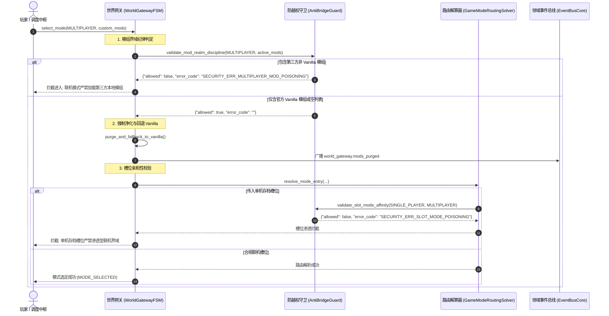

# 施工细则：MOD开发者SDK自动同步与联机安全净化引擎施工细则 —— 阶段3：联机域MOD气密级净化与防越权安全守卫加固

> [!NOTE]
> **【施工目标】**：加固世界网关防越权安全守卫（`AntiBridgeGuard`）与世界栏生命周期状态机（`WorldGatewayFSM`），建立针对第三方 MOD 的气密级界域隔离机制。在单机沙盒模式下保持第三方剧情/数值模组完全放行；在联机界域跃迁前，执行严格的模组界域纪律核验，坚决阻断任何携带本地非 Vanilla 模组进入联机界的行为；切入联机模式时强制净化卸载本地第三方模组并回退 Vanilla 原生核心与洗脱内存；坚决拦截单机/带 MOD 槽位跨界渗透联机，确保联机环境零协议毒化与零内存污染。
> **施工开始日期**：2026-10-11

---

## 📌 第一性原理溯源指针

* **精准上游规范指针**：[AGENTS.md 工作区全局刚性公理](../../../../../AGENTS.md) §二.1、§二.2、§三、§四.1
* **核心不变量约束断言**：
  - `Inv-MULTIPLAYER-POISON-GUARD-1 (联机模式零毒化公理)`：任何联机模式跃迁（包括 `select_mode` 与 `enter_world`），只要活跃模组列表中包含任何第三方非 Vanilla 模组，必须由 `AntiBridgeGuard.validate_mod_realm_discipline` 坚决拦截，返回 `SECURITY_ERR_MULTIPLAYER_MOD_POISONING`；
  - `Inv-SINGLEPLAYER-SANDBOX-PASS-2 (单机模组沙盒完全放行公理)`：目标模式为 `SINGLE_PLAYER` 时，模组界域纪律守卫完全放行任意第三方与官方原生剧情/数值 MOD，保障单机沙盒环境的最大自由度；
  - `Inv-REALM-PURGE-AND-SCRUB-3 (切入联机强制净化与内存全量洗脱公理)`：当网关切入联机模式时，强制卸载本地加载的所有第三方模组，回退并仅保留官方 Vanilla 原生核心，并执行全量内存洗脱（Full Memory Scrubbing），彻底根除内存残存脚本/变量污染联机协议；
  - `Inv-SLOT-MODE-AFFINITY-4 (单机槽位跨界渗透联机绝对阻断公理)`：单机存档槽位或携带单机模组特征的槽位严禁渗透进入联机界域，必须由 `AntiBridgeGuard.validate_slot_mode_affinity` 拦截并返回 `SECURITY_ERR_SLOT_MODE_POISONING`。
* **业务实现最高指示**：联机模式严禁加载第三方本地剧情/数值 MOD；网关退出时必须对称释放所有模式状态与模组运行时。

---

## 一、 第一性原理与架构解耦契约

### 1. 联机模组净化与防越权守卫交互拓扑

联机模式的核心资产为跨客户端权威同步与状态一致性。单机本地可能安装了修改剧情因果树、属性数值或逻辑节点的第三方 MOD，若带入联机界域，将引发协议反序列化崩溃、幽灵实体同步以及严重的越权作弊。因此，引擎必须在进入联机域的各关键节点设立气密级关卡：

### 2. 核心鉴别规则与安全契约

1. **模组界域纪律判定 (`validate_mod_realm_discipline`)**：
   - 输入参数：`target_mode: int`, `active_mods: Array`；
   - 裁定规则：
     - 若 `target_mode == SINGLE_PLAYER`，直接返回放行字典 `{"allowed": true, "error_code": "", "message": "单机模组沙盒放行"}`；
     - 若 `target_mode == MULTIPLAYER`，遍历检查 `active_mods` 中每个条目：若存在非 Vanilla 原生模组，立即阻断并返回 `{"allowed": false, "error_code": "SECURITY_ERR_MULTIPLAYER_MOD_POISONING", "message": "联机模式严禁加载第三方本地剧情/数值 MOD"}`；若全部为 Vanilla 模组或列表为空，放行并返回 `{"allowed": true, "error_code": "", "message": "官方 Vanilla 原生包在联机模式下安全放行"}`。
2. **Vanilla 模组识别契约 (`_is_vanilla_pack`)**：
   - 字典/DTO 支持：检查显式标记 `is_vanilla == true` 或 `is_official == true`；
   - 包标识前缀：检查 `pack_id` 是否为 `vanilla`、以 `vanilla_` 开头、以 `official_` 开头或为 `core_vanilla`；
   - 作者身份：检查 `author` 是否为 `vanilla` 或 `official`；
   - 字符串简写支持：支持直接传入字符串并检查是否属于原生前缀。
3. **网关状态机强制净化与内存洗脱 (`purge_and_fallback_to_vanilla` / `exit_to_gateway`)**：
   - 净化机制：在进入联机域时，剔除非官方模组，仅保留合规的原生 Vanilla 包；
   - 内存洗脱：在退出网关 `exit_to_gateway` 时，重置 `selected_mode` 为 `UNSELECTED`，清空 `selected_slot_id`、`selected_world_id`、`active_character_id` 以及 `active_mods`，发布 `world_gateway.memory_scrubbed` 广播，保障状态对称释放。

---

## 二、 命令式施工执行清单 (Agent Execution Checklist)

- [x] Step 3.1: 编制 Phase 114 阶段3 联机域 MOD 气密级净化与防越权安全守卫技术规范
- [x] Step 3.2: 改造 `AntiBridgeGuard`，定义 `SECURITY_ERR_MULTIPLAYER_MOD_POISONING` 错误码
- [x] Step 3.3: 在 `AntiBridgeGuard` 中实现静态方法 `validate_mod_realm_discipline` 与 `_is_vanilla_pack`
- [x] Step 3.4: 扩展 `AntiBridgeGuard.validate_slot_mode_affinity`，支持模组携带特征与模式不匹配双重防御
- [x] Step 3.5: 改造 `WorldGatewayFSM`，增加 `active_mods` 成员、`purge_and_fallback_to_vanilla` 净化方法
- [x] Step 3.6: 在 `WorldGatewayFSM.select_mode` 与 `enter_world` 接入模组纪律裁定与联机净化流水线
- [x] Step 3.7: 加固 `WorldGatewayFSM.exit_to_gateway`，实现全量模组列表与会话字段对称洗脱

---

## 三、 DoD 验收矩阵 (DoD Matrix)

| 检验项 ID | 校验目标 | 验证输入 | 预期输出断言 |
| :--- | :--- | :--- | :--- |
| TC-SEC-SP-01 | 单机模式第三方模组沙盒完全放行 | target_mode == SINGLE_PLAYER, active_mods 包含第三方 MOD | 返回 allowed=true, error_code="", message="单机模组沙盒放行" |
| TC-SEC-MP-02 | 联机模式加载第三方 MOD 坚决拦截 | target_mode == MULTIPLAYER, active_mods 包含第三方 MOD | 返回 allowed=false, error_code="SECURITY_ERR_MULTIPLAYER_MOD_POISONING" |
| TC-SEC-SLOT-03 | 单机/带 MOD 槽位跨界渗透联机阻断 | slot_mode == SINGLE_PLAYER, target_mode == MULTIPLAYER | 返回 allowed=false, error_code="SECURITY_ERR_SLOT_MODE_POISONING" |
| TC-SEC-PURGE-04 | 联机模式切入时本地模组强制净化卸载 | 激活模组包含 Vanilla 与第三方模组，切入联机模式 | 第三方模组被强制移除，仅保留 Vanilla 核心，广播 world_gateway.mods_purged |
| TC-SEC-VANILLA-05 | 官方 Vanilla 原生包在联机模式下安全放行 | target_mode == MULTIPLAYER, active_mods 仅包含 Vanilla 官方包 | 返回 allowed=true, error_code="", 放行进入联机模式 |
| TC-SEC-RESET-06 | 网关退出模式重置与状态对称洗脱 | 调用 exit_to_gateway() | 模式重置为 UNSELECTED，active_mods 全量清空，广播 memory_scrubbed |
