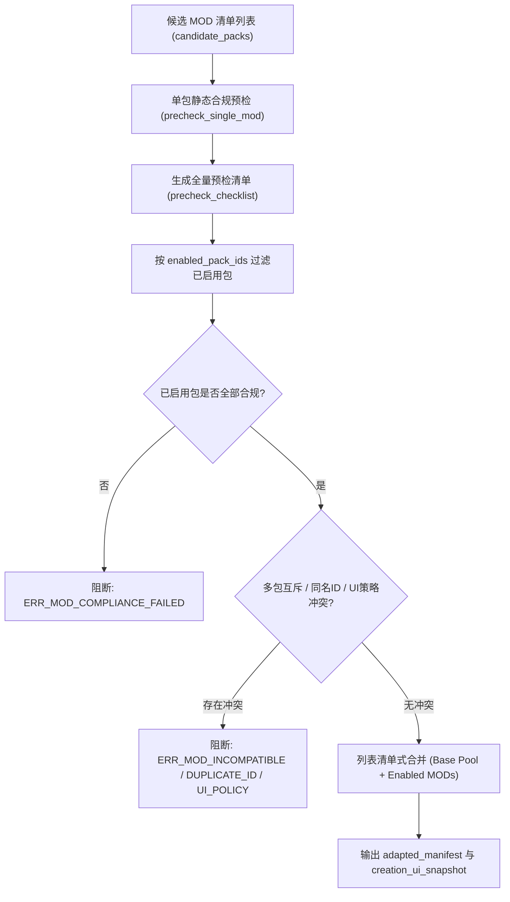

# 施工细则：Phase 115 单机显性MOD预检与命途UI多包列表适配引擎 —— 阶段1：单机显性MOD合规预检与多包列表冲突适配契约

> [!NOTE]
> **【施工目标】**：定义单机显性命途 MOD 的声明清单数据契约 `DestinyModManifestDTO` 与预检适配引擎 `ModPrecheckAndAdaptationSolver`。确立单包合规性预检五维守卫（非空包标识、UI 操作策略枚举、身世六维加点与初始金币预算上限、正负因果天赋天平、初始套件物品容量与 canonical_id 非空），设计多包勾选启用列表下的三类冲突裁决规则（显式互斥冲突、同名实体 ID 撞车冲突、前端 UI 操作策略冲突），并输出列表清单式合并快照 `adapted_manifest` 与 `creation_ui_snapshot`。
> 施工开始日期: 2026-10-11

---

## 📌 第一性原理溯源指针

* **精准上游规范指针**：[AGENTS.md 工作区全局刚性公理](../../../../../AGENTS.md) §二.1、§三、§四.1；[Phase 112 阶段1 细则](../../../归档库/03_短期施工档案卷/第11期_105到114/Phase_112_世界内角色权威创建与时空装配施工细则/KALAR-DEV-2026-ST108-001_阶段1_角色权威创建请求契约与后端生成拓扑设计.md)
* **核心不变量约束断言**：
  - `Inv-DESTINY-PRECHECK-1 (单包数值与因果天平边界)`：任何单机命途 MOD 自定义身世的单维属性修正必须处于 `[-2, 3]` 且六维净加点总和处于 `[-2, 4]`，初始金币处于 `[0, 1000]`；自定义配对天赋必须满足一正一负且净代价绝对值 `<= 1`；单套件物品总数 `<= 10`；
  - `Inv-DESTINY-CHECKLIST-2 (勾选启用隔离预检法则)`：候选列表中的所有 MOD 均执行静态预检生成 `precheck_checklist`，但仅当被玩家勾选启用（或 `"*"` 全选）的包存在违规时才阻断返回 `ERR_MOD_COMPLIANCE_FAILED`，未勾选的坏包不得阻断合法勾选包运行；
  - `Inv-DESTINY-CONFLICT-3 (多包零歧义冲突阻断)`：已启用的合规 MOD 集合若存在 `incompatible_packs` 互斥、同名 `origin_id`/`trait_id`/`kit_id` 撞车或 UI 策略 `ALLOW_MANUAL` 与 `FORCE_RANDOM` 互斥，必须立即阻断并返回精确错误码；
  - `Inv-DESTINY-ADAPT-4 (基础池与多包无损清单合并)`：合并后的 `adapted_manifest` 必须保留 `GameConfig` 内置基础池并追加所有已启用合规包的自定义身世、天赋、配对预设、初始套件与路由规则。
* **防漂移最高指示**：严禁跳过静态预检直接将未校验的外部 MOD 数据注入权威创角解算器；严禁静默吞没多包同名 ID 撞车或 UI 策略冲突。

---

## 一、 第一性原理与架构解耦契约

### 1. 单机显性 MOD 预检与多包列表冲突适配拓扑

单机模式下玩家可在创角向导中勾选启用多个命途扩展 MOD（如扩展新身世、开放手动选择身世/天赋、开放属性重随、定制初始行囊与专属序章路由）。为保障引擎数值体系不被异常包击穿、多包并存时不发生静默覆盖，系统采用「单包静态预检 -> 启用集过滤 -> 多包冲突检测 -> 列表清单合并」四步流水线：

### 2. 核心数据契约设计 (`DestinyModManifestDTO`)

| 字段名称 | 类型 | 缺省回退值 | 契约约束与职责语义 |
| :--- | :--- | :--- | :--- |
| `pack_id` | `String` | `""` | 命途 MOD 唯一标识符，非空，缺失触发 `ERR_DESTINY_EMPTY_PACK_ID` |
| `pack_name` | `String` | `""` | 模组可读显示名称，缺省回退为 `pack_id` |
| `version` | `String` | `"1.0.0"` | 语义化版本号 |
| `priority` | `int` | `100` | 模组加载优先级权重 |
| `dependencies` | `Array[String]` | `[]` | 依赖的前置模组 ID 列表 |
| `incompatible_packs` | `Array[String]` | `[]` | 显式声明互斥的模组 ID 列表 |
| `ui_capabilities` | `Dictionary` | `{}` | 声明 `origin_selection_mode`、`trait_selection_mode` 与 `allow_attribute_reroll` |
| `custom_origins` | `Array[Dictionary]` | `[]` | 自定义身世定义数组（含加成、金币、初始套件与序章 DAG 绑定） |
| `custom_traits` | `Dictionary` | `{}` | 自定义正负天赋字典（按 `trait_id` 索引） |
| `paired_presets` | `Array[Dictionary]` | `[]` | 自定义因果平衡天赋配对列表（含 `positive`、`negative`、`weight`） |
| `custom_starter_kits` | `Dictionary` | `{}` | 自定义初始行囊套件字典（按 `kit_id` 索引） |
| `custom_routing_rules` | `Array[Dictionary]` | `[]` | 自定义序章剧情 DAG 路由匹配规则数组 |

### 3. 单包预检与多包冲突错误码契约

| 错误码常量 | 触发阶段 | 判定条件与拦截阈值 |
| :--- | :--- | :--- |
| `ERR_DESTINY_EMPTY_PACK_ID` | 单包预检 | `pack_id` 为空字符串或纯空白字符 |
| `ERR_DESTINY_INVALID_UI_MODE` | 单包预检 | `origin_selection_mode` 或 `trait_selection_mode` 不属于 `["INHERIT", "ALLOW_MANUAL", "FORCE_RANDOM"]` |
| `ERR_DESTINY_STAT_BUDGET_EXCEEDED` | 单包预检 | 身世 `attribute_bonus` 单维超出 `[-2, 3]` 或六维净加点总和超出 `[-2, 4]` |
| `ERR_DESTINY_GOLD_CAP_EXCEEDED` | 单包预检 | 身世 `initial_gold` 超出 `[0, 1000]` 合理区间 |
| `ERR_DESTINY_CAUSALITY_IMBALANCE` | 单包预检 | 配对天赋未定义、正负极性错误或 `absi(pos_cost + neg_cost) > 1` |
| `ERR_DESTINY_KIT_INVALID` | 单包预检 | 套件物品 `canonical_id` 为空、数量 `<= 0` 或单套件总件数 `> 10` |
| `ERR_MOD_COMPLIANCE_FAILED` | 列表适配 | 被勾选启用的 MOD 中存在至少一个 `is_compliant == false` 的不合规包 |
| `ERR_MOD_INCOMPATIBLE_CONFLICT` | 列表适配 | 两个已启用包之间存在 `incompatible_packs` 互斥引用 |
| `ERR_MOD_DUPLICATE_ID_CONFLICT` | 列表适配 | 两个已启用包定义了相同的 `origin_id`、`trait_id` 或 `kit_id` |
| `ERR_MOD_UI_POLICY_CONFLICT` | 列表适配 | 同一选择维度上同时存在启用包声明 `ALLOW_MANUAL` 与 `FORCE_RANDOM` |

---

## 二、 命令式施工执行清单 (Agent Execution Checklist)

- [x] Step 1: 编制 Phase 115 阶段1单机显性 MOD 合规预检与多包列表冲突适配契约文档
- [x] Step 2: 实现 `DestinyModManifestDTO` 数据传输对象，支持字典与强类型数组双向无损转换
- [x] Step 3: 实现 `ModPrecheckAndAdaptationSolver.precheck_single_mod` 五维静态合规预检逻辑
- [x] Step 4: 实现 `ModPrecheckAndAdaptationSolver.precheck_and_adapt_mod_list` 勾选过滤与三类冲突检测
- [x] Step 5: 实现基础内置池与多包资产的列表清单式合并，生成 `adapted_manifest` 与 `creation_ui_snapshot`

---

## 三、 DoD 验收矩阵 (DoD Matrix)

| 检验项 ID | 校验目标 | 验证输入 | 预期输出断言 |
| :--- | :--- | :--- | :--- |
| TC-MOD-PRE-01 | 单包属性预算超标拦截 | 传入 `attribute_bonus: {"STR": 5}` 或净和 `> 4` 的自定义身世 | `precheck_single_mod` 返回 `valid == false`，`error_code == "ERR_DESTINY_STAT_BUDGET_EXCEEDED"` |
| TC-MOD-PRE-02 | 单包因果天平失衡拦截 | 传入 `pos_cost = 3, neg_cost = -1`（净和为 2）的配对天赋 | `precheck_single_mod` 返回 `valid == false`，`error_code == "ERR_DESTINY_CAUSALITY_IMBALANCE"` |
| TC-MOD-PRE-03 | 勾选隔离过滤机制 | 候选池含 1 个合规包 A 与 1 个违规包 B，`enabled_pack_ids` 仅勾选 `["A"]` | `precheck_and_adapt_mod_list` 返回 `success == true`，预检清单记录 B 为 `is_compliant: false, is_enabled: false` |
| TC-MOD-ADP-04 | 多包互斥与同名撞车拦截 | 同时启用互斥包或含相同 `origin_id` / `trait_id` / `kit_id` 的两包 | 立即阻断并分别返回 `ERR_MOD_INCOMPATIBLE_CONFLICT` 或 `ERR_MOD_DUPLICATE_ID_CONFLICT` |
| TC-MOD-ADP-05 | 多包 UI 策略冲突拦截 | 包 A 声明 `ALLOW_MANUAL` 且包 B 声明 `FORCE_RANDOM` 并同时启用 | 立即阻断并返回 `error_code == "ERR_MOD_UI_POLICY_CONFLICT"` |
