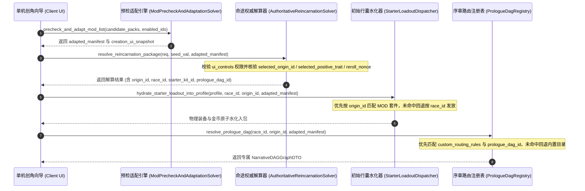

# 施工细则：Phase 115 单机显性MOD预检与命途UI多包列表适配引擎 —— 阶段2：命途MOD权威解算与多包初始行囊联动引擎实现

> [!NOTE]
> **【施工目标】**：升级后端角色身世权威解算器 `AuthoritativeReincarnationSolver`、新手初始物资水化器 `StarterLoadoutDispatcher` 与序章剧情路由注册表 `PrologueDagRegistry`，在保持原版（Vanilla）零信任调用 100% 向后兼容的前提下，打通单机显性命途 MOD 的受控自选验签（身世手动选择、因果天赋对手动选择、属性重随 Nonce 混入）、身世专属初始套件物理水化以及专属序章剧情 DAG 路由联动。
> 施工开始日期: 2026-10-11

---

## 📌 第一性原理溯源指针

* **精准上游规范指针**：[AGENTS.md 工作区全局刚性公理](../../../../../AGENTS.md) §二.1、§三、§四.1；[阶段1_单机显性MOD合规预检与多包列表冲突适配契约.md](阶段1_单机显性MOD合规预检与多包列表冲突适配契约.md)
* **核心不变量约束断言**：
  - `Inv-SOLVER-CONTROLLED-SELECT-1 (受控自选零信任验签不变量)`：仅当 `adapted_mod_manifest.ui_controls` 显式开启对应能力（如 `allow_manual_origin_select == true`）且客户端请求的 ID 在合并后的合法池中真实存在时才予采纳；在 Vanilla 模式、未开启自选或传入非法伪造 ID 时，后端强制忽略客户端选择并退回确定性权重随机抽取；
  - `Inv-SOLVER-REROLL-DETERMINISM-2 (属性重随确定性收敛)`：仅当 `allow_attribute_reroll == true` 时才允许将 `reroll_nonce` 混入确定性 RNG 种子，且无论如何重随，最终六维属性仍严格钳制于 `[1, 6]` 闭区间内；
  - `Inv-LOADOUT-ORIGIN-PRIORITY-3 (行囊套件身世优先回退链)`：`StarterLoadoutDispatcher` 优先按 `origin_id` 从 `adapted_mod_manifest` 检索专属 `starter_kit_id` 与套件配置，未命中时平滑回退至内置 `race_kit_map` 与全局默认套件；
  - `Inv-PROLOGUE-MOD-ROUTING-4 (序章剧情多级路由链)`：`PrologueDagRegistry` 优先匹配 `adapted_mod_manifest` 的 `custom_routing_rules` 及身世绑定的 `prologue_dag_id`，未命中时无损回退至 `narratives.prologue_dag_catalog`。
* **业务实现最高指示**：严禁破坏既有 1~2 参数调用签名与原版零信任随机行为；所有循环体严格遵守 `ADV-PRF-002` 零瞬态分配与 `CC <= 15` 复杂度红线。

---

## 一、 命途权威解算与多包行囊/序章联动架构

### 1. 受控自选验签与三级联动时序流

### 2. 三大核心组件升级契约

#### 2.1 `AuthoritativeReincarnationSolver.resolve_reincarnation_package`

* **兼容签名**：`static func resolve_reincarnation_package(req: AuthoritativeCharacterCreationRequestDTO, seed_val: int = 0, adapted_mod_manifest: Dictionary = {}) -> Dictionary`
* **受控验签矩阵**：
  - `allow_attribute_reroll == true`：读取 `int(req.extra_custom_fields.get("reroll_nonce", 0))`，非 0 时与基础种子执行确定性哈希混洗后构造 `DeterministicRNG`；
  - `allow_manual_origin_select == true`：读取 `req.extra_custom_fields.get("selected_origin_id", "")`，若存在于合并后的 `origins_catalog` 则直接锁定该身世，否则走 `DeterministicRNG.pick_weighted`；
  - `allow_manual_trait_select == true`：读取 `selected_positive_trait`（或 `selected_trait_pair_index`），若在合并后的 `paired_presets` 中精确匹配合法因果配对则直接采纳，否则按权重随机抽取；
  - **新增输出键**：在返回字典中追加 `"starter_kit_id"` 与 `"prologue_dag_id"`。

#### 2.2 `StarterLoadoutDispatcher.hydrate_starter_loadout_into_profile`

* **兼容签名**：`static func hydrate_starter_loadout_into_profile(profile: CharacterProfile, race_id: String, origin_id: String = "", adapted_mod_manifest: Dictionary = {}) -> Dictionary`
* **三级套件解析链**：
  1. 检查 `adapted_mod_manifest.origin_kit_map[origin_id]` 或 `origins_catalog[origin_id].starter_kit_id`，从 `adapted_mod_manifest.starter_kits` 获取自定义套件定义；
  2. 若未命中，按 `race_id` 查询 `domains.starter_loadout` 的 `race_kit_map`；
  3. 仍未命中则回退至 `defaults/fallback_kit` (`KIT_HUMAN_DEFAULT`)。

#### 2.3 `PrologueDagRegistry.resolve_prologue_dag`

* **兼容签名**：`static func resolve_prologue_dag(race_id: String, origin_id: String = "", adapted_mod_manifest: Dictionary = {}) -> NarrativeDAGGraphDTO`
* **四级路由解析链**：
  1. 优先匹配 `adapted_mod_manifest.custom_routing_rules` 中 `match_condition.origin_id == origin_id` 的规则；
  2. 次查 `adapted_mod_manifest.origins_catalog[origin_id].prologue_dag_id`（或 `origin_dag_map[origin_id]`）；
  3. 再查 `custom_routing_rules` 中 `match_condition.race_id == race_id` 或 `is_default == true` 的规则；
  4. 最终回退至内置 `narratives.prologue_dag_catalog` 的 `prologue_routing_rules`。

---

## 二、 命令式施工执行清单 (Agent Execution Checklist)

- [x] Step 1: 编制 Phase 115 阶段2命途 MOD 权威解算与多包初始行囊联动引擎实现文档
- [x] Step 2: 升级 `AuthoritativeReincarnationSolver.resolve_reincarnation_package`，实现受控身世/天赋自选验签与重随种子混入
- [x] Step 3: 在解算返回载荷中透传身世绑定的 `starter_kit_id` 与 `prologue_dag_id`
- [x] Step 4: 升级 `StarterLoadoutDispatcher.hydrate_starter_loadout_into_profile`，支持按 `origin_id` 优先水化 MOD 自定义初始套件
- [x] Step 5: 升级 `PrologueDagRegistry.resolve_prologue_dag`，支持 `custom_routing_rules` 与 `prologue_dag_id` 优先路由及内置目录平滑回退

---

## 三、 DoD 验收矩阵 (DoD Matrix)

| 检验项 ID | 校验目标 | 验证输入 | 预期输出断言 |
| :--- | :--- | :--- | :--- |
| TC-SOLV-MOD-01 | 原版零信任防伪向后兼容 | 不传 `adapted_mod_manifest`，在 `extra_custom_fields` 中伪造 `selected_origin_id` 与属性 | 伪造参数被 100% 忽略，解算结果完全由确定性种子与内置配置决定 |
| TC-SOLV-MOD-02 | 受控身世与天赋手动选择 | 启用声明 `ALLOW_MANUAL` 的合规 MOD，传入合法 `selected_origin_id` 与 `selected_positive_trait` | 权威解算器精准采纳所选自定义身世与配对天赋，并正确计算身世加成与金币 |
| TC-SOLV-MOD-03 | 非法自选 ID 零信任回退 | 启用 `ALLOW_MANUAL` 的 MOD，但客户端传入不存在的 `selected_origin_id: "HACK_GOD"` | 解算器拒绝非法 ID 并自动退回加权随机抽取，六维属性严格处于 `[1, 6]` |
| TC-LOAD-MOD-04 | 自定义身世专属行囊水化 | 调用 `hydrate_starter_loadout_into_profile` 传入自定义 `origin_id` 与 `adapted_manifest` | 角色档案成功水化自定义套件的主手武器、背包道具与专属初始金币，返回对应 `kit_id` |
| TC-DAG-MOD-05 | 专属序章 DAG 路由联动 | 调用 `resolve_prologue_dag` 传入含 `custom_routing_rules` 或 `prologue_dag_id` 的 `adapted_manifest` | 优先命中 MOD 声明的目标 `graph_id`，未命中时准确回退内置种族序章图 |
