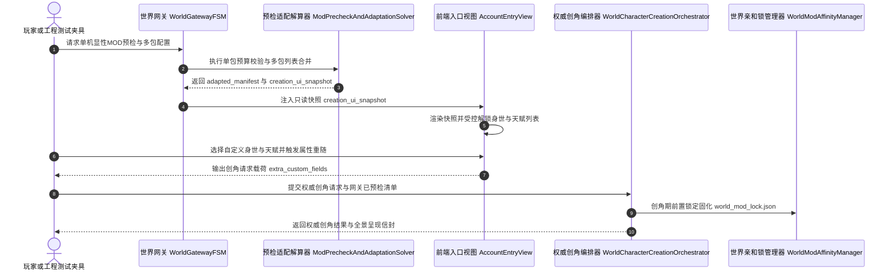

# 施工细则：Phase 115 单机显性MOD预检与命途UI多包列表适配引擎 —— 阶段3：单机网关显性预检接线前端UI受控解锁与工程测试夹具

> [!NOTE]
> **【施工目标】**：打通单机网关（`WorldGatewayFSM`）显性 MOD 预检与多包合并适配接线，升级权威创角门面（`WorldCharacterCreationOrchestrator`）以支持预检合并清单透传与创角期 `world_mod_lock.json` 前置锁定固化；在严格遵守前端 18 条边界护栏红线的前提下，通过只读快照（`apply_snapshot`）驱动前端入口视图（`AccountEntryView` / `AccountEntryTabs`）受控解锁身世下拉框、正负天赋列表与属性重随按钮并生成合规创角请求载荷；同步升级工程测试夹具（`SnapshotInjectionSolver`）支持内存虚拟命途 MOD 一键注入水化与对称反装配。
> 施工开始日期: 2026-10-11

---

## 📌 第一性原理溯源指针

* **精准上游规范指针**：[AGENTS.md 工作区全局刚性公理](../../../../../AGENTS.md) §二.1、§二.2、§三、§四.1
* **核心不变量约束断言**：
  - `Inv-GATEWAY-MOD-PRECHECK-1 (单机网关显性预检与联机熔断公理)`：`WorldGatewayFSM.precheck_and_configure_single_player_mods` 在联机模式下立即熔断返回 `SECURITY_ERR_MULTIPLAYER_MOD_POISONING`；在单机模式下委托 `ModPrecheckAndAdaptationSolver` 执行显性合规预检与多包合并，预检失败立即清空 `adapted_mod_manifest`，预检成功则固化 `adapted_mod_manifest` 与 `creation_ui_snapshot` 并广播 `world_gateway.mods_prechecked`；
  - `Inv-CREATION-LOCK-PREANCHOR-2 (创角期世界MOD锁前置固化公理)`：`WorldCharacterCreationOrchestrator.create_character_authoritative` 在锚定单机世界时，若 `effective_manifest` 携带非空 `enabled_pack_ids`，立即通过 `WorldModAffinityManager.save_world_mod_lock` 将启用的命途 MOD 列表锁定至 `world_mod_lock.json`；
  - `Inv-FRONTEND-SNAPSHOT-GUARD-3 (前端零直连后端与快照单向受控解锁公理)`：`AccountEntryView` 与 `AccountEntryTabs` 严禁引用任何 `res://backend`、`EventBusCore`、`DeterministicRNG` 或硬编码 `Color(...)`；所有 MOD 预检清单与 UI 能力解锁策略一律经 `apply_snapshot` 注入，原生默认态强制锁定自选控件，仅当快照显式授权对应开关时才解锁交互并输出 `extra_custom_fields`；
  - `Inv-HARNESS-VIRTUAL-MOD-4 (工程夹具内存虚拟MOD水化与对称清理公理)`：`SnapshotInjectionSolver.inject_and_hydrate` 支持读取 `virtual_destiny_mods` 与 `enabled_mod_ids` 并在内存中完成预检适配水化，`teardown_snapshot` 彻底清空 `_injected_mod_adaptation` 零残留。
* **业务实现最高指示**：保持单机原生命途随机轮盘的纯粹性，同时通过受控快照契约賦予单机 MOD 完整的多包协同与 UI 适配能力。

---

## 一、 第一性原理与架构解耦契约

### 1. 单机网关显性预检、前后端快照联动与权威创角拓扑

单机模式下玩家勾选或启用多个命途扩展 MOD 后，首先由 `WorldGatewayFSM` 触发显性预检与多包列表合并，产出的 `creation_ui_snapshot` 通过单向快照注入前端 `AccountEntryView`，而 `adapted_mod_manifest` 则在权威创角时交由 `WorldCharacterCreationOrchestrator` 驱动命途解算、初始装备水化与世界锁文件前置固化：

### 2. 核心模块改造契约

1. **世界网关显性预检接线 (`WorldGatewayFSM`)**：
   - 新增成员 `adapted_mod_manifest: Dictionary = {}` 与 `creation_ui_snapshot: Dictionary = {}`；
   - 实现 `precheck_and_configure_single_player_mods(candidate_packs: Array, enabled_pack_ids: Array = ["*"]) -> Dictionary`；
   - 提供 `get_adapted_mod_manifest()` 与 `get_creation_ui_snapshot()` 访问器，并在 `purge_and_fallback_to_vanilla()` 及 `exit_to_gateway()` 中对称清空。
2. **权威创角编排器升级 (`WorldCharacterCreationOrchestrator`)**：
   - 升级签名 `create_character_authoritative(req: AuthoritativeCharacterCreationRequestDTO, gateway_fsm: WorldGatewayFSM = null, adapted_mod_manifest: Dictionary = {}) -> Dictionary`；
   - 自动从 `gateway_fsm` 回退提取 `adapted_mod_manifest`，透传至 `AuthoritativeReincarnationSolver` 与 `StarterLoadoutDispatcher`；
   - 当 `effective_manifest` 含非空 `enabled_pack_ids` 时，调用 `WorldModAffinityManager.new().save_world_mod_lock(req.world_id, enabled_pack_ids)` 前置生成世界 MOD 锁。
3. **前端视图受控解锁与载荷生成 (`AccountEntryView` & `AccountEntryTabs`)**：
   - 在 `AccountEntryView` 中维护 `mod_precheck_checklist`、`creation_ui_controls`、`available_origins_list`、`available_traits_list`、`form_selected_origin_id`、`form_selected_positive_trait`、`form_reroll_nonce`；
   - 在 `AccountEntryTabs.apply_mod_creation_ui_adaptation()` 中根据快照合并列表填充 `char_origin_option` 与 `char_talent_list`，并依据 `creation_ui_controls` 控制 `disabled` 状态；
   - 提供 `select_custom_origin_by_index`、`select_custom_origin`、`select_custom_trait_by_index`、`select_custom_trait`、`trigger_mod_attribute_reroll` 与 `build_creation_request_payload`。
4. **工程方快照注入夹具 (`SnapshotInjectionSolver`)**：
   - 支持在 `inject_and_hydrate` 中解析 `virtual_destiny_mods` 与 `enabled_mod_ids`，自动完成内存虚拟 MOD 预检与多包合并，缓存至 `_injected_mod_adaptation` 并在 `teardown_snapshot` 中彻底清理。

---

## 二、 命令式施工执行清单 (Agent Execution Checklist)

- [x] Step 3.1: 编制 Phase 115 阶段3 单机网关显性预检接线、前端 UI 受控解锁与工程测试夹具技术规范
- [x] Step 3.2: 改造 `WorldGatewayFSM`，接入 `ModPrecheckAndAdaptationSolver` 预检、事件广播与生命周期洗脱
- [x] Step 3.3: 改造 `WorldCharacterCreationOrchestrator`，透传 `effective_manifest` 并实现创角期 `world_mod_lock.json` 前置锁定
- [x] Step 3.4: 改造 `AccountEntryView` 与 `AccountEntryTabs`，实现纯快照驱动的受控 UI 适配与创角请求载荷构建
- [x] Step 3.5: 改造 `SnapshotInjectionSolver`，支持 `virtual_destiny_mods` 内存虚拟 MOD 注入水化与对称清理

---

## 三、 DoD 验收矩阵 (DoD Matrix)

| 检验项 ID | 校验目标 | 验证输入 | 预期输出断言 |
| :--- | :--- | :--- | :--- |
| TC-GW-PRECHECK-01 | 联机模式调用单机MOD预检熔断 | gateway.context.selected_mode = MULTIPLAYER 时调用预检 | 返回 success=false, error_code="SECURITY_ERR_MULTIPLAYER_MOD_POISONING" |
| TC-GW-PRECHECK-02 | 单机网关多MOD预检与快照缓存 | 传入合规 MOD A 与 MOD B 调用网关预检 | 返回 success=true, 缓存 adapted_mod_manifest 与 creation_ui_snapshot |
| TC-ORCH-LOCK-03 | 创角期世界MOD锁前置固化 | 携带含 enabled_pack_ids 的 manifest 执行权威创角 | 角色创建成功且目标世界目录下生成 world_mod_lock.json |
| TC-FE-UNLOCK-04 | 前端快照驱动受控UI解锁与载荷组装 | 注入 creation_ui_snapshot 解锁自选身世、天赋与重随 | 对应控件解锁，select_custom_origin/trait 返回 true，产出合规 payload |
| TC-HARNESS-MOD-05 | 工程夹具虚拟MOD注入与对称清理 | 传入含 virtual_destiny_mods 的快照注入并执行 teardown | 注入返回非空 mod_adaptation，teardown 后缓存彻底清空 |
