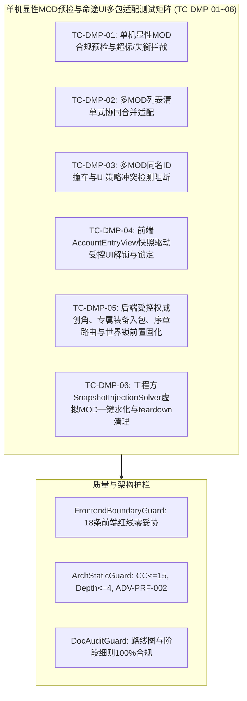

# 施工细则：Phase 115 单机显性MOD预检与命途UI多包列表适配引擎 —— 阶段4：无头多MOD冲突预检与前后端联动验收测试矩阵

> [!NOTE]
> **【施工目标】**：构建单机显性 MOD 预检与命途 UI 多包列表适配全链路自动化集成测试流水线（`test_destiny_mod_precheck_and_ui_adaptation_pipeline.gd`），注册至全域测试注册表（`TestRegistry`），完整覆盖 6 大端到端核心测试场景（`TC-DMP-01` ~ `TC-DMP-06`）：单机显性 MOD 数值预算与因果平衡预检拦截、多 MOD 列表清单式协同合并适配、多 MOD 同名 ID 与 UI 策略冲突阻断、前端 `AccountEntryView` 快照驱动受控 UI 解锁与锁定、后端受控权威创角与初始装备入包及专属序章路由与 `world_mod_lock.json` 前置锁定闭环、以及工程方 `SnapshotInjectionSolver` 内存虚拟 MOD 一键注入水化与 `teardown` 对称清理验证；确保全域文档门禁与静态架构护栏 100% 绿色通过。
> 施工开始日期: 2026-10-11

---

## 📌 第一性原理溯源指针

* **精准上游规范指针**：[AGENTS.md 工作区全局刚性公理](../../../../../AGENTS.md) §二.1、§三、§四.1
* **核心不变量约束断言**：
  - `Inv-TEST-DMP-COVERAGE-1 (六大端到端核心场景全覆盖公理)`：集成测试流水线 `test_destiny_mod_precheck_and_ui_adaptation_pipeline.gd` 必须完整实现并验证 `TC-DMP-01` 至 `TC-DMP-06` 六大测试矩阵，覆盖预检阻断、多包合并、冲突检测、前端快照 UI 解锁、后端权威创角全链路及工程夹具虚拟 MOD 水化；
  - `Inv-TEST-SANDBOX-CLEANUP-2 (测试沙箱与单例状态对称洗脱公理)`：所有涉及世界档案、账号仓储、存档 DAL 与快照注入器的测试用例必须在用例首尾执行严格对称清理，杜绝跨用例状态污染；
  - `Inv-GATES-ZERO-VIOLATION-3 (全域工程与文档门禁零违规公理)`：测试与生产代码严格满足单函数圈复杂度 `CC <= 15`、嵌套深度 `Depth <= 4`、循环体内零瞬态堆分配（`ADV-PRF-002`），且前端视图 100% 通过 `test_frontend_boundary_guard.gd` 全部 18 条边界检查。
* **验收闭环最高指示**：测试套件继承 `TestCase` 并登记入 `TestRegistry.get_all_test_classes()`；无头执行全绿且静态审计零警告零错误为唯一交付标准。

---

## 一、 第一性原理与架构解耦契约

### 1. 无头多 MOD 冲突预检与前后端联动测试矩阵拓扑

为验证单机命途扩展 MOD 从静态预检、多包协同合并、冲突阻断、前端受控快照适配到后端权威创角与工程夹具水化的全生命周期闭环，设计如下六维集成测试矩阵：

### 2. 六大核心测试用例断言规格

1. **TC-DMP-01: 单机显性 MOD 合规预检拦截**：
   - 合规命途扩展包通过 `ModPrecheckAndAdaptationSolver` 与 `WorldGatewayFSM` 预检；
   - 属性加成总和超标的违规包被精准阻断并返回 `ERR_DESTINY_STAT_BUDGET_EXCEEDED`；
   - 正负天赋对因果失衡（单边作弊正面天赋无负面代价或代数和失衡）的违规包被精准阻断并返回 `ERR_DESTINY_CAUSALITY_IMBALANCE`。
2. **TC-DMP-02: 多 MOD 列表清单式协同合并适配**：
   - 同时载入合规 `MOD_A` 与 `MOD_B`（各自追加自定义身世、正负天赋对与专属初始套件）；
   - 验证合并后的 `available_origins_list`、`available_traits_list` 与 `starter_kits` 完整保留 `Vanilla + MOD_A + MOD_B` 全部条目，按优先级稳定排序且零静默吞没。
3. **TC-DMP-03: 多 MOD 冲突检测阻断**：
   - 两个 MOD 声明相同 `origin_id` 时，预检阻断并返回 `ERR_MOD_DUPLICATE_ID_CONFLICT`；
   - `MOD_A` 声明 `ALLOW_MANUAL` 而 `MOD_B` 声明 `FORCE_RANDOM` 产生 UI 策略互斥时，预检阻断并返回 `ERR_MOD_UI_POLICY_CONFLICT`。
4. **TC-DMP-04: 前端 `AccountEntryView` 快照驱动受控 UI 解锁与锁定**：
   - 原生默认状态下，`allow_manual_origin_select`、`allow_manual_trait_select`、`allow_attribute_reroll` 均为 `false`，调用自选或重随方法返回 `false`；
   - 经 `apply_snapshot` 注入合规 MOD 的 `creation_ui_snapshot` 后，控件自动解锁并填充合并列表，调用 `select_custom_origin`、`select_custom_trait`、`trigger_mod_attribute_reroll` 均返回 `true`，`build_creation_request_payload()` 准确输出所选字段。
5. **TC-DMP-05: 后端受控权威创角、专属初始装备入包、专属序章路由与 `world_mod_lock.json` 前置锁定全链路闭环**：
   - 当网关预检启用解锁自选的 MOD 时，前端构造的请求经 `WorldCharacterCreationOrchestrator.create_character_authoritative` 解算生效，专属初始套件物理水化入包，`PrologueDagRegistry.resolve_prologue_dag` 命中 MOD 专属序章 DAG，且 `world_mod_lock.json` 在创角期即完成前置锁定落盘；
   - 当未授权自选时，客户端伪造的 `selected_origin_id` / `selected_positive_trait` 被后端零信任剥离。
6. **TC-DMP-06: 工程方 `SnapshotInjectionSolver` 内存虚拟 MOD 一键注入水化与 `teardown` 对称清理验证**：
   - 向 `SnapshotInjectionSolver.inject_and_hydrate` 传入携带 `virtual_destiny_mods` 与 `enabled_mod_ids` 的快照，验证自动生成并缓存 `mod_adaptation`（含 `adapted_manifest` 与 `creation_ui_snapshot`）；
   - 调用 `teardown_snapshot` 后，验证 `_injected_mod_adaptation` 被彻底清空。

---

## 二、 命令式施工执行清单 (Agent Execution Checklist)

- [x] Step 4.1: 编制 Phase 115 阶段4 无头多 MOD 冲突预检与前后端联动验收测试矩阵技术规范
- [x] Step 4.2: 创建 `test_destiny_mod_precheck_and_ui_adaptation_pipeline.gd`，实现 `TC-DMP-01` ~ `TC-DMP-06` 全链路测试
- [x] Step 4.3: 在 `WebGames/tests/test_registry.gd` 中登记 `TestDestinyModPrecheckAndUiAdaptationPipeline`
- [x] Step 4.4: 更新 `WebGames/docs/路线图/路线图总索引.md`，登记 Phase 115 四阶段看板与顶部活跃施工指针
- [x] Step 4.5: 运行 `audit_docs.py` 与 `audit_arch_static.py` 完成交割前自检闭环

---

## 三、 DoD 验收矩阵 (DoD Matrix)

| 检验项 ID | 校验目标 | 验证输入 | 预期输出断言 |
| :--- | :--- | :--- | :--- |
| TC-DMP-01 | 单机显性MOD合规预检与违规拦截 | 合规MOD包 / 超标属性MOD包 / 因果失衡天赋MOD包 | 合规包通过；超标包返回 ERR_DESTINY_STAT_BUDGET_EXCEEDED；失衡包返回 ERR_DESTINY_CAUSALITY_IMBALANCE |
| TC-DMP-02 | 多MOD列表清单式协同合并适配 | 同时启用合规 MOD_A 与 MOD_B | 合并清单完整包含 Vanilla + MOD_A + MOD_B 的身世、天赋对与初始套件 |
| TC-DMP-03 | 多MOD同名ID与UI策略冲突阻断 | 同名 origin_id 双包 / ALLOW_MANUAL 与 FORCE_RANDOM 冲突双包 | 分别返回 ERR_MOD_DUPLICATE_ID_CONFLICT 与 ERR_MOD_UI_POLICY_CONFLICT |
| TC-DMP-04 | 前端快照驱动受控UI解锁与锁定 | 默认态调用自选 vs 注入 creation_ui_snapshot 后调用自选与重随 | 默认态拒绝自选；注入快照后成功解锁并产出包含自选字段的请求 payload |
| TC-DMP-05 | 后端权威创角、装备水化、序章路由与世界锁闭环 | 网关预检后执行 create_character_authoritative 与 resolve_prologue_dag | 角色命途与专属装备生效、序章路由命中MOD图、world_mod_lock.json 前置落盘 |
| TC-DMP-06 | 工程夹具内存虚拟MOD水化与teardown清理 | inject_and_hydrate 传入 virtual_destiny_mods 后执行 teardown_snapshot | 注入时返回非空 mod_adaptation，teardown 后缓存彻底归零 |
