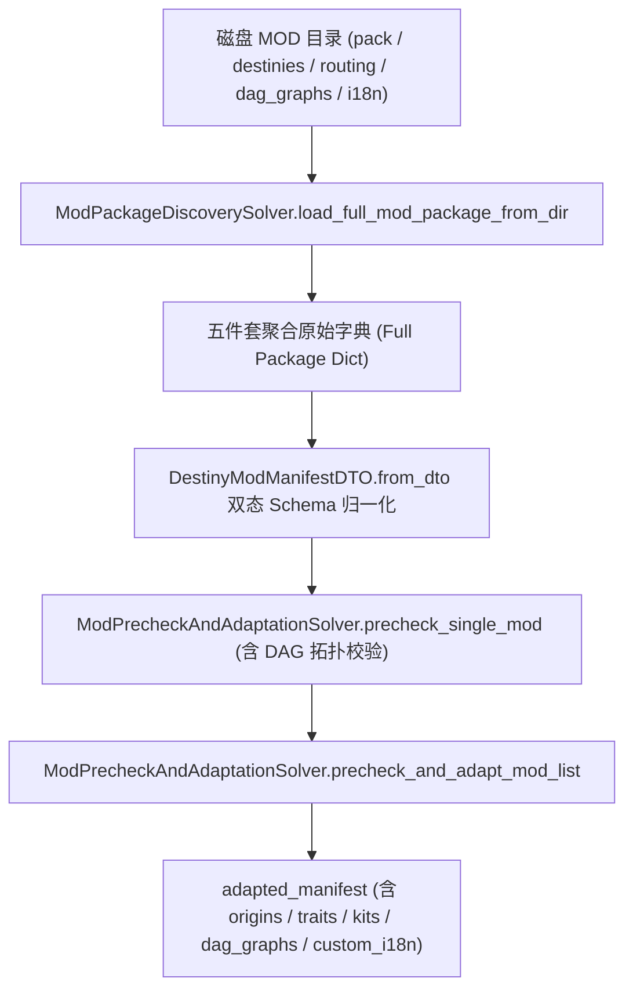

# 施工细则：Phase 116 全目录MOD磁盘聚合桥接与Agent无头试玩闭环 —— 阶段1：全目录MOD磁盘聚合桥接与双态Schema归一化契约

> [!NOTE]
> **【施工目标】**：打通磁盘五件套 MOD 目录（`pack.json`、`destinies.json`、`routing_rules.json`、`dag_graphs/*.json`、`i18n/*.json`）到内存命途清单契约（`DestinyModManifestDTO`）的全量聚合加载桥接。消除 `mod_sdk/templates/starter_story` 与 `scaffold_mod.py` 生成的数组型 `custom_traits`/`custom_starter_kits`、`initial_items`/`canonical_id`/`count`、`race`/`birth_region` 及 `routing_rules` 键名与后端 DTO 之间的 Schema 兼容性断层，并在 `ModPrecheckAndAdaptationSolver` 中合流 `dag_graphs` 与 `custom_i18n` 及 DAG 拓扑合法性预检。
> 施工开始日期: 2026-10-12

---

## 📌 第一性原理溯源指针

* **精准上游规范指针**：[AGENTS.md 工作区全局刚性公理](../../../../../AGENTS.md) §二.1、§三、§四.1；[Phase 115 阶段1 细则](../Phase_115_单机显性MOD预检与命途UI多包列表适配引擎施工细则/阶段1_单机显性MOD合规预检与多包列表冲突适配契约.md)
* **核心不变量约束断言**：
  - `Inv-MOD-BUNDLE-HYDRATE-1 (磁盘五件套无损聚合不变量)`：`ModPackageDiscoverySolver.load_full_mod_package_from_dir` 必须从单个 MOD 物理目录完整聚合 `pack.json`、`destinies.json`、`routing_rules.json`、`dag_graphs/*.json` 与 `i18n/*.json`，缺失可选子文件时平滑回退为空容器且绝不抛异常；
  - `Inv-MOD-SCHEMA-DUAL-2 (数组与字典双态归一化不变量)`：`DestinyModManifestDTO.from_dto` 对 `custom_traits` 与 `custom_starter_kits` 同时兼容 `Dictionary` 与 `Array[Dictionary]`（按 `trait_id` / `kit_id` 索引化），对 `custom_origins` 双向对齐 `race` <-> `race_id` 与 `birth_region` <-> `birth_region_id`，对套件物品双向对齐 `initial_items`/`canonical_id`/`count` 与 `items`/`item_id`/`quantity`；
  - `Inv-MOD-DAG-PRECHECK-3 (内嵌DAG拓扑静态预检不变量)`：`ModPrecheckAndAdaptationSolver.precheck_single_mod` 对包内携带的 `dag_graphs` 执行入口/终点存在性、环路与悬空边预检，非法 DAG 立即登记 `ERR_DESTINY_INVALID_DAG_GRAPH`；
  - `Inv-MOD-ASSET-MERGE-4 (DAG图谱与多语言词条合流不变量)`：`ModPrecheckAndAdaptationSolver._merge_adapted_manifest` 将所有已启用合规包的 `dag_graphs` 与 `custom_i18n` 无损合流至 `adapted_manifest`，供下游序章注册表与占位符解析器直接消费。
* **防漂移最高指示**：严禁在已达 748 行的 `ModPrecheckAndAdaptationSolver` 中堆砌磁盘 I/O 逻辑，磁盘目录扫描与文件读取统一收敛于 `ModPackageDiscoverySolver`；所有循环严格遵守 `ADV-PRF-002` 零瞬态堆分配与 `CC <= 15` 复杂度预算。

---

## 一、 第一性原理与架构解耦契约

### 1. 磁盘五件套聚合加载与双态 Schema 归一化拓扑

### 2. `DestinyModManifestDTO` 扩展字段与双态兼容契约

| 字段或输入结构 | 扩展/兼容类型 | 归一化目标形态 | 职责语义与兼容说明 |
| :--- | :--- | :--- | :--- |
| `root_path` | `String` | `String` | 记录该 MOD 包所在的物理目录路径，内存虚拟包默认为空字符串 |
| `dag_graphs` | `Dictionary` | `Dictionary` | 以 `dag_id` 为键存放包内 `dag_graphs/*.json` 原始图定义字典 |
| `custom_i18n` | `Dictionary` | `Dictionary` | 存放包内 `i18n/*.json` 扁平化后的多语言叙事词条映射 |
| `custom_traits` | `Dictionary` 或 `Array` | `Dictionary` | 支持 `scaffold_mod.py` 生成的数组格式自动按 `trait_id` 归一化为字典 |
| `custom_starter_kits` | `Dictionary` 或 `Array` | `Dictionary` | 支持数组格式按 `kit_id` 转为字典，并双向同步 `initial_items` 与 `items` |
| `custom_routing_rules` | `Array` | `Array[Dictionary]` | 同时兼容 `custom_routing_rules` 与 `routing_rules.json` 的顶层 `routing_rules` |

### 3. 新增与扩展预检错误码契约

| 错误码常量 | 触发阶段 | 判定条件与拦截阈值 |
| :--- | :--- | :--- |
| `ERR_DESTINY_INVALID_DAG_GRAPH` | 单包预检 | `dag_graphs` 中的图缺失 `entry_node_id`/`terminal_node_id` 或未通过 `CausalityDagValidator.validate_graph` |
| `ERR_DESTINY_UNKNOWN_KIT_REF` | 单包预检 | `custom_origins[].starter_kit_id` 非空，但既不在本包 `custom_starter_kits` 也不在内置 `starter_kits` 中 |
| `ERR_DESTINY_UNKNOWN_DAG_REF` | 单包预检 | `custom_origins[].prologue_dag_id` 非空且当本包提供了 `dag_graphs` 时既不在本包 `dag_graphs` 也不在内置 `dag_graphs` 中 |

---

## 二、 命令式施工执行清单 (Agent Execution Checklist)

- [ ] Step 1.1: 在 `ModPackageDiscoverySolver` 中实现 `load_full_mod_package_from_dir(mod_dir: String) -> Dictionary` 与 `scan_installed_full_mod_packages(custom_roots: Array = []) -> Array[Dictionary]`，完成五件套磁盘读取与 Kahn 依赖排序对接
- [ ] Step 1.2: 扩展 `DestinyModManifestDTO` 新增 `root_path`、`dag_graphs`、`custom_i18n` 属性，并实现数组型 `custom_traits`/`custom_starter_kits`、物品字段别名及身世种族/区域键名双向归一化
- [ ] Step 1.3: 在 `ModPrecheckAndAdaptationSolver` 中补充 `starter_kit_id` 引用校验、`dag_graphs` 拓扑校验，并在 `_merge_adapted_manifest` 中合流 `dag_graphs` 与 `custom_i18n`

---

## 三、 DoD 验收矩阵 (DoD Matrix)

| 检验项 ID | 校验目标 | 验证输入 | 预期输出断言 |
| :--- | :--- | :--- | :--- |
| TC-MOD-DISK-01 | 磁盘五件套模板无损聚合 | 调用 `ModPackageDiscoverySolver.load_full_mod_package_from_dir("res://mod_sdk/templates/starter_story")` | 返回字典非空，包含 `pack_id == "starter_story"`、`custom_origins`、`dag_graphs["DAG_STARTER_MINIMAL"]` 与 `custom_i18n` |
| TC-MOD-NORM-02 | 数组型特质与套件双态归一化 | 将 `starter_story` 聚合字典传入 `DestinyModManifestDTO.from_dto` 与 `precheck_single_mod` | `precheck_single_mod` 返回 `valid == true`，`custom_traits` 与 `custom_starter_kits` 正确归一化为键值字典且 `initial_items` 与 `items` 双向对齐 |
| TC-MOD-DAG-03 | 内嵌非法 DAG 与悬空套件拦截 | 传入含环路 DAG 图或引用不存在 `starter_kit_id` 的 MOD 清单 | `precheck_single_mod` 返回 `valid == false`，分别命中 `ERR_DESTINY_INVALID_DAG_GRAPH` 与 `ERR_DESTINY_UNKNOWN_KIT_REF` |
