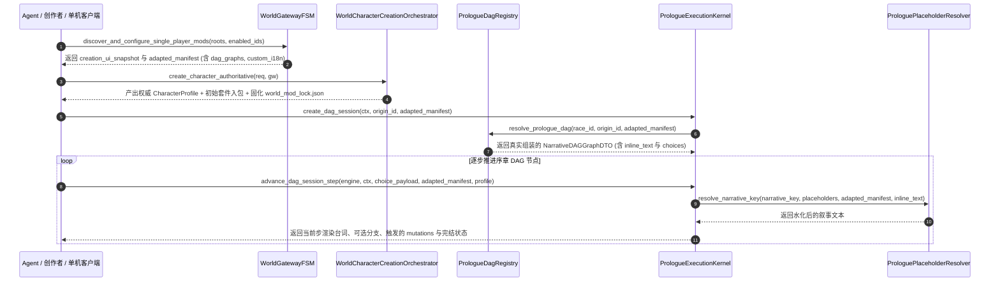

# 施工细则：Phase 116 全目录MOD磁盘聚合桥接与Agent无头试玩闭环 —— 阶段2：网关磁盘预检合流与自定义DAG及多源i18n运行时引擎实现

> [!NOTE]
> **【施工目标】**：在单机世界网关（`WorldGatewayFSM`）暴露一站式磁盘 MOD 扫描预检入口 `discover_and_configure_single_player_mods`；扩展 `NarrativeDAGNode` 与 `PrologueDagRegistry` 支持节点内联叙事文本 `inline_text` 与分支选项 `choices`；升级 `ProloguePlaceholderResolver` 支持命途语义占位符（`{ORIGIN_NAME}`、`{TRAIT_SUMMARY}` 等）、大小写双轨兼容替换（`{PLAYER_NAME}` 与 `{player_name}`）以及「MOD `custom_i18n` -> 内置 `prologue_i18n` -> 节点 `inline_text`」三级叙事解析；并在 `PrologueExecutionKernel` 中实现端到端无头可交互试玩闭环与因果突变结算。
> 施工开始日期: 2026-10-12

---

## 📌 第一性原理溯源指针

* **精准上游规范指针**：[AGENTS.md 工作区全局刚性公理](../../../../../AGENTS.md) §二.1、§三、§四.1；[阶段1_全目录MOD磁盘聚合桥接与双态Schema归一化契约.md](阶段1_全目录MOD磁盘聚合桥接与双态Schema归一化契约.md)
* **核心不变量约束断言**：
  - `Inv-GATEWAY-DISK-DISCOVER-1 (单机网关磁盘发现与联机熔断不变量)`：`WorldGatewayFSM.discover_and_configure_single_player_mods` 在联机模式下立即触发 `SECURITY_ERR_MULTIPLAYER_MOD_POISONING` 熔断；在单机模式下扫描指定或默认三级目录、完成 Kahn 拓扑排序后自动注入 `precheck_and_configure_single_player_mods`；
  - `Inv-PLACEHOLDER-BICASE-2 (占位符大小写双轨与三级i18n回退不变量)`：`ProloguePlaceholderResolver` 同时注入全大写与全小写占位符键（含 `PLAYER_NAME`、`ORIGIN_ID`、`ORIGIN_NAME`、`BIRTH_REGION`、`TRAIT_SUMMARY`、`STARTER_KIT_NAME`、`INITIAL_GOLD`、`INITIAL_EQUIPMENT`），且叙事键解析严格遵循 `MOD custom_i18n -> 内置 prologue_i18n -> 节点 inline_text` 优先级；
  - `Inv-DAG-SESSION-MOD-3 (序章DAG会话MOD感知与因果突变结算不变量)`：`PrologueExecutionKernel.create_dag_session` 支持接收 `origin_id` 与 `adapted_mod_manifest` 解析真实 MOD 自定义图谱，节点完成时通过 `apply_dag_mutations` 将金币奖惩、属性修正与序章完结状态真实结算至上下文与角色档案；
  - `Inv-PLAYTHROUGH-HARNESS-4 (后端无头权威试玩推演同构不变量)`：`PrologueExecutionKernel.execute_headless_mod_playthrough` 支持一步式串联「预检合并 -> 权威创角 -> 初始装备水化 -> 序章 DAG 按决策序列逐步推进 -> 产出结构化试玩战报 `playthrough_transcript`」。
* **业务实现最高指示**：保持既有 `PrologueExecutionKernel` 与 `ProloguePlaceholderResolver` 原有公开方法签名 100% 向后兼容；所有新增默认参数置于签名末尾，循环体内严禁瞬态对象分配（`ADV-PRF-002`）。

---

## 一、 第一性原理与架构解耦契约

### 1. 磁盘 MOD 网关挂载、多源 i18n 水化与无头试玩时序流

### 2. 核心方法与扩展签名契约

| 所属模块 | 方法签名 | 核心职责与返回结构契约 |
| :--- | :--- | :--- |
| `WorldGatewayFSM` | `discover_and_configure_single_player_mods(custom_roots: Array = [], enabled_pack_ids: Array = ["*"]) -> Dictionary` | 扫描磁盘五件套 MOD 目录、执行依赖拓扑排序并完成单机显性预检与多包合并 |
| `NarrativeDAGNode` | `var inline_text: String = ""` / `var choices: Array[Dictionary] = []` | 支持节点在无独立 i18n 文件时内联叙事文本及声明分支选项元数据 |
| `ProloguePlaceholderResolver` | `extract_placeholders(ctx: CharacterPrologueContext, adapted_mod_manifest: Dictionary = {}, profile: CharacterProfile = null) -> Dictionary` | 提取角色、身世、天赋摘要、初始金币与装备占位符，同时写入大写与小写双轨键 |
| `ProloguePlaceholderResolver` | `resolve_narrative_key(narrative_key: String, placeholders: Dictionary, adapted_mod_manifest: Dictionary = {}, inline_fallback: String = "") -> String` | 按 `MOD custom_i18n -> 内置 prologue_i18n -> inline_fallback` 解析模板并替换占位符 |
| `PrologueExecutionKernel` | `create_dag_session(ctx: CharacterPrologueContext, origin_id: String = "", adapted_mod_manifest: Dictionary = {}) -> NarrativeDagExecutionEngine` | 结合 `origin_id` 与 `adapted_mod_manifest` 路由并初始化真实 MOD 序章 DAG 会话 |
| `PrologueExecutionKernel` | `execute_headless_mod_playthrough(config: Dictionary) -> Dictionary` | 无头完整跑通磁盘/内存 MOD 预检、权威创角、装备水化与 DAG 分支推演并输出战报 |

---

## 二、 命令式施工执行清单 (Agent Execution Checklist)

- [ ] Step 2.1: 在 `WorldGatewayFSM` 中新增 `discover_and_configure_single_player_mods`，串联 `ModPackageDiscoverySolver.scan_installed_full_mod_packages` 与 `precheck_and_configure_single_player_mods`
- [ ] Step 2.2: 扩展 `NarrativeDAGNode` 与 `NarrativeDAGGraphDTO`（同步 `dag_id` 与 `graph_id`、解析 `inline_text` 与 `choices`），完善 `PrologueDagRegistry` 节点装配
- [ ] Step 2.3: 升级 `ProloguePlaceholderResolver` 支持命途创角占位符、大小写双轨替换及 `resolve_narrative_key` 三级 i18n 回退
- [ ] Step 2.4: 升级 `PrologueExecutionKernel` 补齐带 MOD 清单的 `create_dag_session`、`render_dag_node_packet`、`apply_dag_mutations` 与 `execute_headless_mod_playthrough`

---

## 三、 DoD 验收矩阵 (DoD Matrix)

| 检验项 ID | 校验目标 | 验证输入 | 预期输出断言 |
| :--- | :--- | :--- | :--- |
| TC-MOD-RT-01 | 磁盘模板网关一键挂载与路由 | `WorldGatewayFSM.discover_and_configure_single_player_mods(["res://mod_sdk/templates"])` | 返回 `success == true`，`PrologueDagRegistry.resolve_prologue_dag` 解析出 `DAG_STARTER_MINIMAL` 全部 3 个真实节点 |
| TC-MOD-RT-02 | 大小写双轨占位符与 MOD i18n 水化 | 渲染 `starter_story` 的 `narrative.starter.awaken`（含小写 `{player_name}`）及大写 `{ORIGIN_NAME}` | 返回文本中 `{player_name}` 与 `{ORIGIN_NAME}` 均被准确替换为角色名与身世名，零未解析花括号残留 |
| TC-MOD-RT-03 | 内联文本 `inline_text` 语法糖兜底 | 节点未配置 `i18n` 词条但声明 `inline_text: "星界旅者 {PLAYER_NAME} 踏入虚空"` | `resolve_narrative_key` 自动采用 `inline_text` 并完成 `{PLAYER_NAME}` 水化 |
| TC-MOD-RT-04 | 端到端无头试玩与突变结算 | 调用 `PrologueExecutionKernel.execute_headless_mod_playthrough` 跑完 `starter_story` 全流程 | 产出完整 `transcript_steps`（3 步台词全水化）、角色穿戴初始铁剑且终态 `is_completed == true` |
