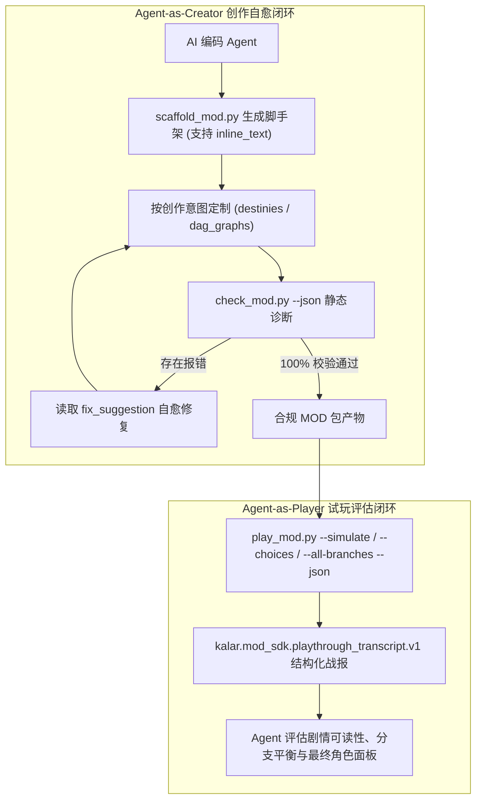

# 施工细则：Phase 116 全目录MOD磁盘聚合桥接与Agent无头试玩闭环 —— 阶段3：SDK跨表校验语法糖升级与Agent结构化试玩推演器实现

> [!NOTE]
> **【施工目标】**：升级 `WebGames/mod_sdk/` 工具链与能力萃取器（`sync_mod_sdk.py`），消除占位符大小写分裂并补充命途创角占位符与内置序章 DAG 清单；强化静态预检器（`check_mod.py`），补齐身世绑定的 `prologue_dag_id` 与 `starter_kit_id` 跨表存在性校验，并支持节点内联叙事文本 `inline_text` 语法糖（免配独立 `i18n/*.json`）；升级脚手架（`scaffold_mod.py`）自动闭环绑定 `prologue_dag_id`；升级预演器（`preview_mod.py`）并实现面向 AI Agent 与创作者的命令行交互式/全分支推演工具（`mod_sdk/tools/play_mod.py`），输出标准结构化 JSON 试玩战报（`kalar.mod_sdk.playthrough_transcript.v1`）。
> 施工开始日期: 2026-10-12

---

## 📌 第一性原理溯源指针

* **精准上游规范指针**：[AGENTS.md 工作区全局刚性公理](../../../../../AGENTS.md) §二.1、§三、§四.1；[阶段1_全目录MOD磁盘聚合桥接与双态Schema归一化契约.md](阶段1_全目录MOD磁盘聚合桥接与双态Schema归一化契约.md)；[阶段2_网关磁盘预检合流与自定义DAG及多源i18n运行时引擎实现.md](阶段2_网关磁盘预检合流与自定义DAG及多源i18n运行时引擎实现.md)
* **核心不变量约束断言**：
  - `Inv-SDK-SYNC-SSOT-1 (SDK契约与能力清单单源同步不变量)`：`sync_mod_sdk.py` 生成的 `capabilities.json` 与 `MOD_SPEC.md` 必须从 `config/` 权威真源提取并包含 `builtin_dag_ids`、全大写与全小写占位符白名单（含 6 类命途占位符），且通过 `audit_sdk_sync.py` 严格比对；
  - `Inv-SDK-CROSS-REF-2 (跨文件引用闭环与内联语法糖合规不变量)`：`check_mod.py` 严格拦截未定义套件引用（`ERR_DESTINY_UNKNOWN_KIT_REF`）与悬空 DAG 引用（`ERR_DESTINY_UNKNOWN_DAG_REF`）；若节点声明了有效 `inline_text`，免去独立 `i18n` 词条要求；若全包所有节点均有 `inline_text`，免去 `i18n/` 目录强制存在要求；
  - `Inv-AGENT-PLAYTHROUGH-3 (Agent试玩器CLI与标准战报信封不变量)`：`mod_sdk/tools/play_mod.py` 必须支持 `--origin` 四级路由选择、`--trait-pair`、`--reroll-nonce`、`--seed`、`--choices` 与 `--choice-strategy all-branches`，且 `--json` 模式输出严格遵循 `kalar.mod_sdk.playthrough_transcript.v1` 模式；
  - `Inv-SCAFFOLD-CLOSED-LOOP-4 (脚手架生成即自愈闭环不变量)`：`scaffold_mod.py` 生成的 MOD 目录开箱即通过 `check_mod.py` 校验，且直接执行 `play_mod.py --json` 获得 `is_success == true` 战报。
* **业务实现最高指示**：`mod_sdk/tools/` 工具链保持纯 Python 3.10+ 标准库实现，零第三方包依赖，执行耗时控制在 100ms 极速区间。

---

## 一、 第一性原理与架构解耦契约

### 1. Agent 辅助创作与交互试玩双闭环拓扑

### 2. 试玩战报数据协议 (`kalar.mod_sdk.playthrough_transcript.v1`) 核心字段

| 顶层属性 | 类型 | 核心含义与包含内容 |
| :--- | :--- | :--- |
| `schema_version` | `String` | 固化协议版本 `"kalar.mod_sdk.playthrough_transcript.v1"` |
| `is_success` | `bool` | 试玩全流程推演是否顺利完成且未达死胡同 |
| `precheck_report` | `Dictionary` | 记载 `check_mod.py` 对当前包的静态预检结果与诊断列表 |
| `creation_ui_snapshot` | `Dictionary` | 记载该 MOD 激活后暴露给创角向导的可选身世、套件与天赋总数 |
| `character_sheet` | `Dictionary` | 记载解算后的角色面板（六维属性、生理属性、身世/天赋、初始背包装备与金币） |
| `dag_routing` | `Dictionary` | 记载最终解析命中的 `resolved_dag_id` 及其路由来源（身世绑定或默认规则） |
| `transcript_steps` | `Array[Dictionary]` | 逐步记录每个节点的 `rendered_text`、可选分支、选中分支与触发的 `mutations` |
| `final_state` | `Dictionary` | 记载终态节点 `terminal_node_id`、总步数与累积触发的因果突变数组 |

---

## 二、 命令式施工执行清单 (Agent Execution Checklist)

- [ ] Step 3.1: 扩展 `sync_mod_sdk.py`，从 `config/` 提取 `builtin_dag_ids` 与双轨大小写占位符白名单，并同步更新 `capabilities.json` 与 `MOD_SPEC.md`
- [ ] Step 3.2: 升级 `check_mod.py`，补齐 `custom_origins[].prologue_dag_id` 与 `starter_kit_id` 跨表存在性校验，支持 DAG 节点 `inline_text` 语法糖
- [ ] Step 3.3: 升级 `scaffold_mod.py`，自动绑定 `prologue_dag_id`、补充 `dag_id` 顶层键，并支持 `--inline-text` 选项
- [ ] Step 3.4: 升级 `preview_mod.py` 支持 `--origin` 四级路由，并实现 `mod_sdk/tools/play_mod.py` 交互式与全分支推演 CLI（支持 `--json` 输出标准试玩战报）

---

## 三、 DoD 验收矩阵 (DoD Matrix)

| 检验项 ID | 校验目标 | 验证输入 | 预期输出断言 |
| :--- | :--- | :--- | :--- |
| TC-SDK-SYNC-01 | 能力清单与规范单源萃取 | 运行 `python scripts/py/sync_mod_sdk.py && python scripts/py/audit_sdk_sync.py` | 退出码为 0，`capabilities.json` 正确包含 `builtin_dag_ids` 与双轨占位符 |
| TC-SDK-CHECK-02 | 悬空引用拦截与内联文本放行 | 运行 `check_mod.py` 检验故意写错 `prologue_dag_id` 的包，以及仅含 `inline_text` 的极简包 | 悬空包准确抛出 `ERR_DESTINY_UNKNOWN_DAG_REF`，内联包 100% 绿色通过且无需 `i18n/` 目录 |
| TC-SDK-PLAY-03 | 一键全分支试玩推演战报 | 运行 `python mod_sdk/tools/play_mod.py mod_sdk/templates/starter_story --choice-strategy all-branches --json` | 返回有效 JSON，包含 `schema_version`、3 步水化台词记录且 `is_success == true` |
| TC-SDK-SCAFFOLD-04 | 脚手架开箱即通过校验与试玩 | 运行 `scaffold_mod.py --id mod_test_box --name "测试模组" --dir <tmp>` 后接 `check_mod.py` 与 `play_mod.py` | 静态预检 0 错误 0 告警，推演战报 `is_success == true` |

