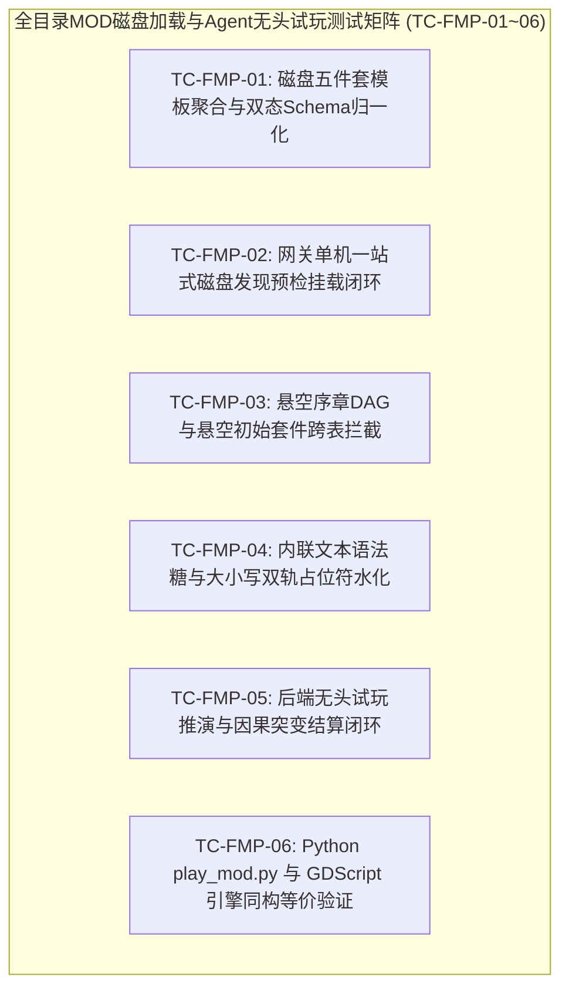

# 施工细则：Phase 116 全目录MOD磁盘聚合桥接与Agent无头试玩闭环 —— 阶段4：端到端磁盘MOD加载与Agent无头试玩全链路验收矩阵

> [!NOTE]
> **【施工目标】**：构建全目录五件套 MOD 磁盘加载、跨表引用校验、序章内联叙事及 Agent 无头试玩全链路自动化集成测试流水线（`test_full_mod_disk_and_playthrough_pipeline.gd`），注册至全域测试注册表（`TestRegistry`）与架构守卫（`test_architecture_guard.gd`），完整覆盖 6 大端到端核心测试场景（`TC-FMP-01` ~ `TC-FMP-06`）：磁盘五件套模板无损聚合与双态 Schema 归一化、网关单机一键磁盘发现与多包预检挂载、悬空序章 DAG 与悬空初始套件跨表拦截、内联文本 `inline_text` 语法糖与大小写双轨占位符水化、后端无头试玩推演与因果突变结算闭环、以及 Python 工具链（`check_mod.py` / `play_mod.py`）与 GDScript 引擎同构等价性验证；确保全域文档门禁与静态架构护栏 100% 绿色通过。
> 施工开始日期: 2026-10-12

---

## 📌 第一性原理溯源指针

* **精准上游规范指针**：[AGENTS.md 工作区全局刚性公理](../../../../../AGENTS.md) §二.1、§三、§四.1；[阶段1_全目录MOD磁盘聚合桥接与双态Schema归一化契约.md](阶段1_全目录MOD磁盘聚合桥接与双态Schema归一化契约.md)；[阶段2_网关磁盘预检合流与自定义DAG及多源i18n运行时引擎实现.md](阶段2_网关磁盘预检合流与自定义DAG及多源i18n运行时引擎实现.md)；[阶段3_SDK跨表校验语法糖升级与Agent结构化试玩推演器实现.md](阶段3_SDK跨表校验语法糖升级与Agent结构化试玩推演器实现.md)
* **核心不变量约束断言**：
  - `Inv-TEST-FMP-COVERAGE-1 (六大端到端测试场景全覆盖公理)`：集成测试流水线 `test_full_mod_disk_and_playthrough_pipeline.gd` 必须完整实现并验证 `TC-FMP-01` 至 `TC-FMP-06` 六大测试矩阵，覆盖磁盘聚合、网关挂载、跨表拦截、内联水化、无头推演与双端等价；
  - `Inv-TEST-REGISTRY-SYNC-2 (全域测试套件双向同步注册公理)`：新增测试套件必须在 `tests/guards/test_architecture_guard.gd` 的 `CROSS_CUTTING_SUITES`（53 -> 54）与 `tests/test_registry.gd`（100 -> 101）中双向登记，确保 `TC-ARCH-03` 测试总数自洽无误；
  - `Inv-TEST-SANDBOX-ISOLATION-3 (测试沙箱与单例状态对称洗脱公理)`：所有涉及磁盘读取、世界档案、网关会话与测试目录的用例首尾必须执行严格对称清理，严禁遗留临时文件；
  - `Inv-GATES-ZERO-VIOLATION-4 (全域工程与文档门禁零违规公理)`：测试与生产代码严格满足单函数圈复杂度 `CC <= 15`、控制流深度 `Depth <= 4`、循环体内零瞬态堆分配（`ADV-PRF-002`），全域文档审计零违规。
* **验收闭环最高指示**：测试套件继承 `TestCase` 并登记入 `TestRegistry.get_all_test_classes()`；无头执行全绿且全仓静态审计零警告零错误为唯一交付标准。

---

## 一、 第一性原理与架构解耦契约

### 1. 全目录 MOD 磁盘加载与 Agent 无头试玩测试矩阵拓扑

### 2. 测试夹具与测试沙箱生命周期契约

| 测试夹具方法 | 职责说明与环境隔离保证 | 对称清理保证 |
| :--- | :--- | :--- |
| `_setup_environment()` | 初始化纯净沙箱目录 `user://test_sandbox_fmp_pipeline/`，复位 `WorldArchiveRepository`、`AccountRepository` 与 `RuntimeModeGate` | 确保每次测试运行处于隔离测试世界 |
| `_teardown_environment()` | 清理沙箱目录下创建的所有临时 MOD 目录与世界档案，重置所有全局单例内存状态 | 杜绝残留文件与跨用例污染 |
| `_make_synthetic_inline_mod()` | 构造包含 `inline_text` 且零 `i18n/` 目录的合法极简 MOD 内存夹具 | 用于验证内联语法糖独立运作 |

---

## 二、 命令式施工执行清单 (Agent Execution Checklist)

- [ ] Step 4.1: 编写 `res://tests/integration/pipelines/test_full_mod_disk_and_playthrough_pipeline.gd`，完整实现 `TC-FMP-01` 至 `TC-FMP-06`
- [ ] Step 4.2: 在 `tests/guards/test_architecture_guard.gd` 的 `CROSS_CUTTING_SUITES` 中追加新测试路径
- [ ] Step 4.3: 在 `tests/test_registry.gd` 中 preload 并注册新测试套件，使套件总数同步递增
- [ ] Step 4.4: 运行全量单元测试与无头验证脚本（`check-gdscript.ps1`、`test-run.ps1`），确保 101/101 套用例全绿
- [ ] Step 4.5: 运行全工作区五大支柱统一审查（`audit-all.ps1 -Fast`），确保 100% 绿色通行

---

## 三、 DoD 验收矩阵 (DoD Matrix)

| 检验项 ID | 校验目标 | 验证输入 | 预期输出断言 |
| :--- | :--- | :--- | :--- |
| TC-FMP-01 | 磁盘五件套模板聚合与归一化 | 读取 `res://mod_sdk/templates/starter_story` 物理目录 | 返回聚合字典完整，`custom_traits` 成功归一化为字典，`canonical_id` 成功映射至 `item_id` |
| TC-FMP-02 | 网关单机一键磁盘挂载闭环 | `WorldGatewayFSM.discover_and_configure_single_player_mods(["res://mod_sdk/templates"])` | `success == true`，`get_adapted_mod_manifest()` 包含 `dag_graphs` 与 `custom_i18n` |
| TC-FMP-03 | 悬空序章与套件跨表拦截 | 构造引用未知 `prologue_dag_id` 或未知 `starter_kit_id` 的 MOD | 预检拦截返回 `valid == false`，包含对应结构化错误码 |
| TC-FMP-04 | 内联文本与大小写双轨水化 | 渲染含 `inline_text` 及 `{player_name}` / `{PLAYER_NAME}` 的节点文本 | 占位符 100% 替换且无未解析花括号，零语法异常 |
| TC-FMP-05 | 后端无头试玩与因果突变结算 | 执行 `execute_headless_mod_playthrough` 推演 `starter_story` 全部步骤 | 产出结构化战报，金币与行囊正确落盘，终态 `is_completed == true` |
| TC-FMP-06 | 跨平台双端试玩同构等价 | 对比 `play_mod.py --json` 与 GDScript 推演返回的战报关键字段 | 最终步数、触发的 `mutations` 序列与装备物品清单完全一致 |
