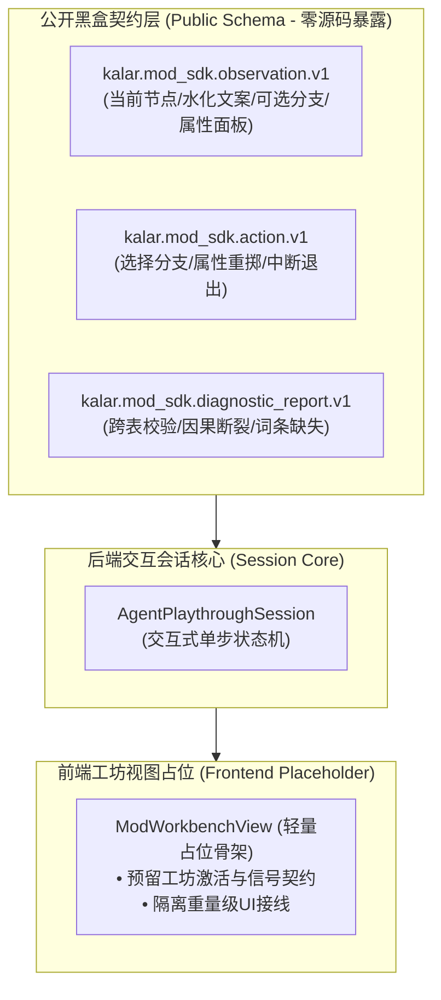

# 施工细则：Phase 117 黑盒MOD工作台基础骨架与Agent交互试玩伴侣协议 —— 阶段1：黑盒SDK与工坊接口标准Schema及前端占位契约

> [!NOTE]
> **【施工目标】**：定义与规范卡拉尔 MOD 黑盒接口层与工作台交互标准 Schema（入参、观察、行动与诊断契约），隔绝底层源码暴露。确立 Agent 交互式观察-行动数据契约（Observation-Action Protocol），并在前端预留工坊视图（`ModWorkbenchView`）轻量白模与占位契约接口，明确在引擎整体进度达到 80% 之前不执行重量级打包构建与复杂视图接线，优先夯实基础设施与无头交互底座。
> 施工开始日期: 2026-10-12

---

## 📌 第一性原理溯源指针

* **精准上游规范指针**：[AGENTS.md 工作区全局刚性公理](../../../../../AGENTS.md) §二.1、§三、§四.1；[路线图总索引.md](../../路线图总索引.md)；[Phase 116 阶段3 细则](../Phase_116_全目录MOD磁盘聚合桥接与Agent无头试玩闭环施工细则/阶段3_SDK跨表校验语法糖升级与Agent结构化试玩推演器实现.md)
* **核心不变量约束断言**：
  - `Inv-SCHEMA-BLACKBOX-1 (黑盒接口非暴露公理)`：对外公开的 SDK 仅包含 JSON Schema 规范、标准错误码清单与结构化数据接口契约，底层核心推演算法与数值逻辑通过二进制或无头接口封装，零源码泄露；
  - `Inv-FRONTEND-PLACEHOLDER-2 (前端低度耦合预留公理)`：前端创作者工坊仅建立规范接口占位（`ModWorkbenchView`）与信号协议，严格隔离重度 UI 渲染与网络 IPC 打包，待项目成熟度达到 80% 后再行演进深度接线；
  - `Inv-OBS-ACT-PROTOCOL-3 (观察-行动协议确定性公理)`：交互式 Agent 会话所接收的观察包（Observation）与下发的行动包（Action）必须具备唯一步进序列号（`step_index`）与因果溯源标识，确保 100% 可重放性与确定性。
* **防漂移最高指示**：数据 Schema 必须严格收口于单一真源定义，禁止在各前后端模块中散落不兼容的自由字典解析。

---

## 一、 第一性原理与接口契约拓扑

### 1. 黑盒数据契约与双层解耦拓扑

### 2. 观察包（Observation）与行动包（Action）标准协议结构

| 字段名称 | 类型 | 语义说明与不变量要求 |
| :--- | :--- | :--- |
| `session_id` | String | 交互会话全局唯一 UUID 标识，保障多会话并发隔离 |
| `step_index` | int | 单调递增的步进序列号（从 0 开始），用于断点回放与时序对齐 |
| `current_node_id` | String | 当前序章 DAG 激活的节点 ID |
| `hydrated_text` | String | 占位符水化后的最终剧情描述文案（零未决花括号） |
| `available_choices` | Array[Dictionary] | 当前可选分支列表（含 `choice_id`, `text`, `requirements`） |
| `character_snapshot` | Dictionary | 角色属性、天赋对、初始装备与金币瞬态切片 |
| `is_terminal` | bool | 是否抵达终止节点（`true` 时会话推进完毕） |

---

## 二、 命令式施工执行清单 (Agent Execution Checklist)

- [ ] Step 1.1: 编写标准 JSON Schema 契约定义与数据模型
- [ ] Step 1.2: 在 `mod_sdk/` 中建立黑盒接口规范与对外公开清单
- [ ] Step 1.3: 在 `backend/domains/narrative_orchestration/dto/` 中建立 `AgentObservationDTO` 与 `AgentActionDTO`
- [ ] Step 1.4: 在 `frontend/` 中建立轻量 `ModWorkbenchView` 接口契约占位，明确声明延迟接线注解

---

## 三、 DoD 验收矩阵 (DoD Matrix)

| 检验项 ID | 校验目标 | 验证输入 | 预期输出断言 |
| :--- | :--- | :--- | :--- |
| TC-STG1-01 | 观察包 DTO 序列化一致性 | 构造完整 `AgentObservationDTO` 实例 | `to_dto()` 包含全部规范字段，字段类型严格遵从 v1 规范 |
| TC-STG1-02 | 行动包 DTO 反序列化与容错 | 解析合规与缺省行动字典 | 非法动作被拦截，合法动作正确映射 `action_type` 与 `choice_id` |
| TC-STG1-03 | 前端工坊占位接口完整性 | 实例化 `ModWorkbenchView` 占位类 | 包含预留的初始化与数据绑定接口，不触发任何重量级节点依赖错误 |
