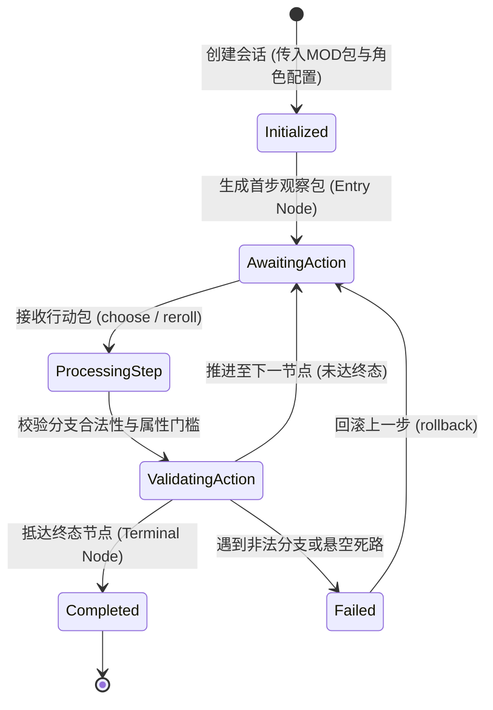

# 施工细则：Phase 117 黑盒MOD工作台基础骨架与Agent交互试玩伴侣协议 —— 阶段2：长程Agent交互式推演会话核与单步控制器实现

> [!NOTE]
> **【施工目标】**：在叙事与创角领域实现长程无头交互式推演会话控制器（`AgentPlaythroughSession`）。突破一次性批处理推演局限，支持外部 Agent 通过命令流进行单步观察（`get_current_observation()`）、单步执行分支行动（`step(action)`）、重置（`reset()`）以及回溯回滚（`rollback()`）。同时在 Python 工具链中为 `play_mod.py` 扩充 `--interactive` 模式，实现同构交互管道。
> 施工开始日期: 2026-10-12

---

## 📌 第一性原理溯源指针

* **精准上游规范指针**：[AGENTS.md 工作区全局刚性公理](../../../../../AGENTS.md) §二.1、§三、§四.1；[阶段1_黑盒SDK与工坊接口标准Schema及前端占位契约.md](阶段1_黑盒SDK与工坊接口标准Schema及前端占位契约.md)；[Phase 116 阶段2 细则](../Phase_116_全目录MOD磁盘聚合桥接与Agent无头试玩闭环施工细则/阶段2_网关磁盘预检合流与自定义DAG及多源i18n运行时引擎实现.md)
* **核心不变量约束断言**：
  - `Inv-SESSION-STATE-ISOLATION-1 (会话状态气密隔离公理)`：每个 `AgentPlaythroughSession` 拥有独立的运行时上下文、执行引擎与历史记录栈，多个并发会话互不污染；
  - `Inv-STEP-CAUSAL-CONSISTENCY-2 (单步因果一致性公理)`：每次调用 `step(action)` 必须严格经历校验前置条件、推演行动、结算因果突变、生成最新观察包四步原子事务，状态异常时自动回滚；
  - `Inv-STEP-GUARD-MAX-3 (防死循环保护公理)`：步进调度必须内置最大步数熔断守卫（默认 100 步），防止恶意或循环 DAG 导致会话陷入无限挂起。
* **防漂移最高指示**：状态机推进严禁跳过因果突变结算器，所有分支转移必须留痕入历史栈。

---

## 一、 第一性原理与状态机架构

### 1. 交互式单步会话推进状态流转

### 2. 单步控制器核心方法接口定义

| 方法名 | 入参 | 返回值 | 职责与行为描述 |
| :--- | :--- | :--- | :--- |
| `start_session(config)` | Dictionary | Dictionary | 完成预检、创角权威解算、初始化 DAG 引擎并返回第 0 步观察包 |
| `step(action)` | Dictionary | Dictionary | 校验并执行当前行动，触发突变结算，推进至下一节点并返回最新观察包 |
| `rollback()` | 无 | Dictionary | 弹出栈顶历史状态，回退至上一决策节点，用于 Agent 探索不同分支 |
| `get_summary_report()` | 无 | Dictionary | 输出符合 `playthrough_transcript.v1` 的完整推演战报与指标摘要 |

---

## 二、 命令式施工执行清单 (Agent Execution Checklist)

- [ ] Step 2.1: 在 `backend/domains/character_creation/` 实现 `agent_playthrough_session.gd`
- [ ] Step 2.2: 实现单步推进、分支校验、因果结算与历史快照回滚机制
- [ ] Step 2.3: 在 `mod_sdk/tools/play_mod.py` 中扩充 `--interactive` / `--agent-session` 命令行交互流
- [ ] Step 2.4: 确保代码控制流平铺直叙，单函数圈复杂度 CC <= 15，循环体内零瞬态堆分配

---

## 三、 DoD 验收矩阵 (DoD Matrix)

| 检验项 ID | 校验目标 | 验证输入 | 预期输出断言 |
| :--- | :--- | :--- | :--- |
| TC-STG2-01 | 会话初始化与首步观察 | 传入 `starter_story` 模板包初始化会话 | `session_id` 自动生成，返回 `step_index == 0`，当前节点为入口节点 |
| TC-STG2-02 | 单步推进与分支选择 | 发送合法分支行动 `{"choice_id": "NODE_STARTER_EXPLORE"}` | 步进成功，`step_index` 递增为 1，角色属性与文本正确更新 |
| TC-STG2-03 | 探索回溯与状态恢复 | 推进两步后调用 `rollback()` | 会话安全回退至上一节点，当前节点恢复，突变变动同步洗脱 |
