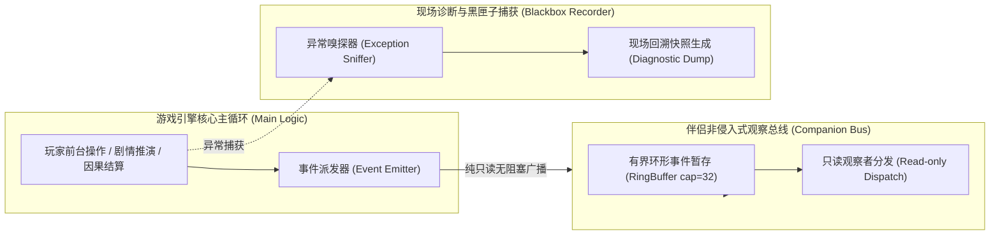

# 施工细则：Phase 117 黑盒MOD工作台基础骨架与Agent交互试玩伴侣协议 —— 阶段3：非侵入式伴侣观察总线与现场黑匣子捕获引擎实现

> [!NOTE]
> **【施工目标】**：构建面向真实用户陪伴游玩的非侵入式伴侣观察总线（`CompanionObserverBus`）与现场黑匣子诊断转储器（`CompanionBlackboxRecorder`）。通过轻量只读观察者机制，在游戏运行时向伴侣 Agent 广播剧情与决策快照，实现零渲染延迟、零逻辑干预的侧边陪伴；当第三方 MOD 发生突发错误时，自动抓取并生成现场黑匣子转储（`Replay Dump`），辅助快速排查。
> 施工开始日期: 2026-10-12

---

## 📌 第一性原理溯源指针

* **精准上游规范指针**：[AGENTS.md 工作区全局刚性公理](../../../../../AGENTS.md) §二.1、§三、§四.1；[阶段2_长程Agent交互式推演会话核与单步控制器实现.md](阶段2_长程Agent交互式推演会话核与单步控制器实现.md)；[EventBus2.0规范](../../../后端架构/后端架构需求表索引.md)
* **核心不变量约束断言**：
  - `Inv-COMPANION-NON-INVASIVE-1 (伴侣总线非侵入公理)`：伴侣观察总线对游戏主循环为纯单向、只读无阻塞通知，观察者无论发生何种异常或延迟，绝不可阻断游戏核心渲染与业务流；
  - `Inv-BLACKBOX-ZERO-CORRUPTION-2 (黑匣子转储防损坏公理)`：错误捕获机制在捕获未决异常时，必须实施就地防御与安全兜底，输出结构化崩溃报告，阻断引擎闪退；
  - `Inv-RING-BUFFER-BOUNDED-3 (环形缓冲区有界公理)`：黑匣子最近事件跟踪使用定长环形队列（默认容量 32 条），杜绝内存无界膨胀与瞬态堆分配。
* **防漂移最高指示**：严禁伴侣观察总线反向注入未鉴权的内存修改，保持只读安全边界。

---

## 一、 第一性原理与双轨伴侣架构

### 1. 伴侣观察总线与主渲染流解耦模型

### 2. 黑匣子现场快照（Diagnostic Dump）标准结构

| 字段名 | 类型 | 说明与用途 |
| :--- | :--- | :--- |
| `dump_id` | String | 诊断快照唯一 ID |
| `timestamp` | int | 物理毫秒时间戳 |
| `failing_pack_id` | String | 产生异常的 MOD 包 ID |
| `failing_node_id` | String | 发生异常的 DAG 节点 ID |
| `error_code` | String | 机器可读错误码（如 `ERR_UNKNOWN_PLACEHOLDER`） |
| `recent_event_tail` | Array[Dictionary] | 故障发生前最近 8 个事件足迹，供 Agent 精确定位根因 |
| `character_snapshot` | Dictionary | 故障发生时的角色面板切片 |

---

## 二、 命令式施工执行清单 (Agent Execution Checklist)

- [ ] Step 3.1: 在 `backend/infrastructure/` 或叙事领域实现 `companion_observer_bus.gd`
- [ ] Step 3.2: 在 `backend/infrastructure/` 实现 `companion_blackbox_recorder.gd`，支持定长环形缓冲
- [ ] Step 3.3: 在 `world_gateway_fsm.gd` 或会话核中接入观察广播发射点
- [ ] Step 3.4: 编写黑匣子捕获与诊断快照输出逻辑，实现零闪退容错

---

## 三、 DoD 验收矩阵 (DoD Matrix)

| 检验项 ID | 校验目标 | 验证输入 | 预期输出断言 |
| :--- | :--- | :--- | :--- |
| TC-STG3-01 | 观察总线非阻塞派发 | 注册模拟伴侣监听器并推进 5 步剧情 | 监听器收到 5 条完整观察事件，主线程无任何阻塞延迟 |
| TC-STG3-02 | 有界环形缓冲不溢出 | 连续写入 50 条观察事件 | 环形缓冲区仅保留最近 32 条记录，无内存泄漏与堆膨胀 |
| TC-STG3-03 | 现场黑匣子异常捕获 | 模拟注入悬空节点导致的分支异常 | 引擎静默捕获，黑匣子记录器生成包含 `recent_event_tail` 的合规转储 |

