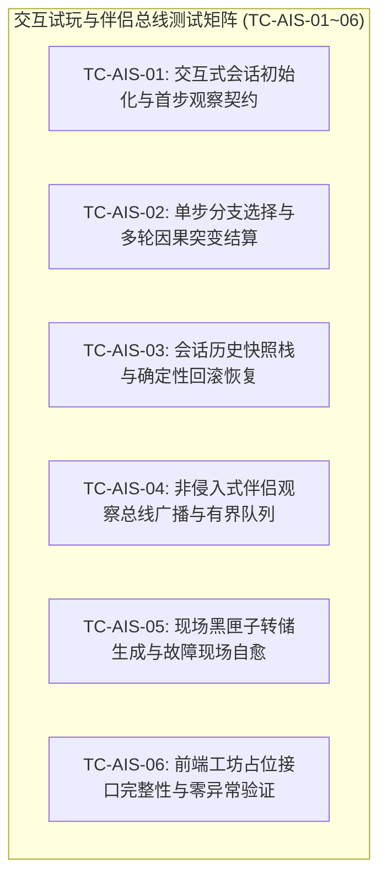

# 施工细则：Phase 117 黑盒MOD工作台基础骨架与Agent交互试玩伴侣协议 —— 阶段4：无头交互试玩与伴侣观察总线全链路验收矩阵

> [!NOTE]
> **【施工目标】**：构建长程交互式 Agent 推演会话、黑盒契约模型、非侵入式伴侣观察总线及黑匣子现场转储的全链路自动化集成测试流水线（`test_agent_interactive_session_and_companion_pipeline.gd`）。双向登记于 `test_architecture_guard.gd`（54 -> 55）与 `test_registry.gd`（101 -> 102 套），完整覆盖 6 大核心场景（`TC-AIS-01` ~ `TC-AIS-06`），确保全域门禁与静态架构守卫 100% 绿色通行。
> 施工开始日期: 2026-10-12

---

## 📌 第一性原理溯源指针

* **精准上游规范指针**：[AGENTS.md 工作区全局刚性公理](../../../../../AGENTS.md) §二.1、§三、§四.1；[阶段1_黑盒SDK与工坊接口标准Schema及前端占位契约.md](阶段1_黑盒SDK与工坊接口标准Schema及前端占位契约.md)；[阶段2_长程Agent交互式推演会话核与单步控制器实现.md](阶段2_长程Agent交互式推演会话核与单步控制器实现.md)；[阶段3_非侵入式伴侣观察总线与现场黑匣子捕获引擎实现.md](阶段3_非侵入式伴侣观察总线与现场黑匣子捕获引擎实现.md)
* **核心不变量约束断言**：
  - `Inv-TEST-AIS-COVERAGE-1 (交互式会话测试全覆盖公理)`：集成测试流水线必须完整实现并验证 `TC-AIS-01` 至 `TC-AIS-06` 六大测试矩阵，覆盖长程推演、单步分支、状态回滚、伴侣广播、黑匣子捕获与前端契约占位；
  - `Inv-TEST-REGISTRY-SYNC-2 (全域测试双向同步公理)`：新增测试套件必须在架构守卫 `CROSS_CUTTING_SUITES` 与 `TestRegistry` 中双向登记，保持测试总数绝对自洽；
  - `Inv-SANDBOX-TEARDOWN-3 (沙箱对称洗脱公理)`：测试用例首尾执行严格对称清理，严禁在 `user://` 沙箱留下脏文件。
* **验收闭环最高指示**：测试套件继承 `TestCase` 并登记入 `TestRegistry.get_all_test_classes()`；无头执行全绿且全仓静态审计零警告零错误为唯一交付标准。

---

## 一、 第一性原理与测试矩阵拓扑

### 1. 交互试玩与伴侣总线测试矩阵拓扑

---

## 二、 命令式施工执行清单 (Agent Execution Checklist)

- [ ] Step 4.1: 编写 `res://tests/integration/pipelines/test_agent_interactive_session_and_companion_pipeline.gd`，完整实现 `TC-AIS-01` 至 `TC-AIS-06`
- [ ] Step 4.2: 在 `tests/guards/test_architecture_guard.gd` 的 `CROSS_CUTTING_SUITES` 中追加新测试路径 (54 -> 55)
- [ ] Step 4.3: 在 `tests/test_registry.gd` 中 preload 并注册新测试套件 (101 -> 102)
- [ ] Step 4.4: 运行全量单元测试与静态架构守卫（`audit_arch_static.py`），确保测试套件条目自洽
- [ ] Step 4.5: 运行全工作区五大支柱统一审查（`audit-all.ps1 -Fast`），确保 100% 绿色通行

---

## 三、 DoD 验收矩阵 (DoD Matrix)

| 检验项 ID | 校验目标 | 验证输入 | 预期输出断言 |
| :--- | :--- | :--- | :--- |
| TC-AIS-01 | 会话创建与观察包生成 | 调用 `AgentPlaythroughSession.new().start_session(...)` | `session_id` 有效，返回首步观察包，包含当前节点与合法分支 |
| TC-AIS-02 | 单步推演与突变结算 | 连续调用 `step({"choice_id": ...})` 推进 3 步 | 每步正确过渡节点，属性/金币正确结算，终态抵达 `is_terminal == true` |
| TC-AIS-03 | 决策树回退与历史恢复 | 执行推进后调用 `rollback()` | 会话成功回退到上一分支节点，状态完全复原，无内存污染 |
| TC-AIS-04 | 伴侣总线广播与非阻塞 | 注册观察回调并推进剧情 | 伴侣观察者无丢包收到事件序列，有界队列容量稳定不超过 32 |
| TC-AIS-05 | 现场黑匣子诊断转储 | 模拟突发异常并触发记录器 | 生成标准 `DiagnosticDump` 字典，含最近事件轨迹，进程不崩溃 |
| TC-AIS-06 | 前端工坊占位契约验证 | 检查 `ModWorkbenchView` 接口 | 接口齐备，预留方法调用安全，满足 80% 进度前轻量解耦规范 |
