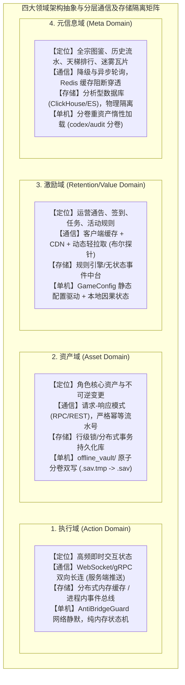
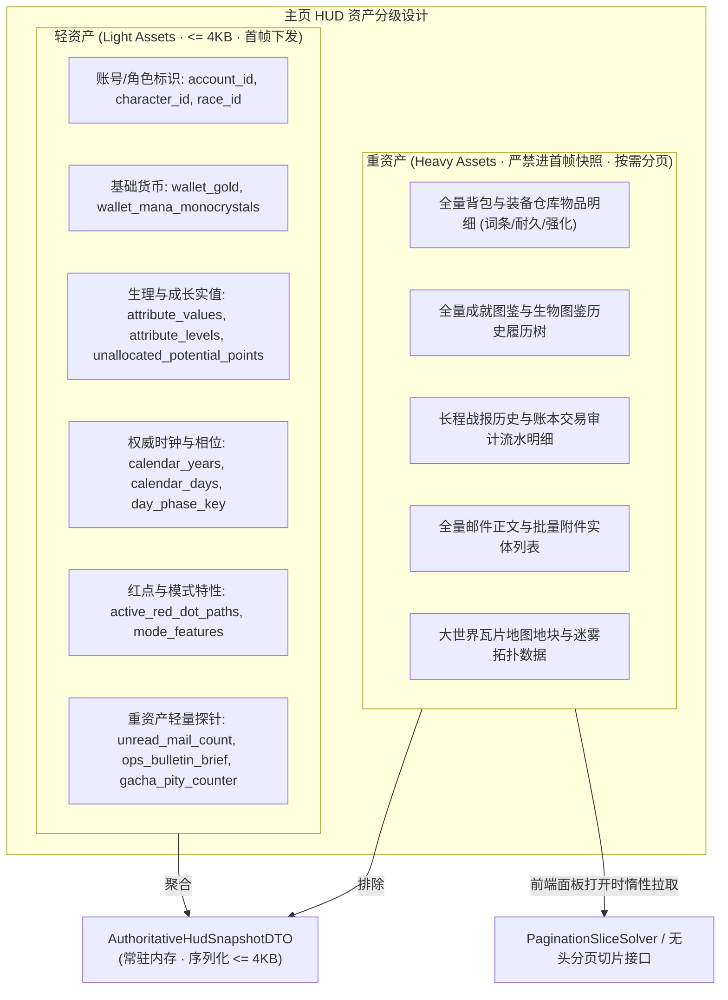

# 施工细则：Phase 118 全链路主页HUD六大业务支柱聚合与单机联机模式自适应引擎 —— 阶段1：全链路主页HUD数据契约与单机联机特性清单规范

> [!NOTE]
> **【施工目标】**：依据纯文字魔幻 RPG 现行底座与未来瓦片地图平滑升级架构，建立主页 HUD 权威聚合契约（`AuthoritativeHudSnapshotDTO`）与模式特性清单契约（`ModeFeatureManifestDTO`）。系统化收敛六大业务支柱，引入四大领域（执行域 Action、资产域 Asset、激励域 Retention、元信息域 Meta）指导后端分层、通信协议分流与存储隔离；严格定义轻资产（常驻内存、体积 $\le 4\text{KB}$）与重资产（分卷存储、按需惰性分页加载）边界，以及单机（`SINGLE_PLAYER`）与联机（`MULTIPLAYER`）双轨气密隔离。
> 施工开始日期: 2026-10-13

---

## 📌 第一性原理溯源指针

* **精准上游规范指针**：[AGENTS.md 工作区全局刚性公理](../../../../../AGENTS.md) §二.1、§二.2、§三；[路线图总索引.md](../../路线图总索引.md)；[基本玩法需求设计稿二.md](../../../玩法汇总/基础玩法/基本玩法需求设计稿二.md)；[基本玩法需求设计稿五.md](../../../玩法汇总/基础玩法/基本玩法需求设计稿五.md)
* **核心不变量约束断言**：
  - `Inv-HUD-ZERO-MYTH-1 (HUD 数据零臆造公理)`：主页 HUD 所有展示字段必须 100% 具备后端权威数据源（六维实值源于 `CharacterPhysiologySheet`、钱包源于 `CharacterWalletEntity`、时钟源于 `WorldClockMaster`），严禁未决占位与虚假常数；
  - `Inv-LIGHT-ASSET-PAYLOAD-2 (轻资产快照体积极限公理)`：`AuthoritativeHudSnapshotDTO` 仅允许聚合轻资产与重资产探针（`count/brief`），序列化体积硬性限制 $\le 4\text{ KB}$，重资产明细严禁侵入快照；
  - `Inv-MODE-FEATURE-ISOLATION-3 (网关模式特性气密隔离公理)`：单机模式下 `ModeFeatureManifestDTO` 必须将强网络特性（组队匹配、公网聊天、网络商城、跨服公会）硬性置为 `false`，信道通信遵循 `AntiBridgeGuard` 网络静默；
  - `Inv-STORAGE-VAULT-ISOLATION-4 (存储选型与物理目录隔离公理)`：单机数据必须严格物理隔离于 `user://offline_vault/` 分卷，联机缓存受限于 `user://online_cache/`，严禁跨目录越界与双向污染；
  - `Inv-DIVIDER-GUARD-5 (除数防零与物理下限公理)`：所有上限数值（`hp_max`、`mp_max`、`ap_max`、经验阈值）必须经过 `maxf(1.0, ...)` 钳制，杜绝除零浮点异常；
  - `Inv-HEADLESS-PURE-SOLVER-6 (无头纯逻辑公理)`：数据契约与解析求解器必须完全基于 GDScript `RefCounted`，零 Godot 视觉节点依赖，零 DOM 依赖。
* **防漂移最高指示**：数据 DTO 必须严格收口于单一真源定义，严禁在前后端散落未登记的自由字典与臆造字段。

---

## 一、 四大领域架构抽象与分层通信及存储矩阵

为指导系统设计中的网络协议选择、缓存策略与存储隔离，将主页大分页与六大业务支柱统一映射至四大领域：



### 1.1 业务与通信协议分流详细对照表

| 领域分类 | 对应六大业务支柱 | 联机模式网络协议与交互机制 | 单机模式通信退化机制 (`SINGLE_PLAYER`) |
| :--- | :--- | :--- | :--- |
| **执行域 (Action)** | P5 社交与会话（组队、即时状态）、P3 时钟心跳 | **WebSocket / gRPC 双向长连接**。强调服务端主动推送（队友准备、匹配超时），毫秒级低延迟响应。 | **进程内直接调用与内存总线**。`AntiBridgeGuard` 物理阻断外部网络 Socket，纯单机事件调度。 |
| **资产域 (Asset)** | P1 资产与账本（金币、魔晶）、P2 角色潜力点/升级、P4 商业化/抽卡消耗 | **请求-响应模式 (RPC / HTTP REST)**。强依赖幂等设计与单调递增 `ledger_nonce`，等待事务确认。 | **本地单机原子操作**。直接修改内存实体并触发 `SaveReadinessGuard` 预备检查，无外部网络等待。 |
| **激励域 (Retention)** | P3 运营配置与通告、P4 CDKey兑换/首充标记、P6 红点前缀树路径 | **客户端缓存 + CDN + 动态轻拉取**。静态图文走 CDN，后端仅提供玩家状态布尔值与版本号校验。 | **本地配置驱动 (`GameConfig`)**。直接从本地 JSON 提取通告与码表，红点由前缀树本地结算。 |
| **元信息域 (Meta)** | P2 成就全宗历史、P5 战斗战报日志、地图瓦片地块全量状态 | **降级与异步轮询**。允许秒级/分钟级延迟，前置 Redis 缓存阻断穿透，支持按需游标分页。 | **分卷按需反序列化**。主存仅存引用指针，玩家打开面板时由 `PaginationSliceSolver` 惰性读盘。 |

### 1.2 存储选型与物理隔离原则详细对照表

| 领域分类 | 联机模式存储架构 | 单机模式存储架构 (`user://offline_vault/`) | 隔离与防穿透红线 |
| :--- | :--- | :--- | :--- |
| **执行域 (Action)** | Redis Cluster / 专服内存网关 | 仅保留于 Godot 运行时堆内存 (`RefCounted`) | **绝不上关系型数据库主库**；单机退出进程即销毁，不产生脏持久化。 |
| **资产域 (Asset)** | 分布式关系型数据库主库（行级锁、强事务保证）+ 只读从库 | `user://offline_vault/world_slot_XX/world_header.sav` (双写原子落盘) | **核心资产持久化基石**；单机采用 HMAC 完整性校验，杜绝明文篡改。 |
| **激励域 (Retention)** | 运营规则引擎 + 事件中台（无状态 Stateless 脚本执行） | `res://config/domains/world_state/core.json` + 单机剧情信件池 | **逻辑无状态化**；规则执行不侵入核心资产服务代码。 |
| **元信息域 (Meta)** | 分析型数据库（ClickHouse / Elasticsearch）与图数据库 | `user://offline_vault/world_slot_XX/codex_archive.sav` 及 `audit_stream.sav` | **与主服/主线程物理隔离**；重资产查询绝不阻塞游戏主线程帧率。 |

---

## 二、 轻资产与重资产分级治理架构



---

## 三、 核心 DTO 契约详细规范（GDScript Reference）

### 3.1 模式功能特性清单契约 (`ModeFeatureManifestDTO`)

```gdscript
class_name ModeFeatureManifestDTO
extends RefCounted

var game_mode: int = 1 # 1: SINGLE_PLAYER, 2: MULTIPLAYER
var show_matchmaking: bool = false       # [Action域] 是否展示组队匹配大厅
var show_online_chat: bool = false       # [Action域] 是否开启跨服/公网聊天频道
var show_real_money_shop: bool = false   # [Asset域] 是否展示真实货币网络充值商城
var show_cross_server_guild: bool = false# [Action/Meta域] 是否展示跨服公会在线成员名册
var enable_offline_cdkey: bool = true    # [Retention域] 是否允许本地离线兑换码核销
var enable_offline_gacha: bool = true    # [Asset/Retention域] 是否允许单机离线保底祈愿
var enable_local_story_mail: bool = true # [Retention域] 是否接收本地单机剧情信件

func to_dto() -> Dictionary:
    return {
        "game_mode": game_mode,
        "show_matchmaking": show_matchmaking,
        "show_online_chat": show_online_chat,
        "show_real_money_shop": show_real_money_shop,
        "show_cross_server_guild": show_cross_server_guild,
        "enable_offline_cdkey": enable_offline_cdkey,
        "enable_offline_gacha": enable_offline_gacha,
        "enable_local_story_mail": enable_local_story_mail
    }
```

### 3.2 历法时钟与昼夜环境契约 (`WorldCalendarEnvironmentDTO`)

```gdscript
class_name WorldCalendarEnvironmentDTO
extends RefCounted

var calendar_years: int = 1     # 卡拉尔公历年纪
var calendar_months: int = 1    # 月份 (1~12)
var calendar_days: int = 1      # 日期 (1~30)
var travel_hours: int = 0       # 24小时制时辰
var day_phase_key: String = "DAY_PHASE_NOON" # DAWN(晨), NOON(昼), DUSK(暮), MIDNIGHT(夜)
var mana_density_tier: int = 1  # 局部区域魔素浓度等级 (1~5)

func to_dto() -> Dictionary:
    return {
        "calendar_years": calendar_years,
        "calendar_months": calendar_months,
        "calendar_days": calendar_days,
        "travel_hours": travel_hours,
        "day_phase_key": day_phase_key,
        "mana_density_tier": mana_density_tier
    }
```

### 3.3 任务追踪轻量摘要契约 (`ActiveQuestTrackerDTO`)

```gdscript
class_name ActiveQuestTrackerDTO
extends RefCounted

# 轻量探针摘要：仅包含关键 ID、文案占位键与进度标量，严禁包含任务前置 DAG 树
var main_quest: Dictionary = {}  # { "quest_id", "title_key", "desc_key", "progress": float }
var side_quest: Dictionary = {}  # 支线任务摘要
var daily_quest: Dictionary = {} # 日常/委托摘要

func to_dto() -> Dictionary:
    return {
        "main_quest": main_quest.duplicate(true),
        "side_quest": side_quest.duplicate(true),
        "daily_quest": daily_quest.duplicate(true)
    }
```

### 3.4 主页 HUD 权威聚合快照契约 (`AuthoritativeHudSnapshotDTO`)

```gdscript
class_name AuthoritativeHudSnapshotDTO
extends RefCounted

# [LIGHT_ASSET] 基础身份与生理状态
var account_id: String = ""
var character_id: String = ""
var character_name: String = ""
var race_id: String = ""
var level: int = 1
var hp_current: float = 100.0
var hp_max: float = 100.0
var mp_current: float = 50.0
var mp_max: float = 50.0
var ap_current: float = 10.0
var ap_max: float = 10.0

# [LIGHT_ASSET - Asset域] 基础钱包货币
var wallet_gold: int = 0
var wallet_mana_monocrystals: int = 0
var ledger_nonce: int = 0

# [LIGHT_ASSET - Asset域] 核心成长属性 (六维L3实值与待分配点)
var attribute_values: Dictionary = {}
var attribute_levels: Dictionary = {}
var unallocated_potential_points: int = 0
var title_rank_key: String = ""

# [LIGHT_ASSET - Retention域] 运营时钟与轻量探针
var calendar_env: WorldCalendarEnvironmentDTO = null
var ops_bulletin_brief: String = ""
var unread_mail_count: int = 0
var gacha_pity_counter: int = 0

# [LIGHT_ASSET - Action/Retention域] 社交阵营与红点前缀树
var guild_faction_id: String = ""
var active_red_dot_paths: Array[String] = []
var quest_tracker: ActiveQuestTrackerDTO = null
var mode_features: ModeFeatureManifestDTO = null

func to_dto() -> Dictionary:
    return {
        "account_id": account_id,
        "character_id": character_id,
        "character_name": character_name,
        "race_id": race_id,
        "level": level,
        "hp_current": hp_current,
        "hp_max": maxf(1.0, hp_max),
        "mp_current": mp_current,
        "mp_max": maxf(1.0, mp_max),
        "ap_current": ap_current,
        "ap_max": maxf(1.0, ap_max),
        "wallet_gold": wallet_gold,
        "wallet_mana_monocrystals": wallet_mana_monocrystals,
        "ledger_nonce": ledger_nonce,
        "attribute_values": attribute_values.duplicate(true),
        "attribute_levels": attribute_levels.duplicate(true),
        "unallocated_potential_points": unallocated_potential_points,
        "title_rank_key": title_rank_key,
        "calendar_env": calendar_env.to_dto() if calendar_env else {},
        "ops_bulletin_brief": ops_bulletin_brief,
        "unread_mail_count": unread_mail_count,
        "gacha_pity_counter": gacha_pity_counter,
        "guild_faction_id": guild_faction_id,
        "active_red_dot_paths": active_red_dot_paths.duplicate(),
        "quest_tracker": quest_tracker.to_dto() if quest_tracker else {},
        "mode_features": mode_features.to_dto() if mode_features else {}
    }
```

---

## 四、 通用无头分页架构适配协议 (Generic Pagination Protocol)

针对前端各种分页架构（定长页码分页、虚拟滚动游标分页、Tab分类过滤切片），后端权威层建立标准化无头分页模型，杜绝一次性全量下发大数组引发瞬态堆膨胀与首帧卡顿。

### 4.1 分页查询请求契约 (`PaginationQueryDTO`)

```gdscript
class_name PaginationQueryDTO
extends RefCounted

var page_index: int = 0         # 从 0 开始的页码索引 (防负数守卫: >= 0)
var page_size: int = 10         # 每页尺寸 (下限 >= 1，上限安全钳制 <= 50)
var cursor_token: String = ""   # 游标标识 (用于时间序列日志/战报终端游标分页)
var filter_tag: String = ""     # 分类过滤标签 (如背包类型/邮件已读状态)

func to_dto() -> Dictionary:
    return {
        "page_index": max(0, page_index),
        "page_size": clampi(page_size, 1, 50),
        "cursor_token": cursor_token,
        "filter_tag": filter_tag
    }

static func make_default(size: int = 10) -> PaginationQueryDTO:
    var q := PaginationQueryDTO.new()
    q.page_size = clampi(size, 1, 50)
    return q
```

### 4.2 分页结果响应契约 (`PagedResultDTO`)

```gdscript
class_name PagedResultDTO
extends RefCounted

var page_index: int = 0
var page_size: int = 10
var total_count: int = 0
var total_pages: int = 0
var has_next: bool = false
var has_prev: bool = false
var next_cursor: String = ""
var items: Array = []

func to_dto() -> Dictionary:
    return {
        "page_index": page_index,
        "page_size": page_size,
        "total_count": total_count,
        "total_pages": total_pages,
        "has_next": has_next,
        "has_prev": has_prev,
        "next_cursor": next_cursor,
        "items": items.duplicate(true)
    }
```

---

## 五、 阶段交付物与合规清单

1. `WebGames/backend/domains/world_state/dto/pagination_query_dto.gd`
2. `WebGames/backend/domains/world_state/dto/paged_result_dto.gd`
3. `WebGames/backend/domains/world_state/dto/mode_feature_manifest_dto.gd`
4. `WebGames/backend/domains/world_state/dto/world_calendar_environment_dto.gd`
5. `WebGames/backend/domains/world_state/dto/active_quest_tracker_dto.gd`
6. `WebGames/backend/domains/world_state/dto/authoritative_hud_snapshot_dto.gd` (对现有 `HudStatusSnapshotDTO` 进行向前兼容演进扩展)

---

## 二、 命令式施工执行清单 (Agent Execution Checklist)

- [x] Step 1.1: 编写 `ModeFeatureManifestDTO` 模式功能特性清单契约
- [x] Step 1.2: 编写 `WorldCalendarEnvironmentDTO` 历法时钟与环境契约
- [x] Step 1.3: 编写 `ActiveQuestTrackerDTO` 活跃任务追踪轻量契约
- [x] Step 1.4: 编写 `AuthoritativeHudSnapshotDTO` 权威 HUD 聚合快照契约
- [x] Step 1.5: 编写 `PaginationQueryDTO` 与 `PagedResultDTO` 分页切片契约

---

## 三、 DoD 验收矩阵 (DoD Matrix)

| 检验项 ID | 校验目标 | 验证输入 | 预期输出断言 |
| :--- | :--- | :--- | :--- |
| TC-HMA-S1-01 | 权威快照轻资产体积约束 | 构造包含 6 支柱的完整快照序列化 | 快照总体积 $\le 4\text{KB}$，绝对无重资产字段污染 |
| TC-HMA-S1-02 | 除数防零与物理下限守卫 | 传入零或负数上限参数 | `hp_max/ap_max/mp_max >= 1.0` 强下限钳制 |
| TC-HMA-S1-03 | 单机模式强网络特性阻断 | 单机模式 `ModeFeatureManifestDTO` | 组队、公网聊天、网络商城、跨服公会全为 `false` |
| TC-HMA-S1-04 | 分页切片防负数与越界钳制 | 传入负数页码与超大尺寸 | 页码自动归零，尺寸钳制 $\le 50$，游标计算精确 |
