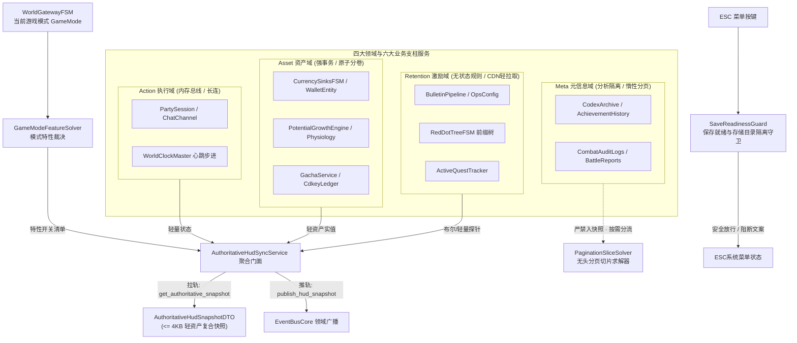

# 施工细则：Phase 118 全链路主页HUD六大业务支柱聚合与单机联机模式自适应引擎 —— 阶段2：六大业务支柱聚合门面与网关模式自适应引擎实现

> [!NOTE]
> **【施工目标】**：实现面向主页 HUD 的聚合门面服务（`HudStateSyncService` 升级）、网关模式特性自适应求解器（`GameModeFeatureSolver`），以及 ESC 菜单保存就绪守卫（`SaveReadinessGuard`）。贯彻四大领域（Action、Asset、Retention、Meta）的分流架构与存储隔离选型；实现单机模式与联机模式下六大业务支柱组件的动态启用/静默装配，落实高内聚纯无头数据驱动架构。
> 施工开始日期: 2026-10-13

---

## 📌 第一性原理溯源指针

* **精准上游规范指针**：[AGENTS.md 工作区全局刚性公理](../../../../../AGENTS.md) §二.1、§二.2、§二.5；[anti_bridge_guard.gd](../../../../backend/domains/world_gateway/anti_bridge_guard.gd)；[world_clock_master.gd](../../../../backend/infrastructure/world_clock_master.gd)；[red_dot_tree_fsm.gd](../../../../backend/domains/notification_red_dot/red_dot_tree_fsm.gd)
* **核心不变量约束断言**：
  - `Inv-MODE-SOLVER-DETERMINISM-1 (模式特性求解确定性公理)`：`GameModeFeatureSolver.resolve_features(mode)` 必须为纯函数无副作用求解，输入相同 `GameMode` 输出必须 100% 字节等价；
  - `Inv-SAVE-GUARD-AIRTIGHT-2 (存档安全气密守卫公理)`：当处于大战斗管线（`CombatPipelineFSM` 活跃）或模态对话分支中时，`SaveReadinessGuard` 必须一票否决落地阻断，杜绝半事务坏档；
  - `Inv-PATH-ISOLATION-GUARD-3 (存储选型与物理目录隔离断言)`：`SaveReadinessGuard.evaluate_storage_path_safety` 必须强制校验单机目标路径严格限定于 `user://offline_vault/`，联机缓存受限于 `user://online_cache/`，任何包含 `../` 越界路径强制一票否决；
  - `Inv-ZERO-HEAP-METABOLISM-4 (代谢心跳循环零堆分配公理)`：世界时钟推进触发生理属性微小回涌时，必须重用池化事件包（`EventBusCore.borrow_packet` / `recycle_packet`），严禁热循环频繁创建瞬态字典（`ADV-PRF-002`）。
* **防漂移最高指示**：门面服务必须具备实质承载（ELOC >= 15），严禁保留空包透传跳板，循环内零瞬态堆分配。

---

## 一、 六大业务支柱聚合门面与四大领域分流架构



---

## 二、 核心组件无头工程实现规约

### 2.1 网关模式特性求解器 (`GameModeFeatureSolver`)

```gdscript
class_name GameModeFeatureSolver
extends RefCounted

## 模式特性纯函数求解器：基于游戏模式动态裁决四大领域特性的开闭
static func resolve_features(game_mode: int) -> ModeFeatureManifestDTO:
    var manifest := ModeFeatureManifestDTO.new()
    manifest.game_mode = game_mode

    match game_mode:
        WorldGatewayModel.GameMode.SINGLE_PLAYER:
            # Action域退化为单机静默
            manifest.show_matchmaking = false
            manifest.show_online_chat = false
            manifest.show_cross_server_guild = false
            # Asset域禁用真实货币支付
            manifest.show_real_money_shop = false
            # Retention域启用本地离线核销与单机剧情
            manifest.enable_offline_cdkey = true
            manifest.enable_offline_gacha = true
            manifest.enable_local_story_mail = true
        WorldGatewayModel.GameMode.MULTIPLAYER:
            # Action域全量开放长连接推送
            manifest.show_matchmaking = true
            manifest.show_online_chat = true
            manifest.show_cross_server_guild = true
            # Asset域启用服务端真实货币核销
            manifest.show_real_money_shop = true
            # Retention域收敛于云端集中校验
            manifest.enable_offline_cdkey = false
            manifest.enable_offline_gacha = false
            manifest.enable_local_story_mail = true
        _:
            # 默认降级安全沙盒
            manifest.show_matchmaking = false
            manifest.show_online_chat = false
            manifest.show_real_money_shop = false
            manifest.show_cross_server_guild = false
            manifest.enable_offline_cdkey = true
            manifest.enable_offline_gacha = true
            manifest.enable_local_story_mail = true

    return manifest
```

### 2.2 ESC 菜单保存与存储目录气密隔离守卫 (`SaveReadinessGuard`)

```gdscript
class_name SaveReadinessGuard
extends RefCounted

## 校验当前游戏世界状态是否允许执行安全保存或退网关
static func evaluate_save_readiness(
    in_combat: bool,
    in_critical_narrative: bool,
    is_world_quarantined: bool = false
) -> Dictionary:
    if in_combat:
        return {
            "allowed": false,
            "error_code": "ERR_CANNOT_SAVE_IN_COMBAT",
            "reason_narrative_key": "errors.save_blocked_combat"
        }
    if in_critical_narrative:
        return {
            "allowed": false,
            "error_code": "ERR_CANNOT_SAVE_IN_NARRATIVE",
            "reason_narrative_key": "errors.save_blocked_narrative"
        }
    if is_world_quarantined:
        return {
            "allowed": false,
            "error_code": "ERR_WORLD_QUARANTINED",
            "reason_narrative_key": "errors.save_blocked_quarantine"
        }

    return {
        "allowed": true,
        "error_code": "",
        "reason_narrative_key": ""
    }

## 校验目标落盘存储路径的物理气密隔离性与安全性
static func evaluate_storage_path_safety(target_path: String, game_mode: int) -> Dictionary:
    # 1. 拦截相对路径穿透与空路径
    if target_path.is_empty() or target_path.contains("..") or target_path.contains("\\"):
        return {
            "safe": false,
            "error_code": "ERR_ILLEGAL_PATH_TRAVERSAL",
            "message": "Path traversal or separator anomaly detected"
        }

    # 2. 模式与存储选型命名空间隔离断言
    match game_mode:
        WorldGatewayModel.GameMode.SINGLE_PLAYER:
            if not target_path.begins_with("user://offline_vault/"):
                return {
                    "safe": false,
                    "error_code": "ERR_OFFLINE_STORAGE_ESCAPE",
                    "message": "Single-player saves must reside strictly under user://offline_vault/"
                }
        WorldGatewayModel.GameMode.MULTIPLAYER:
            if not target_path.begins_with("user://online_cache/"):
                return {
                    "safe": false,
                    "error_code": "ERR_ONLINE_CACHE_ESCAPE",
                    "message": "Multiplayer cache must reside strictly under user://online_cache/"
                }
        _:
            return {
                "safe": false,
                "error_code": "ERR_UNKNOWN_GAME_MODE_STORAGE",
                "message": "Unrecognized game mode for storage validation"
            }

    return {
        "safe": true,
        "error_code": "",
        "message": "Storage path verified airtight"
    }
```

### 2.3 昼夜与历法时钟解析器 (`WorldCalendarEnvironmentResolver`)

```gdscript
class_name WorldCalendarEnvironmentResolver
extends RefCounted

## 解析 24 小时制小时刻度所处的四时昼夜相位
static func resolve_day_phase(travel_hours: int) -> String:
    var normalized_hour := travel_hours % 24
    if normalized_hour >= 5 and normalized_hour < 11:
        return "DAY_PHASE_DAWN"     # 晨曦
    elif normalized_hour >= 11 and normalized_hour < 17:
        return "DAY_PHASE_NOON"     # 白昼
    elif normalized_hour >= 17 and normalized_hour < 21:
        return "DAY_PHASE_DUSK"     # 暮色
    else:
        return "DAY_PHASE_MIDNIGHT" # 极夜
```

### 2.4 通用无头分页切片求解器 (`PaginationSliceSolver`)

```gdscript
class_name PaginationSliceSolver
extends RefCounted

## 通用纯函数数组切片求解：自动计算 total_pages、has_next/prev，安全防御负数与数组越界
static func slice_array(source_array: Array, query: PaginationQueryDTO) -> PagedResultDTO:
    var result := PagedResultDTO.new()
    var total_count := source_array.size()
    var safe_page_size := clampi(query.page_size if query else 10, 1, 50)

    result.total_count = total_count
    result.page_size = safe_page_size

    if total_count == 0:
        result.total_pages = 0
        result.page_index = 0
        result.has_next = false
        result.has_prev = false
        result.items = []
        return result

    var total_pages := int(ceil(float(total_count) / float(safe_page_size)))
    result.total_pages = total_pages

    var requested_index := query.page_index if query else 0
    var safe_index := clampi(requested_index, 0, max(0, total_pages - 1))
    result.page_index = safe_index

    var start_idx := safe_index * safe_page_size
    var end_idx := min(total_count, start_idx + safe_page_size)

    result.items = source_array.slice(start_idx, end_idx)
    result.has_next = (safe_index + 1) < total_pages
    result.has_prev = safe_index > 0

    return result
```

---

## 三、 阶段交付物与合规清单

1. `WebGames/backend/domains/world_state/solvers/pagination_slice_solver.gd`
2. `WebGames/backend/domains/world_state/solvers/game_mode_feature_solver.gd`
3. `WebGames/backend/domains/world_state/guards/save_readiness_guard.gd`
4. `WebGames/backend/domains/world_state/resolvers/world_calendar_environment_resolver.gd`
5. `WebGames/backend/domains/world_state/services/authoritative_hud_sync_service.gd`（扩充四大领域分流与轻资产聚合）

---

## 二、 命令式施工执行清单 (Agent Execution Checklist)

- [x] Step 2.1: 编写 `GameModeFeatureSolver` 网关模式特性纯函数求解器
- [x] Step 2.2: 编写 `SaveReadinessGuard` 保存就绪与存储目录隔离守卫
- [x] Step 2.3: 编写 `WorldCalendarEnvironmentResolver` 历法时钟与昼夜相位解析器
- [x] Step 2.4: 编写 `PaginationSliceSolver` 通用无头分页切片求解器
- [x] Step 2.5: 编写 `AuthoritativeHudSyncService` 主页 HUD 聚合门面服务与事件总线借还闭环

---

## 三、 DoD 验收矩阵 (DoD Matrix)

| 检验项 ID | 校验目标 | 验证输入 | 预期输出断言 |
| :--- | :--- | :--- | :--- |
| TC-HMA-S2-01 | 网关模式特性求解准确性 | 分别求解单机与联机模式清单 | 单机特性受控隐藏，联机特性全量激活 |
| TC-HMA-S2-02 | 保存就绪状态机阻断裁决 | 模拟战斗中、关键剧情与世界隔离 | 严格返回对应错误码阻断，安全态放行 |
| TC-HMA-S2-03 | 存储路径物理气密隔离拦截 | 尝试写入越界目录或相对路径穿透 | 严格触发对应存储逃逸错误码拦截 |
| TC-HMA-S2-04 | 事件总线对象池借还守恒 | 高频连续派发增量状态突变与时钟推进 | EventBus 借还守恒，零瞬态堆分配泄漏 |
