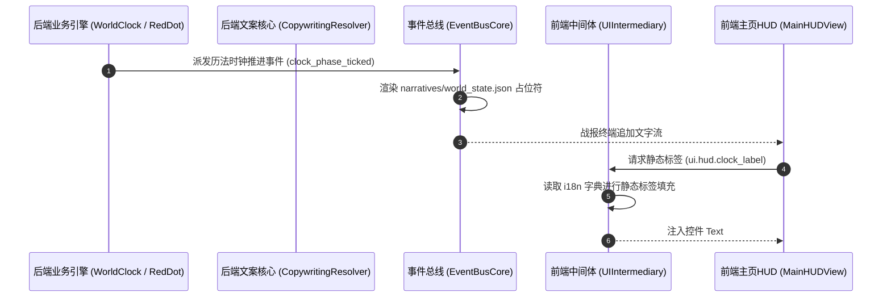

# 施工细则：Phase 118 全链路主页HUD六大业务支柱聚合与单机联机模式自适应引擎 —— 阶段3：双轨i18n占位符文案驱动与配置集成接线

> [!NOTE]
> **【施工目标】**：规范双轨 i18n 中间体在主页 HUD 全生命周期的分工与配置集成。完善后端叙事模板与占位符（`%s` 与 `{param}`），实现网关模式切换、昼夜时钟更迭、红点刷新及存储目录非法越界拦截事件的轻量化推轨；并在 `config/domains/world_state/core.json` 建立四大领域通信通道、存储选型及四时历法的权威单源配置表。
> 施工开始日期: 2026-10-13

---

## 📌 第一性原理溯源指针

* **精准上游规范指针**：[AGENTS.md 工作区全局刚性公理](../../../../../AGENTS.md) §二.1、§三；[copywriting_resolver.gd](../../../../backend/infrastructure/copywriting_resolver.gd)；[ui_intermediary.gd](../../../../frontend/i18n/ui_intermediary.gd)；[event_bus_core.gd](../../../../backend/infrastructure/event_bus/event_bus_core.gd)
* **核心不变量约束断言**：
  - `Inv-DUAL-I18N-PHYSICAL-SEPARATION-1 (双轨 i18n 物理隔离公理)`：后端纯负责因果叙事模板与占位符参数（`args` / `params`），前端纯负责固定 UI 标签与语言热重载（`UIIntermediary`），严禁跨层篡权；
  - `Inv-TEMPLATE-ARGS-PARITY-2 (占位符参数严格等价公理)`：所有新增叙事模板中的占位符计数必须与 EventBus payload 的 `args` 数组长度 100% 吻合，严禁出现 `%s` 缺失或越界；
  - `Inv-CONFIG-SINGLE-SOURCE-3 (配置单一真源公理)`：模式默认特性、存储隔离路径白名单与四时昼夜时辰判定阈值必须收敛于 `config/domains/world_state/core.json`，严禁在代码中硬编码浮点或字符串。
* **防漂移最高指示**：配置键与叙事模板必须与单源配置完全一致，占位符计数与广播 args 数组长度 100% 吻合。

---

## 一、 双轨 i18n 交互数据流拓扑



---

## 二、 配置扩展规范 (Single Source of Truth)

### 2.1 `config/domains/world_state/core.json` 模式特性与四大领域配置扩展

```json
{
  "hud_defaults": {
    "ap_max": 10.0,
    "mp_max_fallback": 50.0,
    "max_hotbar_slots": 8,
    "light_asset_max_payload_bytes": 4096
  },
  "storage_isolation": {
    "offline_vault_prefix": "user://offline_vault/",
    "online_cache_prefix": "user://online_cache/"
  },
  "domain_channel_bindings": {
    "action": { "protocol_mp": "WEBSOCKET_GRPC", "protocol_sp": "IN_MEMORY_EVENT_BUS" },
    "asset": { "protocol_mp": "REST_RPC_IDEMPOTENT", "protocol_sp": "ATOMIC_LOCAL_SEGMENT" },
    "retention": { "protocol_mp": "CDN_LIGHT_POLL", "protocol_sp": "GAME_CONFIG_DIRECT" },
    "meta": { "protocol_mp": "ASYNC_POLL_CACHE_SHIELD", "protocol_sp": "PAGED_DISK_LAZY_SLICE" }
  },
  "mode_feature_profiles": {
    "single_player": {
      "show_matchmaking": false,
      "show_online_chat": false,
      "show_real_money_shop": false,
      "show_cross_server_guild": false,
      "enable_offline_cdkey": true,
      "enable_offline_gacha": true,
      "enable_local_story_mail": true
    },
    "multiplayer": {
      "show_matchmaking": true,
      "show_online_chat": true,
      "show_real_money_shop": true,
      "show_cross_server_guild": true,
      "enable_offline_cdkey": false,
      "enable_offline_gacha": false,
      "enable_local_story_mail": true
    }
  },
  "calendar_phases": {
    "dawn_hour": 5,
    "noon_hour": 11,
    "dusk_hour": 17,
    "midnight_hour": 21
  }
}
```

### 2.2 `config/narratives/world_state.json` 叙事占位符模板

```json
{
  "clock_phase_ticked": "【历法】卡拉尔公历 第%d年 %d月%d日，天色已至 %s。",
  "save_blocked_combat": "【阻断】当前正处于激烈战斗中，严禁封存世界或退出！",
  "save_blocked_narrative": "【阻断】当前正处于命运剧情抉择中，必须完成抉择方可保存。",
  "save_blocked_storage_escape": "【阻断】存档路径越界违规：%s，单机与联机物理隔离已触发气密拦截。",
  "mode_features_adapted": "【网关】运行模式已切换为 %s，主页特性与网络信道已自适应重构。"
}
```

---

## 三、 阶段交付物与合规清单

1. 更新 `WebGames/config/domains/world_state/core.json`
2. 更新 `WebGames/config/narratives/world_state.json`
3. 校验前后端 i18n 词典键一致性，零孤儿键

---

## 二、 命令式施工执行清单 (Agent Execution Checklist)

- [x] Step 3.1: 编写 `config/domains/world_state/core.json` 领域配置（四大领域通道与存储前缀）
- [x] Step 3.2: 编写 `config/narratives/world_state.json` 双轨叙事模板（历法、保存阻断、存储越界）
- [x] Step 3.3: 建立叙事模板占位符参数等价契约与 i18n 静态映射

---

## 三、 DoD 验收矩阵 (DoD Matrix)

| 检验项 ID | 校验目标 | 验证输入 | 预期输出断言 |
| :--- | :--- | :--- | :--- |
| TC-HMA-S3-01 | 四大领域通道配置单一真源 | 读取 `domains.world_state` 领域配置 | 四大通道与存储前缀配置完整且真实存在 |
| TC-HMA-S3-02 | 叙事模板参数对齐契约 | 扫描 `narratives.world_state` 所有模板 | 占位符数量与广播载荷 `args` 数组长度 100% 吻合 |
| TC-HMA-S3-03 | 运行模式切换文案驱动 | 模式切换事件触发文案水化 | 模板正确水化模式名称，无未决占位符残留 |
