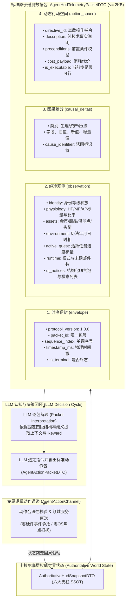

# 施工细则：Phase 119 主页HUD面向Agent结构化切片流与行动空间双轨适配引擎 —— 阶段1：主页HUD标准遥测数据包与动态行动空间契约设计

> [!NOTE]
> **【施工目标】**：在 Phase 118 主页 HUD 六大业务支柱聚合引擎的基础上，聚焦于**主页 HUD 业务域**（坚决不扩散至战斗 HUD），为智能体（Agent / 决策模型 / 自动化无头测试器）建立**面向 LLM 逐包解读（Packet-by-Packet）的标准原子数据包外壳契约**（`AgentHudTelemetryPacketDTO`）。封装四大顶层正交分区：时序信封（`envelope`）、纯净切片观测（`observation`）、单步因果差分（`causal_deltas`）与动态行动空间（`action_space`）。规范双向无损序列化与对象池重置契约，保证单包序列化体积严格 $\le 2\text{ KB}$。
> 施工开始日期: 2026-10-13

---

## 📌 第一性原理溯源指针

* **精准上游规范指针**：[AGENTS.md 工作区全局刚性公理](../../../../../AGENTS.md) §二.1、§二.2、§三；[路线图总索引.md](../../路线图总索引.md)；[阶段1_全链路主页HUD数据契约与单机联机特性清单规范.md](../Phase_118_全链路主页HUD六大业务支柱聚合与单机联机模式自适应引擎施工细则/阶段1_全链路主页HUD数据契约与单机联机特性清单规范.md)
* **核心不变量约束断言**：
  - `Inv-STANDARD-PACKET-ENVELOPE-1 (标准数据包原子外壳公理)`：对 Agent 暴露的全部主页数据流必须严格封装在顶层四段式标准数据包中（`envelope`, `observation`, `causal_deltas`, `action_space`），杜绝平铺杂散字典，确保 LLM 具备 100% 确定性的结构化解析神谕；
  - `Inv-SEQUENCE-MONOTONIC-2 (包序号单调递增与防漂移公理)`：数据包信封必须包含物理量纲时间戳 `timestamp_ms`、协议版本 `protocol_version` 与严格单调自增的 `sequence_index`，防止时序倒置与丢包混淆；
  - `Inv-AGENT-SLICE-PURITY-3 (Agent 切片纯净性公理)`：面向 Agent 的切片观测严禁包含任何表现层 UI 渲染元素（如富文本 BBCode、材质路径、动画状态、UI 坐标与本地化提示词），必须保持纯强类型标量与枚举；
  - `Inv-SINGLE-SOURCE-DERIVATION-4 (同源单向派生公理)`：数据包观测数据必须 100% 派生自底层权威快照 `AuthoritativeHudSnapshotDTO`，严禁在后端维护独立于人类玩家的数据源；
  - `Inv-TOKEN-BUDGET-COMPACT-5 (切片体积与 Token 预算公理)`：单包完整序列化 JSON 体积严格 $\le 2\text{ KB}$，以极简高密度表征适配 LLM 上下文窗口与低 Token 消耗要求；
  - `Inv-ACTION-SPACE-PRUNING-6 (行动空间动态剪枝公理)`：数据包中的行动指令集必须经过前置条件即时演算（AP/资产/状态校验），仅暴露当前合法的离散指令，严禁让 Agent 盲目尝试非法 API；
  - `Inv-HOME-HUD-BOUNDARY-7 (主页 HUD 业务聚焦公理)`：严格限定于主页 HUD 范围（六大业务支柱与系统主菜单交互），坚决不扩散至战斗场景与实时技能判定；
  - `Inv-SEPARATE-INPUT-CHANNEL-8 (输入通道零硬件争抢公理)`：智能体上行决策通过专用数据包 `AgentActionPacketDTO` 经内存级专属动作通道（`AgentActionChannel`）直投至领域服务层，彻底脱离 Godot `InputEventKey`/`InputEventMouseButton` 硬件事件流，严禁与人类玩家发生光标、焦点与窗口激活态争抢；
  - `Inv-UI-FEED-STRUCTURAL-PURITY-9 (UI 引导与通知去表现化公理)`：UI 提示气泡、系统 Toast 与模态确认框通过 `HudUiNoticeDTO` 结构化呈现，仅暴露语义类别（INFO/WARN/GUIDE/MODAL）、标题、文本及专属操作指令，彻底剥离字体、颜色、动画与屏幕绝对坐标；
  - `Inv-HUMAN-SUPREMACY-PREEMPTION-10 (人类优先抢占与控制租约公理)`：人类操作永远享有最高权威；当前台侦测到人类正在操作 UI 或模态弹窗展开时，系统立即下发人类操作租约锁（`human_interaction_state: "ACTIVE"`），将智能体行动空间强制剪枝置灰（`is_writable: false`，全部指令 `is_executable: false` 并附带 `ERR_PREEMPTED_BY_HUMAN` 阻断码），将 Agent 安全平滑降级为纯只读观察态（`READ_ONLY_OBSERVER`）；
  - `Inv-CAUSAL-INITIATOR-PROVENANCE-11 (因果突变发起者溯源公理)`：所有因果差分（`causal_deltas`）必须显式携带 `initiator` 溯源标签（`"HUMAN_UI_INTERACTION"`、`"AGENT_ACTION_CHANNEL"`、`"SYSTEM_TICK_SIMULATION"`），使 Agent 能够 100% 区分当前状态改变是人类玩家前台点击触发还是系统环境自然演化，杜绝控制幻觉。
* **防漂移最高指示**：数据 DTO 必须严格收口于单一真源定义，严禁在前后端散落未登记的自由字典与臆造字段。

---

## 一、 面向 LLM 逐包解读（Packet-by-Packet）的标准数据包架构

为使 LLM 能够以最快速度、零幻觉完成环境感知并决策输出，构建规范的“数据包进、动作包出（Packet In $\to$ Action Out）”双轨闭环协议：



---

## 二、 核心数据契约详细规格设计

### 1. `AgentHudTelemetryPacketDTO`（顶层标准遥测数据包契约）
位于 `res://backend/domains/world_state/dto/agent_hud_telemetry_packet_dto.gd`：

```gdscript
class_name AgentHudTelemetryPacketDTO
extends RefCounted

# 一、信封元数据 (Envelope)
var protocol_version: String = "1.0.0"
var packet_id: String = ""
var sequence_index: int = 0
var timestamp_ms: int = 0
var domain: String = "HOME_HUD"
var is_terminal: bool = false

# 人机协同与控制权租约元数据 (Human Preemption Lease)
var human_interaction_state: String = "IDLE"      # "IDLE", "ACTIVE", "EXCLUSIVE_MODAL_OPEN"
var agent_control_mode: String = "READ_WRITE"     # "READ_WRITE", "READ_ONLY_OBSERVER"
var active_operator: String = "IDLE"             # "HUMAN_PLAYER", "AGENT", "SYSTEM"
var is_writable: bool = true                     # 当前帧是否允许智能体上行提交动作
var preempted_by_human: bool = false             # 是否被人类前台操作抢占锁定

# 二、纯净状态观测 (Observation Context Slice)
var observation: AgentHudContextSliceDTO = null

# 三、单步因果差分流 (Causal Deltas)
var causal_deltas: Array[HudCausalDeltaDTO] = []

# 四、动态行动空间指令集 (Action Space Directives)
var action_space: Array[AgentActionDirectiveDTO] = []

func reset_state() -> void:
    protocol_version = "1.0.0"
    packet_id = ""
    sequence_index = 0
    timestamp_ms = 0
    domain = "HOME_HUD"
    is_terminal = false
    human_interaction_state = "IDLE"
    agent_control_mode = "READ_WRITE"
    active_operator = "IDLE"
    is_writable = true
    preempted_by_human = false
    if observation != null:
        observation.reset_state()
    causal_deltas.clear()
    action_space.clear()

func to_dto() -> Dictionary:
    var deltas_arr: Array[Dictionary] = []
    for d in causal_deltas:
        if d != null:
            deltas_arr.append(d.to_dto())

    var actions_arr: Array[Dictionary] = []
    for a in action_space:
        if a != null:
            actions_arr.append(a.to_dto())

    return {
        "envelope": {
            "protocol_version": protocol_version,
            "packet_id": packet_id,
            "sequence_index": sequence_index,
            "timestamp_ms": timestamp_ms,
            "domain": domain,
            "is_terminal": is_terminal,
            "control_lease": {
                "human_interaction_state": human_interaction_state,
                "agent_control_mode": agent_control_mode,
                "active_operator": active_operator,
                "is_writable": is_writable,
                "preempted_by_human": preempted_by_human
            }
        },
        "observation": observation.to_dto() if observation != null else {},
        "causal_deltas": deltas_arr,
        "action_space": actions_arr
    }
```

### 2. `AgentHudContextSliceDTO`（观测切片契约）
位于 `res://backend/domains/world_state/dto/agent_hud_context_slice_dto.gd`：

```gdscript
class_name AgentHudContextSliceDTO
extends RefCounted

# 基础身份切片
var account_id: String = ""
var character_id: String = ""
var character_name: String = ""
var race_id: String = "HUMAN"
var level: int = 1

# 生理体能切片 (数值与下限安全归一化比率 0.0 ~ 1.0)
var hp_current: float = 100.0
var hp_max: float = 100.0
var hp_ratio: float = 1.0

var mp_current: float = 100.0
var mp_max: float = 100.0
var mp_ratio: float = 1.0

var ap_current: float = 10.0
var ap_max: float = 10.0
var ap_ratio: float = 1.0

# 资产与潜能切片
var wallet_gold: int = 0
var wallet_mana_monocrystals: int = 0
var ledger_nonce: int = 0
var unallocated_potential_points: int = 0
var attribute_values: Dictionary = {}
var title_rank_key: String = ""

# 环境历法切片
var calendar_year: int = 1
var calendar_month: int = 1
var calendar_day: int = 1
var day_phase_key: String = "DAWN"
var season_key: String = "SPRING"
var weather_key: String = "CLEAR"

# 任务进度切片 (标量)
var active_quest_id: String = ""
var active_quest_target_count: int = 0
var active_quest_current_count: int = 0
var is_quest_completable: bool = false

# 系统与网络元数据
var game_mode: String = "SINGLE_PLAYER"
var is_multiplayer_ready: bool = false
var unread_mail_count: int = 0

# UI 引导提示与活动模态通知切片 (去表现化纯文本与交互指令)
var ui_notices: Array[HudUiNoticeDTO] = []
```

### 3. `AgentActionDirectiveDTO`（动态行动空间指令契约）
位于 `res://backend/domains/world_state/dto/agent_action_directive_dto.gd`：

```gdscript
class_name AgentActionDirectiveDTO
extends RefCounted

var directive_id: String = ""       # 操作唯一标识符
var domain: String = "ASSET"         # 四大领域之一
var description: String = ""        # 纯技术事实说明，面向 LLM
var cost_payload: Dictionary = {}   # 代价
var preconditions: Dictionary = {}  # 前置条件
var allowed_parameters: Dictionary = {} # 参数值域
var is_executable: bool = true      # 当前步是否允许执行
var blocked_reason: String = ""     # 阻断原因码 (如 "ERR_INSUFFICIENT_AP")
```

### 4. `HudCausalDeltaDTO`（因果差分契约）
位于 `res://backend/domains/world_state/dto/hud_causal_delta_dto.gd`：

```gdscript
class_name HudCausalDeltaDTO
extends RefCounted

var delta_category: String = ""   # "PHYSIOLOGY", "WALLET", "CALENDAR", "QUEST"
var target_field: String = ""     # "hp_current", "wallet_gold", "day_phase_key"
var previous_value: Variant = null
var current_value: Variant = null
var delta_amount: float = 0.0
var cause_identifier: String = "" # 诱因标识符 (如 "ACTION_REST_INN")
var initiator: String = "SYSTEM_TICK_SIMULATION" # 突变发起者: "HUMAN_UI_INTERACTION" | "AGENT_ACTION_CHANNEL" | "SYSTEM_TICK_SIMULATION"
var reason: String = ""           # 面向 Agent 解释因果的纯客观说明 (如 "Human player clicked UI button")

func reset_state() -> void:
    delta_category = ""
    target_field = ""
    previous_value = null
    current_value = null
    delta_amount = 0.0
    cause_identifier = ""
    initiator = "SYSTEM_TICK_SIMULATION"
    reason = ""

func to_dto() -> Dictionary:
    return {
        "delta_category": delta_category,
        "target_field": target_field,
        "previous_value": previous_value,
        "current_value": current_value,
        "delta_amount": delta_amount,
        "cause_identifier": cause_identifier,
        "initiator": initiator,
        "reason": reason
    }
```

### 5. `HudUiNoticeDTO`（去表现化结构化 UI 消息与通知契约）
位于 `res://backend/domains/world_state/dto/hud_ui_notice_dto.gd`：

```gdscript
class_name HudUiNoticeDTO
extends RefCounted

var notice_id: String = ""         # 唯一提示标识符 (如 "GUIDE_POTENTIAL_ALLOCATION")
var category: String = "INFO"      # "INFO", "WARNING", "GUIDE", "MODAL"
var title: String = ""             # 纯文本标题
var body_text: String = ""         # 纯文本正文 (严格剔除 BBCode 与 HTML)
var is_modal: bool = false         # 是否阻断性模态框 (需优先响应)
var action_directive_ids: Array[String] = [] # 响应此通知绑定的动作指令 (如 ["DISMISS_UI_NOTICE", "CONFIRM_ALLOCATION"])

func reset_state() -> void:
    notice_id = ""
    category = "INFO"
    title = ""
    body_text = ""
    is_modal = false
    action_directive_ids.clear()

func to_dto() -> Dictionary:
    return {
        "notice_id": notice_id,
        "category": category,
        "title": title,
        "body_text": body_text,
        "is_modal": is_modal,
        "action_directive_ids": action_directive_ids.duplicate()
    }
```

### 6. `AgentActionPacketDTO`（面向专属逻辑动作通道的上行标准动作包契约）
位于 `res://backend/domains/world_state/dto/agent_action_packet_dto.gd`：

```gdscript
class_name AgentActionPacketDTO
extends RefCounted

var session_id: String = ""         # 对应会话 ID
var sequence_index: int = 0         # 响应的目标遥测包序号
var directive_id: String = ""       # 选定的合法指令 ID (如 "ALLOCATE_POTENTIAL_STAT")
var params: Dictionary = {}         # 参数载荷 (如 {"stat_target": "STR", "points": 1})
var client_timestamp_ms: int = 0   # 决策产出物理时间戳

func reset_state() -> void:
    session_id = ""
    sequence_index = 0
    directive_id = ""
    params.clear()
    client_timestamp_ms = 0

func to_dto() -> Dictionary:
    return {
        "session_id": session_id,
        "sequence_index": sequence_index,
        "directive_id": directive_id,
        "params": params.duplicate(true),
        "client_timestamp_ms": client_timestamp_ms
    }

static func from_dto(data: Dictionary) -> AgentActionPacketDTO:
    var pkt := AgentActionPacketDTO.new()
    pkt.session_id = str(data.get("session_id", ""))
    pkt.sequence_index = int(data.get("sequence_index", 0))
    pkt.directive_id = str(data.get("directive_id", ""))
    pkt.params = data.get("params", {}).duplicate(true)
    pkt.client_timestamp_ms = int(data.get("client_timestamp_ms", 0))
    return pkt
```

---

## 三、 标准数据包序列化范例 (LLM 输入黄金标准)

以下为序列化后的真实 JSON 数据包形态，体积仅约 $1.2\text{ KB}$：

```json
{
  "envelope": {
    "protocol_version": "1.0.0",
    "packet_id": "pkt_home_1728821940_0001",
    "sequence_index": 1,
    "timestamp_ms": 1728821940123,
    "domain": "HOME_HUD",
    "is_terminal": false,
    "control_lease": {
      "human_interaction_state": "ACTIVE",
      "agent_control_mode": "READ_ONLY_OBSERVER",
      "active_operator": "HUMAN_PLAYER",
      "is_writable": false,
      "preempted_by_human": true
    }
  },
  "observation": {
    "account_id": "ACC_TEST_01",
    "character_id": "CHAR_TEST_01",
    "character_name": "阿尔托莉雅",
    "race_id": "HUMAN",
    "level": 15,
    "hp_current": 85.0,
    "hp_max": 100.0,
    "hp_ratio": 0.85,
    "mp_current": 50.0,
    "mp_max": 50.0,
    "mp_ratio": 1.0,
    "ap_current": 8.0,
    "ap_max": 10.0,
    "ap_ratio": 0.8,
    "wallet_gold": 2500,
    "wallet_mana_monocrystals": 18,
    "ledger_nonce": 42,
    "unallocated_potential_points": 5,
    "attribute_values": {"STR": 24.5, "AGI": 18.0},
    "title_rank_key": "KNIGHT_CAPTAIN",
    "calendar_year": 3,
    "calendar_month": 7,
    "calendar_day": 14,
    "day_phase_key": "DAWN",
    "active_quest_id": "Q_MAIN_01",
    "active_quest_target_count": 5,
    "active_quest_current_count": 3,
    "is_quest_completable": false,
    "game_mode": "SINGLE_PLAYER",
    "is_multiplayer_ready": false,
    "unread_mail_count": 3,
    "ui_notices": [
      {
        "notice_id": "GUIDE_POTENTIAL_ALLOCATION",
        "category": "GUIDE",
        "title": "潜能觉醒提示",
        "body_text": "当前有5点未分配潜能点，建议分配至力量或敏捷属性。",
        "is_modal": false,
        "action_directive_ids": ["ALLOCATE_POTENTIAL_STAT", "DISMISS_UI_NOTICE"]
      }
    ]
  },
  "causal_deltas": [
    {
      "delta_category": "WALLET",
      "target_field": "wallet_gold",
      "previous_value": 2450,
      "current_value": 2500,
      "delta_amount": 50.0,
      "cause_identifier": "QUEST_STAGE_REWARD",
      "initiator": "HUMAN_UI_INTERACTION",
      "reason": "Human player turned in quest on HUD dialog"
    }
  ],
  "action_space": [
    {
      "directive_id": "ALLOCATE_POTENTIAL_STAT",
      "domain": "ASSET",
      "description": "分配未分配潜能点至基础属性",
      "cost_payload": {"potential_points": 1},
      "preconditions": {"unallocated_points_min": 1},
      "allowed_parameters": {"stat_target": ["STR", "AGI", "INT", "STA"]},
      "is_executable": true,
      "blocked_reason": ""
    },
    {
      "directive_id": "DISMISS_UI_NOTICE",
      "domain": "INTERACTION",
      "description": "关闭并已读当前非模态UI引导提示气泡",
      "cost_payload": {},
      "preconditions": {},
      "allowed_parameters": {"notice_id": ["GUIDE_POTENTIAL_ALLOCATION"]},
      "is_executable": true,
      "blocked_reason": ""
    },
    {
      "directive_id": "REST_AND_ADVANCE_TIME",
      "domain": "RETENTION",
      "description": "在安全宿屋休息推进时相并恢复体能",
      "cost_payload": {"ap": 2.0},
      "preconditions": {"ap_min": 2.0},
      "allowed_parameters": {},
      "is_executable": true,
      "blocked_reason": ""
    }
  ]
}
```

### 4. 专属上行动作包序列化范例 (`AgentActionPacketDTO` -> 动作通道输入)

Agent 针对上述遥测数据包做出的响应反馈，无需操作鼠标键盘，仅输出轻量动作包（仅约 $150\text{ B}$）：

```json
{
  "session_id": "sess_home_1728821940_0001",
  "sequence_index": 1,
  "directive_id": "ALLOCATE_POTENTIAL_STAT",
  "params": {
    "stat_target": "STR",
    "points": 1
  },
  "client_timestamp_ms": 1728821940650
}
```

---

## 四、 阶段交付物与自检标准

1. **交付文件集**：
   - `WebGames/backend/domains/world_state/dto/agent_hud_telemetry_packet_dto.gd`
   - `WebGames/backend/domains/world_state/dto/agent_hud_context_slice_dto.gd`
   - `WebGames/backend/domains/world_state/dto/agent_action_directive_dto.gd`
   - `WebGames/backend/domains/world_state/dto/hud_causal_delta_dto.gd`
   - `WebGames/backend/domains/world_state/dto/hud_ui_notice_dto.gd`
   - `WebGames/backend/domains/world_state/dto/agent_action_packet_dto.gd`
2. **第一性原理自检标准**：
   - 六大数据契约全部基于 `RefCounted`，彻底实现 `reset_state()` 循环对象池复用；
   - 顶层数据包提供 `to_dto()` 与 `from_dto()` 双向无损序列化；
   - 遥测下行 JSON 体积严格 $\le 2\text{ KB}$，动作上行 JSON 体积 $\le 250\text{ B}$；
   - 零 Godot 物理输入依赖，零 UI 渲染材质杂质。

---

## 二、 命令式施工执行清单 (Agent Execution Checklist)

- [x] Step 1.1: 编写 `AgentHudTelemetryPacketDTO` 顶层标准遥测数据包契约与信封模型
- [x] Step 1.2: 编写 `AgentHudContextSliceDTO` 纯净观测状态切片契约
- [x] Step 1.3: 编写 `AgentActionDirectiveDTO` 动态行动空间指令集契约
- [x] Step 1.4: 编写 `HudCausalDeltaDTO` 因果差分溯源契约
- [x] Step 1.5: 编写 `HudUiNoticeDTO` 去表现化结构化 UI 消息与通知契约
- [x] Step 1.6: 编写 `AgentActionPacketDTO` 专属逻辑动作通道上行动作包契约

---

## 三、 DoD 验收矩阵 (DoD Matrix)

| 检验项 ID | 校验目标 | 验证输入 | 预期输出断言 |
| :--- | :--- | :--- | :--- |
| TC-AHS-S1-01 | 标准数据包体积与 Token 预算 | 构造包含全部切片与指令的完整包序列化 | 下行 JSON 体积严格 $\le 2\text{KB}$，上行动作包 $\le 250\text{B}$ |
| TC-AHS-S1-02 | 对象池生命周期与状态复位 | 触发 `reset_state()` 循环回收复用 | 集合清空、引用释放、标量回归初始默认值，零内存泄漏 |
| TC-AHS-S1-03 | 双向序列化无损与逆向还原 | `to_dto()` 导出后经 `from_dto()` 还原 | 还原对象与原对象字段逐一等价，零数据漂移 |
| TC-AHS-S1-04 | 纯净观测切片剥离视觉杂质 | 检查观测切片字段集与类型标注 | 严禁包含 BBCode、节点路径、动画或本地化文本，仅含纯标量与枚举 |
