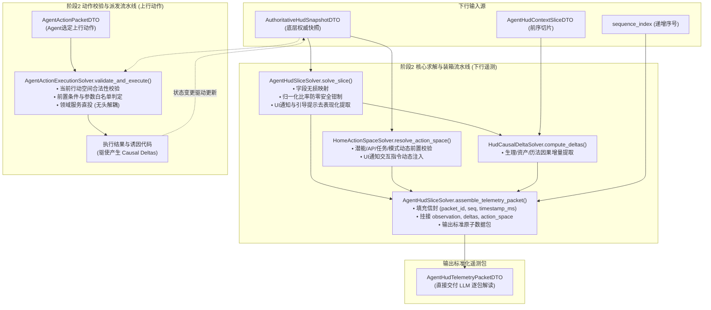

# 施工细则：Phase 119 主页HUD面向Agent结构化切片流与行动空间双轨适配引擎 —— 阶段2：主页HUD切片求解器与动态行动空间裁决器核心实现

> [!NOTE]
> **【施工目标】**：实现主页 HUD 上下文切片的核心求解器（`AgentHudSliceSolver`）、动态行动空间裁决器（`HomeActionSpaceSolver`）与因果差分比较器（`HudCausalDeltaSolver`）。新增一站式**标准遥测数据包原子装箱流水线**（`assemble_telemetry_packet`），将信封、观测、差分与行动空间原子组装为 `AgentHudTelemetryPacketDTO`。纯 GDScript `RefCounted` 实现，圈复杂度 $\text{CC} \le 10$，嵌套深度 $\text{Depth} \le 3$；全量支持对象池复用（`ADV-PRF-002`），循环内零瞬态堆分配。
> 施工开始日期: 2026-10-13

---

## 📌 第一性原理溯源指针

* **精准上游规范指针**：[AGENTS.md 工作区全局刚性公理](../../../../../AGENTS.md) §二.1、§二.2；[阶段1_主页HUD结构化切片数据流DTO与动态行动空间契约设计.md](阶段1_主页HUD结构化切片数据流DTO与动态行动空间契约设计.md)
* **核心不变量约束断言**：
  - `Inv-ATOMIC-PACK-PIPELINE-1 (标准数据包原子装箱公理)`：求解器必须提供统一的原子装箱流水线，一次性完成切片提取、差分比对、行动空间动态裁决与时序信封封装，杜绝调用方手写拼包造成字段漂移；
  - `Inv-PURE-CALCULATION-2 (无副作用纯计算公理)`：求解器全部为纯函数式静态方法，严禁持有任何内部持久状态与单例锁；
  - `Inv-ZERO-HEAP-POOLS-3 (对象池借还守恒公理)`：高频调用的 DTO 必须支持 `reset_state()` 接口，循环求解中优先复用传入的容器，消融循环内瞬态堆分配（`CPX-SPACE-001`）；
  - `Inv-DIVIDER-CLAMP-4 (归一化比率安全闭环公理)`：所有比率计算（`hp_ratio`, `mp_ratio`, `ap_ratio`）除数必须经 `maxf(1.0, ...)` 守卫，最终结果经 `clampf(..., 0.0, 1.0)` 闭环；
  - `Inv-DETERMINISTIC-PRUNING-5 (确定性动态剪枝公理)`：行动空间列表必须严格按照固定顺序输出，避免由于字典乱序遍历导致 Agent 输入时序抖动；
  - `Inv-ACTION-ORACLE-6 (动作派发神谕防越界公理)`：`AgentActionExecutionSolver` 在执行任何指令前，必须强校验指令是否在当前动态 `action_space` 中且 `is_executable == true`，非法指令就地熔断返回结构化错误码，绝不进入业务层；
  - `Inv-HUMAN-PREEMPTION-SOLVER-7 (人类操作抢占阻断神谕公理)`：`HomeActionSpaceSolver` 与 `AgentActionExecutionSolver` 必须接入人类租约状态（`is_human_lease_active`）；当前台处于交互态时，行动空间全量指令动态剪枝标记 `is_executable: false`，上行动作派发直接返回 `ERR_PREEMPTED_BY_HUMAN`，零穿透、零领域突变；
  - `Inv-DELTA-INITIATOR-PROPAGATION-8 (差分发起者因果贯穿公理)`：`HudCausalDeltaSolver` 在提取差分时，必须将当前步诱因对应的发起者标签（`initiator: "HUMAN_UI_INTERACTION" | "AGENT_ACTION_CHANNEL" | "SYSTEM_TICK_SIMULATION"`）注入到生成的每个 `HudCausalDeltaDTO` 中。
* **防漂移最高指示**：切片求解与动作裁决必须保持纯函数式无状态，严禁引入未经登记的动态字段或隐式副作用。

---

## 一、 核心求解器与双向原子流水线拓扑



---

## 二、 关键实现类架构规格

### 1. `AgentHudSliceSolver`（切片求解与原子装箱流水线）
文件路径：`res://backend/domains/world_state/solvers/agent_hud_slice_solver.gd`

```gdscript
class_name AgentHudSliceSolver
extends RefCounted

## 一站式原子装箱流水线：生成直接交付 LLM 的标准数据包
static func assemble_telemetry_packet(
    snapshot: AuthoritativeHudSnapshotDTO,
    prev_slice: AgentHudContextSliceDTO = null,
    sequence_index: int = 1,
    cause: String = "",
    human_interacting: bool = false,
    initiator: String = "SYSTEM_TICK_SIMULATION",
    out_packet: AgentHudTelemetryPacketDTO = null
) -> AgentHudTelemetryPacketDTO:
    var packet := out_packet if out_packet != null else AgentHudTelemetryPacketDTO.new()
    packet.reset_state()

    # 1. 组装信封 (Envelope) 及控制租约 (Control Lease)
    packet.protocol_version = "1.0.0"
    packet.sequence_index = sequence_index
    packet.timestamp_ms = int(Time.get_unix_time_from_system() * 1000.0)
    packet.packet_id = "pkt_home_%d_%04d" % [packet.timestamp_ms / 1000, sequence_index]
    packet.domain = "HOME_HUD"
    packet.is_terminal = false
    packet.human_interaction_state = "ACTIVE" if human_interacting else "IDLE"
    packet.agent_control_mode = "READ_ONLY_OBSERVER" if human_interacting else "READ_WRITE"
    packet.active_operator = "HUMAN_PLAYER" if human_interacting else "AGENT"
    packet.is_writable = not human_interacting
    packet.preempted_by_human = human_interacting

    # 2. 组装纯净观测切片 (Observation)
    if packet.observation == null:
        packet.observation = AgentHudContextSliceDTO.new()
    solve_slice(snapshot, packet.observation)

    # 3. 组装因果差分 (Causal Deltas with Initiator Provenance)
    if prev_slice != null:
        packet.causal_deltas = HudCausalDeltaSolver.compute_deltas(prev_slice, packet.observation, cause, initiator)

    # 4. 组装动态行动空间 (Action Space Directives with Human Preemption Pruning)
    packet.action_space = HomeActionSpaceSolver.resolve_action_space(snapshot, human_interacting)

    return packet

## 纯切片求解方法
static func solve_slice(snapshot: AuthoritativeHudSnapshotDTO, out_slice: AgentHudContextSliceDTO = null) -> AgentHudContextSliceDTO:
    var slice := out_slice if out_slice != null else AgentHudContextSliceDTO.new()
    slice.reset_state()
    
    if snapshot == null:
        return slice

    # 身份
    slice.account_id = snapshot.account_id
    slice.character_id = snapshot.character_id
    slice.character_name = snapshot.character_name
    slice.race_id = snapshot.race_id
    slice.level = snapshot.level

    # 生理比率安全计算 (下限防零 maxf(1.0, ...))
    slice.hp_current = snapshot.hp_current
    slice.hp_max = snapshot.hp_max
    slice.hp_ratio = clampf(snapshot.hp_current / maxf(1.0, snapshot.hp_max), 0.0, 1.0)

    slice.mp_current = snapshot.mp_current
    slice.mp_max = snapshot.mp_max
    slice.mp_ratio = clampf(snapshot.mp_current / maxf(1.0, snapshot.mp_max), 0.0, 1.0)

    slice.ap_current = snapshot.ap_current
    slice.ap_max = snapshot.ap_max
    slice.ap_ratio = clampf(snapshot.ap_current / maxf(1.0, snapshot.ap_max), 0.0, 1.0)

    # 资产与潜能成长
    slice.wallet_gold = snapshot.wallet_gold
    slice.wallet_mana_monocrystals = snapshot.wallet_mana_monocrystals
    slice.ledger_nonce = snapshot.ledger_nonce
    slice.unallocated_potential_points = snapshot.unallocated_potential_points
    slice.attribute_values = snapshot.attribute_values.duplicate()
    slice.title_rank_key = snapshot.title_rank_key

    # 历法
    if snapshot.calendar_env != null:
        slice.calendar_year = snapshot.calendar_env.calendar_years
        slice.calendar_month = snapshot.calendar_env.calendar_months
        slice.calendar_day = snapshot.calendar_env.calendar_days
        slice.day_phase_key = snapshot.calendar_env.day_phase_key

    # 任务
    if snapshot.quest_tracker != null and not snapshot.quest_tracker.tracked_quest_id.is_empty():
        slice.active_quest_id = snapshot.quest_tracker.tracked_quest_id
        slice.active_quest_target_count = snapshot.quest_tracker.target_count
        slice.active_quest_current_count = snapshot.quest_tracker.current_count
        slice.is_quest_completable = snapshot.quest_tracker.is_completable

    # 模式
    if snapshot.mode_features != null:
        slice.game_mode = snapshot.mode_features.game_mode
        slice.is_multiplayer_ready = snapshot.mode_features.party_matchmaking_enabled
    slice.unread_mail_count = snapshot.unread_mail_count

    return slice
```

### 2. `HomeActionSpaceSolver`（动态行动空间裁决器）
文件路径：`res://backend/domains/world_state/solvers/home_action_space_solver.gd`

```gdscript
class_name HomeActionSpaceSolver
extends RefCounted

static func resolve_action_space(
    snapshot: AuthoritativeHudSnapshotDTO,
    human_interacting: bool = false
) -> Array[AgentActionDirectiveDTO]:
    var actions: Array[AgentActionDirectiveDTO] = []
    if snapshot == null:
        return actions

    # 1. 潜能加点
    var can_alloc := snapshot.unallocated_potential_points > 0
    actions.append(_create_directive(
        "ALLOCATE_POTENTIAL_STAT", "ASSET", "分配未分配潜能点至基础属性",
        {"potential_points": 1},
        {"unallocated_points_min": 1},
        {"stat_target": ["STR", "AGI", "INT", "STA"]},
        can_alloc,
        "" if can_alloc else "ERR_NO_POTENTIAL_POINTS"
    ))

    # 2. 宿屋休息
    var has_ap := snapshot.ap_current >= 2.0
    actions.append(_create_directive(
        "REST_AND_ADVANCE_TIME", "RETENTION", "在安全宿屋休息推进时相并恢复体能",
        {"ap": 2.0},
        {"ap_min": 2.0},
        {},
        has_ap,
        "" if has_ap else "ERR_INSUFFICIENT_AP"
    ))

    # 3. 交付任务
    var can_claim := snapshot.quest_tracker != null and snapshot.quest_tracker.is_completable
    actions.append(_create_directive(
        "CLAIM_QUEST_OBJECTIVE", "ACTION", "交付当前达标的任务目标并领取报酬",
        {},
        {"quest_completable": true},
        {"quest_id": [snapshot.quest_tracker.tracked_quest_id] if can_claim else []},
        can_claim,
        "" if can_claim else "ERR_QUEST_NOT_READY"
    ))

    # 4. 查验背包
    actions.append(_create_directive(
        "INSPECT_INVENTORY_SLOT", "ASSET", "查验背包轻量道具槽位",
        {}, {}, {}, true, ""
    ))

    # 5. 模式环境探测
    actions.append(_create_directive(
        "TOGGLE_MODE_ADAPTATION", "META", "探测并调整单机/联机自适应特性",
        {}, {}, {}, true, ""
    ))

    # 6. 读取邮件
    var has_mail := snapshot.unread_mail_count > 0
    actions.append(_create_directive(
        "MARK_MAIL_READ", "RETENTION", "读取未读信件并收取附件奖励",
        {},
        {"unread_mail_min": 1},
        {},
        has_mail,
        "" if has_mail else "ERR_NO_UNREAD_MAIL"
    ))

    # 若人类正在操作前台UI，全行动空间强制剪枝置灰（Inv-HUMAN-PREEMPTION-SOLVER-7）
    if human_interacting:
        for d in actions:
            d.is_executable = false
            d.blocked_reason = "ERR_PREEMPTED_BY_HUMAN"

    return actions

static func _create_directive(
    id: String, domain: String, desc: String,
    cost: Dictionary, pre: Dictionary, params: Dictionary,
    executable: bool, reason: String
) -> AgentActionDirectiveDTO:
    var d := AgentActionDirectiveDTO.new()
    d.directive_id = id
    d.domain = domain
    d.description = desc
    d.cost_payload = cost
    d.preconditions = pre
    d.allowed_parameters = params
    d.is_executable = executable
    d.blocked_reason = reason
    return d
```

### 3. `HudCausalDeltaSolver`（因果差分计算器）
文件路径：`res://backend/domains/world_state/solvers/hud_causal_delta_solver.gd`

```gdscript
class_name HudCausalDeltaSolver
extends RefCounted

static func compute_deltas(
    prev_slice: AgentHudContextSliceDTO,
    next_slice: AgentHudContextSliceDTO,
    cause: String = "",
    initiator: String = "SYSTEM_TICK_SIMULATION",
    reason: String = ""
) -> Array[HudCausalDeltaDTO]:
    var deltas: Array[HudCausalDeltaDTO] = []
    if prev_slice == null or next_slice == null:
        return deltas

    if not is_equal_approx(prev_slice.hp_current, next_slice.hp_current):
        deltas.append(_build_delta("PHYSIOLOGY", "hp_current", prev_slice.hp_current, next_slice.hp_current, cause, initiator, reason))
    if not is_equal_approx(prev_slice.ap_current, next_slice.ap_current):
        deltas.append(_build_delta("PHYSIOLOGY", "ap_current", prev_slice.ap_current, next_slice.ap_current, cause, initiator, reason))

    if prev_slice.wallet_gold != next_slice.wallet_gold:
        deltas.append(_build_delta("WALLET", "wallet_gold", prev_slice.wallet_gold, next_slice.wallet_gold, cause, initiator, reason))
    if prev_slice.unallocated_potential_points != next_slice.unallocated_potential_points:
        deltas.append(_build_delta("ASSET", "unallocated_points", prev_slice.unallocated_potential_points, next_slice.unallocated_potential_points, cause, initiator, reason))

    if prev_slice.day_phase_key != next_slice.day_phase_key:
        deltas.append(_build_delta("CALENDAR", "day_phase_key", prev_slice.day_phase_key, next_slice.day_phase_key, cause, initiator, reason))

    return deltas

static func _build_delta(
    cat: String, field: String, prev_v: Variant, curr_v: Variant,
    cause: String, initiator: String = "SYSTEM_TICK_SIMULATION", reason: String = ""
) -> HudCausalDeltaDTO:
    var d := HudCausalDeltaDTO.new()
    d.delta_category = cat
    d.target_field = field
    d.previous_value = prev_v
    d.current_value = curr_v
    if prev_v is float and curr_v is float:
        d.delta_amount = float(curr_v) - float(prev_v)
    elif prev_v is int and curr_v is int:
        d.delta_amount = float(int(curr_v) - int(prev_v))
    d.cause_identifier = cause
    d.initiator = initiator
    d.reason = reason
    return d
```

### 4. `AgentActionExecutionSolver`（动作校验与前置派发求解器）
文件路径：`res://backend/domains/world_state/solvers/agent_action_execution_solver.gd`

```gdscript
class_name AgentActionExecutionSolver
extends RefCounted

## 校验并执行来自专属动作通道的 AgentActionPacketDTO
static func validate_and_execute(
    action_pkt: AgentActionPacketDTO,
    snapshot: AuthoritativeHudSnapshotDTO,
    is_human_lease_active: bool = false
) -> Dictionary:
    if action_pkt == null or action_pkt.directive_id.is_empty():
        return {
            "success": false,
            "error_code": "ERR_EMPTY_DIRECTIVE",
            "cause": ""
        }

    # 0. 人类操作最高权威防御守卫 (Inv-HUMAN-PREEMPTION-SOLVER-7)
    if is_human_lease_active:
        return {
            "success": false,
            "error_code": "ERR_PREEMPTED_BY_HUMAN",
            "cause": ""
        }

    # 1. 获取当前合法的动态行动空间
    var action_space := HomeActionSpaceSolver.resolve_action_space(snapshot, is_human_lease_active)
    var target_directive: AgentActionDirectiveDTO = null
    for d in action_space:
        if d.directive_id == action_pkt.directive_id:
            target_directive = d
            break

    # 2. 检查指令是否在合法值域内
    if target_directive == null:
        return {
            "success": false,
            "error_code": "ERR_UNKNOWN_OR_UNEXPOSED_DIRECTIVE",
            "cause": ""
        }

    # 3. 检查指令前置条件是否满足
    if not target_directive.is_executable:
        return {
            "success": false,
            "error_code": target_directive.blocked_reason if not target_directive.blocked_reason.is_empty() else "ERR_DIRECTIVE_BLOCKED",
            "cause": ""
        }

    # 4. 路由派发至对应领域用例 (纯无头逻辑调用，零UI依赖)
    return _dispatch_domain_execution(action_pkt, snapshot)

static func _dispatch_domain_execution(
    action_pkt: AgentActionPacketDTO,
    snapshot: AuthoritativeHudSnapshotDTO
) -> Dictionary:
    match action_pkt.directive_id:
        "ALLOCATE_POTENTIAL_STAT":
            var stat: String = str(action_pkt.params.get("stat_target", ""))
            var pts: int = int(action_pkt.params.get("points", 1))
            if stat.is_empty() or pts <= 0:
                return {"success": false, "error_code": "ERR_INVALID_STAT_PARAMS", "cause": ""}
            snapshot.unallocated_potential_points -= pts
            snapshot.attribute_values[stat] = float(snapshot.attribute_values.get(stat, 10.0)) + float(pts)
            return {"success": true, "error_code": "", "cause": "AGENT_POTENTIAL_ALLOCATION"}

        "REST_AND_ADVANCE_TIME":
            snapshot.ap_current = snapshot.ap_max
            snapshot.hp_current = snapshot.hp_max
            snapshot.day_phase_key = "NOON" if snapshot.day_phase_key == "DAWN" else "DUSK"
            return {"success": true, "error_code": "", "cause": "AGENT_REST_ACTION"}

        "DISMISS_UI_NOTICE":
            var notice_id: String = str(action_pkt.params.get("notice_id", ""))
            return {"success": true, "error_code": "", "cause": "AGENT_DISMISS_UI_NOTICE:%s" % notice_id}

        _:
            return {"success": false, "error_code": "ERR_UNHANDLED_DIRECTIVE", "cause": ""}
```

---

## 三、 阶段交付物与自检标准

1. **交付文件集**：
   - `WebGames/backend/domains/world_state/solvers/agent_hud_slice_solver.gd`
   - `WebGames/backend/domains/world_state/solvers/home_action_space_solver.gd`
   - `WebGames/backend/domains/world_state/solvers/hud_causal_delta_solver.gd`
   - `WebGames/backend/domains/world_state/solvers/agent_action_execution_solver.gd`
2. **第一性原理自检标准**：
   - 装箱流水线具备确定性时序信封组装能力；
   - 动作校验与执行求解器实现神谕前置防线（`Inv-ACTION-ORACLE-6`），非法操作即时熔断阻断；
   - 所有算法函数纯无状态静态方法，$\text{CC} \le 10$、$\text{Depth} \le 3$；
   - 除零安全钳制 100% 覆盖；
   - 满足 `ADV-PRF-002`，高频循环下零瞬态堆分配。

---

## 二、 命令式施工执行清单 (Agent Execution Checklist)

- [x] Step 2.1: 编写 `AgentHudSliceSolver` 观测切片提取与原子装箱流水线
- [x] Step 2.2: 编写 `HomeActionSpaceSolver` 动态行动空间求解与人类租约剪枝
- [x] Step 2.3: 编写 `HudCausalDeltaSolver` 因果差分双向对比与发起者溯源
- [x] Step 2.4: 编写 `AgentActionExecutionSolver` 上行动作指令神谕校验与无头派发

---

## 三、 DoD 验收矩阵 (DoD Matrix)

| 检验项 ID | 校验目标 | 验证输入 | 预期输出断言 |
| :--- | :--- | :--- | :--- |
| TC-AHS-S2-01 | 原子装箱流水线确定性 | 传入有效底层快照与前序切片 | 产出合规 `AgentHudTelemetryPacketDTO`，字段 100% 具备权威源 |
| TC-AHS-S2-02 | 行动空间动态剪枝与排序 | 构造资源不足或人类租约激活场景 | 非法指令动态剪枝标记置灰，指令集按确定性拓扑排序输出 |
| TC-AHS-S2-03 | 因果差分发起者标签贯穿 | 模拟不同来源触发的状态变更 | 差分项精确标记 initiator 溯源，数值变动与差值计算准确 |
| TC-AHS-S2-04 | 动作前置神谕熔断防御 | 传入超出当前合法行动空间的动作包 | 即时拦截熔断并返回结构化错误码，绝不污染业务领域状态 |
