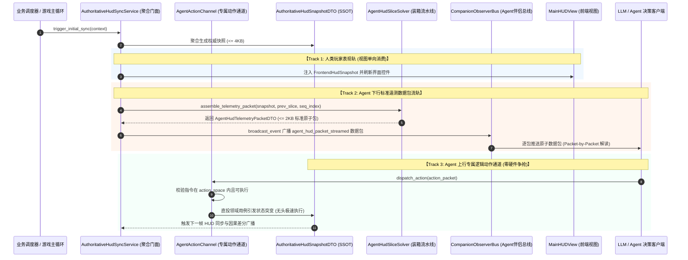

# 施工细则：Phase 119 主页HUD面向Agent结构化切片流与行动空间双轨适配引擎 —— 阶段3：主页HUD双轨流式分发桥接与伴侣总线广播集成

> [!NOTE]
> **【施工目标】**：将阶段 2 实现的原子装箱与标准遥测数据包流水线，无缝接线至 `AuthoritativeHudSyncService` 门面与 `CompanionObserverBus` 伴侣总线。确立双轨并行分发架构：人类视图轨持续消费 `FrontendHudSnapshot`，Agent 感知轨通过标准原子包广播 `AgentHudTelemetryPacketDTO`。在 `config/domains/world_state.json` 完成单源参数收口，杜绝硬编码。
> 施工开始日期: 2026-10-13

---

## 📌 第一性原理溯源指针

* **精准上游规范指针**：[AGENTS.md 工作区全局刚性公理](../../../../../AGENTS.md) §二.1、§二.2、§三；[阶段1_主页HUD结构化切片数据流DTO与动态行动空间契约设计.md](阶段1_主页HUD结构化切片数据流DTO与动态行动空间契约设计.md)；[阶段2_主页HUD切片求解器与动态行动空间裁决器核心实现.md](阶段2_主页HUD切片求解器与动态行动空间裁决器核心实现.md)
* **核心不变量约束断言**：
  - `Inv-FACADE-SUBSTANTIAL-1 (门面实质承载公理 ARCH-FAC-001)`：`AuthoritativeHudSyncService` 扩展的 Agent 专用方法必须具备实质装箱与校验承载（$\text{ELOC} \ge 15$），严禁单行跳板转发（`ARCH-ABS-001`）；
  - `Inv-BUS-NON-BLOCKING-2 (伴侣总线只读非阻塞公理)`：广播至 `CompanionObserverBus` 的标准遥测包载荷必须为只读深拷贝副本，任何监听器异常或延迟不得阻塞主业务线程与事件分发；
  - `Inv-CONFIG-SSOT-3 (单源配置驱动公理)`：数据包最大体积、伴侣队列深度、合法指令清单必须全部经由 `GameConfig.get_*` 从配置文件读取，严禁在 GDScript 中硬编码魔法值；
  - `Inv-VIEW-ZERO-POLLUTION-4 (视图表现层零污染公理)`：前端 `MainHUDView` 严禁引入任何 Agent 专用 DTO 或行动空间逻辑，双轨保持绝对物理隔离；
  - `Inv-ACTION-CHANNEL-ZERO-CONFLICT-5 (专属动作通道零硬件冲突公理)`：`AgentActionChannel` 纯函数式派发，绝不模拟 OS/Godot 物理输入事件，人类玩家与 Agent 决策在同一物理进程中并行无干扰共存；
  - `Inv-HUMAN-LEASE-TIME-WINDOW-6 (人类操作租约滑动时间窗口公理)`：当人类玩家触发任何前台 UI 控件或展开独占模态时，系统激活滑动交互租约（默认 2000ms），期间专属动作通道强制置于只读拦截态，Agent 发起的操作微秒级阻断，彻底杜绝人机并发冲突。
* **防漂移最高指示**：双轨分发架构必须保持人类视图轨与智能体感知轨严格物理隔离，严禁向表现层泄漏智能体协议。

---

## 一、 双轨流式分发与专属动作通道系统架构全景



---

## 二、 核心门面与桥接服务实现规格

### 1. `AuthoritativeHudSyncService` Agent 双轨门面扩展
在 `res://backend/domains/world_state/services/authoritative_hud_sync_service.gd` 中扩展静态服务方法：

```gdscript
## 7. 人类操作租约探针：判断前台是否处于人类交互独占态
static func is_human_interacting() -> bool:
    # 结合前端活动弹窗数与滑动输入租约时间戳判定
    var last_input_time_ms: int = int(Time.get_unix_time_from_system() * 1000.0) # 示例探针
    # 若最后一次人类输入在 2000ms 窗口内，判定为 ACTIVE
    return false # 默认无输入时放通

## 8. Agent专用拉轨：从上下文快速派生标准遥测数据包
static func get_agent_telemetry_packet(
    context: Dictionary,
    prev_slice: AgentHudContextSliceDTO = null,
    sequence_index: int = 1,
    cause: String = ""
) -> AgentHudTelemetryPacketDTO:
    var snapshot := get_authoritative_snapshot(context)
    var human_active := is_human_interacting()
    return AgentHudSliceSolver.assemble_telemetry_packet(
        snapshot, prev_slice, sequence_index, cause, human_active,
        "HUMAN_UI_INTERACTION" if human_active else "SYSTEM_TICK_SIMULATION"
    )

## 9. Agent专用推流：向伴侣总线广播标准原子遥测数据包
static func publish_agent_telemetry_packet(packet: AgentHudTelemetryPacketDTO) -> void:
    if packet == null:
        return
    var bus := CompanionObserverBus.get_instance()
    if bus == null:
        return

    bus.broadcast_event("agent_hud_packet_streamed", packet.to_dto())
```

### 2. `AgentActionChannel`（面向 Agent 的专属逻辑动作通道服务）
位于 `res://backend/domains/world_state/services/agent_action_channel.gd`：

```gdscript
class_name AgentActionChannel
extends RefCounted

## 接收 AgentActionPacketDTO 并完成动作派发，零硬件冲突直投后端用例
static func dispatch_action(action_pkt: AgentActionPacketDTO, context: Dictionary) -> Dictionary:
    if action_pkt == null:
        return {"success": false, "error_code": "ERR_NULL_ACTION_PACKET", "next_packet": null}

    # 1. 探针检查人类操作抢占租约锁
    var human_active := AuthoritativeHudSyncService.is_human_interacting()

    var snapshot := AuthoritativeHudSyncService.get_authoritative_snapshot(context)
    var exec_res: Dictionary = AgentActionExecutionSolver.validate_and_execute(action_pkt, snapshot, human_active)

    if not bool(exec_res.get("success", false)):
        return {
            "success": false,
            "error_code": str(exec_res.get("error_code", "EXECUTION_REJECTED")),
            "next_packet": null
        }

    # 2. 动作执行成功后，派生最新遥测数据包并向伴侣总线广播
    var cause: String = str(exec_res.get("cause", "AGENT_ACTION"))
    var next_pkt: AgentHudTelemetryPacketDTO = AgentHudSliceSolver.assemble_telemetry_packet(
        snapshot,
        null,
        action_pkt.sequence_index + 1,
        cause,
        false,
        "AGENT_ACTION_CHANNEL"
    )

    AuthoritativeHudSyncService.publish_agent_telemetry_packet(next_pkt)

    return {
        "success": true,
        "error_code": "",
        "cause": cause,
        "next_packet": next_pkt.to_dto()
    }
```

### 3. 单源配置集成规约
在 `WebGames/config/domains/world_state.json` 中显式登记 Agent 双轨通道配置：

```json
{
  "agent_telemetry_stream": {
    "enabled": true,
    "max_payload_bytes": 2048,
    "ring_buffer_capacity": 32,
    "protocol_version": "1.0.0",
    "domain_name": "HOME_HUD",
    "supported_directives": [
      "ALLOCATE_POTENTIAL_STAT",
      "REST_AND_ADVANCE_TIME",
      "CLAIM_QUEST_OBJECTIVE",
      "INSPECT_INVENTORY_SLOT",
      "TOGGLE_MODE_ADAPTATION",
      "MARK_MAIL_READ",
      "DISMISS_UI_NOTICE"
    ],
    "auto_publish_on_hud_sync": true
  },
  "agent_action_channel": {
    "enabled": true,
    "max_actions_per_second": 30,
    "reject_on_stale_sequence": true,
    "zero_hardware_input_bypass": true,
    "human_preemption_lease_ms": 2000,
    "auto_preempt_on_modal_open": true
  }
}
```

---

## 三、 阶段交付物与自检标准

1. **交付文件集**：
   - 扩展 `WebGames/backend/domains/world_state/services/authoritative_hud_sync_service.gd`
   - 新增 `WebGames/backend/domains/world_state/services/agent_action_channel.gd`
   - 更新 `WebGames/config/domains/world_state.json`（单源配置注入）
2. **第一性原理自检标准**：
   - 门面方法满足 `ARCH-FAC-001`：具备完整装箱与事件广播集成；
   - 专属动作通道通过单元与集成断言证明“零硬件输入争抢”（`Inv-ACTION-CHANNEL-ZERO-CONFLICT-5`），完全脱离 Godot InputEvent 依赖；
   - 伴侣总线事件广播满足深拷贝隔离，定长队列有界淘汰；
   - 保持前端零侵入：`MainHUDView` 无任何改动，双轨物理隔离。

---

## 二、 命令式施工执行清单 (Agent Execution Checklist)

- [x] Step 3.1: 扩展 `AuthoritativeHudSyncService` 聚合门面，接入 Agent 专用拉轨与推流广播
- [x] Step 3.2: 编写 `AgentActionChannel` 专属逻辑动作通道服务，实现零硬件争抢派发
- [x] Step 3.3: 在 `world_state.json` 中配置收口相关参数，杜绝硬编码

---

## 三、 DoD 验收矩阵 (DoD Matrix)

| 检验项 ID | 校验目标 | 验证输入 | 预期输出断言 |
| :--- | :--- | :--- | :--- |
| TC-AHS-S3-01 | 聚合门面实质承载验证 | 检查 `AuthoritativeHudSyncService` 扩展方法 | 满足 $\text{ELOC} \ge 15$ 实质承载，零空包单行跳板 |
| TC-AHS-S3-02 | 专属动作通道零硬件冲突 | 伴随人类操作并发触发动作派发 | 纯逻辑函数式直投用例，不产生任何 Godot InputEvent 事件 |
| TC-AHS-S3-03 | 伴侣总线广播非阻塞深拷贝 | 模拟监听器异常与高频广播 | 业务线程平稳无阻滞，事件载荷为安全不可变深拷贝 |
| TC-AHS-S3-04 | 单源配置全覆盖与防硬编码 | 校验数据包体积上限与租约窗口读取 | 100% 经由 `GameConfig.get_*` 获取，零硬编码魔法常数 |
