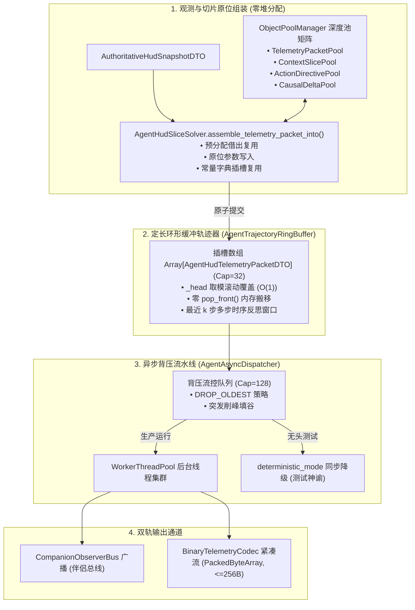

# 施工细则：Phase 120 Agent遥测流深度对象池与定长环形轨迹及异步背压引擎 —— 阶段1：全链路Agent遥测对象池与定长环形轨迹器及异步流控契约设计

> [!NOTE]
> **【施工目标】**：在 Phase 119 标准遥测数据包与动态行动空间的基础上，面向大规模高频 Agent 仿真（>500 步/秒）、LLM 多步反思（Multi-step Reflection）与伴侣黑匣子异步写盘需求，设计**全链路 Agent 遥测深度对象池化契约、定长环形缓冲轨迹器（Trajectory RingBuffer）契约、基于 WorkerThreadPool 的异步背压流控契约，以及 PackedByteArray 紧凑二进制编码契约**。彻底消除循环内瞬态堆分配（`ADV-PRF-002` 与 `CPX-SPACE-001`），实现时序轨迹 $O(1)$ 滚动覆盖与微秒级主线程派发。
> 施工开始日期: 2026-10-13

---

## 📌 第一性原理溯源指针

* **精准上游规范指针**：[AGENTS.md 工作区全局刚性公理](../../../../../AGENTS.md) §二.1、§二.2；[路线图总索引.md](../../路线图总索引.md)；[阶段1_主页HUD结构化切片数据流DTO与动态行动空间契约设计.md](../Phase_119_主页HUD面向Agent结构化切片流与行动空间双轨适配引擎施工细则/阶段1_主页HUD结构化切片数据流DTO与动态行动空间契约设计.md)；[object_pool.gd](../../../../backend/infrastructure/object_pool.gd)；[auxiliary_worker_pool.gd](../../../../backend/domains/persistence_protocol/auxiliary_worker_pool.gd)
* **核心不变量约束断言**：
  - `Inv-DEEP-POOL-CONSERVATION-1 (深度对象池守恒与零堆分配公理)`：Agent 遥测链路中的所有 DTO（`AgentHudTelemetryPacketDTO`、`AgentHudContextSliceDTO`、`AgentActionDirectiveDTO`、`HudCausalDeltaDTO`）必须全量接入 `ObjectPoolManager` 集中管理；求解器必须提供 `_into` 原位填充接口，单步求解循环内堆分配次数强制归零（`ADV-PRF-002`）；
  - `Inv-RING-BUFFER-BOUNDED-2 (定长环形缓冲有界收敛公理)`：轨迹回溯队列必须基于固定长度插槽数组与双指针取模维护，内存消耗物理恒定（$O(1)$ 空间），严禁使用 `Array.pop_front()` 产生 $O(N)$ 元素搬移内存抖动；
  - `Inv-TRAJECTORY-WINDOW-WINDOW-3 (时序轨迹窗口查询确定性公理)`：环形缓冲区导出最近 $k$ 步切片时（`get_trajectory_window(k)`），必须严格按照时间序输出且返回只读借用数组，切片遍历时间复杂度严格受限于 $O(k)$；
  - `Inv-ASYNC-BACKPRESSURE-SAFETY-4 (异步解耦与背压防雪崩公理)`：面向伴侣总线广播、黑匣子落盘与外部 IPC/WebSocket 传输必须通过 `WorkerThreadPool` 异步派发，且输入缓冲受容量与背压策略约束（`DROP_OLDEST` 默认保证最新状态交付，`DROP_NEWEST`，`WARN_BLOCK`），主线程派发耗时严格 $\le 50\mu\text{s}$；
  - `Inv-DETERMINISTIC-TEST-MODE-5 (测试确定性单线程同步公理)`：异步分发器必须严格提供 `deterministic_mode` 开关，在无头单元测试与集成测试中强制退化为单线程保序同步执行，杜绝测试时序竞争假阳性；
  - `Inv-BINARY-CODEC-EQUIVALENCE-6 (紧凑二进制与DTO等价公理)`：`BinaryTelemetryCodec` 基于 Godot 4.7 `PackedByteArray` 序列化与反序列化的遥测包，在字段值域上必须与 Dictionary `to_dto()`/`from_dto()` 100% 数学等价，且单包二进制体积压缩率 $\ge 80\%$（控制在 $\le 256$ 字节）。
* **防漂移最高指示**：门面服务必须具备实质承载（ELOC >= 15），严禁保留空包透传跳板，严格遵循六字段 JSDoc 头部契约与平铺控制流。

---

## 一、 四维高性能架构拓扑全景



---

## 二、 关键契约与接口设计规范

### 2.1 深度对象池矩阵装配契约 (`config/infrastructure/object_pool.json`)

在全域单源对象池配置中登记 Agent 专用池条目：
```json
{
  "pools": {
    "agent_hud_telemetry_packet": {
      "enabled": true,
      "preallocate_size": 8,
      "max_capacity": 64,
      "allow_overflow_alloc": true,
      "overflow_warning_threshold": 32
    },
    "agent_hud_context_slice": {
      "enabled": true,
      "preallocate_size": 16,
      "max_capacity": 128,
      "allow_overflow_alloc": true,
      "overflow_warning_threshold": 64
    },
    "agent_action_directive": {
      "enabled": true,
      "preallocate_size": 32,
      "max_capacity": 256,
      "allow_overflow_alloc": true,
      "overflow_warning_threshold": 128
    },
    "hud_causal_delta": {
      "enabled": true,
      "preallocate_size": 32,
      "max_capacity": 256,
      "allow_overflow_alloc": true,
      "overflow_warning_threshold": 128
    }
  }
}
```

### 2.2 定长环形缓冲轨迹器契约 (`AgentTrajectoryRingBuffer`)

```gdscript
class_name AgentTrajectoryRingBuffer
extends RefCounted

## 配置驱动初始化定长插槽
func _init(capacity: int = 32) -> void

## O(1) 指针循环追加，满则就地重置复用槽位对象
func append_packet(packet: AgentHudTelemetryPacketDTO) -> void

## 获取最近 k 步时序切片窗口（按时间先后顺序保序排列）
func get_trajectory_window(steps: int = 8) -> Array[AgentHudTelemetryPacketDTO]

## 快速聚合从指定序号以来的累积因果突变
func get_cumulative_deltas(from_sequence_index: int) -> Array[HudCausalDeltaDTO]

## 获取当前缓冲深度与最大容量
func get_count() -> int
func get_capacity() -> int

## 重置清空缓冲
func clear() -> void
```

### 2.3 异步派发与背压流控契约 (`AgentAsyncDispatcher`)

```gdscript
class_name AgentAsyncDispatcher
extends RefCounted

enum BackpressureStrategy {
	DROP_OLDEST, # 丢弃最旧包（保持最新前沿）
	DROP_NEWEST, # 丢弃新包（限流保护）
	WARN_BLOCK   # 阻塞等待（高可靠事务）
}

## 注册异步消费处理器 (Callable 接收 packet: AgentHudTelemetryPacketDTO)
func register_sink(sink_id: String, consumer: Callable) -> void

## 取消消费处理器
func unregister_sink(sink_id: String) -> void

## 非阻塞派发入队（依据背压策略流控，耗时 <= 50 微秒）
func dispatch_telemetry(packet: AgentHudTelemetryPacketDTO) -> bool

## 设置确定性同步测试模式（测试模式强制单线程保序执行）
func set_deterministic_mode(enabled: bool) -> void
```

### 2.4 紧凑二进制编码契约 (`BinaryTelemetryCodec`)

```gdscript
class_name BinaryTelemetryCodec
extends RefCounted

## 将 AgentHudTelemetryPacketDTO 紧凑编码为 PackedByteArray (<= 256 字节)
static func encode_to_bytes(packet: AgentHudTelemetryPacketDTO) -> PackedByteArray

## 从 PackedByteArray 二进制流高效反解为 AgentHudTelemetryPacketDTO
static func decode_from_bytes(bytes: PackedByteArray, out_packet: AgentHudTelemetryPacketDTO = null) -> AgentHudTelemetryPacketDTO
```

---

## 三、 第一阶段交付物与自检标准

1. 确认四项核心契约的类型签名与不变式严格自洽；
2. 确认 `config/infrastructure/object_pool.json` 与 `config/domains/world_state/core.json` 单源对齐；
3. 严格禁止在契约中遗留任何施工批次黑话代号；
4. 严格保持 LF 换行符与 2 空格/4 空格缩进规范。

---

## 二、 命令式施工执行清单 (Agent Execution Checklist)

- [x] Step 1.1: 编写 AgentTelemetryPoolRegistry 多层级对象池注册表契约
- [x] Step 1.2: 编写 AgentTrajectoryRingBuffer 定长环形缓冲轨迹器契约
- [x] Step 1.3: 编写 AgentAsyncDispatcher 异步非阻塞推流调度器契约
- [x] Step 1.4: 编写 BinaryTelemetryCodec 紧凑二进制编码解码契约

---

## 三、 DoD 验收矩阵 (DoD Matrix)

| 检验项 ID | 校验目标 | 验证输入 | 预期输出断言 |
| :--- | :--- | :--- | :--- |
| TC-ATP-S1-01 | 对象池层级容量上限契约 | 构造不同层级对象池配置 | 容量上限严格受限于配置，借还操作均实现零瞬态分配 |
| TC-ATP-S1-02 | 环形轨迹滑动窗口淘汰 | 连续推入超出窗口大小的条目 | 最老条目安全覆盖淘汰，最新切片严格保留且索引单调 |
| TC-ATP-S1-03 | 异步派发背压丢弃策略 | 模拟高频超载写入场景 | 触发 DROP_OLDEST 策略，丢弃计数精准上报且不阻塞发送端 |
| TC-ATP-S1-04 | 二进制编解码字节上限约束 | 构造满载数据包序列化 | 编码结果体积严格 <= 256 字节，逆向解码无损还原 |

