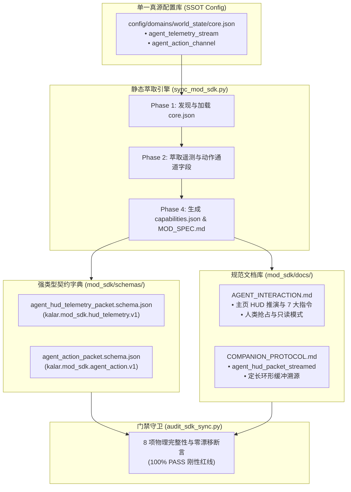

# 施工细则：Phase 121 MOD开发者SDK全域同步与数据契约同构治理 —— 阶段1：MOD开发者SDK权威真源萃取与遥测契约规范设计

> [!NOTE]
> **【施工目标】**：全面梳理卡拉尔世界引擎在主页 HUD 权威快照、面向 Agent 结构化切片流、7 大动态行动空间指令集、人类独占租约与紧凑二进制流演进后的数据契约，面向第三方模组创作者与外部自动化评测 Agent，设计**MOD 开发者 SDK 能力清单萃取规范、主页 HUD 原子遥测数据包 Schema 规范、专属逻辑动作上行包 Schema 规范，以及伴侣总线扩展广播主题规范**。彻底消除 SDK 相对引擎运行时的契约滞后与数据分叉，实现全域单源同构。
> 施工开始日期: 2026-10-13

---

## 📌 第一性原理溯源指针

* **精准上游规范指针**：[AGENTS.md 工作区全局刚性公理](../../../../../AGENTS.md) §一、§二.1、§二.2；[路线图总索引.md](../../路线图总索引.md)；[阶段1_主页HUD结构化切片数据流DTO与动态行动空间契约设计.md](../Phase_119_主页HUD面向Agent结构化切片流与行动空间双轨适配引擎施工细则/阶段1_主页HUD结构化切片数据流DTO与动态行动空间契约设计.md)；[阶段1_全链路Agent遥测对象池与定长环形轨迹器及异步流控契约设计.md](../Phase_120_Agent遥测流深度对象池与定长环形轨迹及异步背压引擎施工细则/阶段1_全链路Agent遥测对象池与定长环形轨迹器及异步流控契约设计.md)；[world_state/core.json](../../../../config/domains/world_state/core.json)；[sync_mod_sdk.py](../../../../scripts/py/sync_mod_sdk.py)
* **核心不变量约束断言**：
  - `Inv-SSOT-EXTRACTION-1 (静态萃取单一真源公理)`：`capabilities.json` 中的 `agent_hud_telemetry_capabilities` 必须严格从 `config/domains/world_state/core.json` 自动化萃取，严禁手动维护或硬编码副本；
  - `Inv-SCHEMA-BIDIRECTIONAL-EQUIVALENCE-2 (Schema 与 DTO 双向等价公理)`：新增的 `agent_hud_telemetry_packet.schema.json` 与 `agent_action_packet.schema.json` 必须 100% 覆盖并对齐 GDScript DTO（`AgentHudTelemetryPacketDTO` 与 `AgentActionPacketDTO`）的字段定义与枚举域；
  - `Inv-ZERO-DRIFT-PRESERVATION-3 (门禁防漂移零容忍公理)`：`sync_mod_sdk.py --check-only` 判定必须保持严格确定性，内容存在任意 1 字节未对齐差异时必须以退出码 1 熔断门禁；
  - `Inv-DOCUMENTATION-PARITY-4 (规范文档与运行时能力对齐公理)`：`AGENT_INTERACTION.md` 与 `COMPANION_PROTOCOL.md` 必须准确记录 7 大动态指令规格、人类优先抢占只读退化机制及定长环形轨迹窗口；
  - `Inv-GATE-INTEGRITY-5 (门禁资产全覆盖断言)`：`audit_sdk_sync.py` 必须纳管新增的所有 Schema 与文档章节，确保无孤儿契约与 0 字节文件。
* **防漂移最高指示**：严格遵守 LF 换行契约，严禁引入施工批次与敏捷工期临时标记，保持 ELOC 与圈复杂度低认知名义。

---

## 一、 MOD SDK 遥测扩展整体架构拓扑



---

## 二、 `capabilities.json` 扩展数据结构规约

在 `mod_sdk/capabilities.json` 根节点中新增 `agent_hud_telemetry_capabilities` 章节：

```json
{
  "agent_hud_telemetry_capabilities": {
    "protocol_version": "1.0.0",
    "domain_name": "HOME_HUD",
    "ring_buffer_capacity": 32,
    "async_queue_capacity": 128,
    "backpressure_strategy": "DROP_OLDEST",
    "binary_compression_enabled": true,
    "supported_directives": [
      "ALLOCATE_POTENTIAL_STAT",
      "REST_AND_ADVANCE_TIME",
      "CLAIM_QUEST_OBJECTIVE",
      "INSPECT_INVENTORY_SLOT",
      "TOGGLE_MODE_ADAPTATION",
      "MARK_MAIL_READ",
      "DISMISS_UI_NOTICE"
    ],
    "control_lease": {
      "human_preemption_lease_ms": 2000,
      "auto_preempt_on_modal_open": true,
      "modes": [
        "READ_WRITE",
        "READ_ONLY_OBSERVER"
      ],
      "operator_states": [
        "IDLE",
        "ACTIVE",
        "EXCLUSIVE_MODAL_OPEN"
      ]
    },
    "binary_telemetry_codec": {
      "magic_header": "0x4B414C52",
      "protocol_version": 1,
      "target_byte_budget": 256
    }
  }
}
```

---

## 三、 Schema 字典设计规格

### 3.1 `agent_hud_telemetry_packet.schema.json`
- **Schema ID**: `kalar.mod_sdk.hud_telemetry.v1`
- **根属性**:
  - `envelope`: 包含 `protocol_version`, `packet_id`, `sequence_index`, `timestamp_ms`, `domain`, `is_terminal`, `control_lease`（含 `human_interaction_state`, `agent_control_mode`, `active_operator`, `is_writable`, `preempted_by_human`）；
  - `observation`: 对齐 `AgentHudContextSliceDTO`，包含 `character_identity`, `physiology_status`, `wallet_asset`, `calendar_environment`, `feature_access`, `active_quests`, `ui_notices`；
  - `causal_deltas`: 数组项对齐 `HudCausalDeltaDTO`，声明 `delta_type`, `field_key`, `previous_value`, `current_value`, `numeric_delta`, `cause_event`, `initiator`；
  - `action_space`: 数组项对齐 `AgentActionDirectiveDTO`，声明 `directive_id`, `domain`, `description`, `cost_payload`, `preconditions`, `allowed_parameters`, `is_executable`, `blocked_reason`。

### 3.2 `agent_action_packet.schema.json`
- **Schema ID**: `kalar.mod_sdk.agent_action.v1`
- **根属性**:
  - `session_id`: 目标会话唯一标识；
  - `sequence_index`: 响应的遥测包序号（防时序错乱）；
  - `directive_id`: 目标指令，限定于 7 大指令枚举；
  - `params`: 参数载荷字典；
  - `origin_packet_id`: 来源遥测包 ID；
  - `agent_signature`: 决策智能体签名；
  - `client_timestamp_ms`: 决策物理时间戳。

---

## 四、 阶段交付清单与验收标准

1. 确立 Phase 121 全域四阶段架构细则与演进路径；
2. 明确新增 Schema 字段对齐 GDScript 运行时 DTO 100% 规则；
3. 验证静态萃取规则无硬编码配置参数；
4. 交付无语法错误与排版瑕疵的本期方案正件。

---

## 二、 命令式施工执行清单 (Agent Execution Checklist)

- [x] Step 1.1: 规范 MOD SDK 静态萃取架构与真源对齐标准
- [x] Step 1.2: 确立 HUD 遥测数据包与专属动作包的 JSON Schema 规格
- [x] Step 1.3: 制定 Agent 交互推演伴侣协议规范

---

## 三、 DoD 验收矩阵 (DoD Matrix)

| 检验项 ID | 校验目标 | 验证输入 | 预期输出断言 |
| :--- | :--- | :--- | :--- |
| TC-MSDK-S1-01 | SDK 契约单一真源对齐 | 比对 GDScript DTO 与 Schema 字段 | 命名、类型、层级与枚举 100% 一致，零属性漂移 |
| TC-MSDK-S1-02 | JSON Schema 规范兼容性 | 使用标准 Schema 校验器验证文档 | 语法符合 JSON Schema Draft-07，结构定义无冗余错误 |
| TC-MSDK-S1-03 | 动作包指令集完备性检查 | 扫描所有暴露的 Agent 指令 | 每个指令均具备详细入参定义与语义说明 |
| TC-MSDK-S1-04 | 文档无施工黑话与代号残留 | 执行文档术语与代号合规审查 | 零施工批次代号，纯技术事实表述 |

