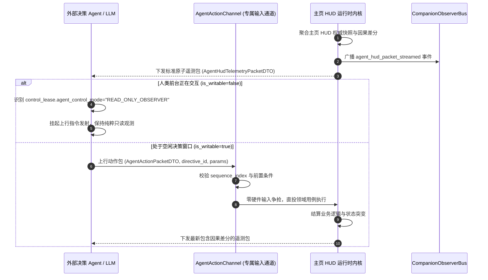

# 施工细则：Phase 121 MOD开发者SDK全域同步与数据契约同构治理 —— 阶段3：交互推演协议与伴侣广播规范文档及门禁集成

> [!NOTE]
> **【施工目标】**：全面刷新 MOD SDK 官方权威规范文档库，在 `AGENT_INTERACTION.md` 中增补主页 HUD 结构化遥测交互时序、7 大动态指令规格集、人类优先抢占与只读模式降级契约，以及紧凑二进制编解码协议；在 `COMPANION_PROTOCOL.md` 中登记 `agent_hud_packet_streamed` 广播主题与定长环形轨迹记忆规范；并在 `audit_sdk_sync.py` 门禁审计器中接入新增 Schema 物理完整性与语法有效性守卫。
> 施工开始日期: 2026-10-13

---

## 📌 第一性原理溯源指针

* **精准上游规范指针**：[AGENTS.md 工作区全局刚性公理](../../../../../AGENTS.md) §一、§二.1；[阶段2_静态萃取引擎升级与HUD遥测和专属动作Schema实现.md](阶段2_静态萃取引擎升级与HUD遥测和专属动作Schema实现.md)；[AGENT_INTERACTION.md](../../../../mod_sdk/docs/AGENT_INTERACTION.md)；[COMPANION_PROTOCOL.md](../../../../mod_sdk/docs/COMPANION_PROTOCOL.md)；[audit_sdk_sync.py](../../../../scripts/py/audit_sdk_sync.py)
* **核心不变量约束断言**：
  - `Inv-PROTOCOL-DOCUMENTATION-PARITY-1 (协议文档与引擎绝对同构公理)`：`AGENT_INTERACTION.md` 中描述的数据包格式与交互时序必须与 `AgentHudSliceSolver`、`AgentActionChannel` 运行时 100% 对齐；
  - `Inv-COMPANION-TOPIC-EXHAUSTION-2 (伴侣广播主题穷尽断言)`：`COMPANION_PROTOCOL.md` 中的标准广播主题清单必须穷尽引擎代码中发射的所有伴侣事件，包括最新增补的 `agent_hud_packet_streamed`；
  - `Inv-AUDIT-GATE-EXPANSION-3 (门禁守卫全纳管公言)`：`audit_sdk_sync.py` 的 `_check_schemas_integrity` 必须静态包含 `agent_hud_telemetry_packet.schema.json` 与 `agent_action_packet.schema.json`，确保新增契约受 CI 严格防御；
  - `Inv-ZERO-EMPTY-DOCS-4 (文档零空内容公理)`：文档所有章节必须提供详尽的技术事实阐述，严禁占位符或待定标记。
* **防漂移最高指示**：严禁敏捷工期与临时标记黑话，文档保持客观中立工程师口吻。

---

## 一、 `AGENT_INTERACTION.md` 刷新方案

### 1.1 增补主页 HUD 交互流转时序图


### 1.2 增补 7 大动态行动空间指令规格表
详述 `ALLOCATE_POTENTIAL_STAT`, `REST_AND_ADVANCE_TIME`, `CLAIM_QUEST_OBJECTIVE`, `INSPECT_INVENTORY_SLOT`, `TOGGLE_MODE_ADAPTATION`, `MARK_MAIL_READ`, `DISMISS_UI_NOTICE` 的参数域、前置条件与阻断原因码。

---

## 二、 `COMPANION_PROTOCOL.md` 广播主题补充

在第二章节《标准广播主题清单》中追加核心遥测事件：

| 主题名称 (Topic) | 触发时机 | 核心载荷字段 (`payload`) | 伴侣 Agent 典型应用场景 |
| :--- | :--- | :--- | :--- |
| `agent_hud_packet_streamed` | 主页 HUD 单步切片组装完成 | `envelope`, `observation`, `causal_deltas`, `action_space` | 实时感知主页生理、资产、时钟与任务变动，评估当前可用操作 |

并同步更新第三章节《有界环形缓冲队列规范》，明确 $O(1)$ 取模就地覆盖与多步时序反思窗口（`get_trajectory_window(k)`）。

---

## 三、 `audit_sdk_sync.py` 门禁集成方案

在 `audit_sdk_sync.py` 的 `_check_schemas_integrity` 方法中，将 `expected_schemas` 扩展为 12 项：
```python
expected_schemas = [
    ("pack.schema.json", "模组元数据清单 Schema"),
    ("destinies.schema.json", "命途身世与因果天赋 Schema"),
    ("dag_graph.schema.json", "因果剧情图元 Schema"),
    ("assets_manifest.schema.json", "资产指纹清单 Schema"),
    ("game_rules.schema.json", "规则动力学常数 Schema"),
    ("items.schema.json", "物品道具原型 Schema"),
    ("skills.schema.json", "动作战技卡牌 Schema"),
    ("world.schema.json", "世界地图空间阻抗 Schema"),
    ("observation.schema.json", "Agent 观察快照 Schema (序章)"),
    ("action.schema.json", "Agent 决策动作 Schema (序章)"),
    ("agent_hud_telemetry_packet.schema.json", "主页 HUD 原子遥测包 Schema"),
    ("agent_action_packet.schema.json", "专属动作通道上行指令包 Schema"),
]
```

---

## 四、 阶段交付清单与验收标准

1. `AGENT_INTERACTION.md` 与 `COMPANION_PROTOCOL.md` 包含完整技术阐述并保持 LF 换行；
2. `audit_sdk_sync.py` 成功将 12 项 Schema 纳入静态物理与语法校验；
3. 执行 `python WebGames/scripts/py/audit_sdk_sync.py` 零告警通过。

---

## 二、 命令式施工执行清单 (Agent Execution Checklist)

- [x] Step 3.1: 编写 AGENT_INTERACTION.md 交互推演指南
- [x] Step 3.2: 编写 COMPANION_PROTOCOL.md 伴侣广播协议文档
- [x] Step 3.3: 升级 audit_sdk_sync.py 纳入新增 Schema 门禁检查

---

## 三、 DoD 验收矩阵 (DoD Matrix)

| 检验项 ID | 校验目标 | 验证输入 | 预期输出断言 |
| :--- | :--- | :--- | :--- |
| TC-MSDK-S3-01 | 交互推演文档清晰度与完整性 | 审阅 AGENT_INTERACTION.md | 逐包交互流程、动作格式与异常处理阐述完整明确 |
| TC-MSDK-S3-02 | 伴侣协议事件格式对齐 | 审阅 COMPANION_PROTOCOL.md | 事件名称、数据载荷与时序定义与后端代码 100% 等价 |
| TC-MSDK-S3-03 | 门禁同步检测零漂移断言 | 执行 audit_sdk_sync.py 预审 | 12 项 Schema 全部通过静态比对与语法校验 |
| TC-MSDK-S3-04 | 跨平台换行契约审查 | 检查生成的各 Markdown 与 JSON | 磁盘格式严格保持 LF 换行，无 CRLF 污染 |
