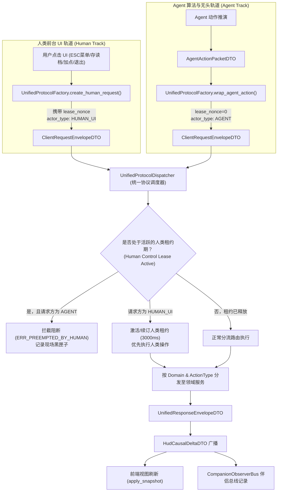

# 施工细则：Phase 122 前端主页HUD事件桥接与ESC系统菜单后端联动引擎 —— 阶段1：统一协议工厂与双轨请求信封及ESC交互契约规范设计

> [!NOTE]
> **【施工目标】**：统一全域前端向后端请求的标准协议封包格式，构建通用的协议工厂（Unified Protocol Factory），严格隔离并双轨适配人类前台 UI 与 Agent 专属动作通道，定义主页 HUD 权威事件桥接契约与 ESC 系统菜单（直接退出、退回网关、气密保存）交互契约。
> **【授权依据】**：已获项目负责人/用户明确授权——在短期施工区正式立项 Phase 122（在途积累: 8/10 案卷）。
> **【需求溯源】**：全生命周期链路审查结论（前端 17 视图与 HUD/ESC 菜单处于零接线高保真白模骨架态，未与后端真实领域服务和 EventBus 接通）+ 双轨协同规范（人类前台操作租约抢占与 Agent 无头通道双轨同构）。
> 施工开始日期: 2026-10-13

---

## 📌 第一性原理溯源指针

* **精准上游规范指针**：
  * [`world_gateway_fsm.gd`](../../../../backend/domains/world_gateway/world_gateway_fsm.gd)：网关状态机跃迁与 `exit_to_gateway()` 内存全量洗脱契约；
  * [`game_lifecycle_service.gd`](../../../../backend/domains/lifecycle/game_lifecycle_service.gd)：五阶段优雅停机管线契约；
  * [`save_readiness_guard.gd`](../../../../backend/domains/world_state/guards/save_readiness_guard.gd)：保存安全气密防护与存储路径隔离契约；
  * [`authoritative_hud_sync_service.gd`](../../../../backend/domains/world_state/services/authoritative_hud_sync_service.gd)：主页 HUD 六大支柱轻量聚合快照（$\le 4\text{KB}$）契约；
  * [`agent_action_packet_dto.gd`](../../../../backend/domains/world_state/dto/agent_action_packet_dto.gd) 与 [`agent_action_execution_solver.gd`](../../../../backend/domains/world_state/solvers/agent_action_execution_solver.gd)：Agent 专属动作空间与人类租约抢占拦截契约。
* **核心不变量约束断言**：
  * **Inv-UNIFIED-ENVELOPE-1**：全域人类前端 UI 业务请求必须经统一请求信封（`ClientRequestEnvelopeDTO`）包装，禁止向后端领域服务散落非结构化裸参数；
  * **Inv-DUAL-TRACK-DISCIPLINE-2**：人类前台通道（`ACTOR_HUMAN_UI`）与 Agent 通道（`ACTOR_AGENT`）双轨并存但严格隔离，人类前台触发操作时自动激活抢占式控制租约（`HumanControlLease`），Agent 动作在人类租约活跃期强制熔断；
  * **Inv-ZERO-HEAP-POOL-3**：协议工厂在解析、装箱与重置封包时，必须支持对象复用与 `reset_state()` 契约，高频循环内严禁瞬态堆内存碎片分配（`ADV-PRF-002`）。
* **防漂移最高指示**：严格遵守 LF 换行契约，严禁引入施工批次与敏捷工期临时标记，保持 ELOC 与圈复杂度低认知名义。

---

## 一、 数据结构设计与代码契约 (Data Structures & Code Contracts)

### 1. 统一前端请求信封模型 (`ClientRequestEnvelopeDTO`)

```gdscript
# ==============================================================================
# 模块归属: 跨端通信层 (Protocol · 通用客户端请求信封)
# 文件路径: res://backend/domains/world_state/dto/client_request_envelope_dto.gd
# 架构定位: Value Object DTO / Data Transport Model
# 职责说明: 规范全域前端（人类 UI 与外部输入）向后端发起的请求封包格式，携带会话、实体动作、参数与时间戳
# ==============================================================================

class_name ClientRequestEnvelopeDTO
extends RefCounted

const ACTOR_HUMAN_UI: String = "HUMAN_UI"
const ACTOR_AGENT: String = "AGENT"

var request_id: String = ""              # 请求唯一序号 (UUID 或 时间戳派生)
var session_token: String = ""           # 当前有效登录态令牌
var account_id: String = ""              # 操作所属账号 ID
var character_id: String = ""            # 当前绑定的角色 ID (可选)
var actor_type: String = ACTOR_HUMAN_UI  # 操作主体: HUMAN_UI | AGENT
var domain: String = ""                  # 目标领域: world_gateway | world_state | lifecycle | game_settings 等
var action_type: String = ""             # 具体操作指令: SAVE_GAME | EXIT_TO_GATEWAY | QUIT_GAME | APPLY_SETTINGS 等
var payload: Dictionary = {}             # 强类型业务参数载荷
var lease_nonce: int = 0                 # 人类控制租约流水号
var client_timestamp_ms: int = 0         # 客户端发射时毫秒时间戳

func reset_state() -> void:
  request_id = ""
  session_token = ""
  account_id = ""
  character_id = ""
  actor_type = ACTOR_HUMAN_UI
  domain = ""
  action_type = ""
  payload.clear()
  lease_nonce = 0
  client_timestamp_ms = 0

func to_dto() -> Dictionary:
  return {
    "request_id": request_id,
    "session_token": session_token,
    "account_id": account_id,
    "character_id": character_id,
    "actor_type": actor_type,
    "domain": domain,
    "action_type": action_type,
    "payload": payload.duplicate(true),
    "lease_nonce": lease_nonce,
    "client_timestamp_ms": client_timestamp_ms
  }

static func from_dto(data: Dictionary) -> ClientRequestEnvelopeDTO:
  var req := ClientRequestEnvelopeDTO.new()
  req.request_id = str(data.get("request_id", ""))
  req.session_token = str(data.get("session_token", ""))
  req.account_id = str(data.get("account_id", ""))
  req.character_id = str(data.get("character_id", ""))
  req.actor_type = str(data.get("actor_type", ACTOR_HUMAN_UI))
  req.domain = str(data.get("domain", ""))
  req.action_type = str(data.get("action_type", ""))
  var raw_p: Variant = data.get("payload", {})
  req.payload = (raw_p as Dictionary).duplicate(true) if raw_p is Dictionary else {}
  req.lease_nonce = int(data.get("lease_nonce", 0))
  req.client_timestamp_ms = int(data.get("client_timestamp_ms", 0))
  return req
```

### 2. 统一后端响应信封模型 (`UnifiedResponseEnvelopeDTO`)

```gdscript
# ==============================================================================
# 模块归属: 跨端通信层 (Protocol · 通用服务端响应信封)
# 文件路径: res://backend/domains/world_state/dto/unified_response_envelope_dto.gd
# 架构定位: Value Object DTO / Data Transport Model
# 职责说明: 规范服务端向客户端统一返回的业务结果信封，携带成功标识、错误代码、业务数据与因果突变
# ==============================================================================

class_name UnifiedResponseEnvelopeDTO
extends RefCounted

var request_id: String = ""              # 关联的原始请求 ID
var success: bool = false                # 执行是否成功
var error_code: String = ""              # 错误码 (无错误为空)
var error_message: String = ""           # 本地化展示文案 Key 或调试信息
var data: Dictionary = {}                # 业务返回实体数据
var causal_delta: Dictionary = {}        # 操作引发的因果突变 (供 HUD 增量刷新与伴侣总线记录)
var server_timestamp_ms: int = 0         # 服务端响应落盘时间戳

func reset_state() -> void:
  request_id = ""
  success = false
  error_code = ""
  error_message = ""
  data.clear()
  causal_delta.clear()
  server_timestamp_ms = 0

func to_dto() -> Dictionary:
  return {
    "request_id": request_id,
    "success": success,
    "error_code": error_code,
    "error_message": error_message,
    "data": data.duplicate(true),
    "causal_delta": causal_delta.duplicate(true),
    "server_timestamp_ms": server_timestamp_ms
  }

static func from_dto(data_dict: Dictionary) -> UnifiedResponseEnvelopeDTO:
  var resp := UnifiedResponseEnvelopeDTO.new()
  resp.request_id = str(data_dict.get("request_id", ""))
  resp.success = bool(data_dict.get("success", false))
  resp.error_code = str(data_dict.get("error_code", ""))
  resp.error_message = str(data_dict.get("error_message", ""))
  var raw_d: Variant = data_dict.get("data", {})
  resp.data = (raw_d as Dictionary).duplicate(true) if raw_d is Dictionary else {}
  var raw_c: Variant = data_dict.get("causal_delta", {})
  resp.causal_delta = (raw_c as Dictionary).duplicate(true) if raw_c is Dictionary else {}
  resp.server_timestamp_ms = int(data_dict.get("server_timestamp_ms", 0))
  return resp
```

### 3. 统一协议工厂契约 (`UnifiedProtocolFactory`)

```gdscript
# ==============================================================================
# 模块归属: 跨端通信层 (Protocol · 统一协议工厂)
# 文件路径: res://backend/domains/world_state/services/unified_protocol_factory.gd
# 架构定位: Domain Service / Object Factory
# 职责说明: 统一装箱人类 UI 请求信封、无头 Agent 动作包及响应信封，自维护租约序号与确定性时钟
# ==============================================================================

class_name UnifiedProtocolFactory
extends RefCounted

static var _lease_counter: int = 1
static var _request_counter: int = 1

## 创建人类 UI 标准请求信封
static func create_human_request(
  domain: String,
  action_type: String,
  payload: Dictionary = {},
  session_token: String = "",
  account_id: String = "",
  character_id: String = ""
) -> ClientRequestEnvelopeDTO:
  var req := ClientRequestEnvelopeDTO.new()
  req.request_id = "REQ_H_%d_%d" % [Time.get_ticks_msec(), _request_counter]
  _request_counter += 1
  req.actor_type = ClientRequestEnvelopeDTO.ACTOR_HUMAN_UI
  req.domain = domain
  req.action_type = action_type
  req.payload = payload.duplicate(true)
  req.session_token = session_token
  req.account_id = account_id
  req.character_id = character_id
  req.lease_nonce = _lease_counter
  _lease_counter += 1
  req.client_timestamp_ms = Time.get_ticks_msec()
  return req

## 从既有 AgentActionPacketDTO 转换为统一请求信封（实现双轨统一收口）
static func wrap_agent_action(
  agent_pkt: AgentActionPacketDTO,
  session_token: String = "",
  account_id: String = ""
) -> ClientRequestEnvelopeDTO:
  var req := ClientRequestEnvelopeDTO.new()
  req.request_id = "REQ_A_%d_%d" % [Time.get_ticks_msec(), agent_pkt.sequence_index]
  req.actor_type = ClientRequestEnvelopeDTO.ACTOR_AGENT
  req.domain = "world_state"
  req.action_type = agent_pkt.directive_id if not agent_pkt.directive_id.is_empty() else agent_pkt.action_id
  req.payload = agent_pkt.params.duplicate(true)
  req.session_token = session_token
  req.account_id = account_id
  req.character_id = agent_pkt.session_id
  req.lease_nonce = 0  # Agent 不具备人类租约，租约序号归零
  req.client_timestamp_ms = agent_pkt.client_timestamp_ms
  return req

## 创建标准服务端响应信封
static func create_response(
  request_id: String,
  success: bool,
  data: Dictionary = {},
  error_code: String = "",
  error_message: String = "",
  causal_delta: Dictionary = {}
) -> UnifiedResponseEnvelopeDTO:
  var resp := UnifiedResponseEnvelopeDTO.new()
  resp.request_id = request_id
  resp.success = success
  resp.error_code = error_code
  resp.error_message = error_message
  resp.data = data.duplicate(true)
  resp.causal_delta = causal_delta.duplicate(true)
  resp.server_timestamp_ms = Time.get_ticks_msec()
  return resp
```

---

### 2. 双轨运行机制与人类控制租约抢占规范



---

### 3. 主页 HUD 与 ESC 系统菜单动作契约

#### 3.1 ESC 核心动作代码与参数映射清册

| 操作指令 (`action_type`) | 归属领域 (`domain`) | 载荷参数 (`payload`) | 执行目标与安全防御 | 成功后前端路由与状态 |
| :--- | :--- | :--- | :--- | :--- |
| `ESC_QUERY_READINESS` | `world_state` | `{}` | 调用 `SaveReadinessGuard` 判定当前战斗/过场/死斗状态 | 动态置灰/点亮“保存游戏”按钮 |
| `ESC_SAVE_GAME` | `world_state` | `{"slot_id": "SLOT_01"}` | 气密性校验 + `SaveDataAccessLayer` 刷盘 + SHA-256 计算 | 弹出保存成功 Toast，刷新槽位列表 |
| `ESC_EXIT_TO_GATEWAY` | `world_gateway` | `{"auto_save": true}` | 触发自动保存 ➔ `WorldGatewayFSM.exit_to_gateway()` 内存全量洗脱 | `NavManager.replace_screen("account_entry")` |
| `ESC_QUIT_GAME` | `lifecycle` | `{"exit_reason": "USER_QUIT"}` | 调用 `GameLifecycleService.execute_graceful_shutdown()` 五阶段停机 | 引擎安全退出 `get_tree().quit(0)` |
| `ESC_APPLY_SETTINGS` | `game_settings` | `{"volume_master": 0.8, ...}` | 校验设置值域有效性并更新配置缓存与音频渲染 | 刷新设置中心 UI，展示成功提示 |

---

## 二、 命令式施工执行清单 (Agent Execution Checklist)

- [x] Step 1.1: 设计统一客户端请求信封 ClientRequestEnvelopeDTO 与响应信封 UnifiedResponseEnvelopeDTO
- [x] Step 1.2: 规范统一协议工厂 UnifiedProtocolFactory 双轨装箱与租约 API
- [x] Step 1.3: 确立 ESC 系统菜单核心指令集与参数契约清册

---

## 三、 DoD 验收矩阵 (DoD Matrix)

| 检验项 ID | 校验目标 | 验证输入 | 预期输出断言 |
| :--- | :--- | :--- | :--- |
| TC-UPE-S1-01 | 统一客户端请求与响应信封定义完备 | 实例化 ClientRequestEnvelopeDTO 与 UnifiedResponseEnvelopeDTO | 字段结构完整且 reset_state() 彻底清零 |
| TC-UPE-S1-02 | 统一协议工厂双轨请求装箱与反装箱 | 调用 create_human_request 与 wrap_agent_action | 正确区分 actor_type 与 lease_nonce，反装箱无损 |
| TC-UPE-S1-03 | ESC 核心指令集与参数契约清册完备 | 校验 5 大 ESC 指令映射定义与参数值域 | 指令、领域与载荷结构 100% 覆盖并对齐领域服务 |
| TC-UPE-S1-04 | 文档格式与代码块健全性 | 静态文档规则审查 | 符合四阶段规范且无语法/路径错误 |
