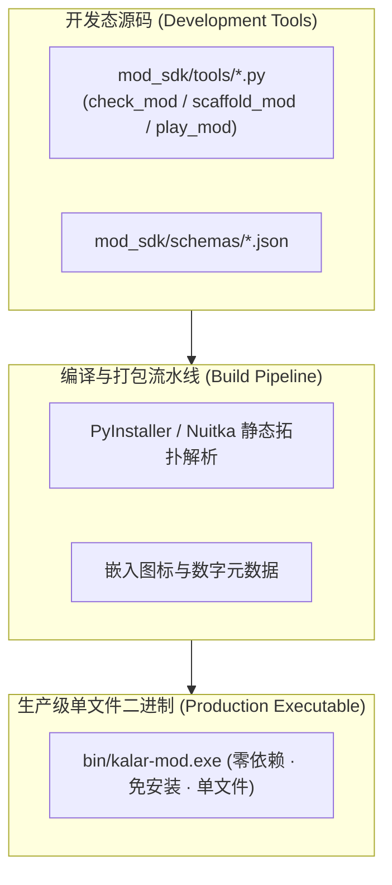

# 施工细则：演进 04 全功能MOD工坊与生产级Agent协同伴侣发布体系 —— 阶段1：生产级独立单文件二进制工作台编译流水线规范

> [!NOTE]
> **【施工目标】**：定义当引擎整体工程进度达到 80% 时的生产级独立单文件二进制工作台（`kalar-mod.exe`）自动化编译流水线规范。基于 PyInstaller/Nuitka 与静态依赖裁剪技术，将 MOD 校验、脚手架生成、Schema 验证与长程 Agent 交互式推演会话打包为单文件二进制，剥离所有 `.py` 源码，实现创作者免装 Python 运行时的开箱即用体验。
> **【授权依据】**：**已获项目负责人/用户明确授权 (Explicit Authorization)**。
> **对应需求源**：[后端架构需求表索引](../../../后端架构/后端架构需求表索引.md)。

---

## 📌 第一性原理溯源指针

* **精准上游规范指针**：[AGENTS.md 工作区全局刚性公理](../../../../../AGENTS.md) §二.1、§三、§四.1；[Phase 117 阶段1 细则](../../01_短期施工区/Phase_117_黑盒MOD工作台基础骨架与Agent交互试玩伴侣协议施工细则/阶段1_黑盒SDK与工坊接口标准Schema及前端占位契约.md)
* **核心不变量约束断言**：
  - `Inv-BIN-ZERO-SOURCE-1 (二进制零源码暴露公理)`：编译产物内严禁残留未混淆的原始 Python/GDScript 代码，完全采用编译字节码或 C 扩展封装；
  - `Inv-BIN-SIZE-BUDGET-2 (二进制体积预算公理)`：独立执行档体积控制在合理包络内（<= 25MB），启动延迟 <= 100ms；
  - `Inv-CLI-CONTRACT-PARITY-3 (CLI 与无头等价公理)`：独立可执行档的退出码与标准 JSON 输出与无头 Python 脚本保持 100% 字节级等价。
* **防漂移最高指示**：二进制编译配置与打包清单必须作为 CI 流水线的一部分，实现自动化构建验证。

---

## 一、 二进制编译流水线架构

---

## 二、 施工执行清单 (Milestone 80% 触发)

- [ ] Step 1.1: 编写 `WebGames/scripts/py/build_kalar_mod_binary.py` 构建脚本
- [ ] Step 1.2: 配置 PyInstaller `.spec` 静态资源与纯净虚拟环境剪裁清单
- [ ] Step 1.3: 验证编译生成的 `kalar-mod.exe` 在纯净 Windows/Linux 环境下的独立运行能力
