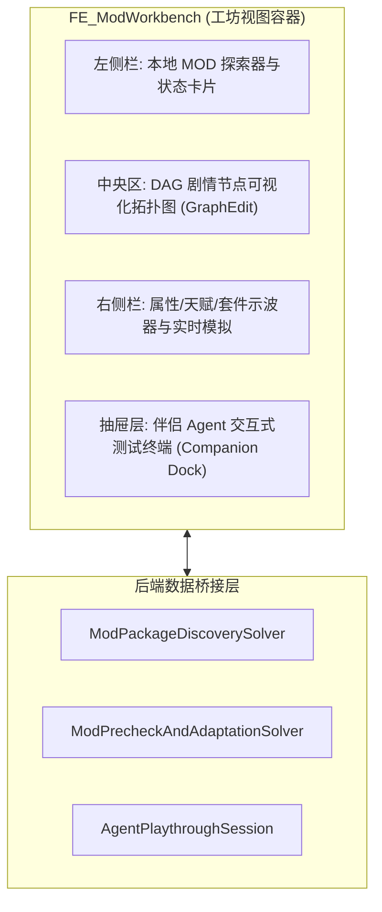

# 施工细则：演进 04 全功能MOD工坊与生产级Agent协同伴侣发布体系 —— 阶段2：全功能创作者工坊前端视图深度接线与交互架构

> [!NOTE]
> **【施工目标】**：定义当引擎整体工程进度达到 80% 时的游戏内全功能创作者工坊前端视图（`FE_ModWorkbench`）深度接线与交互架构。将 Phase 117 预留的轻量占位骨架演进为生产级 GUI，支持本地 MOD 图形化扫描与管理、序章 DAG 节点图可视化编辑与校验高亮、实时数值面板示波器、以及一键呼出伴侣 Agent 的全息试玩窗口。
> **【授权依据】**：**已获项目负责人/用户明确授权 (Explicit Authorization)**。
> **对应需求源**：[后端架构需求表索引](../../../后端架构/后端架构需求表索引.md)。

---

## 📌 第一性原理溯源指针

* **精准上游规范指针**：[AGENTS.md 工作区全局刚性公理](../../../../../AGENTS.md) §二.1、§三、§四.1；[Phase 117 阶段1 细则](../../01_短期施工区/Phase_117_黑盒MOD工作台基础骨架与Agent交互试玩伴侣协议施工细则/阶段1_黑盒SDK与工坊接口标准Schema及前端占位契约.md)
* **核心不变量约束断言**：
  - `Inv-GUI-DATA-DRIVEN-1 (视图纯渲染无业务逻辑公理)`：工坊视图严格遵循 MVC/MVP 解耦，所有校验数据与拓扑连通性必须通过后端求解器计算，视图仅通过 `apply_snapshot` 消费；
  - `Inv-GUI-ZERO-LEAK-2 (工坊视图生命周期零泄漏公理)`：退出创作者工坊返回游戏主界面时，必须彻底释放 DAG 节点图资源与预览纹理，内存完全洗脱。
* **防漂移最高指示**：严禁在视图脚本中直接读取磁盘未解析文件，必须统一经由后端 DTO 桥接。

---

## 一、 创作者工坊视图模块拓扑

---

## 二、 施工执行清单 (Milestone 80% 触发)

- [ ] Step 2.1: 实现 `frontend/systems/mod_workbench/` 全套表现层场景与视图控制器
- [ ] Step 2.2: 接入 GraphEdit 节点图渲染组件，实现与 `NarrativeDAGGraphDTO` 的双向映射
- [ ] Step 2.3: 实现工坊内的 Agent 单步试玩交互浮窗与黑匣子转储可视化展示
