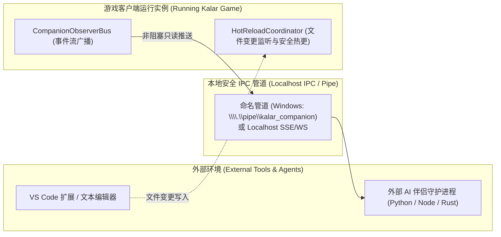

# 施工细则：演进 04 全功能MOD工坊与生产级Agent协同伴侣发布体系 —— 阶段3：跨进程IPC守护进程与现场热重载协同机制

> [!NOTE]
> **【施工目标】**：定义当引擎整体工程进度达到 80% 时的生产级跨进程 IPC 伴侣守护进程与现场热重载协同机制。通过本地高性能命名管道或 Localhost Unix Socket / WebSocket，实现正在运行的游戏客户端与外部 AI Agent、VS Code 扩展之间的双向低延迟长程通信。支持创作者在外部保存 MOD JSON 文件时游戏内无感热重载，并支持伴侣 Agent 远程嗅探异常。
> **【授权依据】**：**已获项目负责人/用户明确授权 (Explicit Authorization)**。
> **对应需求源**：[后端架构需求表索引](../../../后端架构/后端架构需求表索引.md)。

---

## 📌 第一性原理溯源指针

* **精准上游规范指针**：[AGENTS.md 工作区全局刚性公理](../../../../../AGENTS.md) §二.1、§三、§四.1；[Phase 117 阶段3 细则](../../01_短期施工区/Phase_117_黑盒MOD工作台基础骨架与Agent交互试玩伴侣协议施工细则/阶段3_非侵入式伴侣观察总线与现场黑匣子捕获引擎实现.md)
* **核心不变量约束断言**：
  - `Inv-IPC-SECURITY-BOUND-1 (本地安全边界公理)`：跨进程 IPC 严格限制监听在 `127.0.0.1` 本地回环或系统命名管道，严禁对外暴露公共网络端口，防止端口滥用与安全穿透；
  - `Inv-HOT-RELOAD-IDEMPOTENT-2 (热重载幂等洗脱公理)`：触发 MOD 热重载时，必须先原子校验新文件合法性；若存在语法错误保持旧状态运行，若校验通过则执行状态机内存就地置换。
* **防漂移最高指示**：IPC 消息格式必须严格遵从 Phase 117 的观察-行动 Schema，禁止引入不兼容的私有扩展字段。

---

## 一、 跨进程 IPC 守护协同拓扑

---

## 二、 施工执行清单 (Milestone 80% 触发)

- [ ] Step 3.1: 编写 `backend/infrastructure/companion_ipc_server.gd` 本地安全管道服务
- [ ] Step 3.2: 编写基于文件修改时间的原子热重载调度器 `mod_hot_reload_solver.gd`
- [ ] Step 3.3: 编写配套的 Node/Python 客户端 SDK 示例与 VS Code 扩展联动调试器
