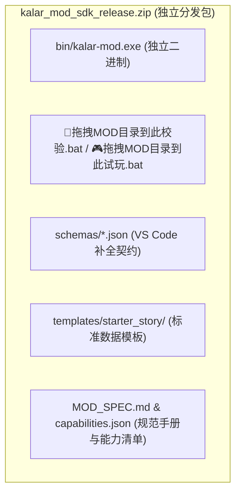

# 施工细则：演进 04 全功能MOD工坊与生产级Agent协同伴侣发布体系 —— 阶段4：跨平台分发包自动化构建与端到端发布验收矩阵

> [!NOTE]
> **【施工目标】**：定义当引擎整体工程进度达到 80% 时的生产级跨平台发布打包与端到端集成验收规范。在 `package.ps1` 与 CI 构建中集成 `-IncludeModSDK` 选项，全自动打包生成包含 `bin/kalar-mod.exe`、公开 Schema 字典、规范手册与标准模板的免安装创作者 SDK 发行包（`kalar_mod_sdk_release.zip`），并完成多操作系统实机端到端验收。
> **【授权依据】**：**已获项目负责人/用户明确授权 (Explicit Authorization)**。
> **对应需求源**：[后端架构需求表索引](../../../后端架构/后端架构需求表索引.md)。

---

## 📌 第一性原理溯源指针

* **精准上游规范指针**：[AGENTS.md 工作区全局刚性公理](../../../../../AGENTS.md) §二.1、§三、§四.1；[Phase 117 阶段4 细则](../../01_短期施工区/Phase_117_黑盒MOD工作台基础骨架与Agent交互试玩伴侣协议施工细则/阶段4_无头交互试玩与伴侣观察总线全链路验收矩阵.md)
* **核心不变量约束断言**：
  - `Inv-PACKAGE-SELF-CONTAINED-1 (分发包自包含公理)`：生成的 SDK 压缩包必须纯净自包含，目标机器无需预先安装 Python、Node 或 Git 即可一键运行并完成 MOD 全量校验；
  - `Inv-RELEASE-CHECKSUM-2 (发布签名与校验和公理)`：发布包产物必须自动生成 SHA-256 校验和并核对体积健康度，防止发布资产损坏。
* **防漂移最高指示**：严禁在生产发布包中遗留单元测试脚本或内部工程脚手架。

---

## 一、 发布物产物拓扑

---

## 二、 施工执行清单 (Milestone 80% 触发)

- [ ] Step 4.1: 在 `scripts/ps1/package.ps1` 与 `scripts/sh/package.sh` 中增加 `-IncludeModSDK` 构建开关
- [ ] Step 4.2: 编写发布产物物理卫生审查与防泄漏扫描脚本
- [ ] Step 4.3: 模拟全新纯净无开发环境虚拟机，验证一键解压、拖拽校验与 Agent 联动试玩 100% 成功

