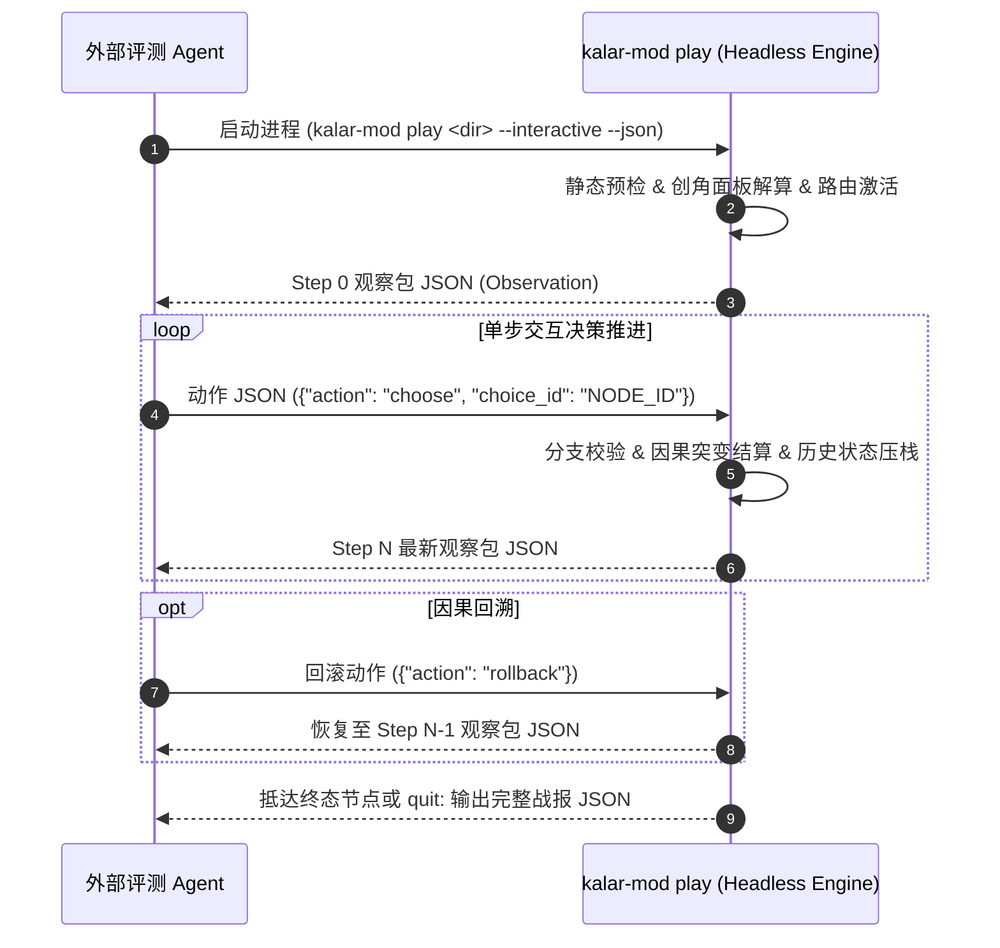

# 卡拉尔世界引擎 · 模组创作者数据契约速查指南 (MOD Quick-Reference Spec v1.2)

> [!NOTE]
> **【规范定位】**：本手册是面向模组开发者与自主推演 Agent 的根目录官方契约速查指南与真源索引总枢。所有动态能力清单均由底层单一真源自动化静态萃取同步，确保数据契约与引擎运行时保持 100% 绝对一致。
> 完整深入的架构设计、算法公式与协议明细，请直接查阅 [`docs/`](docs/) 对应权威规范卷。
> **引擎接口版本**：`1.0.0`

---

## 🧭 官方权威规范导航矩阵 (Documentation Index & Navigation Hub)

模组工程的核心架构与专题协议已按业务职责解耦至 `docs/` 目录，开发者可依序渐进查阅：

| 专题领域 | 权威规范文档指针 | 核心内容摘要 |
| :--- | :--- | :--- |
| **全景架构与装配** | [`docs/SPECIFICATION.md`](docs/SPECIFICATION.md) | 模组核心架构、Kahn 拓扑排序装配算法、多包冲突裁决公理与静态门禁错误码字典 |
| **视听多媒体准入** | [`docs/ART_AND_ASSETS_GUIDE.md`](docs/ART_AND_ASSETS_GUIDE.md) | Tier 2 视听资产烹饪规范、WebP/OGG/TTF 格式白名单、体积配额与 SHA-256 清单机制 |
| **规则大魔改覆写** | [`docs/TOTAL_CONVERSION_SPEC.md`](docs/TOTAL_CONVERSION_SPEC.md) | Tier 3 全局大魔改规范、世界地图空间阻抗、物品卡牌、战斗动力学公式与差分覆写语义 |
| **无头交互推演** | [`docs/AGENT_INTERACTION.md`](docs/AGENT_INTERACTION.md) | Agent 无头交互式推演协议、STDIO NDJSON 双向流式通信契约与 Observation-Action 状态机 |
| **现场遥测与伴侣** | [`docs/COMPANION_PROTOCOL.md`](docs/COMPANION_PROTOCOL.md) | 非侵入式伴侣观察总线、事件广播协议、会话遥测与现场黑匣子录制归档规范 |

---

## 🏛️ 模组分级架构体系速查 (Tier Hierarchy)

卡拉尔引擎将扩展包划分为三个自底向上兼容的架构级别：

1. **Tier 1: 纯逻辑与剧情命途包 (Logic & Narrative Pack)**
   - 聚焦叙事分支图元、出身背景、因果天赋守恒与本地化文案；
   - 纯静态声明式 JSON，体积极小（< 100KB），零多媒体依赖，热重载极速响应。
2. **Tier 2: 视听与艺术资产增强包 (Audiovisual & Assets Pack)**
   - 在 Tier 1 逻辑之上注入受控多媒体资产（立绘、场景纹理、UI 音效、背景音乐、字体与纯文本着色器）；
   - 包含 `assets/` 物理目录与 `assets_manifest.json`，受虚拟协议 `mod://<pack_id>/assets/...` 与严格体积配额保护。
3. **Tier 3: 全局大魔改规则包 (Total Conversion & Overhaul Pack)**
   - 包含 Tier 1 & Tier 2 完整能力，深度重构底层游戏世界观、地理空间阻抗、物品装备原型与战斗动力学常数；
   - 包含 `content/` 模块化目录，支持 `MERGE`、`REPLACE_ENTRY` 与 `TOTAL_PURGE` 声明式差分覆写。

---

## 一、 扩展包目录结构规范 (Package Layout & Topology)

合规模组物理上为一个独立目录（位于 `mods/<pack_id>/` 或 `user://mods/<pack_id>/`），标准布局如下：

```text
<pack_id>/
├── pack.json                   # 【必需】MOD 清单元数据与依赖描述文件
├── routing_rules.json          # 【必需】创角种族与出身到序章 DAG 的路由映射表
├── destinies.json              # 【推荐/可选】自定义身世、因果天赋、初始行囊与 UI 解锁策略
├── dag_graphs/                 # 【必需】剧情有向无环图配置目录
│   └── DAG_<NAME>.json         # 因果剧情图（单 START_ENTRY，至少 1 个 TERMINAL_EXIT）
├── i18n/                       # 【必需】剧情多语言本地化文案字典
│   └── zh-CN.json              # 包含白名单占位符的剧情文本
├── assets_manifest.json        # 【Tier 2/3 必需】多媒体资产清单与 SHA-256 校验指纹
├── assets/                     # 【Tier 2/3 可选】受控视听资源存储目录
│   ├── textures/               # 纹理与插画 (WebP / PNG)
│   ├── audio/                  # 音频与音效 (OGG / WAV)
│   ├── fonts/                  # 自定义字体 (TTF / WOFF2)
│   └── shaders/                # 纯文本着色器 (GDShader)
└── content/                    # 【Tier 3 专有】大魔改规则模块化数据目录
    ├── world/                  # 世界地图阻抗与空间拓扑
    ├── items/                  # 物品原型与装备数值
    ├── skills/                 # 动作战技与卡牌规则
    ├── entities/               # 怪物原型与 NPC 模板
    └── rules/                  # 动力学战斗常数与伤害公式
```

---

## 二、 MOD 清单元数据契约 (`pack.json`)

`pack.json` 描述 MOD 的基础身份与依赖拓扑，反序列化严格对齐 `NarrativePackManifestDTO`：

| 字段名称 | 类型 | 必需 | 默认值 | 约束说明与语义 |
| :--- | :---: | :---: | :--- | :--- |
| `pack_id` | String | 是 | - | 唯一标识符，全小写字母、数字与下划线（如 `mod_valan_origins`） |
| `pack_name` | String | 是 | - | 人类可读显示名称（如 `瓦兰边境起源包`） |
| `version` | String | 是 | - | 语义化版本号（如 `1.0.0`） |
| `author` | String | 否 | `"Unknown"` | 作者或制作组署名 |
| `engine_api_version` | String | 是 | `"1.0.0"` | 兼容的目标引擎 API 版本 |
| `tier` | String | 否 | `"TIER_1_LOGIC"` | 模组分级：`TIER_1_LOGIC`, `TIER_2_AUDIOVISUAL`, `TIER_3_OVERHAUL` |
| `priority` | int | 否 | `100` | 同拓扑层级内的加载优先级（数值越大越优先装配） |
| `dependencies` | Array[String] | 否 | `[]` | 必须前置加载的 MOD `pack_id` 列表 |
| `incompatible_packs` | Array[String] | 否 | `[]` | 互斥冲突 MOD 标识符黑名单 |
| `semantic_tags` | Array[String] | 否 | `[]` | 语义标签（如 `["prologue", "dark_fantasy"]`） |
| `is_active` | bool | 否 | `true` | 是否激活启用状态 |

---

## 三、 引擎能力真源契约 (Engine Capabilities)

<!-- AUTOGEN_CAPABILITIES_START -->
> [!IMPORTANT]
> **【引擎权威能力清单】**：当前兼容引擎 API 版本: `1.0.0`。本节由 `sync_mod_sdk.py` 静态萃取维护，禁止手动篡改。

### 1. 启用的种族清单 (Supported Races)

MOD 创作者角色与序章节点路由仅允许绑定下列已启用种族：

| 种族标识符 (Race ID) | 状态 | 规范语义 |
| :--- | :---: | :--- |
| `HUMAN` | 启用 (Active) | 卡拉尔世界核心创角与剧情支持种族 |

### 2. 合法 DAG 节点类型 (Valid DAG Node Types)

剧情图由下列四类节点拓扑连接，严禁使用非声明节点类型：

| 节点类型枚举 | 拓扑约束 | 语义与职责 |
| :--- | :--- | :--- |
| `START_ENTRY` | 入度必须为 0，单图仅允许 1 个 | 序章剧情唯一的起始入口节点 |
| `STANDARD_STEP` | 入度 >= 1，出度 >= 1 | 标准顺序执行剧情推进步骤 |
| `BRANCH_CHOICE` | 入度 >= 1，出度 >= 2 | 具有多分支交互选择或因果分流节点 |
| `TERMINAL_EXIT` | 出度必须为 0，允许触发完成突变 | 剧情图唯一的终结退出节点 |

### 3. 合法文本占位符字典 (Available Placeholders)

本地化文案模板（i18n）与节点内联文案（`inline_text`）支持大小写双轨插值（如 `{player_name}` 与 `{PLAYER_NAME}`）：

| 占位符宏 (Placeholder) | 解析源与说明 |
| :--- | :--- |
| `{PLAYER_NAME}` | 当前玩家角色的自定义名称（支持大小写双轨：{player_name} 与 {PLAYER_NAME}） |
| `{CHARACTER_NAME}` | 当前角色的名称标识，同 {PLAYER_NAME}（支持大小写双轨：{character_name} 与 {CHARACTER_NAME}） |
| `{CHARACTER_ID}` | 角色实例全局唯一标识符（支持大小写双轨：{character_id} 与 {CHARACTER_ID}） |
| `{RACE_ID}` | 角色所属种族唯一标识符，如 HUMAN（支持大小写双轨：{race_id} 与 {RACE_ID}） |
| `{GENDER}` | 角色性别标识，如 FEMALE / MALE（支持大小写双轨：{gender} 与 {GENDER}） |
| `{START_LOCATION}` | 角色出生与初始降临的地理场景标识或本地化名称（支持大小写双轨：{start_location} 与 {START_LOCATION}） |
| `{INITIAL_EQUIPMENT}` | 角色获得的初始佩剑或基础装备道具名称（支持大小写双轨：{initial_equipment} 与 {INITIAL_EQUIPMENT}） |
| `{NPC_TARGET}` | 对话交互或剧情引导的目标 NPC 实体名称（支持大小写双轨：{npc_target} 与 {NPC_TARGET}） |
| `{EVENT_RESULT}` | 前序节点或剧情事件的判定结果摘要（支持大小写双轨：{event_result} 与 {EVENT_RESULT}） |
| `{ORIGIN_ID}` | 角色选定或随机抽取的出身背景唯一标识符（支持大小写双轨：{origin_id} 与 {ORIGIN_ID}） |
| `{ORIGIN_NAME}` | 角色出身背景的人类可读显示名称（支持大小写双轨：{origin_name} 与 {ORIGIN_NAME}） |
| `{BIRTH_REGION}` | 角色出身关联的降临地域标识符（支持大小写双轨：{birth_region} 与 {BIRTH_REGION}） |
| `{TRAIT_SUMMARY}` | 角色装配的正负因果天赋组合摘要文本（支持大小写双轨：{trait_summary} 与 {TRAIT_SUMMARY}） |
| `{STARTER_KIT_NAME}` | 角色装配的初始装备行囊名称（支持大小写双轨：{starter_kit_name} 与 {STARTER_KIT_NAME}） |
| `{INITIAL_GOLD}` | 角色创角结算后的初始金币数量（支持大小写双轨：{initial_gold} 与 {INITIAL_GOLD}） |

### 4. 状态突变事件规范 (Valid Mutation Events)

DAG 终结节点或剧情关键节点仅允许发布下列合法状态突变事件：

| 突变事件类型 (Mutation Type) | 触发阶段与语义 |
| :--- | :--- |
| `CharacterCreated` | 角色基础档案初始化完成并装配属性 |
| `LocationAssigned` | 角色出生地与初始空间坐标指派完毕 |
| `EquipmentGranted` | 角色初始新兵行囊与佩剑装备入包 |
| `DialogueReady` | 对话总线就绪并激活引导 NPC 交互 |
| `PrologueCompleted` | 序章历程完结，世界大门敞开，流转至主舞台 |

### 5. 参考预设枚举库 (Reference Constants)

- **可选出身预设 (Origins)**: `DWARVEN_BLACKSMITH, ELVEN_SCHOLAR, IMPERIAL_NOBLE, SHADOW_OUTCAST`
- **可选出生地域 (Birth Regions)**: `CENTRAL_CONTINENT, HOWLING_TUNDRA, SCORCHED_CANYON, SILVER_FOREST, VOID_ARCHIPELAGO`
- **标准初始场景 (Locations)**: `CENTRAL_CITY_PLAZA, ELVEN_SANCTUARY_GROVE, VALAN_OUTPOST`
- **标准初始装备 (Items)**: `KALAR_EQUIP_WEAPON_BLADE_IRON_SWORD, KALAR_EQUIP_WEAPON_BLADE_MITHRIL_LONGSWORD`
- **引导 NPC 实体 (NPCs)**: `FORTRESS_GUARD`

### 6. 命途与创角扩展能力契约 (`destinies.json` Capabilities)

- **六维核心属性键 (`attribute_keys`)**: `STR, CON, INT, AGI, SPR, VIT`
- **六维基础生成边界 (`attribute_bounds`)**: 单维范围 `[1, 6]`，基准值 `3`，总点数预算 `21`
- **自定义身世加成红线 (`origin_bonus_budget`)**: 单维加成 `[-2, 3]`，六维净代数和 `[-2, 4]`，初始金币上限 `<=1000`
- **正负因果天赋守恒规则 (`causality_trait_rules`)**: `require_paired_pos_neg=True`（必须一正一负成对配置），`max_net_cost_delta=1`（正负点数净和绝对值 `<= 1`）
- **前端 UI 受控解锁策略 (`ui_capability_modes`)**: `origin_selection_mode`: `[INHERIT, ALLOW_MANUAL, FORCE_RANDOM]`；`trait_selection_mode`: `[INHERIT, ALLOW_MANUAL, FORCE_RANDOM]`
- **内置因果天赋 (`builtin_traits`)**: `GIANT_MIGHT, HEART_CORE_FISSURE, IRON_WILL, MANA_INSULATED, PRIMORDIAL_RESONANCE`
- **内置初始套件 (`builtin_starter_kits`)**: `KIT_ELF_DEFAULT, KIT_HUMAN_DEFAULT`
- **内置序章图元 (`builtin_dag_ids`)**: `DAG_PROLOGUE_ELF_SANCTUARY, DAG_PROLOGUE_HUMAN_CAPITAL`
- **合法物品 ID 清单 (`canonical_item_ids`)**: `KALAR:CONSUM:ALCHEMY:POTION_MANA, KALAR:CONSUM:FOOD:HEARTY_STEW, KALAR:EQUIP:ARMOR:IRON_CHEST, KALAR:EQUIP:ARMOR:RUNIC_SHIELD, KALAR:EQUIP:WEAPON_BLADE:ELVEN_BOW, KALAR:EQUIP:WEAPON_BLADE:IRON_SWORD, KALAR:EQUIP:WEAPON_BLADE:MITHRIL_LONGSWORD, KALAR:MATERIAL:DISPOSAL:MANA_DUST, KALAR:MATERIAL:DISPOSAL:SLAG_ASH, KALAR:MATERIAL:ORE:MITHRIL_ORE, KALAR:QUEST:ARTIFACT:RELIC_FRAGMENT`
- **静态门禁错误码 (`supported_error_codes`)**: `ERR_MOD_DIR_NOT_FOUND, ERR_FILE_MISSING, ERR_JSON_INVALID, ERR_MANIFEST_NOT_OBJECT, ERR_MANIFEST_FIELD_MISSING, ERR_MANIFEST_FIELD_TYPE, ERR_ROUTING_EMPTY, ERR_ROUTING_TARGET_MISSING, ERR_ROUTING_TARGET_UNKNOWN, ERR_ROUTING_TARGET_NOT_FOUND, ERR_DAG_DIR_MISSING, ERR_DAG_NO_FILES, ERR_DAG_NO_NODES, ERR_DAG_ENTRY_COUNT, ERR_DAG_TERMINAL_COUNT, ERR_DAG_DANGLING_EDGE, ERR_DAG_MISSING_PREREQUISITE, ERR_DAG_CYCLE, ERR_DAG_ORPHAN_NODE, ERR_DAG_UNREACHABLE_TERMINAL, ERR_DAG_NODE_TEXT_MISSING, ERR_I18N_DIR_MISSING, ERR_I18N_EMPTY, ERR_I18N_MISSING_KEY, ERR_UNKNOWN_PLACEHOLDER, ERR_DESTINY_NOT_OBJECT, ERR_DESTINY_INVALID_UI_MODE, ERR_DESTINY_STAT_BUDGET_EXCEEDED, ERR_DESTINY_GOLD_CAP_EXCEEDED, ERR_DESTINY_CAUSALITY_IMBALANCE, ERR_DESTINY_KIT_INVALID, ERR_DESTINY_UNKNOWN_DAG_REF, ERR_DESTINY_UNKNOWN_KIT_REF, ERR_MOD_DUPLICATE_ID_CONFLICT, ERR_MOD_INCOMPATIBLE_CONFLICT, ERR_MOD_UI_POLICY_CONFLICT`
<!-- AUTOGEN_CAPABILITIES_END -->

---

## 四、 命途扩展契约规范 (`destinies.json`)

MOD 可通过根目录下的 `destinies.json` 以**列表式结构**扩展创角身世池、正负因果天赋池、初始装备行囊以及前端 UI 交互策略：

1. **前端 UI 受控解锁模式 (`ui_capabilities`)**：
   - `origin_selection_mode` / `trait_selection_mode` 仅允许取值 `"INHERIT"`（默认继承）、`"ALLOW_MANUAL"`（解锁前端下拉自选）、`"FORCE_RANDOM"`（强制盲盒随机）；
   - `allow_attribute_reroll`: 布尔值，控制是否开放创角阶段六维属性重掷开关。
2. **自定义身世数值预算红线 (`custom_origins`)**：
   - 采用列表项声明（每项含唯一 `origin_id`），`attribute_bonus` 单项属性加成严格限制在 `[-2, 3]`，六维加成净代数和严格限制在 `[-2, 4]`；
   - `initial_gold` 严禁超过 `1000` 金币上限。
3. **正负因果天赋配对守恒 (`custom_traits` & `paired_presets`)**：
   - 正向天赋 `cost > 0`，负向天赋 `cost < 0`；
   - `paired_presets` 必须将 1 个正向天赋与 1 个负向天赋成对绑定，且正负 `cost` 代数和绝对值必须 `<= 1`（即 `abs(pos_cost + neg_cost) <= 1`）。
4. **自定义初始行囊契约 (`custom_starter_kits`)**：
   - 每套行囊（含唯一 `kit_id`）的 `initial_items` 物品总件数必须 `<= 10`，且每项物品的 `canonical_id` 必须非空并对齐 `config/items/core.json`。
5. **多包非冲突合并规则 (Multi-Pack Merge & Conflict Guard)**：
   - 多个 MOD 同时启用时，各包的 `custom_origins`、`custom_traits`、`paired_presets`、`custom_starter_kits` 按优先级顺序执行列表追加合并；
   - 严禁跨包出现同名 `origin_id` / `trait_id` / `kit_id`（报 `ERR_MOD_DUPLICATE_ID_CONFLICT`），严禁同时启用 `incompatible_packs` 互斥包（报 `ERR_MOD_INCOMPATIBLE_CONFLICT`），严禁在 `ui_capabilities` 中同时声明 `"ALLOW_MANUAL"` 与 `"FORCE_RANDOM"` 相反策略（报 `ERR_MOD_UI_POLICY_CONFLICT`）。

---

## 五、 因果 DAG 剧情拓扑约束 (DAG Graph Invariants)

1. **严格有向无环**：剧情图必须构成有向无环图 (DAG)，解算器将在装配阶段运行 Kahn 算法，检测到环路立即阻断装配；
2. **单一入口与出口**：每张剧情图必须包含且仅包含 1 个 `START_ENTRY` 与至少 1 个 `TERMINAL_EXIT` 节点；
3. **前置条件闭包**：每个节点的 `required_prerequisites` 列表引用的父节点必须在该图内可达且真实存在；
4. **安全状态突变**：节点完成时的 `mutations_on_complete` 必须从上述 `valid_mutation_events` 中选取，禁止发布未声明事件。

---

## 六、 极简实战工程样例 (Minimal Working Examples)

### 1. Tier 1 纯逻辑与剧情命途包样例

#### (1) `pack.json`
```json
{
  "pack_id": "mod_frontier_awakening",
  "pack_name": "边境要塞苏醒包",
  "version": "1.0.0",
  "author": "KalarModders",
  "engine_api_version": "1.0.0",
  "tier": "TIER_1_LOGIC",
  "priority": 120,
  "dependencies": [],
  "incompatible_packs": [],
  "semantic_tags": ["prologue", "frontier"],
  "is_active": true
}
```

#### (2) `destinies.json`
```json
{
  "ui_capabilities": {
    "origin_selection_mode": "ALLOW_MANUAL",
    "trait_selection_mode": "ALLOW_MANUAL",
    "allow_attribute_reroll": true
  },
  "custom_origins": [
    {
      "origin_id": "STARTER_ASTRAL_INITIATE",
      "name": "星界巡林学徒",
      "race": "HUMAN",
      "birth_region": "CENTRAL_CONTINENT",
      "weight": 25,
      "initial_gold": 150,
      "starter_kit_id": "KIT_STARTER_WANDERER",
      "attribute_bonus": {"INT": 2, "AGI": 1, "CON": -1},
      "desc": "自幼在边境星象观测所研习古籍与巡林箭术的年轻行者。"
    }
  ],
  "custom_traits": [
    {
      "trait_id": "TRAIT_STARLIGHT_AFFINITY",
      "name": "星辉亲和",
      "cost": 2,
      "type": "POSITIVE",
      "modifiers": {"INT": 2, "SPR": 1},
      "desc": "受星界微光眷顾，施法专注与精神韧性显著提升。"
    },
    {
      "trait_id": "TRAIT_ASTRAL_FATIGUE",
      "name": "星蚀倦怠",
      "cost": -2,
      "type": "NEGATIVE",
      "modifiers": {"CON": -1, "VIT": -1},
      "desc": "星力共鸣偶发反噬，肉体耐受力较常人略显单薄。"
    }
  ],
  "paired_presets": [
    {
      "preset_id": "PAIR_STARTER_ASTRAL",
      "positive": "TRAIT_STARLIGHT_AFFINITY",
      "negative": "TRAIT_ASTRAL_FATIGUE",
      "weight": 50
    }
  ],
  "custom_starter_kits": [
    {
      "kit_id": "KIT_STARTER_WANDERER",
      "name": "巡林学徒轻便行囊",
      "initial_gold": 80,
      "display_weapon": "KALAR:EQUIP:WEAPON_BLADE:IRON_SWORD",
      "initial_items": [
        {"canonical_id": "KALAR:EQUIP:WEAPON_BLADE:IRON_SWORD", "count": 1},
        {"canonical_id": "KALAR:CONSUM:ALCHEMY:POTION_MANA", "count": 2}
      ]
    }
  ]
}
```

#### (3) `dag_graphs/DAG_FRONTIER_AWAKEN.json`
```json
{
  "dag_id": "DAG_FRONTIER_AWAKEN",
  "entry_node_id": "NODE_ENTRY",
  "terminal_node_id": "NODE_EXIT",
  "nodes": {
    "NODE_ENTRY": {
      "node_type": "START_ENTRY",
      "narrative_key": "frontier.awakening",
      "required_prerequisites": []
    },
    "NODE_STEP_EXPLORE": {
      "node_type": "STANDARD_STEP",
      "narrative_key": "frontier.explore",
      "required_prerequisites": ["NODE_ENTRY"]
    },
    "NODE_EXIT": {
      "node_type": "TERMINAL_EXIT",
      "narrative_key": "frontier.completed",
      "required_prerequisites": ["NODE_STEP_EXPLORE"],
      "mutations_on_complete": [
        {
          "type": "PrologueCompleted",
          "dag_id": "DAG_FRONTIER_AWAKEN"
        }
      ]
    }
  },
  "edges": [
    {"from": "NODE_ENTRY", "to": "NODE_STEP_EXPLORE"},
    {"from": "NODE_STEP_EXPLORE", "to": "NODE_EXIT"}
  ]
}
```

### 2. Tier 2 视听资产增强包清单样例 (`assets_manifest.json`)

```json
{
  "$schema": "kalar.mod_sdk.assets_manifest.v1",
  "pack_id": "mod_frontier_audiovisual",
  "asset_count": 2,
  "total_size_bytes": 1048576,
  "assets": [
    {
      "path": "textures/characters/scout_portrait.webp",
      "category": "textures",
      "size_bytes": 524288,
      "sha256": "e3b0c44298fc1c149afbf4c8996fb92427ae41e4649b934ca495991b7852b855",
      "mime_type": "image/webp"
    },
    {
      "path": "audio/ambient/wind_whisper.ogg",
      "category": "audio",
      "size_bytes": 524288,
      "sha256": "4b227777d4dd1fc61c6f884f48641d02b4d121d3fd328cb08b5531fcacdabf8a",
      "mime_type": "audio/ogg"
    }
  ]
}
```

### 3. Tier 3 全局大魔改规则配置样例 (`content/rules/game_constants.json`)

```json
{
  "$schema": "kalar.mod_sdk.game_rules.v1",
  "override_mode": "MERGE",
  "combat_dynamics": {
    "base_action_point_recovery_rate": 1.25,
    "critical_damage_multiplier": 2.0,
    "damage_formula_expression": "max(1, raw_attack * 1.15 - target_defense * 0.85)"
  }
}
```

---

## 七、 统一命令行工具速查 (`kalar-mod`)

| 任务目标 | 标准 CLI 命令 | 核心产物与行为说明 |
| :--- | :--- | :--- |
| **脚手架创建** | `python mod_sdk/tools/kalar_mod.py init --id <id> --name <name> --tier <tier>` | 基于官方模板生成初始骨架 |
| **静态诊断** | `python mod_sdk/tools/kalar_mod.py check <mod_dir> [--json]` | 纯静态检测格式、DAG连通性与多包冲突 |
| **资产烹饪** | `python mod_sdk/tools/kalar_mod.py cook <mod_dir> [--check]` | 校验格式与体积配额并生成 SHA-256 清单 |
| **剧情演习** | `python mod_sdk/tools/kalar_mod.py preview <mod_dir> [--simulate]` | 打印 DAG 拓扑概览并模拟剧情推进水化 |
| **无头试玩** | `python mod_sdk/tools/kalar_mod.py play <mod_dir> [--interactive]` | 执行批量验收推演或 Agent STDIO 交互 |
| **打包归档** | `python mod_sdk/tools/kalar_mod.py pack <mod_dir> [--out-dir <dir>]` | 前置门禁校验并压缩为生产分发包 |

---

## 八、 契约防漂移自动化守卫 (Contract Drift Guard)

本 SDK 规格说明与 `capabilities.json` 由引擎门禁脚本进行强校验。运行以下命令可验证契约是否与底层配置保持一致：

```bash
# 验证 MOD SDK 契约是否与引擎底层真源 100% 对齐（0 漂移）
python WebGames/scripts/py/sync_mod_sdk.py --check-only

# 执行全量 SDK 完整性与门禁审计断言
python WebGames/scripts/py/audit_sdk_sync.py
```

---

## 九、 Agent 无头交互式推演协议速查 (Headless Agent Interactive Protocol)

为支持自主推演 Agent 与自动化评测流水线，MOD SDK 提供基于标准输入输出 (`stdio`) 的流式交互通道。详尽通信协议与状态机请参阅 [`docs/AGENT_INTERACTION.md`](docs/AGENT_INTERACTION.md)。

### 1. 通信通道与契约矩阵
- **启动命令**：`python mod_sdk/tools/kalar_mod.py play <mod_dir> --interactive --json`
- **通道协议**：双向 `sys.stdin` 与 `sys.stdout`，行定界 JSON (NDJSON)；
- **强类型 Schema**：
  * `kalar.mod_sdk.observation.v1` (`schemas/observation.schema.json`)：单步剧情快照；
  * `kalar.mod_sdk.action.v1` (`schemas/action.schema.json`)：单步决策指令 (`choose`, `rollback`, `quit`)。

### 2. 状态机交互时序简图

