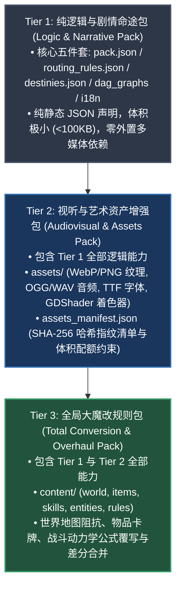
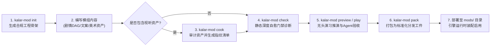

# 卡拉尔世界引擎 · 模组开发者套件 (Kalar World Engine Modding SDK)

> [!NOTE]
> **【核心定位】**：本套件是卡拉尔世界引擎（Kalar World Engine）面向人类开发者与自主推演 Agent 的官方软件开发套件（Modding SDK）。基于数据驱动与因果图元解耦架构，提供三层模组分级体系（Tier 1/2/3）、统一命令行门面（`kalar-mod`）、全量强类型 JSON Schema 契约矩阵、权威真源萃取及持续集成门禁防漂移体系，为模组全生命周期构建坚不可摧的工程底座。

---

## 🏛️ 一、 模组分级架构体系 (Tier Hierarchy)

卡拉尔引擎采用分层解耦、自底向上兼容的模组分级标准，满足从极简纯文字剧情到全量视听增强、乃至底层世界规则大魔改的多元开发需求：



### 1. Tier 1: 纯逻辑与剧情命途包 (Logic & Narrative Pack)
- **定位**：轻量级叙事与创角扩展包，专注于剧情分支拓扑、出身背景、因果天赋守恒与本地化文本。
- **物理组成**：标准“五件套”文件（`pack.json`、`routing_rules.json`、`destinies.json`、`dag_graphs/`、`i18n/`）。
- **核心特性**：纯静态声明式 JSON，零多媒体外链，支持引擎极速热重载与无头推演会话高频验证。

### 2. Tier 2: 视听与艺术资产增强包 (Audiovisual & Assets Pack)
- **定位**：在剧情逻辑之上注入高沉浸感的多媒体艺术资产（立绘、场景插画、UI 音效、环境背景乐、自定义字体与纯文本着色器）。
- **物理组成**：Tier 1 五件套 + `assets_manifest.json` + `assets/` 物理资源目录。
- **核心特性**：受物理沙箱保护，通过受控虚拟协议 `mod://<pack_id>/assets/...` 寻址；经 `cook` 工具校验格式白名单与体积配额并生成 SHA-256 完整性指纹，严禁包含任何可执行二进制。

### 3. Tier 3: 全局大魔改规则包 (Total Conversion & Overhaul Pack)
- **定位**：对底层游戏世界观、地理空间阻抗、物品道具库、动作战技与战斗动力学常数进行深度重塑。
- **物理组成**：Tier 1 & Tier 2 完整架构 + `content/` 模块化目录（包含 `world/`, `items/`, `skills/`, `entities/`, `rules/`）。
- **核心特性**：声明式差分覆写语义（`MERGE` 追加合并、`REPLACE_ENTRY` 条目替换、`TOTAL_PURGE` 全局覆写），由引擎生命周期底座统一解析调度。

---

## 📁 二、 物理目录拓扑结构 (Directory Topology)

SDK 根目录按功能职责划分为规范文档、强类型契约、标准模板、实战样例与开发工具箱：

```text
WebGames/mod_sdk/
├── bin/                        # 【生产分发】独立免安装 CLI 单文件二进制预留目录 (kalar-mod / kalar-mod.exe)
├── docs/                       # 【权威规范库】核心架构、资产烘焙与 Agent 交互全景规范文档
│   ├── SPECIFICATION.md        # 模组核心架构与数据契约全景规范 (v1.0)
│   ├── AGENT_INTERACTION.md    # Agent 无头交互式推演协议与 STDIO NDJSON 流式规范
│   ├── ART_AND_ASSETS_GUIDE.md # Tier 2 视听与艺术资产烹饪配额与安全准入指南
│   ├── TOTAL_CONVERSION_SPEC.md# Tier 3 全局大魔改规则扩展与差分覆写规范
│   └── COMPANION_PROTOCOL.md   # 非侵入式伴侣观察总线与现场黑匣子遥测协议
├── schemas/                    # 【强类型契约】全量 JSON Schema 强类型规范字典
│   ├── pack.schema.json        # 模组元数据清单契约
│   ├── destinies.schema.json   # 命途身世与因果天赋契约
│   ├── dag_graph.schema.json   # 因果剧情图元契约
│   ├── assets_manifest.schema.json # 视听资产清单与哈希指纹契约
│   ├── game_rules.schema.json  # 规则动力学常数契约
│   ├── items.schema.json       # 物品道具原型契约
│   ├── skills.schema.json      # 动作战技卡牌契约
│   ├── world.schema.json       # 世界地图空间阻抗契约
│   ├── observation.schema.json # Agent 观察快照契约 (序章)
│   ├── action.schema.json      # Agent 决策动作契约 (序章)
│   ├── agent_hud_telemetry_packet.schema.json # 主页 HUD 原子遥测包契约
│   └── agent_action_packet.schema.json # 专属动作通道上行指令包契约
├── templates/                  # 【官方脚手架模板】分级合规初始工程骨架
│   ├── starter_story/          # Tier 1 纯逻辑与剧情命途初始工程骨架
│   ├── audio_visual_pack/      # Tier 2 视听与艺术资产增强模板工程
│   └── total_conversion_sample/# Tier 3 全局大魔改规则示例工程
├── examples/                   # 【实战范例】官方实战参考示例
│   ├── custom_hud_theme/       # 自定义 HUD 界面主题与视听资产样例
│   └── README.md               # 范例索引与使用说明
├── tools/                      # 【开发工具箱】统一 CLI 门面与轻量级自动化诊断脚本
│   ├── kalar_mod.py            # 【核心门面】统一命令行工具 (kalar-mod CLI Facade)
│   ├── scaffold_mod.py         # 脚手架骨架生成器 (init 子命令实现)
│   ├── check_mod.py            # 纯静态轻量自愈诊断器 (check 子命令实现)
│   ├── cook_assets.py          # 视听资产预编译与哈希审计器 (cook 子命令实现)
│   ├── preview_mod.py          # 无头拓扑与剧情演习推演器 (preview 子命令实现)
│   └── play_mod.py             # 交互式无头试玩推演会话核 (play 子命令实现)
├── capabilities.json           # 【权威真源】引擎可用种族、节点类型、占位符与突变事件清单（静态萃取）
├── MOD_SPEC.md                 # 【契约速查】面向创作者与 Agent 的根目录快速契约手册与索引总枢
└── README.md                   # 【本文件】SDK 整体架构、分级规范与工具链指引
```

---

## 🛠️ 三、 统一命令行工具指南 (`kalar-mod`)

SDK 提供统一的开发者 CLI 工具门面 `tools/kalar_mod.py`（跨平台兼容 Python 3.10+，亦可作为单文件独立二进制 `kalar-mod` 运行），涵盖模组工程初始化、静态检查、资产烹饪、无头预览、交互推演与打包发布全链路。

```bash
# 查看 CLI 版本与全局帮助
python WebGames/mod_sdk/tools/kalar_mod.py --version
python WebGames/mod_sdk/tools/kalar_mod.py --help
```

### 1. `init` —— 脚手架工程骨架初始化

基于官方模板一键生成合规的模组工程骨架，避免手动书写样板文件出错。

```bash
# 初始化 Tier 1 纯逻辑剧情模组
python WebGames/mod_sdk/tools/kalar_mod.py init --id my_prologue --name "苍白边境要塞" --tier TIER_1_LOGIC --output-dir ./mods/my_prologue

# 初始化 Tier 2 视听艺术增强模组
python WebGames/mod_sdk/tools/kalar_mod.py init --id my_audiovisual --name "北地风暴视听包" --tier TIER_2_AUDIOVISUAL --output-dir ./mods/my_audiovisual

# 初始化 Tier 3 全局大魔改规则模组
python WebGames/mod_sdk/tools/kalar_mod.py init --id my_overhaul --name "极夜重构大魔改" --tier TIER_3_OVERHAUL --output-dir ./mods/my_overhaul
```

| 参数选项 | 类型 | 默认值 | 说明与语义 |
| :--- | :---: | :---: | :--- |
| `--id` | String | 必需 | 模组全局唯一 ID（全小写字母、数字与下划线） |
| `--name` | String | 同 ID | 模组人类可读显示名称 |
| `--tier` | String | `TIER_1_LOGIC` | 模组分级：`TIER_1_LOGIC`, `TIER_2_AUDIOVISUAL`, `TIER_3_OVERHAUL` |
| `--race-id` | String | `HUMAN` | 绑定的基础种族 ID |
| `--output-dir` | Path | 当前目录下与 ID 同名 | 目标输出目录路径 |
| `--with-destiny` | Flag | `True` | 是否包含命途扩展骨架 (`destinies.json`) |

### 2. `check` —— 纯静态自愈诊断门禁

执行深层静态分析，校验 JSON Schema 规范性、因果 DAG 拓扑连通性（Kahn 算法无环检测、孤儿节点拦截）、文案占位符白名单与多包主键冲突。

```bash
# 静态诊断单个模组
python WebGames/mod_sdk/tools/kalar_mod.py check ./mods/my_prologue

# 多模组联合冲突诊断（检测跨包 origin_id/trait_id 撞车与 UI 策略冲突）
python WebGames/mod_sdk/tools/kalar_mod.py check ./mods/my_prologue --multi-dirs ./mods/another_mod

# 输出机器可读结构化 JSON 诊断报告（面向 CI 流水线或 Agent 自愈）
python WebGames/mod_sdk/tools/kalar_mod.py check ./mods/my_prologue --json
```

### 3. `cook` —— 视听资产预编译与审计

递归扫描 `assets/` 目录，校验格式扩展名白名单、拦截可执行恶意文件、验证单文件体积与总包体积配额，并自动计算 SHA-256 哈希值写入 `assets_manifest.json`。

```bash
# 编译并生成/更新 assets_manifest.json
python WebGames/mod_sdk/tools/kalar_mod.py cook ./mods/my_audiovisual

# 仅执行审计检查（不修改磁盘清单，适用于 CI 门禁断言）
python WebGames/mod_sdk/tools/kalar_mod.py cook ./mods/my_audiovisual --check

# 输出 JSON 格式资产清单与审计明细
python WebGames/mod_sdk/tools/kalar_mod.py cook ./mods/my_audiovisual --check --json
```

### 4. `preview` —— 剧情拓扑演习推演

在无头环境下静态解析剧情 DAG，输出拓扑层级摘要；支持 `--simulate` 模拟玩家随机步进推进，验证占位符文案水化结果。

```bash
# 打印剧情图元概览与分支结构
python WebGames/mod_sdk/tools/kalar_mod.py preview ./mods/my_prologue

# 无头模拟剧情流转演练并打印水化台词
python WebGames/mod_sdk/tools/kalar_mod.py preview ./mods/my_prologue --simulate --player-name "林克" --race-id HUMAN
```

### 5. `play` —— 无头试玩推演与 Agent 交互

调用引擎无头会话内核，支持全自动批量跑通验收套件，或开启双向行定界 JSON (NDJSON) 交互流供外部评测 Agent 开展实时决策推演。

```bash
# 批量全自动端到端试玩推演并打印历程战报
python WebGames/mod_sdk/tools/kalar_mod.py play ./mods/my_prologue

# 交互式 Agent STDIO 推演模式（单步 Observation-Action 协议）
python WebGames/mod_sdk/tools/kalar_mod.py play ./mods/my_prologue --interactive --json
```

### 6. `pack` —— 模组分发归档打包

前置运行静态检查与资产审计，通过后自动过滤开发临时文件（如 `__pycache__`, `.git`, `.tmp`），压缩打包为标准 `.zip` 生产分发包并输出校验哈希。

```bash
# 校验并打包至默认输出目录
python WebGames/mod_sdk/tools/kalar_mod.py pack ./mods/my_prologue

# 指定归档分发包输出目录
python WebGames/mod_sdk/tools/kalar_mod.py pack ./mods/my_prologue --out-dir ./dist
```

---

## 🔄 四、 创作者标准开发工作流



---

## 🛡️ 五、 权威真源与防漂移门禁系统

为确保开发者套件契约与引擎核心运行时数据保持绝对同步，本工程部署了全自动真源静态萃取与门禁审计工具：

1. **权威真源萃取 (`WebGames/scripts/py/sync_mod_sdk.py`)**：
   - 静态提取引擎启用的种族清单、合法 DAG 节点类型、文本占位符字典及状态突变事件；
   - 幂等更新 `mod_sdk/capabilities.json` 与 `mod_sdk/MOD_SPEC.md` 中的动态能力标记区块；
   - 支持 `--check-only` 模式，在持续集成中比对磁盘现状与内存真源，检测到非预期漂移立即阻断。

2. **门禁自动化审计 (`WebGames/scripts/py/audit_sdk_sync.py`)**：
   - 验证 SDK 根目录元数据、`docs/` 文档库、`schemas/` 强类型字典、`tools/kalar_mod.py` 工具链的物理完整性与非空状态；
   - 校验能力清单枚举结构的语义正确性；
   - 执行 0 漂移严格断言，保障全链路交付质量。

```bash
# 门禁自检命令：校验真源对齐（0 漂移）
python WebGames/scripts/py/sync_mod_sdk.py --check-only

# 门禁自检命令：执行 SDK 全量资产完整性与结构审计
python WebGames/scripts/py/audit_sdk_sync.py
```

---

## 📚 六、 官方核心规范文档索引

开发者在进阶模组制作过程中，可根据需求查阅 `docs/` 目录下的专题规范文档：

| 规范文档路径 | 核心内容与职责说明 |
| :--- | :--- |
| [`docs/SPECIFICATION.md`](docs/SPECIFICATION.md) | **模组核心架构与数据契约全景规范**：包含 Kahn 拓扑排序装配算法、多包冲突裁决公理与完整自愈错误码字典。 |
| [`docs/ART_AND_ASSETS_GUIDE.md`](docs/ART_AND_ASSETS_GUIDE.md) | **视听多媒体资产烹饪与准入规范**：涵盖 WebP/OGG/TTF 格式白名单、单文件/整包体积配额与 SHA-256 清单机制。 |
| [`docs/TOTAL_CONVERSION_SPEC.md`](docs/TOTAL_CONVERSION_SPEC.md) | **全局大魔改规则扩展规范**：涵盖世界地图空间阻抗、物品卡牌、战斗动力学公式覆写及差分合并语义。 |
| [`docs/AGENT_INTERACTION.md`](docs/AGENT_INTERACTION.md) | **Agent 无头交互式推演协议**：定义基于 STDIO 的行定界 JSON (NDJSON) 双向流式通信契约与状态机流转。 |
| [`docs/COMPANION_PROTOCOL.md`](docs/COMPANION_PROTOCOL.md) | **非侵入式伴侣观察总线协议**：定义伴侣观察事件广播、轻量会话遥测与现场黑匣子录制归档规范。 |
