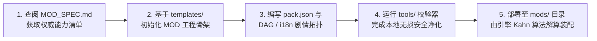

# 卡拉尔世界引擎 · MOD 开发者 SDK (Modding SDK)

> [!NOTE]
> **【核心定位】**：本目录为卡拉尔世界引擎面向剧情与世界扩展包（Narrative & World MODs）开发者的官方软件开发工具包（SDK）。通过标准化数据契约与权威真源萃取系统，为 MOD 创作者与创作者 Agent 提供物理隔离、零硬编码、抗版本漂移的工程底座。

---

## 📁 目录架构与资产索引

```text
WebGames/mod_sdk/
├── capabilities.json       # 【权威真源】引擎当前可用种族、节点类型、占位符与突变事件清单（自动生成）
├── MOD_SPEC.md             # 【契约指南】面向创作者 Agent 的一页纸极简开发契约与范式规范
├── README.md               # 【本文件】SDK 整体架构、工作流与治理指南
├── tools/                  # 【开发工具】MOD 本地校验与静态分析 CLI 工具箱（由 devkit 专员施工）
└── templates/              # 【模板脚手架】标准初始 MOD 工程骨架与样例配置（由 devkit 专员施工）
```

---

## 🔄 契约防漂移与自动化同步机制

为保障开发者 SDK 与引擎底层核心系统（`core.json`、`prologue_dag_catalog.json`、`prologue_i18n.json` 等）永不脱节，项目引入了全自动静态真源萃取与持续集成门禁系统：

1. **权威萃取引擎 (`WebGames/scripts/py/sync_mod_sdk.py`)**：
   - 静态提取启用种族（`supported_races`）、DAG 节点类型（`valid_node_types`）、i18n 文本占位符（`available_placeholders`）及状态突变事件（`valid_mutation_events`）；
   - 自动生成 `capabilities.json`，并幂等更新 `MOD_SPEC.md` 中的 `<!-- AUTOGEN_CAPABILITIES_START -->` 区块；
   - 支持 `--check-only` 模式，在 CI 流程中比对磁盘与内存萃取结果，检测到漂移立即阻断。

2. **门禁审计引擎 (`WebGames/scripts/py/audit_sdk_sync.py`)**：
   - 检验 SDK 文件的物理完整性与非空断言；
   - 校验能力清单结构合法性与必需键的存在性；
   - 阻止未经同步的引擎改动合并入主干。

---

## 🛠️ MOD 创作者标准工作流



---

## 🧪 本地自检与门禁指令

在提交代码或发布 MOD 前，可执行以下命令验证 SDK 与工程健康度：

```bash
# 验证 MOD SDK 是否与引擎底层单一真源对齐（无漂移）
python WebGames/scripts/py/sync_mod_sdk.py --check-only

# 运行 MOD SDK 门禁自动化审计测试
python WebGames/scripts/py/audit_sdk_sync.py
```
