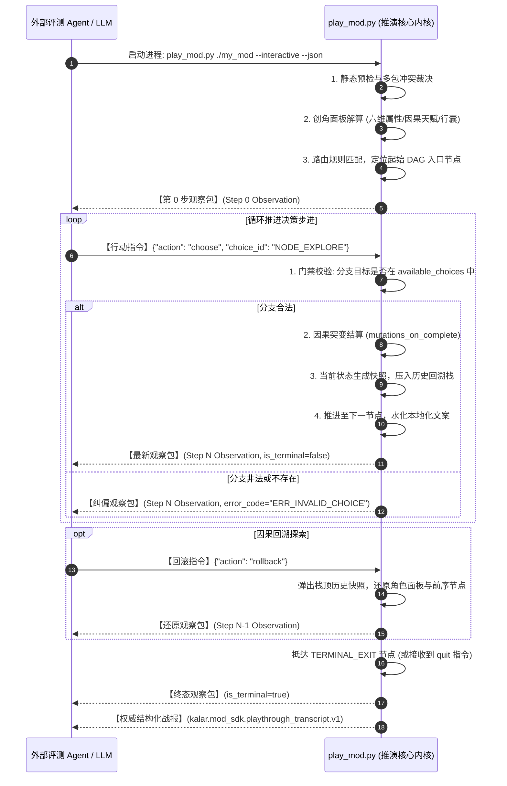

# 卡拉尔世界引擎 · Agent 交互推演协议与无头评测指南 (Agent Interaction Protocol)

> [!NOTE]
> **【协议定位与目标】**
> 本指南定义了卡拉尔世界引擎与外部自动化评测 Agent、自主决策推演模型以及黑盒集成流水线之间的流式交互协议。基于标准输入输出 (`stdio`) 与行定界 JSON (NDJSON)，外部 Agent 能够以完全无头（Headless）的方式开展单步剧情观察、分支决策探索、因果回溯排查与生成权威战报。

---

## 一、 通道管道与通信协议规范 (Channel Protocol)

推演通信建立在进程间标准输入输出通道之上，具备跨平台、低开销、零外部网络依赖等特性。

### 1. 启动命令与命令行参数

外部 Agent 进程通过子进程方式唤起推演引擎内核：

```bash
python mod_sdk/tools/play_mod.py <mod_dir_1> [mod_dir_2 ...] --interactive [--json]
```

#### 关键参数表：
- `<mod_dirs...>`：一个或多个待联合装配推演的模组物理目录路径；
- `--interactive`：【核心开关】激活交互式单步会话模式，挂起批处理推演，等待来自 `stdin` 的动作指令；
- `--json`：强制要求全程输出纯净 NDJSON 数据包，抑制所有人类可读彩色控制台格式化字符；
- `--race <RACE_ID>`：（可选）指定创角种族（如 `HUMAN`, `ELF`，缺省自动解析或继承）；
- `--origin <ORIGIN_ID>`：（可选）指定创角身世标识符；
- `--seed <STRING>`：（可选）设置确定性伪随机数种子，保障同参探索 100% 可重现。

### 2. 编码与防死锁缓冲公理 (I/O & Flush Invariants)

1. **UTF-8 全程保证**：通道两端的所有字符传输必须统一采用 UTF-8 编码，彻底杜绝 Windows GBK 环境下的转义损毁；
2. **行定界 JSON (NDJSON)**：每个发往 `stdin` 的行动包（Action）与每个由 `stdout` 吐出的观察包（Observation）必须占用且仅占用单行文本，以换行符 `\n` 作为完整包定界符；
3. **即时清空刷新 (Immediate Flush)**：推演引擎与 Agent 在写入每个完整 JSON 行后，必须立即显式调用流刷新操作（如 Python 的 `sys.stdout.flush()`）。严禁因管道行缓冲机制导致会话死锁挂起。

---

## 二、 观察-行动单步流转时序 (Observation-Action Flow)

推演会话生命周期严格遵从确定性因果状态机模型：



---

## 三、 数据契约结构详解

### 1. 观察包结构 (`kalar.mod_sdk.observation.v1`)

引擎向 Agent 派发的单步快照，详见 `mod_sdk/schemas/observation.schema.json`：

```json
{
  "schema_version": "kalar.mod_sdk.observation.v1",
  "session_id": "sess_8f3a9e21",
  "step_index": 0,
  "current_node_id": "NODE_ENTRY",
  "node_type": "START_ENTRY",
  "narrative_key": "frontier.awakening",
  "text_source": "i18n",
  "hydrated_text": "年轻的冒险者 瓦兰之剑 从边境哨所的石榻上醒来，窗外风雪呼啸。",
  "available_choices": [
    "NODE_STEP_EXPLORE",
    "NODE_STEP_REST"
  ],
  "character_snapshot": {
    "player_name": "瓦兰之剑",
    "race": "HUMAN",
    "origin_id": "IMPERIAL_NOBLE",
    "attributes": {"STR": 4, "CON": 3, "INT": 5, "AGI": 3, "SPR": 3, "VIT": 3},
    "hp": 100,
    "max_hp": 100,
    "gold": 500
  },
  "applied_mutations": [
    {"type": "CharacterCreated"},
    {"type": "LocationAssigned"}
  ],
  "history_depth": 0,
  "is_terminal": false,
  "error_code": null
}
```

### 2. 行动包指令结构 (`kalar.mod_sdk.action.v1`)

Agent 经由 `stdin` 下发的决策包，支持三种核心指令：

#### A. 分支推进 (`choose`)
```json
{
  "action": "choose",
  "choice_id": "NODE_STEP_EXPLORE"
}
```
*注：`choice_id` 支持传入目标节点 ID 字符串，亦兼容整数索引（如 `0`, `1`）。*

#### B. 历史状态回退 (`rollback`)
```json
{
  "action": "rollback"
}
```
*注：弹出历史栈顶，精准回退至上一决策点。若历史栈为空（处于第 0 步），引擎将返回带有 `ERR_ROLLBACK_EMPTY_STACK` 的观察包，状态保持不变。*

#### C. 主动提前终止 (`quit`)
```json
{
  "action": "quit"
}
```
*注：指示推演引擎立刻截断推演，对当前已有历程进行归档并生成战报。*

---

## 四、 分支探索策略与自动化测试模式

外部评测工具与 Agent 可以基于交互接口实现多样化的探索策略：

1. **贪心首选探索 (Greedy DFS / `first`)**：
   - 每次均选择 `available_choices[0]`，用于快速建立模组基线冒烟测试（Smoke Test）；
2. **随机蒙特卡洛探索 (Random Exploration)**：
   - 依据传入的 `--seed`，在各分支节点执行伪随机挑选，多批次运行以发掘边缘条件下的断裂路径；
3. **基于回溯的图全覆盖遍历 (Exhaustive Branch Coverage via Rollback)**：
   - 利用深度优先结合 `rollback` 指令：当抵达某一叶子节点（`TERMINAL_EXIT`）后，连续执行 `rollback` 回退至具备未探索出边的分支节点，选择另一 `choice_id` 继续探索，直至整张因果图的所有边覆盖率达到 100%。

---

## 五、 结构化战报规范 (`playthrough_transcript.v1`)

当推演抵达终态（`TERMINAL_EXIT`）或收到终止退出指令时，引擎将输出全量结构化战报 JSON。战报完整记录了因果演进轨迹，可直接用于自动化 CI/CD 评测与断言判定：

```json
{
  "schema_version": "kalar.mod_sdk.playthrough_transcript.v1",
  "status": "COMPLETED",
  "seed": "SEED_TEST_2026",
  "summary": {
    "total_steps": 5,
    "unique_nodes_visited": 5,
    "total_choices_made": 4,
    "rollbacks_performed": 0,
    "unresolved_placeholders_count": 0,
    "errors_encountered": 0
  },
  "initial_character": {
    "player_name": "瓦兰巡林者",
    "race": "HUMAN",
    "origin_id": "IMPERIAL_NOBLE",
    "attributes": {"STR": 4, "CON": 3, "INT": 5, "AGI": 3, "SPR": 3, "VIT": 3}
  },
  "final_character": {
    "player_name": "瓦兰巡林者",
    "gold": 650,
    "applied_mutations": ["PrologueCompleted"]
  },
  "timeline_steps": [
    {
      "step_index": 0,
      "node_id": "NODE_ENTRY",
      "text": "年轻的冒险者在哨所醒来。",
      "choice_taken": "NODE_STEP_EXPLORE"
    },
    {
      "step_index": 1,
      "node_id": "NODE_STEP_EXPLORE",
      "text": "你踏雪深入林地，发现了一处被遗弃的符文遗迹。",
      "choice_taken": "NODE_EXIT"
    }
  ],
  "verification_assertions": {
    "has_dangling_edges": false,
    "reached_terminal_cleanly": true,
    "all_placeholders_hydrated": true
  }
}
```

### 自动化测试度量标准：
- **`status` 必须为 `"COMPLETED"`**：验证剧情图无悬空死胡同；
- **`unresolved_placeholders_count` 必须为 `0`**：验证文本中没有任何遗漏插值的未决花括号占位符；
- **`reached_terminal_cleanly` 必须为 `true`**：验证因果突变结算链条完整发布。
