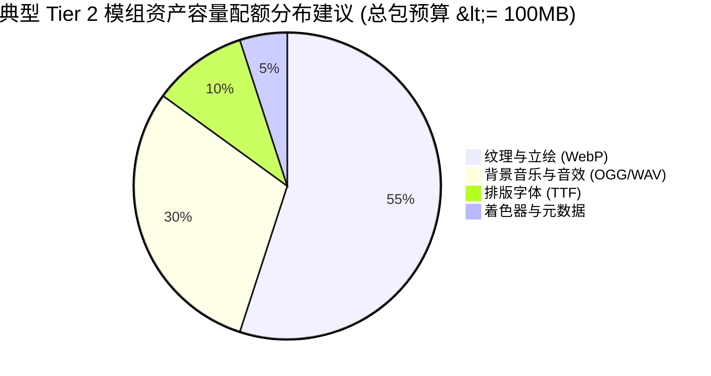
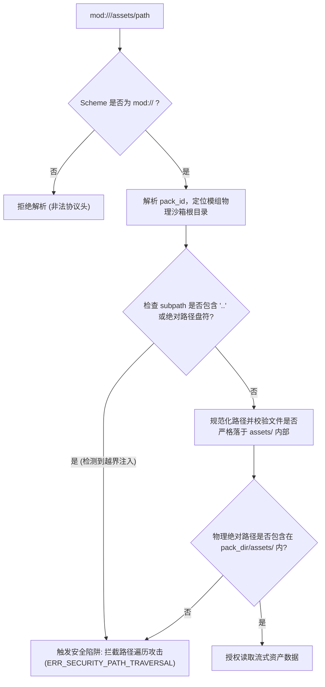

# 卡拉尔世界引擎 · 艺术与媒体资产制作规格与安全指南 (Art & Assets Guide)

> [!NOTE]
> **【指南定位与规范版本】**
> 本指南为 Tier 2（视听增强包）与 Tier 3（全局大魔改包）创作者提供权威的美术、音频、字体与着色器工程规格，阐明虚拟寻址协议 `mod://` 的解析公理，并确立严格的沙箱隔离与二进制拦截安全防线。

---

## 一、 资产目录拓扑结构 (`assets/`)

扩展包中所有的静态多媒体资产必须集中存放于模组根目录下的 `assets/` 物理子目录内。标准布局划分如下：

```text
my_mod/
├── assets_manifest.json        # 资产清单与 SHA-256 完整性哈希清单
└── assets/
    ├── textures/               # 纹理、UI 贴图与角色立绘
    │   ├── ui/                 # 界面元素、边框、图标与徽标
    │   ├── portraits/          # 角色身世与 NPC 对话立绘
    │   └── backgrounds/        # 序章场景插画与背景底图
    ├── audio/                  # 音效与配乐
    │   ├── bgm/                # 背景音乐流式音轨
    │   └── sfx/                # 界面点击、技能释放与环境音效
    ├── fonts/                  # 自定义排版字体文件
    └── shaders/                # 纯文本 GPU 着色器代码
```

---

## 二、 推荐媒体格式与技术规格

引擎运行时针对不同媒体资源类型制定了明确的编码格式规范与技术边界：

| 资产类型 | 推荐容器/格式 | 次优/兼容格式 | 严禁使用格式 | 规格限制与技术指标 |
| :--- | :--- | :--- | :--- | :--- |
| **纹理与立绘** | `WebP` (推荐无损/高压比) | `PNG` | `BMP`, `TIFF`, `GIF` | 最大分辨率 **4096 × 4096**；单张物理体积 $\le$ **15 MB**；建议使用 sRGB 颜色空间与透明通道 (Alpha) |
| **流式背景音** | `OGG` (Vorbis 编码) | - | `MP3`, `FLAC` | 采样率 **44.1 kHz / 48 kHz**；立体声 (Stereo)；码率推荐 128~192 kbps；单文件 $\le$ **30 MB** |
| **短打击音效** | `WAV` (PCM 16-bit) | `OGG` | `MP3`, `MIDI` | 极低延迟打击/界面反馈；单声道/立体声；单文件 $\le$ **5 MB** |
| **排版字体** | `TTF` (TrueType) | `WOFF2` | `EOT`, `FON` | UTF-8 全字形集合或常用汉字子集 (3500 字常用字表)；单字体文件 $\le$ **20 MB** |
| **材质着色器** | `GDShader` (纯文本) | - | `.gdc` (预编译二进制) | Godot 4.x 着色器标准脚本，仅支持纯文本明文，严禁包含动态宏混淆 |

---

## 三、 资产物理预算与配额红线 (Resource Budgets)

为保障跨设备加载性能与移动端/Web 端运行时的内存平稳，模组扩展包需严格遵循以下配额边界：



1. **单项文件体积上限**：
   - 纹理贴图：单张文件绝对禁止超过 **15 MB**；
   - 背景音频：单个音频切片绝对禁止超过 **30 MB**；
   - 纯文本着色器：单文件代码体积不得超过 **256 KB**。
2. **总包体积预算 (Package Budget)**：
   - 单个 Tier 2 视听包解压后总体积建议控制在 **100 MB** 以内，绝对上限不得超过 **250 MB**；
   - 静态检查工具在预检时若发现单文件或总包超出预算，将提示预警或直接阻断装配。

---

## 四、 `mod://` 虚拟资产寻址协议

### 1. 统一寻址抽象

卡拉尔引擎引入了 `mod://` 虚拟 URI 方案，实现模组资产与底层物理文件系统路径的完全解耦。任何对自定义图片、音效或着色器的引用均须采用以下格式：

$$\text{mod://}\langle\text{pack\_id}\rangle/\text{assets}/\langle\text{subpath}\rangle$$

#### 示例：
- 引用专属立绘：`mod://mod_valan_origins/assets/textures/portraits/scout.webp`
- 引用环境音效：`mod://mod_valan_origins/assets/audio/sfx/wind_howl.ogg`
- 引用战技图标：`mod://mod_valan_origins/assets/textures/ui/skill_slash.webp`

### 2. 虚拟路径解析器安全边界 (Virtual Path Security Guard)

引擎内部的虚拟资产解析器在将 `mod://` 映射为物理文件系统路径时，强制实施以下安全守卫：



- **路径遍历注入防御**：绝对禁止在 URI 中包含 `..`、`./`、`\`、Windows 盘符（如 `C:`）或根目录斜杠（如 `/etc/`）。一旦捕获此类特征，解析器立即熔断抛出安全异常；
- **沙箱锁定**：解析后得到的规范化绝对路径必须严格以模组物理根目录下的 `assets/` 为前缀，防止利用符号链接（Symlink）穿透至宿主系统关键目录。

---

## 五、 纯静态安全守卫与二进制黑名单 (Binary Jail)

卡拉尔世界引擎秉持“零不可信二进制执行”公理。模组系统设计为声明式纯数据驱动，任何包含可执行特征的文件均被视为安全威胁。

### 1. 严禁包含的文件扩展名黑名单

静态门禁（`check_mod.py`）与引擎装配器将对模组目录执行递归扫描，若检测到以下任何扩展名，立即拒绝加载并记录安全警报：

- **Windows 可执行文件与动态库**：`.exe`, `.dll`, `.sys`, `.com`, `.scr`, `.msi`
- **Unix/Linux/macOS 二进制与共享库**：`.so`, `.dylib`, `.bin`, `.app`, `.elf`
- **脚本与命令行解释执行脚本**：`.bat`, `.cmd`, `.sh`, `.ps1`, `.vbs`, `.js`, `.py`
- **WebAssembly 与字节码**：`.wasm`, `.class`, `.pyc`, `.pyd`, `.luac`
- **预编译着色器缓存**：`.gdc`, `.spv`

### 2. 纯文本着色器审核

所有的 `.gdshader` 文件必须是 UTF-8 编码的纯文本文件。禁止在着色器脚本中包含死循环宏或尝试调用未声明的底层 C/C++ 宿主接口。

---

## 六、 资产清单契约 (`assets_manifest.json`)

为了保障网络传输完整性、防止资源篡改并加速客户端只读缓存，Tier 2 与 Tier 3 模组必须在根目录下生成 `assets_manifest.json`：

```json
{
  "$schema": "http://json-schema.org/draft-07/schema#",
  "manifest_version": "1.0.0",
  "pack_id": "mod_valan_origins",
  "total_size_bytes": 1420854,
  "assets": [
    {
      "path": "assets/textures/portraits/scout.webp",
      "virtual_uri": "mod://mod_valan_origins/assets/textures/portraits/scout.webp",
      "asset_type": "TEXTURE",
      "format": "WEBP",
      "size_bytes": 284100,
      "sha256": "e3b0c44298fc1c149afbf4c8996fb92427ae41e4649b934ca495991b7852b855",
      "metadata": {
        "width": 1024,
        "height": 1024
      }
    },
    {
      "path": "assets/audio/sfx/blade_slash.wav",
      "virtual_uri": "mod://mod_valan_origins/assets/audio/sfx/blade_slash.wav",
      "asset_type": "AUDIO",
      "format": "WAV",
      "size_bytes": 128400,
      "sha256": "ca978112ca1bbdcafac231b39a23dc4da786eff8147c4e72b9807785afee48bb",
      "metadata": {
        "sample_rate": 44100,
        "channels": 2,
        "duration_seconds": 1.45
      }
    }
  ],
  "security": {
    "sandbox_verified": true,
    "scan_timestamp": 1791806400
  }
}
```

- **哈希防篡改**：引擎在初次加载资产时将计算物理文件的 SHA-256 校验和，若与清单记录不匹配，将提示资产损坏或被篡改，阻断脏数据注入渲染管线。
