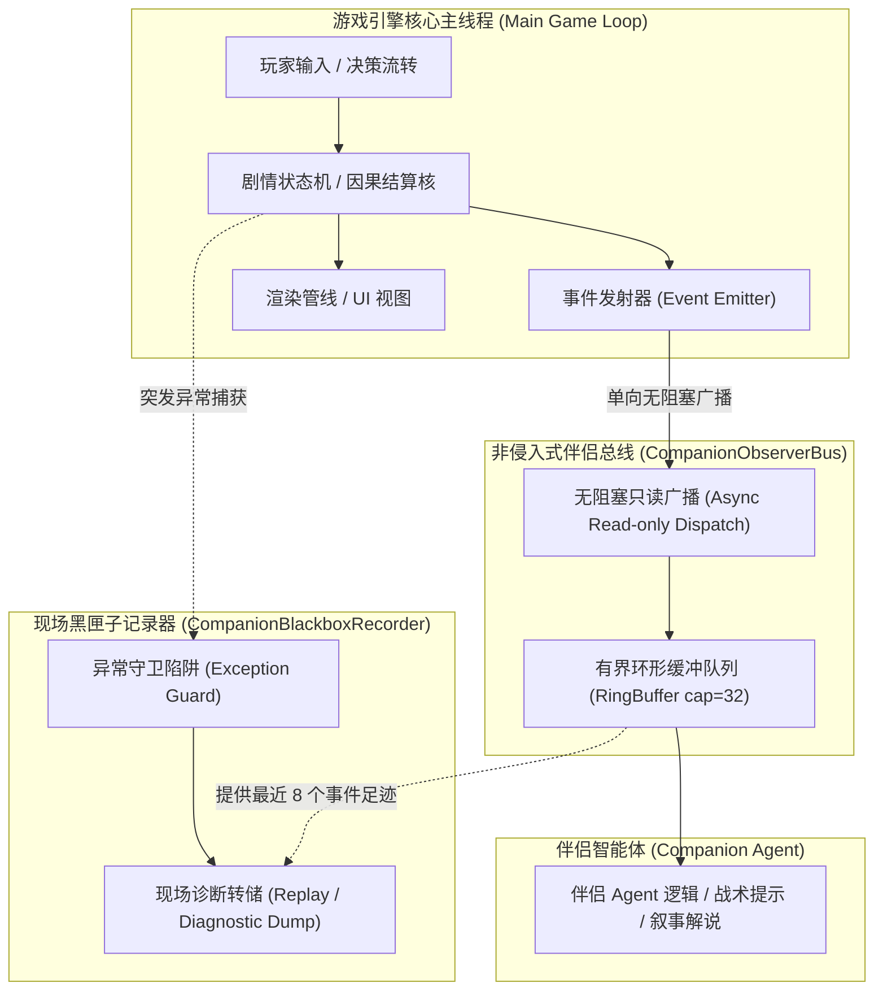
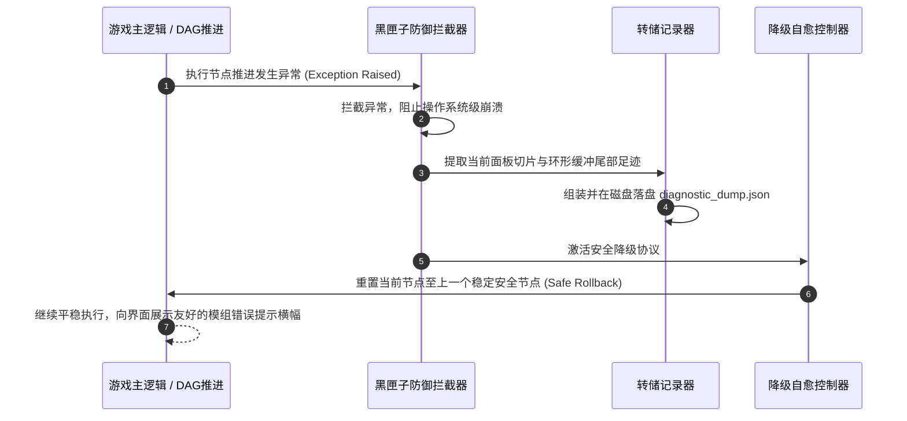

# 卡拉尔世界引擎 · 伴侣观察总线广播协议与黑匣子现场转储规范 (Companion Protocol)

> [!NOTE]
> **【规范定位与第一性原理】**
> 本规范定义了卡拉尔世界引擎中的非侵入式伴侣观察总线（`CompanionObserverBus`）以及现场黑匣子诊断转储引擎（`CompanionBlackboxRecorder`）。通过轻量只读发布-订阅广播机制，引擎在游戏运行时向伴侣 Agent 实时推送剧情脉络与决策快照，实现“零渲染延迟、零逻辑干预”的侧边伴随；当第三方模组发生不可预期的逻辑断裂时，黑匣子记录器能够实施就地防御并转储完整的故障现场上下文，防止引擎闪退崩溃。

---

## 一、 伴侣系统架构与解耦公理

伴侣系统与游戏主循环运行在完全解耦的单向流拓扑中：



### 核心不变量约束：
1. **伴侣总线非侵入公理 (Non-Invasive Invariant)**：
   - 伴侣观察总线对游戏主引擎为纯单向、只读调用。观察者端的任何计算延迟、异常崩溃或网络挂起，绝对严禁阻断游戏核心主线程的帧率渲染与逻辑时钟；
2. **黑匣子转储防损坏公理 (Zero Corruption Invariant)**：
   - 遇到未决异常时，黑匣子系统实施就地结构化防御与日志转储，平稳降级，严禁直接触发操作系统级闪退（Crash）；
3. **有界环形缓冲区公理 (Bounded RingBuffer Invariant)**：
   - 历史事件追踪严格限定于定长有界环形队列中，杜绝无界堆内存膨胀与瞬态 GC 抖动。

---

## 二、 伴侣观察总线广播事件契约

伴侣总线向订阅者推送强类型事件载荷。所有广播事件均遵循统一的事件封包格式：

### 1. 通用事件包头结构

```json
{
  "event_id": "evt_9a8b7c6d5e",
  "topic": "companion.step_observed",
  "timestamp": 1791806400120,
  "session_id": "sess_8f3a9e21",
  "payload": {}
}
```

### 2. 标准广播主题清单 (Event Topics)

| 主题名称 (Topic) | 触发时机 | 核心载荷字段 (`payload`) | 伴侣 Agent 典型应用场景 |
| :--- | :--- | :--- | :--- |
| `companion.session_started` | 序章会话启动或创角完毕 | `session_id`, `character_snapshot`, `pack_id` | 伴侣向玩家致问候语，介绍初始身世与世界背景 |
| `companion.step_observed` | 推进至新的剧情节点 | `step_index`, `current_node_id`, `hydrated_text`, `available_choices` | 伴侣解读当前场景剧情，评估分支利弊 |
| `companion.choice_committed` | 玩家或推演器做出分支选择 | `step_index`, `choice_id`, `choice_label` | 伴侣对玩家的决策行为发表个性化感想 |
| `companion.mutation_applied` | 结算状态突变事件 | `mutation_type`, `delta_summary` | 伴侣提醒属性增长、金币变化或新装备入包 |
| `companion.session_completed`| 抵达终态节点或序章完结 | `transcript_summary`, `final_character` | 伴侣总结历程表现，展望后续开放世界征程 |
| `agent_hud_packet_streamed` | 主页 HUD 单步切片组装完成 | `envelope`, `observation`, `causal_deltas`, `action_space` | 伴侣 Agent 实时感知主页生理、资产、时钟与任务变动，评估当前可用操作 |

---

## 三、 有界环形缓冲队列规范 (`RingBuffer`)

为了在故障突发时能够回溯导致崩溃的前序前驱动作，同时保持内存占用严格恒定，伴侣记录器与时序轨迹器内置定长环形缓冲区（`BoundedRingBuffer` / `AgentTrajectoryRingBuffer`）：

1. **容量限制**：默认定长容量设为 **32 条事件记录**（可在配置文件 `world_state/core.json` 中调整，最大不超过 64）；
2. **覆写策略 (FIFO Eviction)**：当缓冲区写满时，新事件无缝覆盖最老槽位，读写操作均为严格的 $\mathcal{O}(1)$ 常数时间复杂度，彻底消除 `pop_front()` 内存搬移；
3. **多步因果反思窗口**：支持 `get_trajectory_window(k)`，允许在 $\mathcal{O}(k)$ 时间内按时间序提取最近 $k$ 步事件切片，支持长程因果归因；
4. **零瞬态堆膨胀**：预分配固定数组槽位，严禁在主循环中频繁触发数组扩容（Resize）与动态重分配。

---

## 四、 现场黑匣子诊断转储规范 (`Diagnostic Dump`)

当第三方 MOD 发生逻辑断裂、未知占位符损毁、数值溢出或拓扑非法时，黑匣子记录器立即捕获瞬态现场，生成规范化的诊断转储文件（`diagnostic_dump_<dump_id>.json`）：

### 1. 结构化转储模型

```json
{
  "$schema": "http://json-schema.org/draft-07/schema#",
  "dump_id": "dump_err_20261012_982341",
  "timestamp": 1791806400560,
  "engine_api_version": "1.0.0",
  "session_id": "sess_8f3a9e21",
  "failure_context": {
    "failing_pack_id": "mod_frontier_awakening",
    "failing_node_id": "NODE_STEP_UNSTABLE",
    "error_code": "ERR_UNKNOWN_PLACEHOLDER",
    "exception_message": "Node text contains unregistered placeholder: {INVALID_MACRO}",
    "call_stack": [
      "at _hydrate_narrative_text() in play_mod.py: line 432",
      "at step() in agent_playthrough_session: line 210"
    ]
  },
  "character_snapshot": {
    "player_name": "瓦兰之剑",
    "race": "HUMAN",
    "origin_id": "IMPERIAL_NOBLE",
    "attributes": {"STR": 4, "CON": 3, "INT": 5, "AGI": 3, "SPR": 3, "VIT": 3},
    "gold": 500
  },
  "recent_event_tail": [
    {
      "step_index": 1,
      "event": "companion.choice_committed",
      "choice_id": "NODE_STEP_EXPLORE"
    },
    {
      "step_index": 2,
      "event": "companion.step_observed",
      "node_id": "NODE_STEP_EXPLORE"
    },
    {
      "step_index": 2,
      "event": "companion.choice_committed",
      "choice_id": "NODE_STEP_UNSTABLE"
    }
  ],
  "suggested_fix": "请检查 mod_frontier_awakening 中 NODE_STEP_UNSTABLE 的文案模板，将 {INVALID_MACRO} 替换为白名单参数或补充 i18n 字典。"
}
```

### 2. 字段规范说明

- `dump_id`：全局唯一错误快照 ID（便于日志检索与故障跟踪）；
- `timestamp`：故障触发时的物理毫秒级时间戳；
- `failure_context`：精准记录违规的模组标识符、出错节点 ID、标准错误代码与调用栈轨迹；
- `recent_event_tail`：从环形缓冲区中提取的**故障发生前最近 8 个事件足迹**。外部开发者或修复 Agent 可沿此轨迹精准重现导致崩溃的决策链；
- `suggested_fix`：引擎根据错误代码自动匹配的纯技术自愈修复建议。

---

## 五、 错误阻断与自愈降级生命周期

黑匣子引擎在遭遇异常时的生命周期处理流线如下：



1. **瞬态阻断**：引擎捕获错误并阻断异常向操作系统顶层穿透；
2. **落盘存档**：诊断转储文件被持久化存储至 `user://logs/blackbox/` 或控制台标准输出；
3. **安全回滚**：推演状态机自动调用内部 `rollback()` 回退至上一个安全且经过验证的历史节点，提示玩家或推演 Agent 避开故障分支，保障整体体验平稳不中断。
