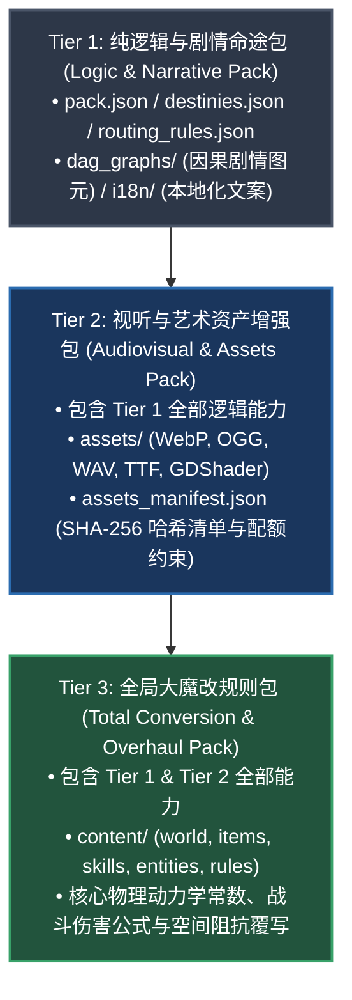
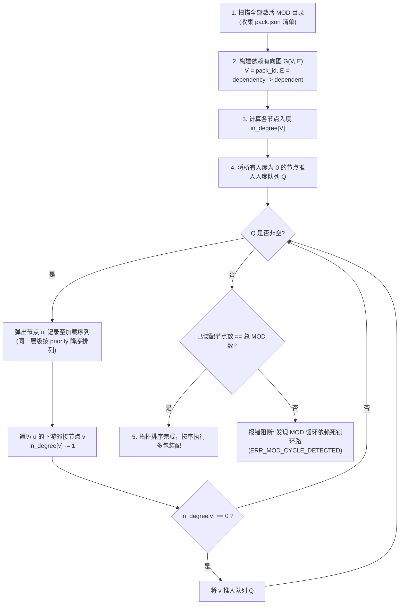

# 卡拉尔世界引擎 · 模组生态核心架构与数据契约规范 (Mod Architecture & Data Contract Specification v1.0)

> [!NOTE]
> **【规范定位与版本】**
> 本规范定义了卡拉尔世界引擎（Kalar World Engine）的官方模组扩展架构与数据契约标准（规范版本：`v1.0`，引擎 API 兼容版本：`1.0.0`）。所有面向人类开发者与自主推演 Agent 的扩展包构建、拓扑依赖裁决、数值预算约束及多包联合装配均须严格遵循本规范。

---

## 一、 核心第一性原理与架构分层

卡拉尔世界引擎采用数据驱动（Data-Driven）与因果图元（Causal DAG）解耦的核心设计原则。模组系统被划分为三个严格解耦、自底向上兼容的架构级别（Tier Hierarchy）：



### 1. Tier 1: 纯逻辑与剧情命途包 (Logic & Narrative Pack)
- **定位**：轻量级扩展，专注于叙事分流、角色出身背景、因果天赋配平与剧情分支拓扑。
- **物理结构**：由基础“五件套”文件构成，零外置多媒体依赖，纯 JSON 静态声明。
- **分发特性**：体积极小（通常 < 100KB），支持热重载与无头推演快速验证。

### 2. Tier 2: 视听与艺术资产增强包 (Audiovisual & Assets Pack)
- **定位**：在剧情逻辑之上注入自定义视听资源（立绘、场景贴图、界面音效、背景音乐、自定义字体与纯文本着色器）。
- **物理结构**：五件套 + `assets/` 物理目录 + `assets_manifest.json` 资产清单文件。
- **安全约束**：受严格物理沙箱保护，仅支持 `mod://<pack_id>/assets/...` 虚拟协议寻址，严禁包含任何可执行二进制。

### 3. Tier 3: 全局大魔改规则包 (Total Conversion & Overhaul Pack)
- **定位**：深度重构游戏底层世界观、空间拓扑、物品库、动作卡牌与战斗数值物理公式。
- **物理结构**：完整架构体系 + `content/` 模块化目录（包含 `world/`, `items/`, `skills/`, `entities/`, `rules/`）。
- **合并语义**：具备声明式差分覆写模式（`MERGE`, `REPLACE_ENTRY`, `TOTAL_PURGE`），由引擎生命周期底座统一调度。

---

## 二、 标准扩展包文件布局（五件套与扩展拓扑）

合规的卡拉尔模组物理存储于 `mods/<pack_id>/` 或用户沙箱目录 `user://mods/<pack_id>/`，标准目录树如下：

```text
<pack_id>/
├── pack.json                   # 【必需】MOD 清单元数据与依赖拓扑描述文件
├── routing_rules.json          # 【必需】创角种族与出身到序章 DAG 的路由映射表
├── destinies.json              # 【必需/推荐】命途身世池、因果天赋对、初始行囊与 UI 解锁策略
├── dag_graphs/                 # 【必需】剧情有向无环图元目录
│   └── DAG_<NAME>.json         # 因果剧情图（单一 START_ENTRY，至少一个 TERMINAL_EXIT）
├── i18n/                       # 【必需】本地化多语言文案字典
│   └── zh-CN.json              # 语言键值映射，含白名单占位符模板
│
├── assets_manifest.json        # 【Tier 2/3 必需】多媒体资产清单与 SHA-256 校验指纹
├── assets/                     # 【Tier 2/3 可选】受控媒体资产存储根目录
│   ├── textures/               # 纹理与图片（WebP / PNG，单图 <= 15MB）
│   ├── audio/                  # 音频（OGG / WAV，单文件 <= 30MB）
│   ├── fonts/                  # 字体（TTF / WOFF2）
│   └── shaders/                # 纯文本着色器（GDShader）
│
└── content/                    # 【Tier 3 专有】大魔改数据模块化根目录
    ├── world/                  # 地理阻抗、A* 寻路参数、行军消耗与城镇模板
    ├── items/                  # 物品原型与装备数值定义
    ├── skills/                 # 动作动词 (verbs) 与战技卡牌
    ├── entities/               # 怪物原型与 NPC 模板
    └── rules/                  # 动力学战斗常数、伤害公式与防御系数
```

---

## 三、 清单元数据契约 (`pack.json`)

`pack.json` 采用标准 JSON 格式，反序列化严格对齐 `NarrativePackManifestDTO`。

### 1. 字段定义表

| 字段名称 | 类型 | 必需 | 默认值 | 约束与语义说明 |
| :--- | :---: | :---: | :---: | :--- |
| `pack_id` | String | 是 | - | 全局唯一标识符，全小写字母、数字与下划线（正则：`^[a-z0-9_]+$`） |
| `pack_name` | String | 是 | - | 模组人类可读显示名称（1-64 字符） |
| `version` | String | 是 | - | 语义化版本号（SemVer 格式，如 `1.0.0`） |
| `author` | String | 否 | `"Unknown"` | 创作者或研发团队署名 |
| `engine_api_version`| String | 是 | `"1.0.0"` | 兼容的目标引擎 API 接口版本 |
| `tier` | String | 否 | `"TIER_1_LOGIC"` | 模组分级：`TIER_1_LOGIC`, `TIER_2_AUDIOVISUAL`, `TIER_3_OVERHAUL` |
| `priority` | Integer | 否 | `100` | 同拓扑层级内的加载优先级（数值越大越优先装配） |
| `dependencies` | Array[String]| 否 | `[]` | 必须前置加载的模组 `pack_id` 列表 |
| `incompatible_packs`| Array[String]| 否 | `[]` | 互斥冲突的模组 `pack_id` 黑名单 |
| `semantic_tags` | Array[String]| 否 | `[]` | 检索与分类标签（如 `["prologue", "dark_fantasy"]`） |
| `is_active` | Boolean | 否 | `true` | 是否激活启用状态 |
| `description` | String | 否 | `""` | 模组背景介绍与详细说明 |
| `homepage` | String | 否 | `""` | 官方发布或代码仓库 URL |

### 2. 标准规范样例

```json
{
  "pack_id": "mod_valan_origins",
  "pack_name": "瓦兰要塞边境起源包",
  "version": "1.0.0",
  "author": "KalarEngineTeam",
  "engine_api_version": "1.0.0",
  "tier": "TIER_1_LOGIC",
  "priority": 120,
  "dependencies": [],
  "incompatible_packs": [],
  "semantic_tags": ["prologue", "frontier", "lore_expansion"],
  "is_active": true,
  "description": "扩展瓦兰要塞周边前线巡林学徒与暗夜卫士的身世背景与专属序章历程。"
}
```

---

## 四、 命途与创角数值预算红线 (`destinies.json`)

`destinies.json` 提供对角色生成面板、因果天赋池与初始装备套件的受控扩展。模组创作者必须恪守以下四项刚性数值不变量：

### 1. 前端 UI 受控交互策略 (`ui_capabilities`)
- `origin_selection_mode`: 仅限取值 `["INHERIT", "ALLOW_MANUAL", "FORCE_RANDOM"]`。
- `trait_selection_mode`: 仅限取值 `["INHERIT", "ALLOW_MANUAL", "FORCE_RANDOM"]`。
- `allow_attribute_reroll`: 布尔值，控制是否在创角界面开放六维属性重掷。

### 2. 自定义身世数值预算红线 (`custom_origins`)
- 核心六维属性键：严格限定为 `STR, CON, INT, AGI, SPR, VIT` 六键。
- **单维修正红线**：单项属性加成严格限制在 `[-2, 3]` 区间。
- **六维净代数和红线**：六项修正的净代数和严格限制在 `[-2, 4]` 区间。
- **初始金币上限**：`initial_gold` 严禁超过 `1000` 金币。
- **序章图引用验证**：`prologue_dag_id` 必须在当前包 `dag_graphs/` 或内置序章图中真实存在。

### 3. 正负因果天赋守恒公理 (`custom_traits` 与 `paired_presets`)
- 正向天赋：`cost > 0` 且 `type == "POSITIVE"`。
- 负向天赋：`cost < 0` 且 `type == "NEGATIVE"`。
- **配对守恒约束**：若定义了自定义天赋，必须通过 `paired_presets` 进行正负成对绑定，且两端代数和的绝对值必须 `<= 1`：
  $$\left| \text{positive\_cost} + \text{negative\_cost} \right| \le 1$$

### 4. 自定义行囊容量约束 (`custom_starter_kits`)
- 套件内 `initial_items` 物品清单总项数与总件数必须 $\le 10$。
- 每项物品必须包含非空的权威物品标识符（`canonical_id`），且必须遵循 `KALAR:<MAJOR>:<MINOR>:<NAME>` 命名空间。

---

## 五、 因果 DAG 剧情拓扑不变量 (`dag_graphs/`)

剧情图采用严格的有向无环图结构，由静态诊断器与运行时解算引擎执行以下四项拓扑公理断言：

1. **单一起始与终结基数公理 (Cardinality Invariant)**：
   - 每张剧情图必须包含且仅包含 1 个 `START_ENTRY` 入口节点（入度为 0）。
   - 每张剧情图必须包含至少 1 个 `TERMINAL_EXIT` 终态节点（出度为 0）。
2. **零死锁有向环公理 (Acyclic Invariant)**：
   - 图结构必须是有向无环的。装配阶段采用 Kahn 算法进行拓扑分析，一旦检测到入度死锁环路立即阻断装配。
3. **前向全连通公理 (Forward Reachability Invariant)**：
   - 从 `START_ENTRY` 出发，沿着有向边必须能够遍历访问到图中的所有节点。严禁存在无法抵达的孤儿断链节点（`ERR_DAG_ORPHAN_NODE`）。
4. **反向全归宿公理 (Backward Reachability Invariant)**：
   - 图中任意节点沿着有向边必须存在一条通向某一 `TERMINAL_EXIT` 的连通路径。严禁存在悬空的死胡同节点（`ERR_DAG_UNREACHABLE_TERMINAL`）。
5. **安全状态突变白名单 (Mutation Whitelist)**：
   - 节点执行完毕时发布的 `mutations_on_complete` 事件严格限制在引擎白名单中：
     * `CharacterCreated`: 角色档案与六维属性装配就绪
     * `LocationAssigned`: 初始地理空间坐标与场景指派完毕
     * `EquipmentGranted`: 初始佩剑与新兵行囊配给入包
     * `DialogueReady`: 引导 NPC 对话总线激活
     * `PrologueCompleted`: 序章主线历程完结，流转至开放世界大地图

---

## 六、 Kahn 拓扑依赖解算与装配算法

当游戏运行时检测到多个扩展模组时，引擎装配器执行标准的 Kahn 拓扑排序算法，解算正确的加载与覆写序列：



### 拓扑排序规则详述：
1. **依赖前置**：若 MOD B 依赖 MOD A（`B.dependencies` 包含 `A`），则 A 必须严格在 B 之前完成装配初始化。
2. **同层优先级**：当多个 MOD 的入度同时归零时，装配器提取各 MOD 的 `priority` 数值进行降序排序（数值越大越优先装配）。
3. **环路阻断**：若待装配列表未清空但队列 Q 已空，说明依赖关系中存在拓扑死锁闭环，引擎将立即阻断启动并抛出受影响的模组清单。

---

## 七、 多包非冲突合并公理 (Multi-Pack Conflict-Free Merge Invariants)

在联合加载多个扩展包时，引擎门禁与装配调度器执行五项严格的冲突裁决不变量：

### 1. 唯一标识符撞车拦截 (`ERR_MOD_DUPLICATE_ID_CONFLICT`)
跨包联合装配时，下列主键必须具备全局全局唯一性，严禁跨包同名撞车：
- `pack_id`：模组标识符绝对唯一；
- `origin_id`：身世背景标识符绝对唯一；
- `trait_id`：因果天赋标识符绝对唯一；
- `kit_id`：初始行囊套件标识符绝对唯一。
若检测到不同 MOD 声明了相同主键，门禁立即阻断装配，并提示为实体 ID 追加模组前缀（如 `MOD_VALAN_SCOUT`）。

### 2. 声明式互斥冲突阻断 (`ERR_MOD_INCOMPATIBLE_CONFLICT`)
若已激活的 MOD A 清单中 `incompatible_packs` 包含 MOD B，或者 MOD B 的 `incompatible_packs` 包含 MOD A，装配引擎立即报告互斥冲突，阻断联合装配。

### 3. UI 交互策略互斥裁决 (`ERR_MOD_UI_POLICY_CONFLICT`)
在 `ui_capabilities` 中：
- 若 MOD A 声明了 `ALLOW_MANUAL`（开放手动自选），而 MOD B 声明了 `FORCE_RANDOM`（强制盲盒随机），两者产生逻辑互斥，阻断装配；
- 若声明为 `INHERIT`，则无条件顺应显式声明的非 `INHERIT` 策略。

### 4. 列表式条目追加合并 (Append-Only Merging)
对于 `custom_origins`、`custom_traits`、`paired_presets` 和 `custom_starter_kits`，引擎采用追加合并模式：
- 按照 Kahn 拓扑排序所得的装配序列，将各包声明的合法非冲突条目顺序追加至运行态全局注册表中；
- 路由规则 `routing_rules.json` 按照优先级高低依次注册至路由表头部，实现高优先级模组的条件路由优先匹配。

---

## 八、 静态门禁与自愈诊断错误码全景字典

静态检查器（`check_mod.py`）与引擎预检门禁提供强类型、结构化错误诊断。所有异常均包含错误码、相对文件路径、违规明细与自愈修复指引：

| 错误代码 (Error Code) | 归属模块 | 触发条件 | 自愈修复指引 |
| :--- | :--- | :--- | :--- |
| `ERR_MOD_DIR_NOT_FOUND` | 包管理 | 指定的 MOD 根路径物理不存在 | 校验命令行参数与目标路径拼写 |
| `ERR_FILE_MISSING` | 文件基座 | 缺少必备文件（如 `pack.json`） | 补充必备骨架文件 |
| `ERR_JSON_INVALID` | 文件基座 | JSON 文件语法损坏或编码非 UTF-8 | 检查括号、逗号匹配与文件编码 |
| `ERR_MANIFEST_FIELD_MISSING`| pack.json | 缺少 `pack_id`, `version` 等必需字段 | 补齐清单声明字段 |
| `ERR_MANIFEST_FIELD_TYPE` | pack.json | 字段类型不匹配（如 `priority` 非整数）| 修正清单字段类型 |
| `ERR_MOD_DUPLICATE_ID_CONFLICT`| 多包合并 | 跨包同名 `pack_id`, `origin_id`, `trait_id` | 为实体 ID 添加模组私有前缀 |
| `ERR_MOD_INCOMPATIBLE_CONFLICT`| 多包合并 | 同时激活了互斥包声明清单中的 MOD | 禁用互斥模组之一 |
| `ERR_MOD_UI_POLICY_CONFLICT` | 多包合并 | 出现 `ALLOW_MANUAL` 与 `FORCE_RANDOM` 互斥 | 统一模组间 UI 策略声明 |
| `ERR_ROUTING_EMPTY` | 路由映射 | `routing_rules.json` 无有效规则 | 添加有效的序章路由匹配项 |
| `ERR_ROUTING_TARGET_UNKNOWN`| 路由映射 | 规则引用的目标 DAG 物理不存在 | 确保在 `dag_graphs/` 下提供对应图元 |
| `ERR_DAG_DIR_MISSING` | 因果 DAG | 缺失 `dag_graphs/` 目录 | 创建该目录并放置图元文件 |
| `ERR_DAG_NO_FILES` | 因果 DAG | 目录下未包含任何 JSON 图元 | 至少创建一个有效序章图元 |
| `ERR_DAG_NO_NODES` | 因果 DAG | 图元内部 `nodes` 字典为空 | 声明序章节点对象集合 |
| `ERR_DAG_ENTRY_COUNT` | 因果 DAG | `START_ENTRY` 节点数不为 1 | 保留且仅保留 1 个入口节点 |
| `ERR_DAG_TERMINAL_COUNT` | 因果 DAG | 缺少 `TERMINAL_EXIT` 终态节点 | 至少添加 1 个退出节点 |
| `ERR_DAG_DANGLING_EDGE` | 因果 DAG | 有向边连接了未在 `nodes` 声明的节点 | 修正边两端的节点 ID |
| `ERR_DAG_MISSING_PREREQUISITE`| 因果 DAG | 节点引用的前置前驱节点不存在 | 补充节点或修正依赖列表 |
| `ERR_DAG_CYCLE` | 因果 DAG | Kahn 算法检测到有向闭环死锁 | 移除形成闭环的边，保持严格有向单向 |
| `ERR_DAG_ORPHAN_NODE` | 因果 DAG | 存在自入口无法到达的孤儿节点 | 添加来自上游节点的边或移除孤儿节点 |
| `ERR_DAG_UNREACHABLE_TERMINAL`| 因果 DAG | 存在无法通向终态的死胡同节点 | 添加引向终态节点的出边 |
| `ERR_DAG_NODE_TEXT_MISSING`| 因果 DAG | 节点既无 `narrative_key` 也无 `inline_text` | 提供文案键或内联文本 |
| `ERR_UNKNOWN_PLACEHOLDER` | 本地化 | 文本包含未声明的非法占位符宏 | 替换为官方白名单占位符 |
| `ERR_I18N_MISSING_KEY` | 本地化 | 语言包缺少图元所需的文案键 | 在 `zh-CN.json` 补齐键值翻译 |
| `ERR_DESTINY_INVALID_UI_MODE`| 命途数值 | `ui_capabilities` 取值非指定枚举 | 修正为合法模式枚举 |
| `ERR_DESTINY_STAT_BUDGET_EXCEEDED`| 命途数值 | 六维加成超出 `[-2, 3]` 或净和超出 `[-2, 4]` | 缩减正负修正，配平净代数和 |
| `ERR_DESTINY_GOLD_CAP_EXCEEDED`| 命途数值 | 初始金币超过 1000 上限 | 调整初始金币至合法区间 `[0, 1000]` |
| `ERR_DESTINY_CAUSALITY_IMBALANCE`| 命途数值 | 天赋极性矛盾或配对净和绝对值 `> 1` | 调整正负天赋点数，保持守恒配平 |
| `ERR_DESTINY_KIT_INVALID` | 命途数值 | 行囊物品总件数 `> 10` 或权威 ID 为空 | 精简行囊配置并填写真实物品 ID |
| `ERR_DESTINY_UNKNOWN_DAG_REF`| 命途数值 | 身世引用的序章图不存在 | 修正引用的 DAG ID |
| `ERR_DESTINY_UNKNOWN_KIT_REF`| 命途数值 | 身世引用的行囊套件不存在 | 修正引用的套件 ID |
