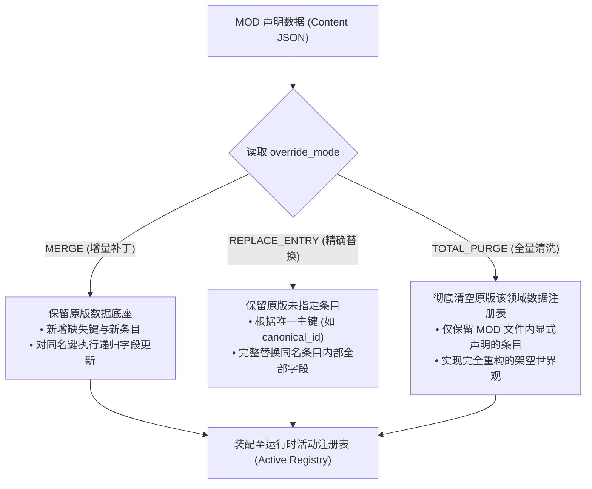

# 卡拉尔世界引擎 · 全局大魔改架构与数据覆写规范 (Total Conversion Specification)

> [!NOTE]
> **【规范定位与适用级别】**
> 本规范专为 Tier 3（全局大魔改 / Total Conversion / Overhaul）创作者制定。大魔改模组允许系统性重写卡拉尔引擎的底层物理世界观、战斗动力学方程、法术相变损失模型、装备体系与空间行军阻抗。

---

## 一、 大魔改定位与体系拓扑

不同于仅提供剧情分支或替换贴图的轻量扩展，全局大魔改模组有权接管并重构核心领域引擎的默认行为。为了保持数据资产的高内聚与可维护性，大魔改模组必须在根目录下建立 `content/` 模块化目录树：

```text
my_overhaul_mod/
├── pack.json                   # 清单中声明 "tier": "TIER_3_OVERHAUL"
├── assets_manifest.json        # 资产校验清单
├── assets/                     # 视听媒体资产
├── content/                    # 【核心】领域数据模块化重构目录
│   ├── world/                  # 地理空间、地形摩擦、A*寻路常数与城镇模板
│   │   └── default.json
│   ├── items/                  # 装备分类、权威物品库与属性修正
│   │   └── weapons.json
│   ├── skills/                 # 战斗动作动词、战技卡牌原型与消耗
│   │   └── combat_skills.json
│   ├── entities/               # 怪物模板、NPC 数值与遭遇战构成
│   │   └── bestiary.json
│   └── rules/                  # 底层动力学公式、相变系数与防御乘数
│       ├── combat_constants.json
│       └── mechanics.json
```

---

## 二、 差分覆写语义模型 (Differential Override Semantics)

大魔改数据文件采用统一的 `override_mode` 声明字段，精确定义模组数据与引擎原版（Vanilla）默认数据源的合并裁决行为。引擎支持三种严格差分模式：



### 1. `MERGE`（增量递归合并 - 默认安全模式）
- **适用场景**：在原版装备或技能库基础上新增扩展，或者微调部分参数（例如提高某把武器的基础威力，降低某种地形的行军消耗）。
- **语义行为**：
  * 字典类型：深度递归遍历合并，原版存在且模组中未提及的键保持原样，重合键采用模组数值覆盖；
  * 列表类型：模组列表项追加至原版列表末尾，跳过已存在的主键。

### 2. `REPLACE_ENTRY`（条目级精确替换）
- **适用场景**：重构特定武器类别、某几个特定动词动作（如重做 `PARRY` 判定），但不影响其他原生条目。
- **语义行为**：
  * 依据每个条目的唯一主键（如 `canonical_id`, `card_id`, `verb_type`）进行定位；
  * 匹配成功的条目被模组中提供的数据完全替换（不再执行字段级递归合并，丢弃原版多余字段）；
  * 原版中未被匹配的条目完整保留。

### 3. `TOTAL_PURGE`（全量清洗重构模式）
- **适用场景**：彻底脱离原版卡拉尔奇幻世界观的全面重构（如将奇幻世界改造为科幻废土或硬科幻星际设定）。
- **语义行为**：
  * 引擎在装配本模块前，将该领域对应的内置注册表全量清空（Purge/Wipe）；
  * 仅将模组文件中声明的条目注册进引擎；
  * 若采用此模式，模组必须完备声明核心系统正常运行所需的基底字段（否则静态门禁将抛出未决完整性缺失警报）。

---

## 三、 核心物理动力学与公式覆写机制

大魔改允许通过 `content/rules/combat_constants.json` 和 `content/rules/mechanics.json` 覆写底层战斗物理演算模型：

### 1. 动能挥砍与动量侵彻公式 (Kinetic & Penetration Formula)

在默认卡拉尔战斗模型中，挥砍打击的动能损伤计算遵循：

$$E_k = \text{energy\_coef} \times \max(m, \text{mass\_floor}) \times \max(v, \text{velocity\_floor})^2$$

有效侵彻压强由刃锋压强系数与动量换算：

$$P_{eff} = k_{mom} \cdot (m \cdot v) + k_{edge} \cdot \text{edge\_sharpness}$$

大魔改可以通过规则文件定制这些核心常数：

```json
{
  "$schema": "http://json-schema.org/draft-07/schema#",
  "override_mode": "MERGE",
  "combat_constants": {
    "kinetic": {
      "energy_coef": 0.65,
      "mass_floor": 0.05,
      "velocity_floor": 0.2
    },
    "defense_multipliers": {
      "block": 0.25,
      "parry": 0.40
    }
  }
}
```

### 2. 始源魔素相变损失方程 (Primordial Mana Phase Transition)

法术在吟唱与空间射程传播过程中的衰减模型：

$$\text{Loss}_{total} = \text{Loss}_{step1}(\text{incantation}) + \text{Loss}_{step2}(\text{distance})$$

模组可调整以下关键阈值，以实现“高损耗远距离衰减”或“超视距禁咒”的独特战斗手感：
- `incantation_step1_base`: 吟唱初始相变损耗底数（默认 `0.25`）；
- `step2_per_meter`: 每米射程的耗散率（默认 `0.01`）。

---

## 四、 声明式安全边界与沙箱公理

为了杜绝通过数值公式注入任意代码，卡拉尔世界引擎对公式覆写确立了严格的第一性原理约束：

1. **零代码执行 (Zero Arbitrary Code Execution)**：
   - 严禁在任何 JSON 文件中注入动态脚本语言片段、Python 代码、Lua 脚本或字符串形式的 `eval()` 表达式；
2. **纯参数化声明 (Pure Parametric Declarations)**：
   - 公式结构由引擎内核以硬编码形式固化，模组仅被授权覆写系数（Coefficients）、指数（Exponents）、乘数（Multipliers）与门槛值（Thresholds）；
3. **边界校验守卫 (Value Boundary Guards)**：
   - 所有的减伤与防御乘数必须满足 $0.0 \le \text{multiplier} \le 1.0$；
   - 质量与速度下限必须大于零（$\ge 0.001$），严禁配置负数或除零隐患参数。

---

## 五、 兼容性保障与降级回退机制 (Fallback Policies)

当多个大魔改模组或与旧版存档发生冲突时，引擎运行时执行以下保底策略：

1. **单大魔改独占建议**：
   - 通常情况下，同一个游戏存档仅允许激活一个声明了 `TOTAL_PURGE` 的 Tier 3 大魔改模组；若检测到多个 `TOTAL_PURGE` 模组同时启用，装配引擎将抛出 `ERR_MOD_INCOMPATIBLE_CONFLICT` 强制要求用户裁决；
2. **缺失键原版兜底 (Vanilla Fallback)**：
   - 在 `MERGE` 模式下，若模组未声明某项关键游戏常数（如 `damage_formulas.json` 遗漏了 `phase_transition`），引擎自动回退使用 `config/domains/combat/` 中的官方基线数值，杜绝运行时空指针异常；
3. **安全自愈隔离**：
   - 若大魔改数据在解析时出现非法类型或数值越界，引擎将在装配日志中记录结构化诊断，并针对受损单项重置为默认基线值，保障游戏主循环平稳运行。
