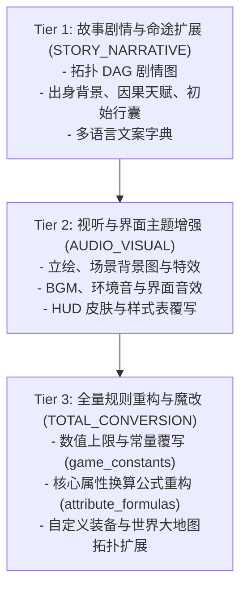

# 卡拉尔世界引擎 · MOD 范例工程与参考实现库 (Mod Examples & Reference Implementations)

本目录提供卡拉尔世界引擎（Kalar World Engine）官方参考范例工程，旨在帮助开发者与自主智能体（Agent）理解 MOD 分层架构规范、资源寻址协议以及工程化落地实践。

---

## 一、 范例工程索引 (Examples Index)

| 范例工程目录 | 分层定级 (Mod Tier) | 核心职责与演示内容 |
| :--- | :---: | :--- |
| [`custom_hud_theme/`](file:///c:/CODE_game-development/vscode-extensions/WebGames/mod_sdk/examples/custom_hud_theme/) | `AUDIO_VISUAL` (Tier 2) | 黑曜石暗黑主题 HUD 界面定制，包含九宫格主框架、状态条、交互按钮皮肤及 UI 音效虚拟资产映射 |

---

## 二、 MOD 架构分层规范 (Architecture Tiers)

卡拉尔引擎支持三级梯队的 MOD 扩展模型，各层级职责清晰且向下兼容：



### 1. Tier 1: 故事剧情与命途扩展 (`STORY_NARRATIVE`)
- **关注点**：剧情有向无环图（DAG）、角色身世起源（Origins）、正负因果天赋对（Causality Traits）、初始装备包（Starter Kits）及多语言本地化（i18n）。
- **参考模板**：[`templates/starter_story/`](file:///c:/CODE_game-development/vscode-extensions/WebGames/mod_sdk/templates/starter_story/)。

### 2. Tier 2: 视听与界面主题增强 (`AUDIO_VISUAL`)
- **关注点**：多媒体资源包与视觉交互覆写。通过声明式资产清单将立绘、背景插画、BGM、音效以及 HUD UI 控件贴图挂载至引擎运行时。
- **参考模板与范例**：
  - 模板：[`templates/audio_visual_pack/`](file:///c:/CODE_game-development/vscode-extensions/WebGames/mod_sdk/templates/audio_visual_pack/)
  - 范例：[`examples/custom_hud_theme/`](file:///c:/CODE_game-development/vscode-extensions/WebGames/mod_sdk/examples/custom_hud_theme/)

### 3. Tier 3: 全量规则重构与魔改 (`TOTAL_CONVERSION`)
- **关注点**：玩法机制、战斗公式、经济系统、物品空间与世界拓扑的大规模替换。通过 `override_mode: "FULL_OVERRIDE"` 覆写游戏基线逻辑。
- **参考模板**：[`templates/total_conversion_sample/`](file:///c:/CODE_game-development/vscode-extensions/WebGames/mod_sdk/templates/total_conversion_sample/)。

---

## 三、 `mod://` 虚拟资源寻址协议规范

为了实现资产解耦与无缝热插拔，卡拉尔世界引擎引入统一的 `mod://` 虚拟 URI 协议。

### 1. 协议语法格式
```text
mod://<asset_domain>/<sub_category>/<asset_name>.<extension>
```

- **协议头**：固定为 `mod://`；
- **虚拟领域路径**：由 MOD 创作者逻辑定义的标准相对路径，例如 `textures/portraits/`、`audio/bgm/`、`ui/hud/frames/`；
- **寻址映射**：所有 `mod://` 虚拟路径必须在 MOD 扩展包内的 `assets/manifest.json` 中明确声明，映射到扩展包物理目录下的真实文件（`relative_path`）。

### 2. 运行时解析流程
1. 引擎在加载 MOD 时解析 `assets/manifest.json`；
2. 注册表建立 `mod://<virtual_path>` 到物理文件路径的映射缓存；
3. UI 视图、DAG 节点或剧情渲染器请求资产时，协议解析器自动返回底层纹理、音频流或 3D 模型句柄；
4. 当多个 MOD 提供相同的虚拟资源时，高加载优先级（`priority` 较大）的 MOD 优先覆盖。

---

## 四、 黑曜石 HUD 主题范例 (`custom_hud_theme`) 结构

```text
custom_hud_theme/
├── pack.json                   # 清单元数据，声明 mod_tier 为 AUDIO_VISUAL
└── assets/
    └── manifest.json           # 声明 HUD 边框、状态条、按钮与 UI 音效规范
```

### 接入指引
1. 将扩展包放置于引擎的 `mods/narratives/` 或 `user://mods/narratives/` 目录下；
2. 确保 `pack.json` 中配置合规的 `pack_id` 与 `priority`；
3. 启动引擎后，单机与演习推演模块将根据依赖与优先级自动装载生效。

---

## 五、 工程验证与质量自检

开发者可通过 DevKit 静态诊断工具验证扩展包的合规性：

```bash
# 执行静态合规自愈预检
python WebGames/mod_sdk/tools/check_mod.py WebGames/mod_sdk/templates/starter_story

# 运行剧情演习推演器（无头模式）
python WebGames/mod_sdk/tools/preview_mod.py WebGames/mod_sdk/templates/starter_story --simulate
```
