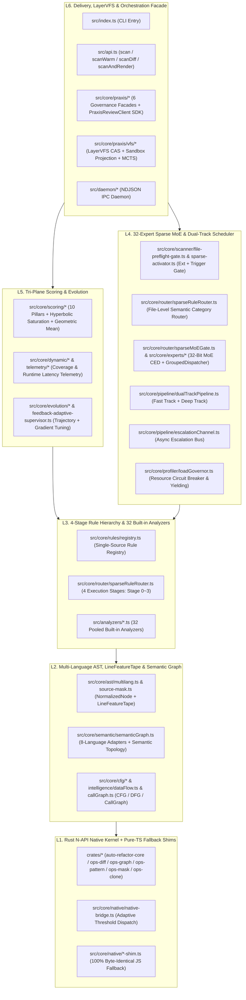
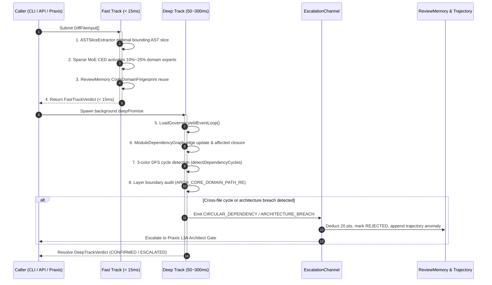

# 01. Six-Layer System Architecture & Core Dataflow

> **Layer**: L1 Core Architecture & Native Kernel (`docs/01-architecture/`)  
> **Source of Truth**: [`src/api.ts`](../../src/api.ts), [`src/core/analyzer.ts`](../../src/core/analyzer.ts), [`src/core/pipeline/dualTrackPipeline.ts`](../../src/core/pipeline/dualTrackPipeline.ts), [`src/core/pipeline/escalationChannel.ts`](../../src/core/pipeline/escalationChannel.ts), [`src/core/router/sparseRuleRouter.ts`](../../src/core/router/sparseRuleRouter.ts), [`src/core/router/sparseMoEGate.ts`](../../src/core/router/sparseMoEGate.ts), [`src/core/experts/expert-catalog.ts`](../../src/core/experts/expert-catalog.ts), [`src/core/experts/grouped-dispatcher.ts`](../../src/core/experts/grouped-dispatcher.ts), [`src/core/scanner/file-preflight-gate.ts`](../../src/core/scanner/file-preflight-gate.ts), [`src/core/profiler/loadGovernor.ts`](../../src/core/profiler/loadGovernor.ts), [`src/core/praxis/vfs/index.ts`](../../src/core/praxis/vfs/index.ts)

---

## 1. Six-Layer Unidirectional Topology

`auto-refactor` enforces a strict **bottom-up 6-layer unidirectional dependency graph**, guaranteeing zero upward coupling from native operators, unified cross-language AST/IR semantics, and 100% byte-identical output between cold and warm scans.

### 1.1 Layer Responsibilities

- **L1 (Native Kernel)**: Rust 2021 Cargo workspace exposing Myers diff, dominator tree, dataflow solver, lexical masking, and MinHash+LSH clone operators via N-API (`crates/auto-refactor-core/`), backed by 100% byte-identical pure-TS shims (`src/core/native/`).
- **L2 (Semantic IR & Tape)**: Normalizes TypeScript, JavaScript, Python, Rust, Go, Shell, GDScript, YAML, and Markdown into `NormalizedNode`, `SemanticGraph`, and single-pass `LineFeatureTape` (`LINE_FLAG_*` bitmasks).
- **L3 (Rule & Analyzer Matrix)**: Single-source registry (`src/core/rules/registry.ts`) governing <!-- METRICS:BEGIN rule-auto-refactor -->**375 条规则**<!-- METRICS:END rule-auto-refactor --> (<!-- METRICS:BEGIN rule-auto-refactor-canonical -->**360 条**<!-- METRICS:END rule-auto-refactor-canonical --> canonical + <!-- METRICS:BEGIN rule-auto-refactor-legacy -->**15 条**<!-- METRICS:END rule-auto-refactor-legacy --> legacy aliases; workspace SSOT <!-- METRICS:BEGIN rule-total -->**534 条规则**<!-- METRICS:END rule-total -->) across <!-- METRICS:BEGIN analyzer-count -->**32 个**<!-- METRICS:END analyzer-count --> pooled analyzers in 4 stages.
- **L4 (Sparse MoE & Dual-Track Pipeline)**: Combines 5-tier Sparse MoE routing, `< 15ms` speculative Fast Track, asynchronous cross-file Deep Track, and `LoadGovernor` memory/CPU circuit breaking.
- **L5 (Quality Scoring)**: 10-pillar hyperbolic saturation + geometric bottleneck penalty fused with runtime telemetry and Git evolution trajectories.
- **L6 (Delivery & LayerVFS)**: CLI, programmatic API, NDJSON daemon, LayerVFS CAS sandbox, and Praxis multi-agent governance SDK (`PraxisReviewClient`).

---

## 2. 32 Built-in Analyzers & 4-Stage Pipeline Matrix

`ALL_BUILTIN_ANALYZERS` in [`src/core/router/sparseRuleRouter.ts`](../../src/core/router/sparseRuleRouter.ts) partitions all <!-- METRICS:BEGIN analyzer-count -->**32 个**<!-- METRICS:END analyzer-count --> built-in analyzers into 4 deterministic stages ($6 + 5 + 9 + 12 = 32$):

| Stage | Responsibility | Built-in Analyzers (Count) | Representative Checks |
| :--- | :--- | :--- | :--- |
| **Stage 0** | **Physical Hygiene & Emergency Security** Fast text/lexical barrier blocking oversized files, leaked secrets, and destructive injections | `hygiene` `shell-lint` `shell-safety` `large-file` `secrets` `security` *(6 analyzers)* | Secret leakage, command injection, destructive deletion taint (`GUARD-DESTR-001`), line/ELOC budget, 0-byte files, mixed EOL |
| **Stage 1** | **Lexical Conventions, Constants & Docs** Validates naming, magic literals, comment headers, and production hygiene | `comments` `naming` `constants` `docs` `production-hygiene` *(5 analyzers)* | Hardcoded literals (`CONST-LAY-001`), naming drift, 6-field module headers (`CMT-HDR-001`), debug residue |
| **Stage 2** | **Single-File AST, Control Flow & Modernization** Evaluates AST complexity, stdlib idioms, and language modernization | `simplify` `complexity` `stdlib` `typescript-modern` `python-modern` `rust-modern` `gdscript-modern` `go-modern` `frontend` *(9 analyzers)* | Cyclomatic/cognitive complexity, nesting depth, trampoline facades (`ARCH-ABS-001`), language-specific modern idioms (`*-modern`) |
| **Stage 3** | **Domain Architecture, Concurrency & Cross-File Topology** Evaluates cross-file dependency graphs, layer boundaries, concurrency hazards, and domain contracts | `performance` `architecture` `data-architecture` `dependency-layout` `dependency-graph` `gate-architecture` `gdscript-game` `vscode-extension` `client-exposure` `test-modernity` `concurrency` `governance` *(12 analyzers)* | Circular imports (`import-cycle`), layer inversion (`clean-layer-violation`), async/lock hazards (`concurrency`), slice breach (`GOV-SLC-001`), multi-agent conflict (`GOV-AGN-001`) |

### 2.1 Single-Source Rule Registry (`RULE_REGISTRY`)

Managed in [`src/core/rules/registry.ts`](../../src/core/rules/registry.ts):
- <!-- METRICS:BEGIN rule-auto-refactor -->**375 条规则**<!-- METRICS:END rule-auto-refactor -->: <!-- METRICS:BEGIN rule-auto-refactor-canonical -->**360 条**<!-- METRICS:END rule-auto-refactor-canonical --> canonical rules (`FAMILY-TOPIC-NNN`) + <!-- METRICS:BEGIN rule-auto-refactor-legacy -->**15 条**<!-- METRICS:END rule-auto-refactor-legacy --> backward-compatible aliases (`import-cycle`, `clean-layer-violation`, etc.).
- <!-- METRICS:BEGIN topic-count -->**33 个**<!-- METRICS:END topic-count --> canonical rule families mapped via `CANONICAL_TOPIC_CATALOG`.
- Enforced by `node scripts/validate-rules-registry.js` for 100% registry $\leftrightarrow$ emitter $\leftrightarrow$ documentation closure.

---

## 3. Dual-Track Concurrent Pipeline (`DualTrackPipeline`)

[`src/core/pipeline/dualTrackPipeline.ts`](../../src/core/pipeline/dualTrackPipeline.ts) decouples sub-15ms foreground feedback from asynchronous whole-graph verification:

- **Fast Track (`< 15ms`)**: Extracts minimal mutated AST slices (`ASTSliceExtractor`), reuses clean domain fingerprints (`ReviewMemoryManager`), runs MoE-gated experts, and returns `FastTrackVerdict` (`SPECULATIVE_PASSED` | `SPECULATIVE_REJECTED`, 10D score, `agentGuidancePrompt`).
- **Deep Track (`50~300ms`)**: Yields event loop via `LoadGovernor.yieldEventLoop()`, updates `ModuleDependencyGraph`, runs iterative 3-color DFS cycle detection (`detectDependencyCycles`), audits layer boundaries, and publishes `CIRCULAR_DEPENDENCY` / `ARCHITECTURE_BREACH` / `TRANSITIVE_REGRESSION` / `SPECULATIVE_INVALIDATION` events to `EscalationChannel` (`ESCALATION_SCORE_PENALTY = 20`).

---

## 4. Five-Tier Sparse MoE Routing & Analyzer Execution Engine

To cut AST traversal and transient heap allocations by 80%–95% without false negatives, `auto-refactor` cascades five routing and pooling mechanisms:

### 4.1 Tier 1: File Preflight Gate & Sparse Activator (`file-preflight-gate.ts` / `sparse-activator.ts`)
- **Language & Extension Matrix**: [`src/core/preflight/sparse-activator.ts`](../../src/core/preflight/sparse-activator.ts) (`LANGUAGE_ANALYZER_MATRIX`) and [`src/core/scanner/file-preflight-gate.ts`](../../src/core/scanner/file-preflight-gate.ts) filter analyzers by file extension (`DOCS_EXTS`, `SHELL_EXTS`, TS/JS/Py/Rust/Go/GDScript) before AST parsing.
- **Fast Substring Trigger Catalog**: [`src/core/scanner/trigger-catalog.ts`](../../src/core/scanner/trigger-catalog.ts) (`registerDefaultTriggers`, `ASYNC_TRIGGERS`) pre-screens raw source buffers; specialized analyzers (`shell-lint`, `concurrency`, `gdscript-modern`, `rust-modern`, `go-modern`, `client-exposure`, `vscode-extension`) bypass files lacking their domain trigger tokens.

### 4.2 Tier 2: Macro File-Level Router (`sparseRuleRouter.ts`)
- Prunes analyzers by `DiffSemanticCategory` × `ProjectArchetype`:
  - **Always-On Core**: `hygiene`, `secrets`, `security`, `governance`.
  - **Conditional Experts**: `doc-only` activates only `comments` + `docs`; `literal-only` activates `constants` + `secrets`; control-flow edits activate `complexity`, `simplify`, `performance`.
  - Achieves **$\ge 70\%$** analyzer bypass ratio on incremental diffs with zero recall loss.

### 4.3 Tier 3: Micro AST-Slice CED Gate (`sparseMoEGate.ts`)
- Evaluates `SliceFeatureVector` (`isDocOnly`, `hasLiteralMutation`, `hasSignatureMutation`, `hasControlFlowMutation`, `hasIoMutation`, `hasAsyncMutation`, `hasTypeMutation`) per mutated function/block, activating **10%–25%** (2–4 experts) per slice with automatic fallback to `complexity` + `governance` + `hygiene`.

### 4.4 Tier 4: 32-Bit Unsigned Expert Bitmask & Grouped Dispatcher (`src/core/experts/`)
- **32-Bit Unsigned Bitmask Parity**: [`src/core/constants/analyzer-bitmask.ts`](../../src/core/constants/analyzer-bitmask.ts) assigns each of the 32 analyzers a distinct bit (`1 << 0` through `1 << 31`). Because `AnalyzerBit.CONCURRENCY = 1 << 31` sets the Int32 sign bit (`-2147483648`), `BIT_TO_ANALYZER_NAME`, `EXPERT_BY_BIT` ([`expert-catalog.ts`](../../src/core/experts/expert-catalog.ts)), and `EXPERT_BASE_SCORES` ([`expert-activation-library.ts`](../../src/core/experts/expert-activation-library.ts)) normalize keys via `(bit >>> 0)` and index both signed and unsigned representations, with `EXPERT_BY_INDEX` fallback in [`grouped-dispatcher.ts`](../../src/core/experts/grouped-dispatcher.ts).
- **`LineFeatureTape` (`LINE_FLAG_*`) Pre-Gating**: Analyzers inspect precomputed per-line bitmasks (`LINE_FLAG_HAS_CALL_PAREN`, `LINE_FLAG_COMMENT`, `LINE_FLAG_IMPORT`, etc. in [`src/core/ast/source-mask.ts`](../../src/core/ast/source-mask.ts)) to skip irrelevant lines in $O(1)$ before regex or AST node inspection.

### 4.5 Tier 5: Zero-Allocation Pooling (`resetState()`) & Lazy AST Evaluation
- **32/32 Instance Pooling**: Every built-in analyzer implements `resetState()` and registers in `AnalyzerPool`, clearing per-file maps/buffers in-place to eliminate per-file analyzer instantiation overhead.
- **Lazy `ctx.sourceFile` Evaluation**: In `finalize(ctx)`, analyzers inspect `ctx.lines` / `ctx.maskedText` first and access `ctx.sourceFile` only when an AST-dependent sub-check actually fires, avoiding eager TypeScript `SourceFile` parsing on text-only paths.

---

## 5. Adaptive Scale Tuning & `LoadGovernor`

[`src/core/profiler/loadGovernor.ts`](../../src/core/profiler/loadGovernor.ts) prevents host OOM and event-loop starvation:

- **Hard Circuit-Breaker Thresholds**: `DEFAULT_RSS_THRESHOLD_MB = 600` (600 MiB), `DEFAULT_HEAP_THRESHOLD_MB = 450` (450 MiB), CPU `loadAvg1m > cpuCount * 0.85`.
- **Scale Grades (`GovernorScaleGrade`)**:
  - `MICRO` ($< 50$ files): `maxDeepConcurrency = 4`, `yieldIntervalMs = 50`
  - `STANDARD` ($50 \sim 500$ files): `maxDeepConcurrency = 4`, `yieldIntervalMs = 25`
  - `ENTERPRISE` ($501 \sim 5000$ files): `maxDeepConcurrency = 6`, `yieldIntervalMs = 10`
  - `MASSIVE` ($> 5000$ files): `maxDeepConcurrency = 8`, `yieldIntervalMs = 5`
- **Memory Pressure Throttling**: When `isMemoryConstrained === true`, `LoadGovernor` clamps `maxDeepConcurrency = 1`, tightens `yieldIntervalMs = 5`, and sets `throttleDeepTrack = true`.

---

## 6. Related Architecture Docs

- [02. Three-Tier Incremental Cache & Topology Invalidation](./02-pipeline-and-caching.md)
- [03. Cross-Platform Daemon & NDJSON IPC Protocol](./03-daemon-and-ipc.md)
- [04. Praxis Fractal Git Worktree & Multi-Stage Gating](./04-praxis-git-fractal-and-gating-spec.md)
- [05. Rust N-API Native Operator Kernel & Dual-Track Shims](./05-rust-native-operator-kernel.md)
