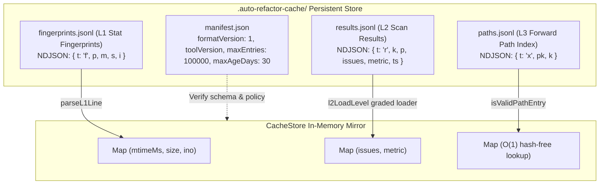

# 02. Three-Tier Incremental Cache & Topology Invalidation

> **Layer**: L1 Core Architecture & Native Kernel (`docs/01-architecture/`)  
> **Source of Truth**: [`src/core/cache.ts`](../../src/core/cache.ts), [`src/core/cache-key.ts`](../../src/core/cache-key.ts), [`src/core/cache-persistence.ts`](../../src/core/cache-persistence.ts), [`src/core/scheduler/topology-cache-manager.ts`](../../src/core/scheduler/topology-cache-manager.ts), [`src/core/reporting/reportFinalizer.ts`](../../src/core/reporting/reportFinalizer.ts)

---

## 1. Physical Three-Tier Cache Layout (`.auto-refactor-cache/`)

```
.auto-refactor-cache/
├── manifest.json       # Format version, tool version & capacity policy
├── fingerprints.jsonl  # L1 physical stat fingerprints: { t: 'f', p, m, s, i }
├── results.jsonl       # L2 per-file scan results: { t: 'r', k, p, issues, metric, ts }
└── paths.jsonl         # L3 path-to-key forward index: { t: 'x', pk, k }
```



- **`manifest.json`**: Schema version gate (`CACHE_FORMAT_VERSION = 1`). Any version mismatch or missing numeric field triggers `rebuildManifest()` to purge and reinitialize the store.
- **`fingerprints.jsonl` (L1)**: Stores `m` (`mtimeMs`), `s` (`size`), and `i` (`ino`). Matching `fs.statSync(filePath)` against L1 bypasses file reads and SHA-256 hashing completely.
- **`results.jsonl` (L2)**: Stores composite `cacheKey` (`k`), normalized relative path (`p`), single-file `issues`, `metric`, and write timestamp (`ts`).
- **`paths.jsonl` (L3)**: Maps normalized path (`pk`) to the latest `cacheKey` (`k`) for $O(1)$ hash-free lookup on warm scans.

---

## 2. Four-Grade Dynamic L2 Loader (`l2LoadLevel`)

To prevent heap exhaustion when `results.jsonl` grows large, `loadResults()` in [`src/core/cache.ts`](../../src/core/cache.ts) computes $\text{LoadRatio} = \operatorname{stat}(\texttt{results.jsonl}).\text{size} / \text{maxL2LoadBytes}$ (default `maxL2LoadBytes = 64 MiB`):

| Grade (`l2LoadLevel`) | Trigger Ratio | Memory Residency Strategy | Target Scenario |
| :--- | :---: | :--- | :--- |
| **`full`** | $\text{Ratio} \le 0.7$ ($\le 44.8\text{ MiB}$) | `loadResultsFull()`: deserializes all L2 issues and metrics into memory | Standard repos, instant warm start |
| **`hot`** | $0.7 < \text{Ratio} \le 1.0$ ($\le 64\text{ MiB}$) | `loadResultsFiltered()`: loads only entries active within 7 days (`ts >= cutoff`) or containing `severity === 'error'` | Large active repos |
| **`metadata`** | $1.0 < \text{Ratio} \le 2.0$ ($\le 128\text{ MiB}$) | `loadResultsMetadataOnly()`: loads keys and metrics only, omitting issue payloads ($> 85\%$ heap savings) | Memory-constrained monorepos |
| **`disabled`** | $\text{Ratio} > 2.0$ ($> 128\text{ MiB}$) | Skips L2 loading with `Logger.warn`, falling back to on-demand analysis | OOM protection |

---

## 3. Composite Cache Key & `FingerprintPayload`

[`src/core/cache-key.ts`](../../src/core/cache-key.ts) constructs each L2 key as:

$$\text{L2Key} = \texttt{"v1:"} + \operatorname{sha256Hex}\big(\operatorname{canonicalJson}(\text{FingerprintPayload})\big) + \texttt{":"} + \operatorname{sha256Hex}(\text{fileRawBytes})$$

### 3.1 `FingerprintPayload` 12 Invalidation Factors

```typescript
export interface FingerprintPayload {
  formatVersion: number;                    // 1. Cache format version (1)
  toolVersion: string;                      // 2. auto-refactor package version
  nodeMajor: number;                        // 3. Node.js major version
  adapterId: string;                        // 4. Parser backend ('typescript' | 'oxc' | 'rust')
  adapterVersions: Record<string, number>;  // 5. Per-language adapter versions
  projection: {                             // 6. AST projection & fastPath policy
    fastPath: boolean;
    legacyCount: number;
    policyHash: string;
  };
  analyzers: {                              // 7. Enabled analyzers & options hashes
    name: string;
    version: number;
    modulePath: string;
    optionsHash: string;
  }[];
  thresholds: Record<string, any>;          // 8. Complexity & metric thresholds
  customHash: string | null;                // 9. Custom plugin SHA-256 (cacheCustom)
  fileExt: string;                          // 10. File extension
  unsupportedLanguage: 'error' | 'warning' | 'off'; // 11. Guard level
  engineDigest: string;                     // 12. Compiled dist/{analyzers,core/ast} SHA-256
}
```

> [!IMPORTANT]
> **`engineDigest` Automatic Invalidation**: Computes SHA-256 over all compiled modules under `dist/analyzers` and `dist/core/ast` sorted by relative path. Any analyzer or AST projection code change automatically shifts `fpHash` without manual version bumps (verified by `tests/unit/core/cache-key-engine-digest.test.ts`).

### 3.2 Post-Scan Decoupling & Cold/Warm Byte Parity
- `results.jsonl` caches **only** context-free single-file issues.
- Cross-file cycle detection (`runCyclePass`), baseline ratcheting (`baseline.json`), suppressions, and 10D scoring execute in [`src/core/reporting/reportFinalizer.ts`](../../src/core/reporting/reportFinalizer.ts) over the merged result set, guaranteeing 100% byte-identical `ScanReport` output between cached warm scans and cold scans (`npm run validate-postscan-parity`).

---

## 4. `TopologyCacheManager` (DAG Cascading Invalidation)

[`src/core/scheduler/topology-cache-manager.ts`](../../src/core/scheduler/topology-cache-manager.ts) maintains a two-tier LRU topology cache (L1 capacity 1,000; L2 capacity 4,000) with bidirectional edges (`dependsOn` and `dependedBy`):

- **Internal Body Edit (`signatureChanged === false`)**: `invalidateSubtree(changedFile, false)` evicts only `changedFile`, preserving cached results for all downstream callers.
- **Public Contract Mutation (`signatureChanged === true`)**: `invalidateSubtree(changedFile, true)` traverses `dependedBy` edges recursively via `collectTransitiveDependents`, evicting the entire affected downstream subgraph from L1/L2 to prevent stale cross-module diagnostics.

---

## 5. Atomic Persistence & `SyncIoBarrier`

[`src/core/cache-persistence.ts`](../../src/core/cache-persistence.ts) isolates synchronous disk I/O behind `SyncIoBarrier` and enforces crash-safe atomic writes via `writeFileAtomic(file, data)`:
1. Writes full payload to `${file}.tmp-${process.pid}-${randomHex}`.
2. Executes atomic OS rename (`fs.renameSync(stagingPath, file)`), preventing 0-byte or torn cache files on crash or power loss.
3. Cleans up any leftover staging file in `catch` via `cleanupStagingFile`.

---

## 6. Related Architecture Docs

- [01. Six-Layer System Architecture & Core Dataflow](./01-system-overview.md)
- [03. Cross-Platform Daemon & NDJSON IPC Protocol](./03-daemon-and-ipc.md)
- [04. Praxis Fractal Git Worktree & Multi-Stage Gating](./04-praxis-git-fractal-and-gating-spec.md)
