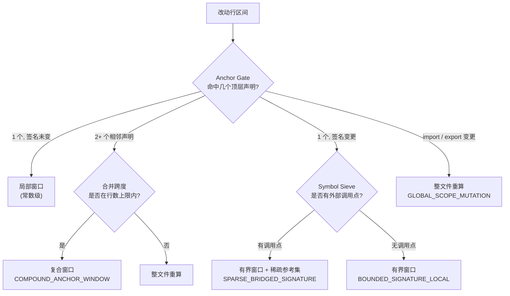

# 稀疏参考滑动窗口重算

> 本文说明 `auto-refactor` 如何把长文档解析领域的稀疏参考注意力思想，落地为代码增量重算里的常数级工作集。读者对象是需要判断「这次改动到底重算了多少」的引擎维护者与 Praxis 对接方。

## 1. 要解决的问题

增量重算的前提是「只算改动影响到的部分」。基线滑窗管理器把局部编辑限制在单个顶层声明内，命中时只重算声明所在的行区间；一旦改动形态超出一个声明，它就退回整文件重算：

| 改动形态 | 基线行为 | 代价 |
| :--- | :--- | :--- |
| 单声明内部编辑 | 有界窗口 | 常数级 |
| 相邻多个声明连续编辑 | 整文件重算 | 随文件长度线性增长 |
| 函数签名变更 | 整文件重算 | 随文件长度线性增长 |
| import / export 变更 | 整文件重算 | 随文件长度线性增长 |

真实重构里，「改一个函数签名」是最常见的动作之一。每次都退回整文件，等于把增量能力在最需要的地方关掉。

## 2. 两级稀疏：Anchor Gate 与 Symbol Sieve

稀疏参考重算把退化情形分成三类，只对可证明有界的两类做提升：

**Anchor Gate** 决定窗口从哪一行到哪一行。

**Symbol Sieve** 决定窗口之外还要看哪些调用点。签名变了，真正需要复核的不是整个文件，而是「哪些外部调用点按旧签名写的」。把这些调用点作为有界参考集挂到窗口上，工作集就不再随文件长度增长，而是随调用点数量增长——而调用点数量由预算封顶。

## 3. 三条边界，为什么这样划

**合并跨度必须有上限。** 一个悄悄覆盖整个文件的「有界窗口」只是换了名字的整文件重算。因此合并只有在跨度不超过行数上限时才发生，超限就如实报告整文件重算。

**import 变更仍然整文件重算。** 改 import 改变的是整个文件的模块解析结果，没有任何有界窗口能证明其余部分不受影响。这里保留退化是正确的，不是遗漏。

**签名变更没有外部调用点时，窗口有界但不标桥接。** 没有外部调用点，声明之外不可能存在旧签名的用法；窗口可以安全地收窄到声明本身。但此时没有参考任何外部上下文，所以不能声称「已桥接」——`isSparseBridged` 保持 false，理由标签是 `BOUNDED_SIGNATURE_LOCAL`。把这两种情形混为一谈会让人误以为外部调用点已被核对。

## 4. 参考集怎么选

调用图里的调用点按两档排序：跨文件调用点优先，同文件调用点靠后。理由很直接——同文件调用点通常已经在窗口内被重算了，把预算花在它身上，被挤掉的恰好是窗口够不到的那个调用点。

同档之内按文件、再按行号排序，因此同一份代码在不同机器、不同运行顺序下得到同一份参考集。

预算默认封顶 32 个调用点。

## 5. 与树级剪枝的配合

窗口确定之后，遍历阶段再做一次节点级剪枝：整棵子树若完全落在窗口之外，直接跳过不下降；节点只要与窗口有交集（哪怕只是包住窗口），仍然派发，因为它携带作用域上下文。

不剪的两类节点是有意保留的：没有位置信息的节点无法证明窗外无内容，包住窗口的节点一旦剪掉会让后续节点的嵌套深度失真。这两种情况剪掉的省不下多少，剪错的代价却是一条漏报。

## 6. 大仓的符号边界

符号索引本身保留全部声明与调用边，这对仓库级语料是正确的，对超大仓则无界。流式视图把两者分开处理：

- 声明留在紧凑名字表里，永不被淘汰——「这个符号存在」几乎不占空间；
- 调用边按活跃文件预算淘汰，腾出空间给新文件；
- 淘汰按引用数优先、再按新旧排序：积累了多条调用边的文件更可能被后续查询需要，而一串只被引用一次的尾部文件不应挤掉图里的枢纽。

被淘汰文件的调用边不再可查。此时「没有调用方」和「这个文件被淘汰了」是两件不同的事，视图不会把后者报成前者。

## 7. 验证入口

| 命令 | 断言内容 |
| :--- | :--- |
| `npm run validate-sparse-replay` | 局部编辑、复合锚点、超限退化、签名桥接、预算封顶、无解析器退化、import 保留整文件、解析器排序与确定性、问题剪枝委托 |
| `npm run validate-sparse-hopper` | 节点定位分类、剪枝资格、派发规则、窗口等价性、空窗口全剪、流式预算、显著性保护、视图还原索引事实 |

窗口等价性是其中的关键断言：同一次有界遍历必须产出与无界遍历完全相同的窗内节点集合。剪枝唯一可接受的效果是「什么都不变，只是更快」。
