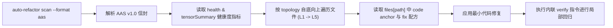

# 05. 外部工程与工作区子系统审查接入指南 (Consumer Integration & Audit Docking Guide)

> **所属层级**：L5 规范、三平面质量度量与性能基准 (`docs/05-specs-and-benchmarks/`)  
> **对应代码真源**：[`reportFinalizer.ts`](../../src/core/reporting/reportFinalizer.ts)、[`scanner.ts`](../../src/core/scanner.ts)、[`aas-reporter.ts`](../../src/core/reporting/aas-reporter.ts)、[`elastic-debt-budget.ts`](../../src/core/intelligence/elastic-debt-budget.ts)、[`validate-baseline-ratchet.js`](../../scripts/validate-baseline-ratchet.js)、[`templates/consumer/run.mjs`](../../templates/consumer/run.mjs)

---

## 1. 架构定位与消费模式矩阵 (Consumer Architecture Matrix)

`auto-refactor` 作为工作区静态分析与多智能体代码治理引擎，内置 <!-- METRICS:BEGIN analyzer-count -->**32 个**<!-- METRICS:END analyzer-count -->分析器与 <!-- METRICS:BEGIN rule-auto-refactor -->**375 条规则**<!-- METRICS:END rule-auto-refactor -->（全工作区 SSOT 单源收录 <!-- METRICS:BEGIN rule-total -->**534 条规则**<!-- METRICS:END rule-total -->）。针对不同的宿主工程形态与执行阶段，系统提供四种正交消费模式：

| 消费模式 | 调用接口 / 入口命令 | 输出介质与协议 | 适用场景与典型消费者 |
| :--- | :--- | :--- | :--- |
| **CLI / 流式命令** | `auto-refactor scan [opts]` | JSON / SARIF 2.1.0 / Text | 本地终端手工排查、CI 提交门禁（`pre-commit-gate.ps1`）、GitHub Code Scanning 平台汇编 |
| **进程内 API 编排** | `import { Scanner } from 'auto-refactor'` | `ScanReport` / 内存对象树 | 兄弟工程测试自审（如 `fractal-git` 的 `run-audit-report.js`）、自定义质检脚本 |
| **常驻 Daemon / IPC** | 命名管道 (Windows) / Unix Domain Socket (POSIX) | NDJSON 流式帧协议 | IDE 语言服务器联动、低延迟增量保存分析（`< 15ms` 响应） |
| **智能体原生审查契约 (AAS)** | `auto-refactor scan --format aas` | AAS v1.0 结构化信封 | SubAgent 自动化审查与修复注入、多智能体协同流水线（Token 压缩比率达 70%~92%） |

---

## 2. 存量工程演进：单向收紧基线棘轮与自适应弹性债务预算

存量大型项目在接入全量静态分析规则时，往往面临已有历史违规的治理问题。若一次性阻断会导致开发受阻；若全量豁免则会掩盖劣变。`auto-refactor` 通过**单向收紧基线棘轮**与**自适应弹性技术债务预算**建立平滑演进通道。

### 2.1 棘轮信用额度消耗模型 (`baseline.json` 1.2.0)

Baseline 1.2.0 采用基于直方图多重度（Multiplicity）的分组信用机制，唯一键为 `(analyzer, rule, file, severity)`：

| 对比场景 | 门禁裁决 | 底层判定依据与信用机制 |
| :--- | :---: | :--- |
| 某「分析器\|规则\|文件」存量记录为 $N$ 次，本次扫描出现 $N$ 次 | **通过 (PASS)** | 消耗历史 $N$ 点信用额度，`ratchetNew = 0`，不阻断日常提交 |
| 某「分析器\|规则\|文件」存量为 $N$ 次，本次扫描增至 $N+1$ 次 | **阻断 (`newBlocking`)** | 前 $N$ 次消耗历史信用，第 $N+1$ 次无信用可用，判定为新增违规 |
| 同一行新增第二条同规则同严重度违规 | **阻断 (`newBlocking`)** | 按直方图计数判定，规避借同一行逃逸门禁的行为 |
| 历史 `warning` 违规因文件复杂度攀升升级为 `error` | **阻断 (`newBlocking`)** | 低严重度信用禁止跨级抵扣高严重度违规 |
| 历史违规被修复，当前违规数降为 $N-1$ 次 | **通过 (PASS)** | 债务实际缩减，可通过 `--baseline-ratchet-down` 锁死新低水位 |

### 2.2 自适应弹性债务预算模型 (Elastic Debt Budget)

在大型代码库重构与渐进迁移过程中，刚性单点阈值易造成良性微调被误阻断。系统引入由 [`elastic-debt-budget.ts`](../../src/core/intelligence/elastic-debt-budget.ts) 驱动的自适应弹性债务限额机制：

$$B_{\text{debt}} = f(\text{LOC}, \text{Files}, \text{CAI}, \text{Grade})$$

- **规模与健康度联动**：基准限额根据工程代码行数、文件规模与当前综合自治度（CAI）动态自适应调节，为高成熟度代码库提供合理的微调容差区间；
- **反刷分与虚假重构熔断 (`BLOCK_GAMING_DETECTED`)**：
  若检测到代码重构中语义有效变更比例 $\text{ELOC}_{\text{semantic}} \le 15\%$，且未消除实质技术债务，系统判定为无效重构并触发熔断阻断；
- **严重度分级隔离**：密钥泄漏（`SEC-LEAK-001`）等致命问题不受弹性配额豁免，维持即时阻断。

---

## 3. 工作区核心工程对接矩阵与实测配置

系统为工作区三大核心兄弟工程提供针对性分析器组合与接入适配：

### 3.1 `fractal-git/`（Taxis Rust 内核工程对接）

- **工程特征**：Rust 2021 Workspace 架构，包含 10 大内核子系统 Crate、约 299 个 Rust 文件与 930+ 项回归测试；
- **审查重点**：
  - Crate DAG 单向分层拓扑与边界规范；
  - 循环内零瞬态堆分配（`FGT-PRF-001`）与 `unsafe` 安全证明（`FGT-SAF-001`）；
  - `ANALYZER_RUST_MODERN`（Type-State 状态机设计、强类型错误声明与错误穷尽性）；
  - `ANALYZER_GATE_ARCHITECTURE`（跨层调用隔离）；
- **进程内深度扫描集成**：
  Taxis 自审门禁 [`fractal-git/scripts/common/run-audit-report.js`](../../../fractal-git/scripts/common/run-audit-report.js) 直接调用 `auto-refactor` 的 `Scanner` 门面：
  ```javascript
  const { Scanner } = require('../../../auto-refactor/src/core/scanner');
  const scanner = new Scanner({
    root: PROJECT_ROOT,
    logLevel: 'error',
    autoAutonomy: true,
    maxEloc: 900,
    maxComplexity: 15,
  });
  const report = await scanner.scan();
  ```
- **晋级门禁桥接**：扫描输出的综合分与 CAI 指标直通 `PROMOTION-BRIDGE-05`，自动驱动 `taxis promotion request` 提权审批工作流。

### 3.2 `workspace-timing/`（VS Code 插件工程对接）

- **工程特征**：VS Code 扩展开发，五层分层依赖架构（`UI -> Engine -> Storage -> Analytics -> Shared`）；
- **审查重点**：
  - `vscode-extension` 分析器：监控 `Disposable` 内存泄漏（`PRF-LEAK-001`）、主线程长任务阻塞；
  - `architecture` 分析器：单向架构依赖守卫与循环引用拦截；
  - UI 国际化双语字典对齐检查；
- **配置示例**（[`presets/vscode-extension.config.json`](../../presets/vscode-extension.config.json)）：
  ```json
  {
    "include": ["src/**/*.ts"],
    "exclude": ["**/dist/**", "**/tests/**"],
    "analyzers": {
      "vscode-extension": { "enabled": true },
      "architecture": { "enabled": true },
      "dependency-graph": { "enabled": true },
      "secrets": { "enabled": true }
    },
    "securityLevel": "full",
    "commentLevel": "standard"
  }
  ```

### 3.3 `WebGames/`（Godot 4.7 GDScript 游戏逻辑对接）

- **工程特征**：全域 `GameConfig` 驱动的 Godot 4.7 游戏工程；
- **审查重点**：
  - `gdscript-modern` 分析器：GDScript 强类型注解与静态推导；
  - `gdscript-game` 分析器：热循环内零瞬态分配（`GME-PRF-001` / `ADV-PRF-002`）、对象池 `reset_state()` 契约；
  - 视图组件业务计算剥离，强制通过 `apply_snapshot()` 单向注入状态；
- **配置示例**（[`presets/godot-game.config.json`](../../presets/godot-game.config.json)）：
  ```json
  {
    "include": ["**/*.gd"],
    "exclude": ["**/addons/**", "**/test/**"],
    "analyzers": {
      "gdscript-modern": { "enabled": true },
      "gdscript-game": { "enabled": true }
    }
  }
  ```

---

## 4. 智能体原生审查架构契约 (AAS v1.0) 消费指南

在智能体主导的自动化流水线中，推荐统一使用 AAS v1.0 协议（详见 [`08-compact-agent-schema.md`](./08-compact-agent-schema.md)）。

### 4.1 协议核心优势

1. **按文件聚合 (File-Grouped)**：消除冗余路径字符串，规避上下文重复填充；
2. **拓扑分层排序 (L1 $\to$ L5)**：
   缺陷文件严格依照系统架构依赖次序排列（`L1_CONTRACT` $\to$ `L2_INFRA` $\to$ `L3_CONFIG` $\to$ `L4_BUSINESS` $\to$ `L5_GOVERNANCE`），指导智能体自底向上开展原子修复；
3. **内联代码锚点 (Code Anchor)**：提取问题核心行及上下文 1~2 行切片（标记 `> ` 指针），智能体无需额外读盘即可直观判定；
4. **结构化修复动作 (Remediation Recipe)**：携带具体动作类型与模板说明，内联单测定向验证命令（`verify`）。

### 4.2 消费流程示意



---

## 5. 标准 CI 接入命令与跨平台运行范式

消费工程可在本地构建与 CI 流程中执行以下标准化指令：

```bash
# 1. 增量 PR 门禁：对比 baseline.json，存在未抵扣新增违规时阻断（退出码 1）
node auto-refactor/scripts/run.mjs --fail-on-severity warning --baseline .auto-refactor/baseline.json

# 2. 智能体原生审查接入：输出高压缩率 AAS 紧凑格式
node auto-refactor/scripts/run.mjs --format aas --out reports/audit.aas.json

# 3. 导出行业标准 SARIF 2.1.0 报告（供 GitHub Code Scanning 解析）
node auto-refactor/scripts/run.mjs --format sarif --out reports/auto-refactor.sarif

# 4. 偿还技术债务后，单向收紧锁存基线水位
node auto-refactor/scripts/run.mjs --update-baseline .auto-refactor/baseline.json --baseline-ratchet-down
```

---

## 6. 关联文档导航

- [01. 配置模式与多格式报告契约](./01-config-and-reports.md)
- [02. 全维性能基准与原生算子加速台账](./02-performance-benchmarks.md)
- [07. 三平面质量量化模型与代码自治度 (CAI) 规范](./07-quantified-quality-standard.md)
- [08. 智能体原生审查架构契约 (AAS v1.0) 规范](./08-compact-agent-schema.md)
- [Praxis 统一客户端 SDK 与智能体集成手册](../praxis-integration-guide.md)
