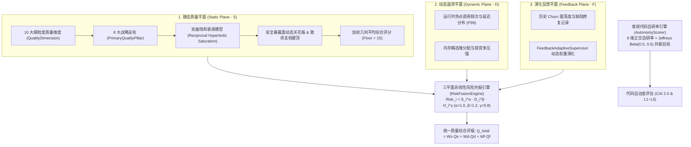

# 07. 三平面质量量化模型与代码自治度 (CAI) 规范

> **所属层级**：L5 规范、三平面质量度量与性能基准 (`docs/05-specs-and-benchmarks/`)  
> **对应代码真源**：[`scoringTypes.ts`](../../src/core/scoring/scoringTypes.ts)、[`eightPillarModel.ts`](../../src/core/scoring/eightPillarModel.ts)、[`scorer-formulas.ts`](../../src/core/scoring/scorer-formulas.ts)、[`riskWeightModel.ts`](../../src/core/scoring/riskWeightModel.ts)、[`risk-fusion-engine.ts`](../../src/core/scoring/risk-fusion-engine.ts)、[`autonomy-scorer.ts`](../../src/core/scoring/autonomy-scorer.ts)

---

## 1. 三平面质量度量体系全景 (Tri-Plane Quality Architecture)

传统静态代码分析极易被注水代码稀释、脱离线上真实运行时表现、且缺乏历史演进视角。`auto-refactor` 构建了 **静态质量平面 ($S$) + 动态运行平面 ($D$) + 演化反馈平面 ($F$)** 的三平面融合质量模型：

---

## 2. 静态质量平面：十大维度与八大战略支柱映射

静态分析在底层通过 **10 个细粒度维度 (`QualityDimension`)** 进行精确违规扣分，并在高阶统一汇聚为面向工程决策的 **8 大战略支柱 (`PrimaryQualityPillar`)**：

### 2.1 维度与支柱映射矩阵 (`DIMENSION_TO_PILLAR_MAP`)

根据 [`eightPillarModel.ts`](../../src/core/scoring/eightPillarModel.ts) 单一真源，10 大细粒度维度与 8 大战略支柱映射如下：

| 八大战略支柱 (`PrimaryQualityPillar`) | 默认权重 | 汇聚归属的细粒度维度 (`QualityDimension`) | 核心评估关注点 |
| :--- | :---: | :--- | :--- |
| **`architecture`** | `0.15` | `architectureConsistency` | 模块单向依赖解耦、循环导入拦截、架构边界纯度 |
| **`maintainability`** | `0.15` | `maintainability` | 单函数圈复杂度、单文件物理/有效代码行、深度嵌套 |
| **`performance`** | `0.15` | `performanceEfficiency` | 循环内瞬态分配、低效算法复杂度、大对象无界膨胀 |
| **`data`** | `0.10` | `duplication`, `semanticPurity` | 重复字面量治理、常量单源拓扑、数据流纯度与无逃逸 |
| **`testing`** | `0.15` | `modernity` (或测试契约覆盖) | 测试框架现代性、同义反复断言拦截、跳过测试项治理 |
| **`reliability`** | `0.10` | `semanticPurity`, `techDebtRisk` | 异常安全、空值防护、全局技术债风险收敛 |
| **`security`** | `0.10` | `codeSecurity` | 敏感密钥硬编码拦截、未转义注入防御、客户端暴露面 |
| **`extensibility`** | `0.10` | `standardization`, `commentQuality`, `duplication` | 代码规范性、六字段模块头、ECD-C 有效注释密度 |

---

## 3. 静态评分数学内核：衰减、天花板与几何平均

### 3.1 双曲饱和衰减模型 (Hyperbolic Saturation Decay)

为了消除传统线性扣分「超量扣分直接跌穿 0 分导致失真」以及负指数衰减在极端负债下缺乏区分度的弊端，[`scorer-formulas.ts`](../../src/core/scoring/scorer-formulas.ts) 采用**倒数型双曲饱和衰减公式**：

$$\text{density} = \frac{\text{rawPoints}}{\text{effectiveScale}}, \qquad \text{Score} = \frac{\text{DIMENSION\_MAX\_SCORE} \times \text{SATURATION\_HALFPOINT}}{\text{SATURATION\_HALFPOINT} + \text{density}}$$

- **核心常数**：$\text{DIMENSION\_MAX\_SCORE} = 100$，半饱和密度常数 $\text{SATURATION\_HALFPOINT} = 30$；
- **数学性质**：
  - 当无任何扣分时（$\text{density} = 0$），$\text{Score} = 100$；
  - 当违规密度恰好达到半饱和点（$\text{density} = 30$）时，$\text{Score} = 50.0$；
  - 当负债密度趋向于无穷大时，得分单调渐近趋于 $0$，严格维持单调序，绝不提前死锁在 0 分。

### 3.2 安全暴露面动态天花板与致命支柱硬顶 (Ceilings)

1. **安全暴露面动态天花板 (`computeSecurityCeiling`)**：
   干净代码的安全上限绝非盲目给满 100 分，而是根据 API 攻击暴露面动态测定：
   $$\text{expTerm} = 0.6 \cdot \min\left(1.0, \frac{\text{expSymbols}}{30}\right), \quad \text{locTerm} = 0.4 \cdot \min\left(1.0, \frac{\text{lines}}{500}\right)$$
   $$\text{discount} = 0.5 \cdot (\text{expTerm} + \text{locTerm}), \quad \text{securityCeiling} = 100.0 - \text{discount} \in [99.50, 100.00]$$
   安全得分在天花板基础上直接扣减违规：$\text{Score}_{\text{security}} = \max(0, \text{securityCeiling} - \text{rawPoints})$。

2. **致命支柱硬顶约束 (`PillarCeilingConstraint`)**：
   当出现不可宽恕的架构硬伤时，强制对所在支柱施加最高分上限，彻底杜绝被海量水代码稀释：
   - **架构致命违规**（如跨层逆向穿透）：$\text{MaxScore}_{\text{architecture}} \le 40$；
   - **性能致命违规**（如超高复杂度死循环）：$\text{MaxScore}_{\text{performance}} \le 45$；
   - **安全致命违规**（如高危明文密钥泄露）：$\text{MaxScore}_{\text{security}} \le 30$。

### 3.3 加权几何平均短板惩罚律 (Weighted Geometric Mean)

为贯彻「一处崩塌即全盘警惕」的短板惩罚哲学，静态综合得分采用加权几何平均，设定刚性下限 $\text{COMPOSITE\_INDEX\_FLOOR} = 15$：

$$\text{CompositeScore} = \exp\left( \frac{\sum_{i \in \text{Evaluated}} w_i \ln\left(\max(15, \text{index}_i)\right)}{\sum_{i \in \text{Evaluated}} w_i} \right)$$

- **短板放大效应**：若 9 个维度满分 100，但 1 个核心维度因致命缺陷跌入 15 分下限，算术平均仍高达 91.5（掩盖危机），而加权几何平均将直接暴跌至 75 分以下，强制倒逼解决根本缺陷。

---

## 4. 三平面风险融合引擎与非线性共振模型

[`risk-fusion-engine.ts`](../../src/core/scoring/risk-fusion-engine.ts) 实现了静态分析、运行时遥测与历史演化的跨平面共振：

$$Risk_i = S_i^{\alpha} \cdot D_i^{\beta} \cdot H_i^{\gamma}$$

- **默认指数敏感度系数**：
  $$\alpha = 1.0 \quad (\text{静态推理基准}), \qquad \beta = 1.2 \quad (\text{动态事实优先倾斜}), \qquad \gamma = 0.8 \quad (\text{历史缺陷敏感度})$$

### 4.1 跨平面三相仲裁逻辑
1. **双向印证共振放大 (Dual Confirmation)**：
   若静态风险 $S_i \ge 3.0$ 且动态热点 $D_i \ge 3.0$，判定为线上真实热路径高危缺陷，风险乘以 **$1.3\times$**，融合分 $\ge 12.0$ 即连带升级为 **`critical`**。
2. **单向冷路径噪声抑制 (Single-Sided Dampening)**：
   若静态显示高复杂度（$S_i \ge 2.0$），但动态遥测证实为极低频冷路径（$D_i \le 0.5$），风险施加 **$0.35\times$** 抑制折扣，自动降级为 `low` 或 `informational`。
3. **隐蔽运行时瓶颈捕获 (Hidden Bottleneck)**：
   若静态评分由于表面简单未扣分（$S_i \le 1.0$），但运行时出现严重锁竞争或延迟尖刺（$D_i \ge 5.0$），强制上调风险，捕获隐蔽瓶颈。

### 4.2 统一多维综合质量评分 ($Q_{total}$)

$$Q_{\text{total}} = W_s \cdot Q_s + W_d \cdot Q_d + W_f \cdot Q_f$$

自适应权重向量 $W = (W_s, W_d, W_f)$ 根据项目领域动态微调：
- 核心框架库：$W_s = 0.55, W_d = 0.30, W_f = 0.15$；
- 密集算法库：$W_s = 0.35, W_d = 0.50, W_f = 0.15$；
- 遥测缺失环境自动退化：$W_s = 0.85, W_d = 0.00, W_f = 0.15$。

---

## 5. 客观代码自研率指数 (Code Autonomy Index — CAI 2.0)

废黜任何主观虚构的定性指标，[`autonomy-scorer.ts`](../../src/core/scoring/autonomy-scorer.ts) 建立了**基于代码真源与依赖拓扑的纯客观六大正交自研率模型**：

### 5.1 六大正交自研率维度 (`AutonomyDimensions`)

| 维度标识符 | 数学代号 | 归一化权重 | 计算公式与测量物理量纲 |
| :--- | :---: | :---: | :--- |
| **`effectiveLocAutonomy`** | $R_{\text{loc}}$ | `0.30` | $\frac{\text{ELOC}_{\text{proprietary}}}{\text{ELOC}_{\text{proprietary}} + \text{ELOC}_{\text{vendor}} + \text{ELOC}_{\text{generated}}} \times 100$ |
| **`symbolCallAutonomy`** | $R_{\text{call}}$ | `0.20` | $\frac{\text{Calls}_{\text{internal}}}{\text{Calls}_{\text{internal}} + \text{Calls}_{\text{external\_sdk}}} \times 100$ |
| **`domainKernelDensity`** | $R_{\text{domain}}$ | `0.15` | $\frac{\text{ELOC}_{\text{core\_domain}}}{\text{ELOC}_{\text{proprietary}}} \times 100$（算法与核心业务逻辑占比） |
| **`codeOriginality`** | $R_{\text{pure}}$ | `0.15` | $\max(0, 100 - \min(30, N_{\text{clones}} \times 1.5))$（扣除大块无序复制代码） |
| **`supplyChainResilience`** | $R_{\text{supply}}$ | `0.10` | 抵抗外部传递依赖爆炸：$100 - (d \cdot 0.5 + \sqrt{t} \cdot 0.8 + \max(0, \text{depth}-1) \cdot 2.0)$ |
| **`criticalPathAutonomy`** | $R_{\text{critical}}$ | `0.10` | 安全/鉴权/加密/主分发核心路径中自研符号调用比例 |

$$\text{CAI} = \sum_{k=1}^6 w_k R_k \in [0.0, 100.0]$$

### 5.2 五级自治度等级划分 (`AutonomyGrade`)

根据综合自研率得分判定严格定性等级：

| 自治等级 | 得分阈值 | 行业定性与架构特征 |
| :--- | :---: | :--- |
| **`L5_INDEPENDENT`** | $\ge 95.0$ | **完全自主研发**：核心算法与领域模型 100% 自研，极度轻量且精准的外部依赖 |
| **`L4_HIGH_AUTONOMY`** | $\ge 85.0$ | **高自主度**：核心业务内核自主实现，规范集成标准开源生态 |
| **`L3_BALANCED`** | $\ge 70.0$ | **均衡依赖**：核心业务自研，与主流框架和云平台中度深度绑定 |
| **`L2_FRAMEWORK_DEPENDENT`** | $\ge 50.0$ | **框架依赖型**：实质性业务逻辑作为第三方 SDK 胶水代码存在 |
| **`L1_SHALLOW_WRAPPER`** | $< 50.0$ | **浅层封装型**：以接口转发与第三方实现套壳为主，自研价值极低 |

### 5.3 严格贝叶斯置信区间 (Jeffreys Beta Conjugate Prior)

为了防止「仅有单个文件的小项目因无第三方依赖直接虚标为 L5 独立项目」，引擎引入无信息无偏的 **Jeffreys 先验 $\text{Beta}(0.5, 0.5)$** 计算 $95\%$ 置信区间：

1. **样本充分度比率 ($S$)**：
   $$S = \left(1 - e^{-\frac{\text{effectiveLoc}}{4000}}\right) \cdot \left(1 - e^{-\frac{\text{totalFiles}}{8}}\right) \in [0.0, 1.0]$$
   当 $S < 0.45$ 时，显式打标 `isLowConfidence = true`。

2. **共轭后验分布更新**：
   - 有效样本量：$N_{\text{eff}} = \max\left(2, \operatorname{round}\left(\frac{\text{effectiveLoc}}{100} + \text{Calls}_{\text{total}}\right)\right)$；
   - 观测胜率：$p = \frac{\text{CAI}}{100}$，观测正样本 $k = p \cdot N_{\text{eff}}$；
   - 后验参数：$\alpha = k + 0.5, \quad \beta = N_{\text{eff}} - k + 0.5$；
   - 后验均值与可信平滑分：$\text{CredibleScore} = \frac{\alpha}{\alpha + \beta} \times 100$。

3. **95% 置信上下界导出**：
   $$\text{Var} = \frac{\alpha \beta}{(\alpha + \beta)^2 (\alpha + \beta + 1)}, \qquad \text{Margin} = 1.95996 \cdot \sqrt{\text{Var}} \times 100$$
   $$\text{LowerBound} = \max(0.0, \text{CredibleScore} - \text{Margin}), \quad \text{UpperBound} = \min(100.0, \text{CredibleScore} + \text{Margin})$$

---

## 6. Finding 级置信校准与三级可裁决分层 (Jev-style Adjudication)

> **代码真源**：[`confidence-calibration.ts`](../../src/core/scoring/confidence-calibration.ts)、[`finding-confidence-arbiter.ts`](../../src/core/scoring/finding-confidence-arbiter.ts)、[`validate-confidence-calibration.js`](../../scripts/validate-confidence-calibration.js)

### 6.1 问题：自评分不是置信度

分析器命中模式后由**同一个分析器**声明「这个命中是真的」。它没有机制发现自己在过度匹配，所以这个自评分是一份自己判的卷子——无论把参数（规则条数）堆到多大，它对自己脑补出来的幻觉天然缺乏概率校准能力。这与文档解析领域「让识别模型给自己打置信分」的失效模式同构。

因此引擎把**提议**与**裁决**拆开：分析器只产出 `Issue` 与自评 `evidence.confidence`，置信度由 `confidence-calibration.ts` 依据**已观测结局**重新裁定。

### 6.2 经验贝叶斯后验与收缩

对每条规则维护 $\text{Beta}(\alpha, \beta)$ 共轭后验，先验取无信息无偏的 **Jeffreys $\text{Beta}(0.5, 0.5)$**：

$$\alpha = \text{TP} + 0.5, \qquad \beta = \text{FP} + 0.5, \qquad N = \text{TP} + \text{FP}$$

后验均值与收缩权重：

$$\mu = \frac{\alpha}{\alpha + \beta}, \qquad r = \frac{N}{N + N_0}, \qquad \text{Calibrated} = r \cdot \mu + (1 - r) \cdot \text{Raw}$$

其中收缩锚点 $N_0 = 10$。三条刚性性质：

1. **零观测即中性**：$N = 0 \Rightarrow r = 0 \Rightarrow \text{Calibrated} = \text{Raw}$。引入校准不是全局静默改分。
2. **小样本不得夺权**：$N = 2 \Rightarrow r \approx 0.17$，后验无法压过分析器自评；$N \ge N_0$ 才置 `isReliable = true`。
3. **无证据不得乐观**：`Actionable` 档在零观测时落在 $\text{CONFIDENCE\_ACTIONABLE\_FLOOR} = 0.90$，而非旧实现假设的 $0.95$ 天花板。「没有证据」与「近乎确定」被彻底分开。

### 6.3 可裁决分层的三档与严重性底线

| 层级 | 语义 | 门禁权威 | `confidenceSource` |
| :--- | :--- | :--- | :--- |
| **T1 Prescriptive** | 确定性静态证明（复杂度超阈、语法错误、密钥泄漏、`error` 级活跃规则） | **阻断** | `verified` |
| **T2 Actionable** | 携带机械可应用 patch（`templateSnippet` / `unifiedDiff` / `patchRange`） | 不阻断 | `calibrated` / `uncalibrated` |
| **T3 Advisory** | 演进建议与风格提示 | 不阻断 | `calibrated` / `uncalibrated` |

**严重性底线 (`enforceSeverityFloor`)**：裁决不得静默撤销分析器的 `error` 声明。一条活跃规则上报 `error` 却不带 patch 时，仍保持 T1 阻断；撤销阻断权只能经**显式可审计的生命周期机制**（`quarantined` / `canary` / `experimental` / `deprecated`）。否则任何过度匹配的 error 级规则都会自动静默，体积红线将退化为装饰。该守卫**单向**：只能恢复阻断，不能新造阻断。

### 6.4 可靠性度量与单调棘轮

`validate-confidence-calibration.js` 以冻结标注语料同时度量**两个方向相反**的指标：

$$\text{ECE} = \sum_{b=1}^{B} \frac{|S_b|}{|S|} \left| \text{acc}(S_b) - \text{conf}(S_b) \right|, \qquad \text{Brier} = \frac{1}{|S|} \sum_{i=1}^{|S|} (\hat{p}_i - y_i)^2$$

- **ECE** 回答「说 0.9 时是否真有 90% 对」，对系统性过度自信敏感；
- **Brier** 是逐观测平方误差，对分箱内部的错序敏感。两者方向互补，缺一都会漏。

实测于 118 条标注观测（含刻意构造的过度自信组）：$\text{ECE}\; 0.2642 \to 0.1589$、$\text{Brier}\; 0.2907 \to 0.1852$、自报告乐观偏差 $0.2643 \to 0.1100$。棘轮钉在 $\text{ECE} \le 0.17$、$\text{Brier} \le 0.20$，只许降不许升；同时断言「全 0.99 判定器得分必须严格更差」，防止指标退化为死数。

残余偏差属收缩锚点的设计代价：每条规则的观测数约等于锚点时，只半信自己的后验。若要归零，须扩充语料，而非削弱锚点——削弱锚点会让极少观测的规则压过分析器，比残余偏差危险得多。

### 6.5 报告与门禁的双通道

| 通道 | 载体 | 回答的问题 |
| :--- | :--- | :--- |
| **严重度** | `summary.bySeverity` | 这条 finding 有多吵 |
| **裁决** | `summary.arbitration` / AAS `usability` | 这条 finding 能不能直接用 |

`summary.arbitration` 记录三档计数、`blockingCount`、`gateVerdict`、`uncalibratedCount`、`reviewQueueCount`（人工必读）、`advisoryOnlyRules`、`ruleTiers`（逐规则最强档）。AAS 报告头部输出 `usability ∈ {proven, patchable, advisory, uncalibrated, needsHuman}`，逐缺陷携带 `tier` 与 `conf`；未裁决时**整块省略**而非输出零值，否则与「什么都没扫到」不可区分。

**退出码只由严重度决定**，不读裁决。两个问题有不同的失败代价：「这条有多吵」的答案错了会漏掉真缺陷，「这条能不能直接用」的答案错了只是多花一次人工复核。用推断出来的档位去收窄门禁，等于让一个可能过度匹配的分层器替操作者决定是否放行——而操作者已经有显式、可审计的撤权通道（`quarantined` / `canary` / `deprecated`），由 `enforceSeverityFloor` 强制执行。因此 `advisoryOnlyRules` 是**报告元数据**，供上层消费者读取，不参与退出码计算。

### 6.6 闭环：结局回收、人工队列与置信门控重审

校准若只停留在报告字段上，就只是一次更精致的自夸。三个模块把裁决接回实际作业面：

| 环节 | 真源 | 解决的问题 | 关闭的旧失效 |
| :--- | :--- | :--- | :--- |
| **语料入口** | [`calibration-corpus.ts`](../../src/core/scoring/calibration-corpus.ts) | 把已记录的结局计数送进裁决器 | `baseline/confidence-calibration.json` 此前有格式无读者，`ruleCalibrationStats` 永远为空 |
| **人工队列** | [`review-queue.ts`](../../src/core/reporting/review-queue.ts) | 把自动化无法定案的残余导出为确定性 NDJSON 工单 | `reviewQueueCount` 只是个数字，没有任何人能看到具体是哪几条 |
| **修复结局** | [`fix-outcome-tracker.ts`](../../src/core/memory/fix-outcome-tracker.ts) | 把「上次报过、这次不报了」记成 `HistoricalFixResult` | `fixResults` 在两条写路径上恒为 `[]`，复审记忆从不记录任何修复 |
| **门控重审** | [`confidence-rework.ts`](../../src/core/pipeline/confidence-rework.ts) | 对**有界**快扫的低置信 finding 做**一次**更宽上下文的重扫 | 有界扫描的窗口边缘误报此前只能二选一：照单全收，或整文件重扫 |

**语料入口的拒绝语义**：负数、非整数、字符串化计数、零观测条目、重复规则 ID 一律拒收并给出理由，绝不 `Number()` 强转。把手写文件的笔误转成 0 或 1 都是凭空捏造观测。语料缺失或不可用即「无证据」，此时每条置信度与分析器自评完全一致——这正是引入校准前的行为，因此坏语料的代价是退回到旧状态，而不是让裁决器拿着脏数据乱判。

**人工队列的四类与优先级**：`needs-human`（无校准证据且声明需要运行时证据）→ `runtime-evidence` → `uncalibrated` → `advisory`。三个排除条件是队列成立的前提：已阻断的由自动化层级定案、已抑制的已被人工定案、**携带可执行 patch 的由 codemod 定案**。缺了第三条，队列会退化成「所有无历史规则的 finding」，在年轻规则集上几乎是全量。排序按分类、文件、行号、规则、分析器五级全序，同输入两次运行必须字节一致。

**修复结局的诚实边界**：规则按 **rule id** 而非 issue id 比对，因为 issue id 内嵌行号，仅仅移动一行就会既像「已修复」又像「新引入」。同时这类消失**不进校准语料的正负样本**——finding 消失的原因可能是改了、删了行、规则收敛了或文件被重新生成，与「当初报错了」不是同一件事。把复发当成功会系统性抬高规则置信度，是比漏计更危险的方向。

**重扫的条件与预算**：仅当扫描是**有界**的、finding 非 `error` 级（严重性底线已定案）、且置信度低于 $\theta = 0.65$ 时才重审，且只跑产出该 finding 的分析器。四种策略按能否改变答案来分派：整体符号类规则（复杂度）放宽窗口无用，走无界 `deepen-ast`；分析器已声明「只有运行时证据才能定案」（`evidence.requiresRuntime`）的走 `defer-external-evidence`——放宽窗口只会重读到同一份「缺动态信息」，本地重扫纯属白跑；稀疏路由漏掉分析器时走 `swap-analyzer-set`；其余走 `widen-context`。重扫**只做一次**：确定性错的分析器第三次也不会对，而无界重试会把一次毫秒级快扫做成它本要避免的深扫。被否证的 finding 直接丢弃并经 `EscalationChannel` 发布 `SPECULATIVE_INVALIDATION`，严重度取 `info`——否证是流水线正常工作的证据，报成 `error` 会让 `hasBreaches()` 在好结果上失败。

### 6.7 回写：人工判定如何变成校准证据

§6.6 的四个环节解决了「读」，但**写**一直是断的：语料有读者没有写入方，队列有写方没有读者。这意味着人在队列里做完判断之后，结论无处可去，下一轮仍然照旧出同一批工单。三个模块补齐这一段：

| 环节 | 真源 | 职责 |
| :--- | :--- | :--- |
| **判定账本** | [`review-verdict-ledger.ts`](../../src/core/scoring/review-verdict-ledger.ts) | 逐**出现点**记录人工判定，拒绝一切非法条目，按同一性去重 |
| **队列回读** | [`review-queue-intake.ts`](../../src/core/reporting/review-queue-intake.ts) | 解析导出的 NDJSON，把每条工单与一个答案配对，跳过已判 |
| **写回命令** | [`review-cmd.ts`](../../src/cli/review-cmd.ts) | `auto-refactor review` 的唯一合法写入路径 |

**账本是真源，语料是投影**：每次写回都从整本账本重算规则计数，而不是在语料上做增量。这个方向不可反——若改成「增量改语料、另存一份判定日志」，人工改判就会留下错对两条计数同时存在，且无法回收。重算是幂等的根源。

**同一性是 rule + file + line，不是 issue id**：issue id 内嵌行号，文件上方插几行就会让同一个缺陷裂成两条记录，账本随即虚增。这条必须与修复结局的比对键保持一致，否则同一条 finding 会以两个身份被记两次。

**两种调用的语义必须分开**：

- **收窄调用**（给了 `--rule` / `--file` / `--line`）视为**经过考虑的具体判断**，允许覆盖旧判定——这是改判的唯一途径。
- **整批调用**（无收窄）跳过已判条目。否则每次例行重跑都会把整个积压重述一遍。

若两者合并成一条规则，会得到两种坏结果之一：允许整批覆盖则例行重跑冲掉历史判断；禁止一切覆盖则改判永远做不到。校验器对两者都有断言。

**拒绝而非部分应用**：账本不可解析、条目字段非法、队列缺失，命令一律以退出码 `1` 退出且**不写任何文件**。部分应用比失败更坏——它会留下一个看起来成功、实际上只推进了一半的语料。

**已验证的端到端**：在 `samples` 上先跑扫描产出队列，对 `large-file` 记一次否证，语料落下 `truePositives: 0 / falsePositives: 1`；再次扫描时报告出现 `model: {calibratedRuleCount: 1, observationCount: 1}`，人工队列由 1 条降为 0 条，仲裁置信度由 0.89 降至 0.8409。

**跨规则批量必须显式确认**：一个 `--verdict` 只能表达**一次**判断。若选中范围横跨多条规则，命令以用法码拒绝，除非显式给出 `--any-rule`。这条守卫针对的是一种极易发生的误用：审阅者想答一条，却因未收窄而把整个积压一次性标成同一答案，于是为**从未看过的规则**伪造了证据。`--dry-run` 提供同样的预览而不落盘。

### 6.8 陈旧构建产物的看守

`tsc` 在 `incremental: true` 下只新增产物、从不删除已重命名或删除源文件的输出。这不是无害残留：本仓所有校验器都从 `dist/` 加载被测代码，因此陈旧产物会让校验器断言一个**已不存在的实现**——而且它会通过，因为那份旧文件自身是自洽的。

本轮就真实踩到了：`review-cmd.ts` 重命名后，`dist/cli/reviewCmd.js` 残留，而校验器 `require` 的正好是旧路径，导致新加的安全守卫"失效"，排查数轮才发现跑的是旧代码。

看守方式是按产物反查源文件：`dist/` 下每个 `.js` 必须能映射回当前 `src/` 中的同名模块，`dist/` 是 `src/` 的忠实投影。清理时发现 **54 个孤儿产物**（162 个含衍生文件），全部为历史重命名残留。

---

## 7. 关联文档导航

- [01. 配置模式与多格式报告契约](./01-config-and-reports.md)
- [02. 全维性能基准与原生算子加速台账](./02-performance-benchmarks.md)
- [03. 规范文件头与有效注释密度 (ECD-C) 规范](./03-comment-and-header-standard.md)
