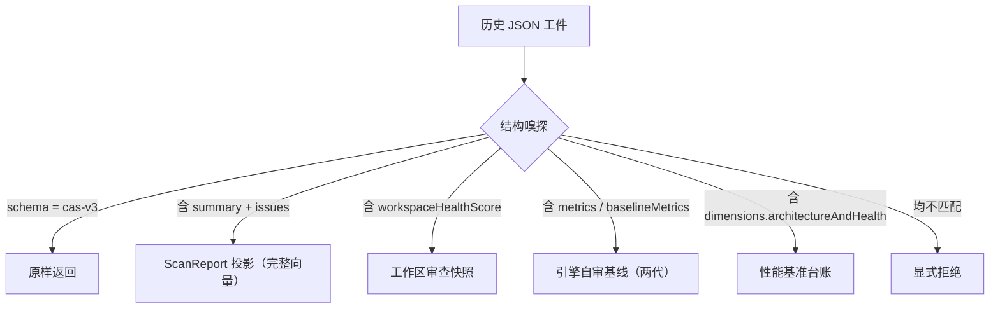

# CAS v3.0 紧凑审查导出契约 (Compact Agent Schema)

> **适用版本**：`auto-refactor` v0.4.0 及以上  
> **入口命令**：`auto-refactor scan --format compact`  
> **核心模块**：[`compact-report-types.ts`](../../src/core/reporting/compact-report-types.ts) · [`compact-report-migrator.ts`](../../src/core/reporting/compact-report-migrator.ts)

---

## 一、 为什么需要独立导出契约

完整 `ScanReport` 是为**可审计性**设计的：每个文件携带十二项结构指标、每条问题携带完整定义域与建议文案、质量分携带逐条扣分审计链。当审查对象是一个数千文件的工作区时，这份报告会达到数百 KB 到数 MB，直接塞进模型上下文既不经济也会稀释真正需要处理的信息。

CAS v3.0 解决的是另一个问题：**在保留全部决策所需事实的前提下，省略重复的结构开销**。它不删除判定依据，只改变表达方式。

| 载体 | 典型体积 | 适用场景 |
| :--- | :--- | :--- |
| `json` (ScanReport) | 数百 KB ~ 数 MB | 归档、离线复算、需要完整扣分审计链 |
| `capp` (CAPP 2.0) | 十余 KB | 纯文本注入，无结构反序列化能力 |
| `agent` (Markdown) | 数十 ~ 上百 KB | 人类可读的指令清单 |
| **`compact` (CAS v3.0)** | **十余 KB** | **模型上下文注入、跨会话基线对比、体积敏感的持久化** |

---

## 二、 结构约定

### 2.1 顶层信封

```json
{
  "schema": "cas-v3",
  "tool": "auto-refactor",
  "version": "0.4.0",
  "ts": "2026-10-24T00:00:00.000Z",
  "root": "/workspace/auto-refactor",
  "verdict": "BLOCK",
  "counts": { "files": 721, "issues": 4752, "errors": 0, "warns": 4173, "info": 579, "suppressed": 130 },
  "health": { "score": 99.03, "grade": "A+", "coverage": 1, "confidence": 0.92, "cai": 78.63 },
  "dimensions": { "arch": 99.74, "std": 95.37, "debt": 99.9 },
  "bottlenecks": [{ "rule": "CMT-LNG-001", "dim": "std", "loss": 22, "count": 140 }],
  "pal": ["governance", "comments"],
  "vectors": [["CMT-LNG-001", 1, "src/core/cache.ts:243", "注释语言与文件主语言不一致", "align_comment_language", 1]]
}
```

### 2.2 位置向量布局

每条问题是一个六元组，取代一个完整对象：

```text
[ rule, severityRank, "file:line", message, action | null, analyzerIndex | null ]
```

- **`severityRank`** 是闭区间 `0..2`（`info` / `warning` / `error`）。用数值而非字符串，使调用方可直接以 `sev >= 1` 过滤，不必逐条比较三个字符串。
- **`analyzerIndex`** 指向 `pal` 数组。分析器名称在数百条问题里高度重复，提取为调色板后每条形如 `0`/`1`，把重复字符串的开销变成一次性成本。
- **`location`** 采用 `file:line` 单串，省略 `start`/`end` 对象层级。反水合时统一以第 1 列重建，因为审查修复只需要定位行，不需要精确列区间。
- **`action`** 取自 `issue.actionable.action`，缺失时为 `null`，使「可自动化」与「需人工判断」在同一位置上即可区分。

### 2.3 维度短键

`dimensions` 与 `bottlenecks[].dim` 使用短键，映射定义在 `COMPACT_DIMENSION_KEYS`：

| 短键 | 完整维度 | 短键 | 完整维度 |
| :--- | :--- | :--- | :--- |
| `arch` | `architectureConsistency` | `mod` | `modernity` |
| `sem` | `semanticPurity` | `maint` | `maintainability` |
| `sec` | `codeSecurity` | `doc` | `commentQuality` |
| `perf` | `performanceEfficiency` | `dup` | `duplication` |
| `std` | `standardization` | `debt` | `techDebtRisk` |

未参与评估的维度**不出现在键集中**，而不是以 `null` 占位 —— 缺失即未测量，避免把未测量读成零分。

### 2.4 扣分瓶颈

`bottlenecks` 由 `qualityScore.deductionsByDimension` 聚合而来：按 `(rule, dimension)` 分组求和，按扣分降序排列。这条聚合替代了原报告中逐条重复的 `rationales` 文本列表，使「哪个规则在哪个维度上最耗分」一眼可见。

### 2.5 重叠声明 `clusters`

同一坐标上若出现同一语义重叠簇的多个成员，紧凑文档会额外发射一条声明：

```json
"clusters": [
  { "at": "src/core/trajectory/eloc-types.ts:187", "cluster": "stub-and-sanitize", "rules": ["GOV-SAN-001", "HYG-STB-002"], "primary": "GOV-SAN-001" }
]
```

簇拓扑的单一真源是 [`overlap-clusters.ts`](../../src/core/rules/overlap-clusters.ts) 的 `OVERLAP_CLUSTERS`，本条目不重述成员清单。

- **附加而非替换**：`vectors` 保留全部诊断，`clusters` 只是把「同一点上几个规则在说同一件事」折叠成一行。消费方忽略该字段时看到的输出与旧版完全一致。
- **聚合范围严格限定 `file + line`**：跨行的成员**永不**合并。不同行是不同修复点，合并会让紧凑视图显得比代码实际更干净。
- **`primary` 在折叠过程中选举**：严重度更高者优先，同严重度取规则 ID 字典序更小者；其余成员仍完整列在 `rules` 中。
- **字段仅在至少存在一条声明时出现**：无重叠时不写空数组，避免把「未发现重叠」与「未测量」混为一谈。

> [!IMPORTANT]
> 声明集由**截断前的合格问题集**派生，而非发射窗口。若由窗口派生，任何真实预算下声明都会恒为空——重叠成员在排序后相邻，小额 `maxVectors` 要么把它们全部丢弃，要么只保留首个成员，两种情况都读作「此处无重叠」。代价是某条声明的坐标可能只部分出现在 `vectors` 中；`truncated` 仍是「被扣留多少」的唯一权威声明，需要回查向量的消费方须先检查它。

---

## 三、 发射策略与截断语义

| 选项 | 默认 | 语义 |
| :--- | :--- | :--- |
| `maxVectors` | `500` | 最多发射的问题条数 |
| `maxMessageChars` | `160` | 单条消息截断长度 |
| `maxBottlenecks` | `12` | 瓶颈行上限 |
| `includeInfo` | `false` | 是否包含 `info` 级问题 |
| `anchorProvider` | 无 | 为阻断级问题提供代码锚点切片 |
| `healthOverride` | 无 | 用调用方自己的聚合口径覆盖 `health` 块 |

> [!IMPORTANT]
> 截断**从不静默发生**。被省略的条数写入 `truncated` 字段，反水合时 `partial` 为 `true`。一个看不到 `truncated` 的消费方会把部分报告读成完整报告，这是唯一必须防住的误读。

默认排除 `info` 级问题是刻意的：该级别主要是风格提示，不是待处理项。需要完整清单时显式传 `includeInfo: true`。

`healthOverride` 存在的原因是两套得分口径都合法且确实不同：自审基线聚合逐文件质量分，而 `qualityScore.compositeScore` 是引擎自评投影。生产者若把侧车挂在基线旁边却引用另一个数字，两份文件就会自相矛盾。未提供的字段保留报告自身取值。

---

## 三之一、 生产者与派生视图的分工

自审运行（`scripts/run-self-audit.js`）每次同时写入两份产物：

| 产物 | 形态 | 定位 |
| :--- | :--- | :--- |
| `reports/self-audit-baseline.json` | 聚合基线 | **无损记录**，五处既有读取方的唯一依赖 |
| `reports/self-audit-baseline.cas.json` | CAS v3 侧车 | **派生视图**，供模型上下文与跨会话比对 |

侧车的向量预算固定为 `60`：基线是聚合视图，若侧车发射全量向量，它会比它所伴随的聚合文件大出数倍，反而失去存在意义。差额由 `truncated` 如实登记。

在生产侧车之前，仓内 `*.cas.json` 数量为零——紧凑格式只能由离线迁移器生成。这意味着移除历史适配器会直接删掉唯一读取通路，因此「生产者原生写出侧车」是兼容层退役的前置条件，而非可选优化。

---

## 四、 历史工件归一化

工作区里存在四代历史审查产物，形状互不相同。`migrateLegacyReport` 通过结构嗅探逐一归一，使旧数据无需重新扫描即可被当前消费方读取：



- **ScanReport** 走完整投影，产出真实向量。
- **快照 / 基线 / 性能台账** 只记录聚合读数，不含逐条问题，因此向量为空而 `truncated` 等于其债务总数 —— 如实声明「已知有 N 条未携带」。
- **无法识别的形状被显式拒绝**，绝不回退成空文档。空文档会被读作「零问题扫描」，这是比报错更危险的失败方式。

各代工件的计数器口径差异也在适配层归一：当前基线用 `totalIssues`，v0.3 基线只有 `blockingWarningCount` + `blockingErrorCount`，性能台账则以 `highDebt` + `criticalDebt` 表达债务规模。

---

## 五、 反水合与兼容边界

`hydrateCompactReport` 重建 `Issue[]` 与 `summary`，可回灌给任何只消费这两个字段的既有代码（门禁判定、计数汇总、Markdown 渲染）。

> [!WARNING]
> 反水合**不可能**恢复以下内容，因为它们已被位置向量压缩掉：逐条 `rationales`、`weights`、`deductionsByDimension` 明细、`fileMetrics` 全量结构指标、问题列区间与 `end` 行。需要这些字段的消费方必须读取原始 `ScanReport`，或从紧凑文档的 `dimensions` / `bottlenecks` 取聚合视图。

---

## 六、 离线批量迁移

```bash
# 预演：只打印归一结果，不落盘
node auto-refactor/scripts/migrate-report-artifacts.js auto-refactor/reports ./.audit-logs

# 落盘：在源文件旁生成 <name>.cas.json 侧车文件
node auto-refactor/scripts/migrate-report-artifacts.js auto-refactor/reports --write --pretty
```

- 默认预演，因为原地改写已归档的审查历史是不可逆动作，必须显式请求。
- **源文件永不删除**：完整工件保留其无损记录地位，紧凑侧车是派生视图。
- 目录中不含审查报告的文件（账本、失败快照）标记为跳过而非失败；真正的 I/O 故障与全部未识别仍然失败。

---

## 七、 验证

```bash
cd auto-refactor && npm run build && node scripts/validate-compact-schema.js
```

该套件断言八件事：投影保真（判定/计数/维度/瓶颈/截断）、`includeInfo` 策略、向量位置布局与严重度排序、反水合往返一致、体积收益比例、四代历史工件归一与未知形状拒绝、重叠声明的附加性与坐标/簇双域限定、`render(report, 'compact')` 派发可达。

其中重叠声明一项额外覆盖截断边界：预算落在同一坐标的成员之间时，声明仍须完整报出两个成员，且被扣留的那个确实不在 `vectors` 中。只断言未截断路径会漏掉这个缺陷——声明在真实预算下恒为空也能通过。
