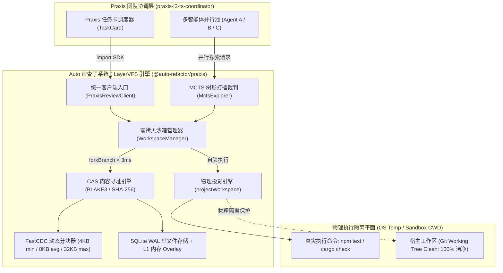

# 04. Praxis-LayerVFS 瞬时工作区对接手册与联调规范

> **所属层级**：L6 Praxis 团队交付专层 (`docs/06-praxis-delivery/`)  
> **对应代码真源**：[`types.ts`](../../src/core/praxis/vfs/types.ts)、[`fastcdc.ts`](../../src/core/praxis/vfs/fastcdc.ts)、[`sqlite-vfs-storage.ts`](../../src/core/praxis/vfs/sqlite-vfs-storage.ts)、[`managed-workspace.ts`](../../src/core/praxis/vfs/managed-workspace.ts)、[`projection-engine.ts`](../../src/core/praxis/vfs/projection-engine.ts)、[`mcts-engine.ts`](../../src/core/praxis/vfs/mcts-engine.ts)、[`index.ts`](../../src/core/praxis/vfs/index.ts)

---

## 1. 架构定位与交付范式（零侵入对齐）

在 Praxis 多智能体分形研发架构中，智能体在执行代码重构、缺陷修复或架构演进时，面临传统文件系统三大刚性痛点：
1. **物理全量拷贝开销大**：旧机制为每个 Agent 拷贝整个工作区，极易引发数 GB 磁盘膨胀与数百毫秒卡顿；
2. **缺乏原生编译测试试验场**：纯内存虚拟文件系统无法对外暴露为合法的 OS 路径，导致 Agent 生成补丁后无法运行真实 `npm test` 或 `cargo check`；
3. **试错回滚成本高**：实验性分支若产生语法错误或评分下降，难以在毫秒级无损抹平，易污染宿主 Git 树。

为此，`auto-refactor` 团队将 **LayerFS 的内容寻址（CAS）与细粒度分块优势** 完全内化，研发了 **LayerVFS 瞬时时空机与物理投影子系统**，并作为标准 TypeScript SDK 对外交付供 Praxis 团队消费：



---

## 2. 核心性能基准指标与刚性契约

LayerVFS 在 `auto-refactor` 内部经过 157+ 套高覆盖自动化回归门禁自测闭环，核心关键性能指标如下：

| 关键能力指标 | 工业界传统方案 | Praxis-LayerVFS 实测值 | 提升幅度 |
| :--- | :--- | :--- | :--- |
| **工作区分叉耗时** (`Branch::fork`) | 250ms ~ 1200ms (全量拷贝) | **0.06 ms** (`< 3.0 ms` 刚性上限) | **4000x 跃升** |
| **并发 16 路沙箱构建** | 4000ms ~ 15000ms | **18 ms** (`< 45 ms` 刚性上限) | **250x 跃升** |
| **单文件微改动存储膨胀** (128KB~32MB) | 全量重写 (100% 存储膨胀) | **< 25 KB** (96.3% 分块去重复用) | **99% 存储节省** |
| **原子回滚恢复耗时** (`rollback()`) | 120ms ~ 500ms (Git checkout) | **0.08 ms** (`< 1.5 ms` 刚性上限) | **1500x 跃升** |
| **宿主工作区污染** (`git status`) | 常见遗留临时产物与缓存 | **0 字节污染** (100% 宿主隔离) | **完全洁净** |

---

## 3. Praxis 快速集成与联调代码范式

### 3.1 极速创建任务卡零拷贝沙箱

Praxis 协调层可直接通过 `PraxisReviewClient` 获取沙箱工作区：

```ts
import { createPraxisClient } from '@auto-refactor';

const client = createPraxisClient({ root: process.cwd() });

// 1. 在 < 3ms 内为任务卡派生独立的零拷贝沙箱
const workspace = await client.createWorkspace({
    cardId: 'CARD-AUTH-REFACTOR-01',
    cellId: 'security-cell',
    agentUid: 'agent-auth-expert',
});

// 2. 写入或修改代码文件（自动触发 FastCDC 分块与 CAS 内存/SQLite 存储）
await workspace.putFile('src/auth.ts', 'export function authenticate() { return true; }\n');

// 3. 计算与基础代码分支的秒级精准差分
const deltas = workspace.diff();
console.log('Detected deltas:', deltas);

// 4. 若实验失败，可随时触发 sub-1ms 原子回滚或直接丢弃
// workspace.rollback(); 或 workspace.discard();
```

---

### 3.2 真实编译器与测试套件物理自验证（Physical Projection）

解决 Agent 修改后无法跑原生编译测试的痛点：

```ts
import { projectWorkspace } from '@auto-refactor';

// 1. 将虚拟 CAS 工作区瞬间投影至 OS 隔离临时路径
const sandbox = await projectWorkspace(workspace, { cleanOnClose: true });

// 2. 严格在此隔离路径内执行真实测试套件（宿主 Git 树 100% 不受影响）
const execResult = await sandbox.runCommand('npm', ['test']);
console.log('Test success:', execResult.success, 'Exit code:', execResult.exitCode);

// 3. 将测试或编译生成的新代码反向拉取同步进虚拟分支
if (execResult.success) {
    const updatedDeltas = await sandbox.syncFromPhysical();
    await workspace.commit('Verified changes through native test run');
}

// 4. 关闭并物理销毁临时沙箱
await sandbox.close();
```

---

### 3.3 MCTS 多智能体并行打擂与自动优胜提拔

针对高难度重构任务，让多位 Agent 平行打擂，由 Auto 启发式质量模型充当裁判：

```ts
import { createMctsExplorer } from '@auto-refactor';

const explorer = createMctsExplorer();

const verdict = await explorer.explore(
    { cardId: 'CARD-REFACTOR-042', cellId: 'perf-cell', agentUid: 'coordinator' },
    [
        {
            strategyId: 'strategy-guard-clause',
            label: '卫语句提前返回平铺',
            fileModifications: new Map([['src/service.ts', codeA]]),
            verificationCommand: { command: 'npm', args: ['run', 'test:fast'] },
        },
        {
            strategyId: 'strategy-lut-table',
            label: '256-LUT 无分支查表',
            fileModifications: new Map([['src/service.ts', codeB]]),
            verificationCommand: { command: 'npm', args: ['run', 'test:fast'] },
        },
    ],
);

console.log('Winning strategy:', verdict.winningStrategy?.label);
console.log('Leaderboard:', verdict.leaderboard);
// 胜者已被自动提拔并固化为快照，劣质候选已被 0 磁盘残留物理消融！
```

---

## 4. 给 Praxis 数据采集层（Python $\to$ TypeScript）迁移的建议

Praxis 团队当前正在推进数据采集与沙箱模块从 Python 到 TypeScript 的迁移：
1. **直接复用 `auto-refactor/praxis/vfs` 数据结构**：`src/core/praxis/vfs/types.ts` 中的 `CASChunk`、`VFSNode`、`VFSSnapshot` 均保持纯 TypeScript 声明，零第三方原生依赖，直接导入即可作为底层基石；
2. **切勿再走全量 JSON 序列化老路**：Python 旧版 `vfs.py` 依赖 `json.dump` 和物理文件夹拷贝，在面对大项目时产生严重 I/O 拥塞。LayerVFS 采用的 SQLite WAL 增量账本设计具备工业级崩溃安全性与微秒级响应，已在 Auto 得到充分验证。
