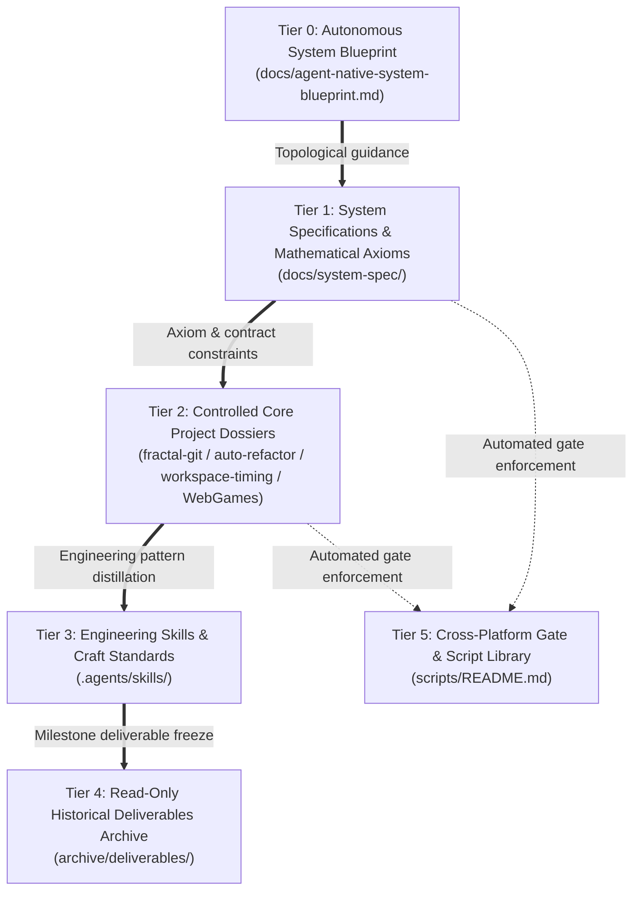

# Workspace Technical Documentation Hub (`docs/README.md`)

> Top-level navigation index and knowledge topology router for the workspace documentation corpus. Enforces a **6-Tier Unidirectional Knowledge Hierarchy** from autonomous system blueprints and mathematical specifications down to project dossiers, engineering skills, historical archives, and cross-platform gate scripts.

---

## 1. Six-Tier Documentation Topology

---

## 2. Layered Navigation Matrix

| Tier | Entry Path | Technical Scope | Target Audience | SSOT |
| :--- | :--- | :--- | :--- | :--- |
| **Tier 0** Blueprint | [**`agent-native-system-blueprint.md`**](./agent-native-system-blueprint.md) | **Multi-Agent Autonomous Evolution & Review Blueprint**: Peer Cell topology, 3-layer dual-surface Diff, R1–R5 memory distillation pipeline, fractal Git gate network & state transitions | Architecture evolution, multi-agent orchestration | `AGENTS.md` |
| **Tier 1** System Specs | [**`system-spec/README.md`**](./system-spec/README.md) | **System Specifications & Mathematical Axioms Index**: 10D quality model, script governance, gate checklist, SSOT rule catalog, 5-layer VS Code extension, and WebGames config-driven spec | Cross-project review, gate audits, scoring mathematics | `docs/system-spec/` |
| | [├─ `quality-scoring-model.md`](./system-spec/quality-scoring-model.md) | **10D Quality Scoring Model**: Hyperbolic density decay, weighted geometric mean, Jeffreys Beta posterior confidence, dual-track security ceiling, and anti-gaming axioms | Static scoring engine, quality evaluation | `auto-refactor/src/core/scoring/` |
| | [├─ `script-governance-architecture.md`](./system-spec/script-governance-architecture.md) | **Workspace Script Governance**: Language × domain matrix, PowerShell / Bash / Node.js contracts, Tier 1 in-memory streaming gates, and fast-path short-circuiting | Build & gate script authoring | `scripts/` |
| | [├─ `rule-catalog-architecture.md`](./system-spec/rule-catalog-architecture.md) | **SSOT Rule Catalog & Meta-Governance**: 3-3-3 naming topology, 3-tier alias network, and <!-- METRICS:BEGIN rule-total -->**536 条规则**<!-- METRICS:END rule-total --> bidirectional closure (`RCFG-RULE-DRIFT`) | Rule registration & anti-drift verification | `scripts/common/rule-catalog.json` |
| | [├─ `workspace-timing-architecture.md`](./system-spec/workspace-timing-architecture.md) | **VS Code Extension 5-Layer Architecture**: UI / Application / Domain / Infrastructure / Utils unidirectional flow, RingBuffer + WAL Journal + JSON crash recovery | VS Code extension engineering | `workspace-timing/` |
| | [├─ `webgames-architecture-spec.md`](./system-spec/webgames-architecture-spec.md) | **WebGames Config-Driven Decoupling Spec**: `GameConfig` SSOT, `apply_snapshot` unidirectional view injection, zero loop heap allocation, and 4-stage workflow | Godot 4 headless domain engineering | `WebGames/` |
| | [├─ `jit-context-and-moe-routing-spec.md`](./system-spec/jit-context-and-moe-routing-spec.md) | **JIT Context & 5-Tier Sparse MoE Routing Spec**: Dual-plane on-demand architecture (4-tier prompt JIT + 5-tier Sparse MoE bitmask dispatch, LayerVFS sandbox, and L1/L2/L3 WAL cache) | Agent context budgeting & engine routing | `auto-refactor/src/core/pipeline/` |
| | [└─ `gate-audit-checklist.md`](./system-spec/gate-audit-checklist.md) | **Quarterly Gate Audit Checklist**: Pre-commit, pre-push, and `audit-all` verification assertions, bypass probes, and remediation templates | Gate self-audits & peer review | `scripts/common/gate-step-registry.json` |
| **Tier 2** Project Dossiers | [**`fractal-git/docs/README.md`**](../fractal-git/docs/README.md) | **Taxis (`fractal-git`) Kernel Dossier**: 10-crate architecture, poset-homomorphic CCD v2, Bloom filters, SWAR diff, TIPSE in-place storage, and single-threaded E2E benchmarks | Lock-free CAS & Git plumbing kernel | `fractal-git/` |
| | [**`auto-refactor/docs/README.md`**](../auto-refactor/docs/README.md) | **`auto-refactor` Engine Dossier**: <!-- METRICS:BEGIN analyzer-count -->**32 个**<!-- METRICS:END analyzer-count --> Sparse MoE experts, dual-surface Diff engine, 8-language AST/IR adapters, LayerVFS sandbox, and Praxis SDK delivery | Static analysis, AST operators & Praxis SDK | `auto-refactor/` |
| | [**`workspace-timing/docs/architecture.md`**](../workspace-timing/docs/architecture.md) | **`workspace-timing` Architecture Dossier**: Time aggregation core, session lifecycle state machine, and high-contrast dark UI contracts | Extension business logic & reporting | `workspace-timing/` |
| | [**`WebGames/docs/README.md`**](../WebGames/docs/README.md) | **`WebGames` Kalar Engine Dossier**: Sandbox simulation domains, unit/skill config tables, MOD SDK specification, and 4-stage roadmap | Gameplay simulation & config tables | `WebGames/` |
| **Tier 3** Skills | [**`.agents/skills/`**](../.agents/skills/) | **Engineering Skill Suite (<!-- METRICS:BEGIN skill-count -->**27 项**<!-- METRICS:END skill-count --> Skills)**: 4-part skill directories (`SKILL.md`, `references/`, `templates/`, `scripts/`) across craft, governance, and project domains | Agent JIT skill loading | `.agents/skills/` |
| | [├─ `skill-catalog.md`](./skill-catalog.md) | **Skill Invocation Catalog**: 3-tier topology, domain linkage chains, trigger keywords, and verification commands rendered from `skill-registry.json` | Skill selection & trigger lookup | `scripts/common/skill-registry.json` |
| | [└─ `skill-activation-and-linkage.md`](../.agents/skills/skill-governance/references/skill-activation-and-linkage.md) | **Skill Activation & Linkage Reference**: Description visibility rules, trigger examples, prerequisite/successor chains, and guard scripts | Skill metadata authoring | `.agents/skills/skill-governance/` |
| **Tier 4** Archives | [**`archive/deliverables/README.md`**](../archive/deliverables/README.md) | **Read-Only Historical Deliverables Archive**: Frozen architecture review dossiers, milestone reports, and historical snapshots | Historical traceability (read-only) | `archive/deliverables/` |
| **Tier 5** Scripts | [**`scripts/README.md`**](../scripts/README.md) | **Cross-Platform Script & Gate Manual**: Inventory of <!-- METRICS:BEGIN script-inventory -->**106 份**<!-- METRICS:END script-inventory --> controlled scripts, invocation contracts, and isolation guarantees | Local gates & CI maintenance | `scripts/` |

---

## 3. Core Architectural Axioms

1. **Objective Telemetry**: All metrics compute from zero without baseline padding, multiplier inflation, or fixed bonus points.
2. **Single Source of Truth (SSOT)**: Rule catalogs, documentation scale metrics, and constant dictionaries derive unidirectionally from authoritative JSON/TS sources.
3. **Unidirectional Layering**: Dependencies flow strictly downward; cross-layer cycles and upward imports are blocked.
4. **Cross-Platform Isomorphism**: Core gate and packaging scripts maintain 1:1 parameter, exit-code, and verdict parity across PowerShell (`ps1/`) and Bash (`sh/`).
5. **Bidirectional Rule Closure**: Every rule ID cited in docs or code must exist in `scripts/common/rule-catalog.json` (`RCFG-RULE-DRIFT`).

---

## 4. Documentation Hygiene Invariants

1. **Relative Links Only (`DOC-LNK-001` / `HC-ABS-PATH`)**: Forbid Windows drive letters (`C:/...`), `file:///`, or machine-specific absolute paths inside repository `.md` files.
2. **Zero Orphan Normative Docs (`validate-doc-reachability.js`)**: Every normative `.md` document must have at least one inbound link from an index document.
3. **Single-Source Scale Metrics (`sync-doc-metrics.js`)**: Scale figures must reside inside `<!-- METRICS:BEGIN <id> -->...<!-- METRICS:END <id> -->` markers or match live truth (`validate-docs-consistency.js`).
4. **User-Facing Isolation**: Root `README.md`, extension `README.md`, and `CHANGELOG.md` remain strictly user-facing without internal refactoring jargon.
