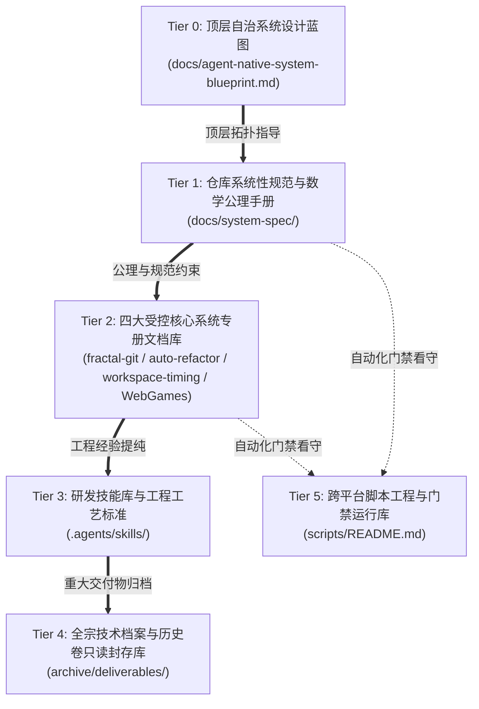

# 工作区核心技术文档全景总枢 (Technical Documentation Hub)

> 本文档为全工作区技术文档库的顶层导航总枢与知识拓扑路由。
> 采用**层级严密·划分合理·解析明确·单源权威**架构，贯通从顶层自治系统设计蓝图、系统性架构规约、子系统专册技术全宗、工程技能集到历史档案的全息知识体系。

---

## 一、 文档库六阶分层架构全景图

全工作区技术文档体系严格划分为 6 个清晰解耦、单向支撑的层级：

---

## 二、 核心文档分层导航与快速查阅矩阵

| 分层梯队 | 文档路径 / 索引入口 | 核心主题与覆盖范围 | 适用场景与读者 | 权威真源 |
| :--- | :--- | :--- | :--- | :--- |
| **Tier 0** 顶层蓝图 | [**`agent-native-system-blueprint.md`**](./agent-native-system-blueprint.md) | **多 Agent 自治演化与审查系统架构设计蓝图**：Cell 平权自治体系、一体两面三层 Diff、R1~R5 记忆提纯管线、分形 Git 门禁网络与系统状态大切换 | 顶层架构演进、跨系统调度协同、智能体身份限定 | `AGENTS.md` |
| **Tier 1** 系统规约 | [**`system-spec/README.md`**](./system-spec/README.md) | **系统性规范与数学公理总索引**：十维质量模型、脚本治理、门禁清单、单源规则元治理、VS Code 扩展五层架构、WebGames 配置驱动规范 | 跨系统统一审查、门禁审计、质量量化数学推导 | `docs/system-spec/` |
| | [├─ `quality-scoring-model.md`](./system-spec/quality-scoring-model.md) | **十维工程质量量化评分模型**：双曲密度衰减曲线、加权几何平均、Jeffreys 先验置信度、理论安全上限双轨扣分与反刷分数学公理 | 质量评估算法、静态评分引擎调优 | `auto-refactor/src/core/scoring/` |
| | [├─ `script-governance-architecture.md`](./system-spec/script-governance-architecture.md) | **仓库级脚本工程治理体系**：语言域 × 职能域正交矩阵、PowerShell / Bash 规范契约、Tier 1 内存流式门禁与性能短路模型 | 构建脚本编写、跨平台调用契约 | `scripts/` |
| | [├─ `rule-catalog-architecture.md`](./system-spec/rule-catalog-architecture.md) | **单源规则目录与元治理架构**：SSOT 唯一真源公理、3-3-3 标准命名拓扑、三阶别名等价网络与 508 条规则双向闭包 | 规则新增与重构、反虚构门禁 | `scripts/common/rule-catalog.json` |
| | [├─ `workspace-timing-architecture.md`](./system-spec/workspace-timing-architecture.md) | **VS Code 扩展五层解耦架构**：表现/应用/领域/基础设施/工具严格单向流动、RingBuffer + WAL Journal + JSON 三级崩溃恢复持久化 | VS Code 扩展开发、高可靠持久化 | `workspace-timing/` |
| | [├─ `webgames-architecture-spec.md`](./system-spec/webgames-architecture-spec.md) | **WebGames 配置驱动解耦规范**：全域 `GameConfig` 单源驱动、视图层 `apply_snapshot` 单向快照注入、对象池零堆分配与四阶段方案纪律 | 游戏系统开发、Godot 逻辑解耦 | `WebGames/` |
| | [└─ `gate-audit-checklist.md`](./system-spec/gate-audit-checklist.md) | **全域门禁审计核查清单**：提交、推送与全量统一审查核查项，失败处置口径与质性复核断言 | 提交前自审、人工/智能体交叉复审 | `scripts/common/gate-step-registry.json` |
| **Tier 2** 专册全宗 | [**`fractal-git/docs/README.md`**](../fractal-git/docs/README.md) | **Taxis 分形 Git 高性能内核专册**：10 大微 Crate 架构、偏序集同态 CCD v2、路径 Bloom 过滤器、SWAR 差分、自举计划与实测基准 | 底层版本控制内核、无锁 CAS 算法 | `fractal-git/` |
| | [**`auto-refactor/docs/README.md`**](../auto-refactor/docs/README.md) | **auto-refactor 静态引擎专册**：27 专家 MoE 稀疏路由、一体两面 Diff 引擎、多语言 AST 适配与 Praxis 客户端交付规约 | 静态分析重构、多语言 AST 算子 | `auto-refactor/` |
| | [**`workspace-timing/docs/architecture.md`**](../workspace-timing/docs/architecture.md) | **workspace-timing 业务架构专册**：时间聚合核心、会话生命周期状态机与暗色高对比度 UI 设计契约 | 计时扩展业务逻辑、报表导出 | `workspace-timing/` |
| | [**`WebGames/docs/README.md`**](../WebGames/docs/README.md) | **WebGames 游戏世界专册**：卡拉尔沙盒模拟体系、单位与技能配置表、MOD SDK 开发规约与四阶段路线图 | 游戏策划配置、战斗模拟引擎 | `WebGames/` |
| **Tier 3** 技能规约 | [**`.agents/skills/`**](../.agents/skills/) | **全工作区工程研发技能集（24 个标准技能）**：编码工艺、复杂度控制、防御性安全、多智能体编排、测试基准工程等物理四件套 | 智能体技能加载、工程工艺落地 | `.agents/skills/` |
| **Tier 4** 历史全宗 | [**`archive/deliverables/README.md`**](../archive/deliverables/README.md) | **全宗技术档案与历史卷只读封存库**：重大架构评审案卷、全量审查报告与里程碑交付物留痕（只读不可变存证） | 历史方案溯源、架构演进比对 | `archive/deliverables/` |
| **Tier 5** 脚本运行 | [**`scripts/README.md`**](../scripts/README.md) | **双平台脚本工程与门禁运行手册**：预审脚本使用指南、调用契约、隔离环境与参数字典 | 本地门禁执行、CI 流水线维护 | `scripts/` |

---

## 三、 架构设计第一性原理与核心公理速查

1. **客观求真公理**：度量数据从 0 纯客观统计，严禁保底伪造、倍数放大、写死置信区间或固定加分；
2. **单一真源公理（SSOT）**：元数据（规则目录、文档度量指标、常量词典）只能存在唯一权威真源，文档与代码均由此单向派生；
3. **分层单向流动公理**：依赖关系严格单向向下流动，严禁跨层循环依赖或反向污染；
4. **同构双实现契约**：跨平台脚本工程在 PowerShell 与 Bash 具备 1:1 参数、退出码与诊断语义对齐；
5. **双向严格闭包**：文档中引用的规则 ID 必须 100% 登记于单源目录，严禁出现脱离目录的虚构规则 ID（`RCFG-RULE-DRIFT`）。

---

## 四、 技术文档维护与演进刚性纪律

1. **零绝对路径与本地 URI 禁令 (`DOC-LNK-001` / `HC-ABS-PATH`)**：
   - 严禁包含 Windows 盘符（如 `C:/...`）、`file:///` 或机器绝对路径；
   - 必须统一采用标准 Markdown 相对路径（如 `[system-spec](./system-spec/README.md)`），确保在 Linux / 容器 / 远端 CI 环境下 100% 可解析；
2. **零死链与可达性守卫 (`validate-doc-reachability.js`)**：
   - 所有规约文档必须在导航索引中有明确的入链引用，杜绝产生不可被读者发现的“孤儿文档”；
3. **数字口径单源渲染 (`sync-doc-metrics.js`)**：
   - 文档中出现的规模数字（如规则总数、分析器数、测试套件数）强制包裹进 `METRICS:BEGIN/END` 标记区域，由同步脚本自动提取权威数据渲染，严禁手工维护裸字面量；
4. **面向用户文档零黑话隔离**：
   - 产品级发布文档（根目录 README、CHANGELOG）纯粹面向软件真实用户，与内部工程重构黑话物理隔离。
