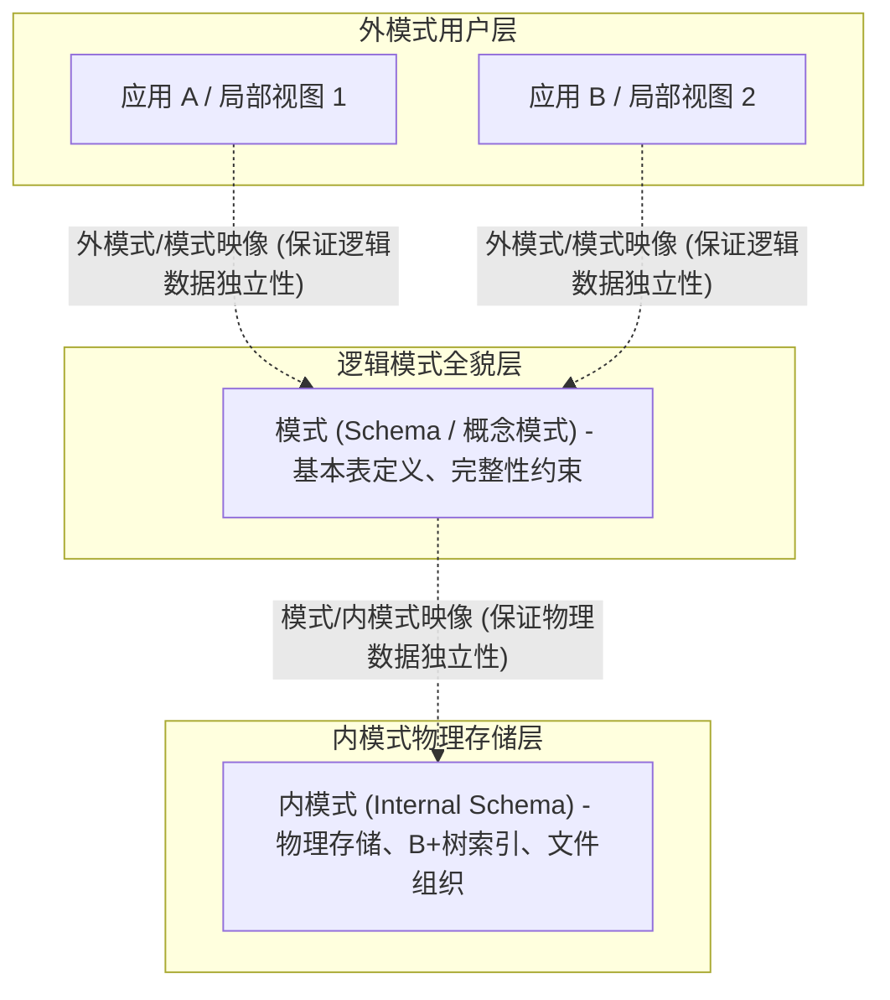
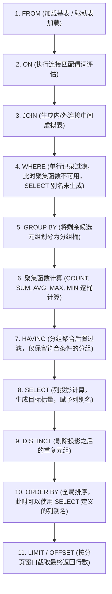
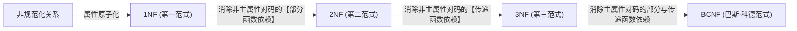

# 🎓 数据库系统与 SQL 期末复习冲刺·全能速查知识图谱 (Ultimate Review Guide & CheatSheet)

> **适用范围**：高校计算机科学与技术、软件工程、大数据与人工智能专业《数据库系统概论》、《关系数据库原理》课程期末理论考试与机试，以及主流数据库（PostgreSQL / MySQL / 达梦 / SQL Server / Oracle / SQL-92/1999 通用标准）日常开发快速查阅。  
> **教学基准模型**：全域采用全国通用标准**学生-课程-选课（`Student` - `Course` - `SC`）**三表拓扑。所有知识点均配以**【真实考题场景】**、**【考查考点】**、**【满分代码】**与**【判卷采分避坑】**。

---

## 📌 快速导航目录 (Table of Contents)

- [一、高频核心关键词全景速查矩阵 (Quick Index)](#一高频核心关键词全景速查矩阵-quick-index)
- [二、关系代数符号与 SQL 语法映射速查表 (含考题实战)](#二关系代数符号与-sql-语法映射速查表-含考题实战)
- [三、核心题型场景极速直达导航](#三核心题型场景极速直达导航)
- [四、理论基石：三级模式两级映像与执行顺序](#四理论基石三级模式两级映像与执行顺序)
  - [4.1 三级模式结构与两级独立性映像](#41-三级模式结构与两级独立性映像)
  - [4.2 SQL 核心语句物理执行生命周期 (11 步底层逻辑)](#42-sql-核心语句物理执行生命周期-11-步底层逻辑)
- [五、经典教学模型统一标准定义 (S-C-SC Schema)](#五经典教学模型统一标准定义-s-c-sc-schema)
- [六、DDL 数据定义语言 (库、模式、表、视图、索引)](#六ddl-数据定义语言-库模式表视图索引)
  - [6.1 数据库与模式操作 (Database & Schema)](#61-数据库与模式操作-database--schema)
  - [6.2 表操作与结构变更 (CREATE / ALTER TABLE 考题精选)](#62-表操作与结构变更-create--alter-table-考题精选)
  - [6.3 视图体系与逻辑独立性 (CREATE VIEW / WITH CHECK OPTION 考题)](#63-视图体系与逻辑独立性-create-view--with-check-option-考题)
  - [6.4 索引体系与物理存储 (CREATE INDEX / 聚簇与辅助索引)](#64-索引体系与物理存储-create-index--聚簇与辅助索引)
- [七、数据库三大完整性约束体系 (大题必考)](#七数据库三大完整性约束体系-大题必考)
  - [7.1 实体完整性 (主码定义与防空防重)](#71-实体完整性-主码定义与防空防重)
  - [7.2 参照完整性与级联策略 (CASCADE / RESTRICT / SET NULL 联动考题)](#72-参照完整性与级联策略-cascade--restrict--set-null-联动考题)
  - [7.3 用户定义完整性与约束维护 (CHECK / UNIQUE / NOT NULL)](#73-用户定义完整性与约束维护-check--unique--not-null)
- [八、DQL 数据查询语言 (精要到压轴大题)](#八dql-数据查询语言-精要到压轴大题)
  - [8.1 单表基础查询与条件谓词 (BETWEEN / IN / LIKE 模糊转义)](#81-单表基础查询与条件谓词-between--in--like-模糊转义)
  - [8.2 聚集函数与三值逻辑 NULL 空值陷阱 (COUNT 区别与运算规则)](#82-聚集函数与三值逻辑-null-空值陷阱-count-区别与运算规则)
  - [8.3 分组统计与 HAVING 机制 (WHERE 与 HAVING 联动考题)](#83-分组统计与-having-机制-where-与-having-联动考题)
  - [8.4 多表连接查询 (INNER / LEFT / FULL / 自连接先修课考题)](#84-多表连接查询-inner--left--full--自连接先修课考题)
  - [8.5 嵌套子查询与量词谓词 (IN / ANY / ALL / 自身平均分比较)](#85-嵌套子查询与量词谓词-in--any--all--自身平均分比较)
  - [8.6 相关子查询与 EXISTS / 压轴双重 NOT EXISTS 全称量词题](#86-相关子查询与-exists--压轴双重-not-exists-全称量词题)
  - [8.7 集合操作 (UNION [ALL] / INTERSECT / EXCEPT 考题)](#87-集合操作-union-all--intersect--except-考题)
  - [8.8 现代进阶查询：窗口函数 (ROW_NUMBER / RANK / DENSE_RANK 分组排名)](#88-现代进阶查询窗口函数-row_number--rank--dense_rank-分组排名)
  - [8.9 条件表达式与行列转换 (CASE WHEN 成绩打标与分段统计)](#89-条件表达式与行列转换-case-when-成绩打标与分段统计)
  - [8.10 公共表表达式 (CTE / WITH 临时结果集解耦)](#810-公共表表达式-cte--with-临时结果集解耦)
- [九、DML 数据操纵语言 (增、删、改)](#九dml-数据操纵语言-增删改)
  - [9.1 插入数据 (INSERT INTO 与子查询批量导入考题)](#91-插入数据-insert-into-与子查询批量导入考题)
  - [9.2 修改数据 (UPDATE 与关联子查询提分考题)](#92-修改数据-update-与关联子查询提分考题)
  - [9.3 删除数据 (DELETE 与子查询孤儿数据清理考题)](#93-删除数据-delete-与子查询孤儿数据清理考题)
  - [9.4 DROP vs TRUNCATE vs DELETE 终极对比矩阵 (简答必背)](#94-drop-vs-truncate-vs-delete-终极对比矩阵-简答必背)
- [十、DCL 数据控制语言 (授权、收权与权限级联)](#十dcl-数据控制语言-授权收权与权限级联)
- [十一、TCL 事务控制语言、ACID 特性与并发隔离级别](#十一tcl-事务控制语言acid-特性与并发隔离级别)
  - [11.1 事务四大 ACID 特性精解](#111-事务四大-acid-特性精解)
  - [11.2 事务控制语句与保存点 (SAVEPOINT 局部回滚考题)](#112-事务控制语句与保存点-savepoint-局部回滚考题)
  - [11.3 并发读异常与 SQL 四大隔离级别对比矩阵 (综合题必考)](#113-并发读异常与-sql-四大隔离级别对比矩阵-综合题必考)
- [十二、进阶可编程对象：触发器 (TRIGGER) 大题模板](#十二进阶可编程对象触发器-trigger-大题模板)
- [十三、期末背诵狂飙：关系范式理论与模式分解大题全解 (1NF~BCNF)](#十三期末背诵狂飙关系范式理论与模式分解大题全解-1nf--bcnf)
- [十四、期末必背十大易错陷阱与答题规范 (避坑清单)](#十四期末必背十大易错陷阱与答题规范-避坑清单)

---

## 一、高频核心关键词全景速查矩阵 (Quick Index)

| 关键词 | 分类 | 语法原型 / 功能简述 | 易错等级 | 快速跳转 |
| :--- | :--- | :--- | :---: | :--- |
| `SELECT` | DQL | 投影输出列、标量表达式或常量 | 低 | [8.1](#81-单表基础查询与条件谓词-between--in--like-模糊转义) |
| `DISTINCT` | DQL | 消除投影结果集中的重复元组 | 低 | [8.1](#81-单表基础查询与条件谓词-between--in--like-模糊转义) |
| `WHERE` | DQL/DML | 行级前置过滤（严禁包含聚集函数，无法使用 SELECT 别名） | **高** | [8.1](#81-单表基础查询与条件谓词-between--in--like-模糊转义) |
| `GROUP BY` | DQL | 按列划分元组，SELECT 中的非聚集列必须全部放入此子句 | **高** | [8.3](#83-分组统计与-having-机制-where-与-having-联动考题) |
| `HAVING` | DQL | 分组聚合后的后置过滤（常配合聚集函数筛选分组） | 中 | [8.3](#83-分组统计与-having-机制-where-与-having-联动考题) |
| `ORDER BY` | DQL | 排序输出，默认 `ASC` 升序，`DESC` 降序，可使用列别名 | 低 | [8.1](#81-单表基础查询与条件谓词-between--in--like-模糊转义) |
| `JOIN ... ON` | DQL | 表连接算子（内连接 `INNER`、外连接 `LEFT`/`RIGHT`/`FULL`） | 中 | [8.4](#84-多表连接查询-inner--left--full--自连接先修课考题) |
| `LIKE` | DQL | 通配符模式匹配（`%` 任意长度，`_` 单字符，`ESCAPE` 转义） | 中 | [8.1](#81-单表基础查询与条件谓词-between--in--like-模糊转义) |
| `BETWEEN ... AND` | DQL | 闭区间范围匹配（包含边界值 $a \le x \le b$） | 低 | [8.1](#81-单表基础查询与条件谓词-between--in--like-模糊转义) |
| `IN / NOT IN` | DQL | 枚举列表或子查询集合成员判断（**注意 NULL 黑洞**） | **高** | [8.5](#85-嵌套子查询与量词谓词-in--any--all--自身平均分比较) |
| `EXISTS` | DQL | 存在性谓词（相关子查询返回非空行即为 TRUE） | **极高** | [8.6](#86-相关子查询与-exists--压轴双重-not-exists-全称量词题) |
| `COUNT / SUM / AVG`| DQL | 聚集统计函数（除 `COUNT(*)` 外均跳过 NULL 计算） | **高** | [8.2](#82-聚集函数与三值逻辑-null-空值陷阱-count-区别与运算规则) |
| `OVER (PARTITION BY)`| DQL | 窗口函数，分组计算动态排名而不折叠行数 | 中 | [8.8](#88-现代进阶查询窗口函数-row_number--rank--dense_rank-分组排名) |
| `CASE WHEN ... END` | DQL | 条件分支表达式，实现行转列与业务分类 | 中 | [8.9](#89-条件表达式与行列转换-case-when-成绩打标与分段统计) |
| `UNION [ALL]` | DQL | 结果集合并（`UNION` 去重排序，`UNION ALL` 直接拼接高吞吐）| 中 | [8.7](#87-集合操作-union-all--intersect--except-考题) |
| `CREATE TABLE` | DDL | 定义基表物理结构与各维度完整性约束 | 中 | [6.2](#62-表操作与结构变更-create--alter-table-考题精选) |
| `ALTER TABLE` | DDL | 变更表定义（`ADD`, `DROP`, `RENAME`, `ALTER TYPE`） | 中 | [6.2](#62-表操作与结构变更-create--alter-table-考题精选) |
| `DROP TABLE` | DDL | 物理销毁表结构、数据、依赖对象与索引 | 低 | [6.2](#62-表操作与结构变更-create--alter-table-考题精选) |
| `TRUNCATE TABLE` | DDL | 高速清空表内全部数据并重置空间，保留表结构 | 中 | [9.4](#94-drop-vs-truncate-vs-delete-终极对比矩阵-简答必背) |
| `CREATE VIEW` | DDL | 定义虚表（含 `WITH CHECK OPTION` 防越界修改机制） | **高** | [6.3](#63-视图体系与逻辑独立性-create-view--with-check-option-考题) |
| `CREATE INDEX` | DDL | 创建普通/唯一/聚簇索引以优化检索性能 | 中 | [6.4](#64-索引体系与物理存储-create-index--聚簇与辅助索引) |
| `PRIMARY KEY` | 约束 | 实体完整性约束：单列或复合主键，唯一且非空 | 低 | [7.1](#71-实体完整性-主码定义与防空防重) |
| `FOREIGN KEY` | 约束 | 参照完整性约束：外键参照主表主键，支持级联动作 | **高** | [7.2](#72-参照完整性与级联策略-cascade--restrict--set-null-联动考题) |
| `CHECK` | 约束 | 用户自定义完整性：布尔表达式约束列取值范围 | 低 | [7.3](#73-用户定义完整性与约束操作-check--unique--not-null) |
| `INSERT INTO` | DML | 插入单行、多行或子查询导入数据 | 低 | [9.1](#91-插入数据-insert-into-与子查询批量导入考题) |
| `UPDATE ... SET` | DML | 修改满足过滤条件的元组属性值（**严防漏写 WHERE**） | **高** | [9.2](#92-修改数据-update-与关联子查询提分考题) |
| `DELETE FROM` | DML | 逐行删除满足条件的元组数据（**严防漏写 WHERE**） | **高** | [9.3](#93-删除数据-delete-与子查询孤儿数据清理考题) |
| `GRANT / REVOKE` | DCL | 授予或收回用户/角色的对象操作特权 | 中 | [十](#十dcl-数据控制语言-授权收权与权限级联) |
| `WITH GRANT OPTION`| DCL | 权限传播关键字，允许被授权者转授该特权 | **高** | [十](#十dcl-数据控制语言-授权收权与权限级联) |
| `COMMIT / ROLLBACK`| TCL | 提交永久落盘 / 回滚撤销事务未决变更 | 低 | [十一](#十一tcl-事务控制语言acid-特性与并发隔离级别) |
| `SAVEPOINT` | TCL | 设立事务保存点，支持局部精准回滚 | 中 | [11.2](#112-事务控制语句与保存点-savepoint-局部回滚考题) |

---

## 二、关系代数符号与 SQL 语法映射速查表 (含考题实战)

大学期末试卷前两大题必考**关系代数表达式**与 **SQL 语句互相转化**，以下为经典考题与标准映射：

### 2.1 关系代数八大运算速查与对照实例

#### ① 选择 (Selection) $\sigma_{F}(R)$
- 📝 **【经典考题】**：查询计算机系（`sdept = 'CS'`）且年龄小于 20 岁的学生全部信息。
- 📐 **关系代数**：$\sigma_{sdept='CS' \ \land \ sage < 20}(Student)$
- 💻 **SQL 映射**：
  ```sql
  SELECT * FROM student WHERE sdept = 'CS' AND sage < 20;
  ```

#### ② 投影 (Projection) $\pi_{A}(R)$
- 📝 **【经典考题】**：查询全校学生的学号和姓名（关系代数投影自带去重）。
- 📐 **关系代数**：$\pi_{sno, sname}(Student)$
- 💻 **SQL 映射**：
  ```sql
  SELECT DISTINCT sno, sname FROM student;
  ```

#### ③ 自然连接 (Natural Join) $R \bowtie S$
- 📝 **【经典考题】**：查询选课表中每个学生的学号、姓名、课程号与成绩。
- 📐 **关系代数**：$\pi_{sno, sname, cno, grade}(Student \bowtie SC)$
- 💻 **SQL 映射**：
  ```sql
  SELECT student.sno, student.sname, sc.cno, sc.grade
  FROM student 
  NATURAL JOIN sc; -- 或显式 INNER JOIN ON student.sno = sc.sno
  ```

#### ④ 条件连接 (Theta Join) $R \bowtie_{A \theta B} S$
- 📝 **【经典考题】**：查询成绩高于自身先修课学分 20 倍的选课记录（广义条件连接）。
- 📐 **关系代数**：$SC \bowtie_{SC.cno = Course.cno \ \land \ SC.grade > Course.ccredit \times 20} Course$
- 💻 **SQL 映射**：
  ```sql
  SELECT sc.* FROM sc 
  JOIN course ON sc.cno = course.cno AND sc.grade > course.ccredit * 20;
  ```

#### ⑤ 笛卡尔积 (Cartesian Product) $R \times S$
- 📝 **【经典考题】**：生成全校所有学生与全校所有开设课程的组合配对列表。
- 📐 **关系代数**：$Student \times Course$
- 💻 **SQL 映射**：
  ```sql
  SELECT student.sno, course.cno FROM student CROSS JOIN course;
  ```

#### ⑥ 并运算 (Union) $R \cup S$
- 📝 **【经典考题】**：查询选修了 1 号课程或者选修了 2 号课程的学生学号。
- 📐 **关系代数**：$\pi_{sno}(\sigma_{cno='1'}(SC)) \cup \pi_{sno}(\sigma_{cno='2'}(SC))$
- 💻 **SQL 映射**：
  ```sql
  SELECT sno FROM sc WHERE cno = '1'
  UNION
  SELECT sno FROM sc WHERE cno = '2';
  ```

#### ⑦ 差运算 (Difference) $R - S$
- 📝 **【经典考题】**：查询选修了 1 号课程但没有选修 2 号课程的学生学号。
- 📐 **关系代数**：$\pi_{sno}(\sigma_{cno='1'}(SC)) - \pi_{sno}(\sigma_{cno='2'}(SC))$
- 💻 **SQL 映射**：
  ```sql
  SELECT sno FROM sc WHERE cno = '1'
  EXCEPT
  SELECT sno FROM sc WHERE cno = '2'; -- (Oracle 为 MINUS)
  ```

#### ⑧ 除法运算 (Division) $R \div S$ (期末压轴大题)
- 📝 **【经典考题】**：查询选修了全部课程的学生学号。
- 📐 **关系代数**：$\pi_{sno, cno}(SC) \div \pi_{cno}(Course)$
- 💻 **SQL 映射**：
  ```sql
  -- 转换为“不存在一门课程该学生没有选修”
  SELECT DISTINCT sno FROM sc sc_out
  WHERE NOT EXISTS (
      SELECT * FROM course c
      WHERE NOT EXISTS (
          SELECT * FROM sc sc_in
          WHERE sc_in.sno = sc_out.sno AND sc_in.cno = c.cno
      )
  );
  ```

---

## 三、核心题型场景极速直达导航

- ❓ **想要查“每个系/每门课成绩前 3 名”（分组 Top N 排序）**  
  👉 跳转到 [8.8 窗口函数](#88-现代进阶查询窗口函数-row_number--rank--dense_rank-分组排名) 使用 `DENSE_RANK() OVER (PARTITION BY ...)`。
- ❓ **试卷大题要求“查询选修了全部课程的学生”（全称量词 $\forall$）**  
  👉 跳转到 [8.6 压轴双重 NOT EXISTS](#86-相关子查询与-exists--压轴双重-not-exists-全称量词题) 直接套用解题模板。
- ❓ **试卷要求“按成绩输出等级：$\ge 90$ 为优秀，$\ge 60$ 为及格，否则不及格”**  
  👉 跳转到 [8.9 条件表达式 CASE WHEN](#89-条件表达式与行列转换-case-when-成绩打标与分段统计)。
- ❓ **题目要求“定义视图，且要求以后通过该视图插入或修改时依然属于该系”**  
  👉 跳转到 [6.3 视图定义](#63-视图体系与逻辑独立性-create-view--with-check-option-考题) 记住末尾加上 `WITH CHECK OPTION`。
- ❓ **题目要求“设计一个触发器：当选课成绩录入时自动更新该学生的平均分”**  
  👉 跳转到 [十二、触发器大题模板](#十二进阶可编程对象触发器-trigger-大题模板)。
- ❓ **简答题问“为什么有了 `WHERE` 还要有 `HAVING`？”**  
  👉 跳转到 [8.3 WHERE vs HAVING 深度辨析](#83-分组统计与-having-机制-where-与-having-联动考题)。
- ❓ **大题考查“给定关系模式与函数依赖集，分解到 3NF / BCNF”**  
  👉 跳转到 [十三、关系范式理论与模式分解大题全解](#十三期末背诵狂飙关系范式理论与模式分解大题全解-1nf--bcnf)。

---

## 四、理论基石：三级模式两级映像与执行顺序

### 4.1 三级模式结构与两级独立性映像

高校数据库理论考试常考“三级模式与两级数据独立性”填空与简答：



- **逻辑数据独立性**：当基本表（模式）增加新属性或调整表结构时，通过修改**外模式/模式映像（视图定义）**，使得上层应用程序无需改动代码。
- **物理数据独立性**：当数据库修改物理存储路径、增加聚簇索引或调整页大小时（修改内模式），通过修改**模式/内模式映像**，使得逻辑模式与应用程序保持不变。

---

### 4.2 SQL 核心语句物理执行生命周期 (11 步底层逻辑)

理解 SQL 的执行阶段是排除语法报错和设计复杂查询的根本法门：



> **🧠 期末简答/辨析必考答题依据**：
> 1. **为什么 `WHERE` 中写 `WHERE AVG(grade) > 60` 会语法报错？**  
>    答：因为 `WHERE` 在第 4 步执行，而分组聚合计算发生在第 5、6 步。在单行过滤阶段，分组尚未建立，聚合值根本不存在。
> 2. **为什么 `WHERE` 中不能用 `SELECT sname AS 姓名` 的别名？**  
>    答：因为 `WHERE`（第 4 步）早于 `SELECT`（第 8 步）执行。执行到 `WHERE` 时别名还没有被解析生成。
> 3. **为什么 `ORDER BY` 中能写列别名？**  
>    答：因为 `ORDER BY` 处于第 10 步，在 `SELECT` 投影赋值完成后执行，此时列别名已经全部注册可用。

---

## 五、经典教学模型统一标准定义 (S-C-SC Schema)

本手册所有 SQL 范例均构建于该完备的标准教学数据库结构之上：

```mermaid
erDiagram
    STUDENT ||--o{ SC : "选修 (sno)"
    COURSE ||--o{ SC : "被选 (cno)"
    COURSE ||--o{ COURSE : "先修课 (cpno -> cno)"

    STUDENT {
        char(9) sno PK "学号 (主键)"
        varchar(20) sname "姓名 (非空)"
        int sage "年龄 (CHECK限制)"
        char(2) ssex "性别 (男/女)"
        varchar(20) sdept "所在系 (默认值)"
    }
    COURSE {
        char(4) cno PK "课程号 (主键)"
        varchar(40) cname "课程名 (唯一)"
        char(4) cpno FK "先修课号 (自引用外键)"
        smallint ccredit "学分"
    }
    SC {
        char(9) sno PK_FK "学号 (复合主键, 参照 Student)"
        char(4) cno PK_FK "课程号 (复合主键, 参照 Course)"
        smallint grade "考试成绩 (0-100)"
    }
```

---

## 六、DDL 数据定义语言 (库、模式、表、视图、索引)

### 6.1 数据库与模式操作 (Database & Schema)

- 📝 **【经典考题】**：创建一个名为 `school` 的数据库，并在库中建立名为 `edu` 的模式，指定所属用户为 `song`。
- 🎯 **【考查知识点】**：数据库的命名与参数定义；模式（Schema）的命名空间隔离与权限归属。

```sql
-- 1. 创建数据库并设置防重判断
CREATE DATABASE IF NOT EXISTS school;

-- 2. 创建模式并指定所属所有者 (PostgreSQL / 国标教材标准)
CREATE SCHEMA edu AUTHORIZATION song;

-- 3. 设置当前会话默认在 edu 模式下执行表操作（避免每次写 edu.tablename）
SET search_path TO edu, public;

-- 4. 级联删除模式（模式下有表时必须加 CASCADE）
DROP SCHEMA IF EXISTS edu CASCADE;
```

---

### 6.2 表操作与结构变更 (CREATE / ALTER TABLE 考题精选)

#### 6.2.1 完整教学三表建表大题

- 📝 **【经典考题】**：请根据以下要求建立三张基本表：
  1. 学生表 `student`：学号 `sno` 为 9 位定长字符主键；姓名 `sname` 20位变长字符非空；年龄 `sage` 整数在 15-45 岁之间；性别 `ssex` 默认为'男'且只能取'男'或'女'；所在系 `sdept` 默认为'计算机系'。
  2. 课程表 `course`：课程号 `cno` 为 4 位定长字符主键；课程名 `cname` 唯一且非空；先修课号 `cpno` 参照本表的课程号；学分 `ccredit` 大于 0。
  3. 选课表 `sc`：学号 `sno` 参照学生表级联删除、级联更新；课程号 `cno` 参照课程表拒绝删除；成绩 `grade` 在 0-100 之间；学号和课程号共同构成复合主键。
- 🎯 **【考查知识点】**：列级主键、表级复合主键、外键级联动作、CHECK 约束、DEFAULT 默认值。

```sql
-- 1. 学生表 Student
CREATE TABLE student (
    sno CHAR(9) PRIMARY KEY,                    -- 实体完整性：单列主键
    sname VARCHAR(20) NOT NULL,                 -- 用户定义完整性：非空
    sage INT CHECK (sage >= 15 AND sage <= 45), -- 用户定义完整性：检查约束
    ssex CHAR(2) DEFAULT '男' CHECK (ssex IN ('男', '女')),
    sdept VARCHAR(20) DEFAULT '计算机系'
);

-- 2. 课程表 Course（含自引用先修课外键）
CREATE TABLE course (
    cno CHAR(4) PRIMARY KEY,
    cname VARCHAR(40) NOT NULL UNIQUE,          -- 用户定义完整性：唯一
    cpno CHAR(4),
    ccredit SMALLINT CHECK (ccredit > 0),
    FOREIGN KEY (cpno) REFERENCES course(cno)   -- 参照完整性：自引用外键
);

-- 3. 选课表 SC（复合主键与级联外键）
CREATE TABLE sc (
    sno CHAR(9) NOT NULL,
    cno CHAR(4) NOT NULL,
    grade SMALLINT CHECK (grade BETWEEN 0 AND 100),
    -- 表级复合主键定义
    CONSTRAINT pk_sc PRIMARY KEY (sno, cno),
    -- 外键 1：参照 student，级联删除与更新
    CONSTRAINT fk_sc_student FOREIGN KEY (sno)
        REFERENCES student(sno)
        ON DELETE CASCADE
        ON UPDATE CASCADE,
    -- 外键 2：参照 course，限制删除
    CONSTRAINT fk_sc_course FOREIGN KEY (cno)
        REFERENCES course(cno)
        ON DELETE RESTRICT
);
```
> 💡 **【判卷采分点】**：
> - 复合主键**必须**写在所有列定义的下方，作为表级约束 `PRIMARY KEY (sno, cno)`，不能在列后面直接写两个 PRIMARY KEY，否则扣全分！
> - 自引用外键 `cpno` 必须指向自身的 `cno`。

#### 6.2.2 变更表结构 (ALTER TABLE 考题)

- 📝 **【经典考题】**：
  1. 为学生表增加“联系电话”列 `phone`（11位定长字符），并设置唯一约束；
  2. 将学生表的姓名列重命名为 `stuname`；
  3. 将学生表的年龄列默认值修改为 18 岁；
  4. 删除选课表的外键约束 `fk_sc_course`。

```sql
-- 1. 增加列与唯一约束
ALTER TABLE student ADD COLUMN phone CHAR(11);
ALTER TABLE student ADD CONSTRAINT uk_student_phone UNIQUE (phone);

-- 2. 重命名列
ALTER TABLE student RENAME COLUMN sname TO stuname;

-- 3. 修改列默认值
ALTER TABLE student ALTER COLUMN sage SET DEFAULT 18;

-- 4. 删除具名约束
ALTER TABLE sc DROP CONSTRAINT fk_sc_course;
```

---

### 6.3 视图体系与逻辑独立性 (CREATE VIEW / WITH CHECK OPTION 考题)

- 📝 **【经典考题一】**：建立计算机系年龄小于 20 岁的学生视图 `cs_young_student`，要求包含学号、姓名、年龄，并要求通过该视图进行增加或修改操作时，必须保证该学生依然属于计算机系且年龄小于 20 岁。
- 🎯 **【考查知识点】**：视图创建语法；`WITH CHECK OPTION` 的防御机理。

```sql
CREATE VIEW cs_young_student AS
SELECT sno, sname, sage
FROM student
WHERE sdept = '计算机系' AND sage < 20
WITH CHECK OPTION; -- ★ 重点：插入或更新时强制校验 WHERE 条件！
```
> 💡 **【判卷采分点】**：如果漏写了 `WITH CHECK OPTION`，通常扣 2~3 分！该选项确保对视图执行 INSERT/UPDATE 时不会发生“数据从视图中越界蒸发”的现象。

- 📝 **【经典考题二】**：建立一个每个学生的选课门数与平均成绩的统计视图 `v_student_score`。
- 🎯 **【考查知识点】**：带聚集函数的虚表定义；显式定义视图别名列。

```sql
CREATE VIEW v_student_score (sno, course_cnt, avg_grade) AS
SELECT sno, COUNT(cno), AVG(grade)
FROM sc
GROUP BY sno;
```

#### 📌 视图可更新性判定法则 (期末判断题必考)
- **可以更新**：由单个基本表导出的**行列子集视图**（且包含主键）。
- **不可更新**：含有聚集函数、`GROUP BY`、`HAVING`、`DISTINCT`、`UNION` 算子的视图**一律不可更新**（因为这些操作已经改变了元组的对应关系，系统无法将更新映射回基表的单一元组）。

---

### 6.4 索引体系与物理存储 (CREATE INDEX / 聚簇与辅助索引)

- 📝 **【经典考题】**：在学生表的系别列上建立普通升序索引 `idx_sdept`；在课程表的课程名上建立唯一索引 `idx_cname`；在选课表上按学号建立聚簇索引 `idx_cluster_sno`。
- 🎯 **【考查知识点】**：辅助索引、唯一索引（UNIQUE）、聚簇索引（CLUSTER）的物理特征。

```sql
-- 1. 普通索引
CREATE INDEX idx_sdept ON student(sdept ASC);

-- 2. 唯一索引
CREATE UNIQUE INDEX idx_cname ON course(cname);

-- 3. 聚簇索引 (决定数据物理存放排布，一张表只能有一个聚簇索引！)
CREATE CLUSTER INDEX idx_cluster_sno ON sc(sno);

-- 4. 删除索引
DROP INDEX idx_sdept;
```

---

## 七、数据库三大完整性约束体系 (大题必考)

### 7.1 实体完整性 (主码定义与防空防重)

- 📝 **【经典理论考题】**：什么是实体完整性？若在 SC 表中插入一条记录 `('2024001', NULL, 85)`，系统会允许吗？为什么？
- 💡 **【满分答案】**：
  - 实体完整性规则规定：关系的主属性（主码中的任何一个属性列）都**不能取空值（NULL）**，且在整个关系中必须**唯一标识**一个元组。
  - 系统**绝对不允许**插入！因为 SC 表的主码是 `(sno, cno)` 复合主键，`cno` 属于主属性，主属性取 NULL 直接违背了实体完整性。

---

### 7.2 参照完整性与级联策略 (CASCADE / RESTRICT / SET NULL 联动考题)

- 📝 **【经典考题】**：在 `sc` 表中定义外键参照 `student(sno)`：
  1. 若要求删除学生时，其所有选课记录一并自动删除，应采用什么策略？
  2. 若要求如果该学生已有选课记录，则严禁直接删除该学生，应采用什么策略？
  3. 若要求删除学生时，其选课记录仍然保留，但学号变为空值，应采用什么策略？
- 🎯 **【考查知识点】**：`ON DELETE` 级联行为的选择与应用。

```sql
-- 策略 1: 级联删除 (CASCADE)
CONSTRAINT fk_sc_stu FOREIGN KEY (sno) REFERENCES student(sno) ON DELETE CASCADE;

-- 策略 2: 拒绝删除 (RESTRICT 或 NO ACTION)
CONSTRAINT fk_sc_stu FOREIGN KEY (sno) REFERENCES student(sno) ON DELETE RESTRICT;

-- 策略 3: 置为空值 (SET NULL - 前提是 sno 列允许 NULL，但在复合主键中不能用)
CONSTRAINT fk_sc_stu FOREIGN KEY (sno) REFERENCES student(sno) ON DELETE SET NULL;
```

---

### 7.3 用户定义完整性与约束维护 (CHECK / UNIQUE / NOT NULL)

- 📝 **【经典考题】**：通过 `ALTER TABLE` 命令为学生表补充约束：要求学生年龄必须大于 0 且小于 150，约束命名为 `ck_student_age`。随后将其安全删除。

```sql
-- 1. 添加检查约束
ALTER TABLE student ADD CONSTRAINT ck_student_age CHECK (sage > 0 AND sage < 150);

-- 2. 删除检查约束
ALTER TABLE student DROP CONSTRAINT ck_student_age;
```

---

## 八、DQL 数据查询语言 (精要到压轴大题)

### 8.1 单表基础查询与条件谓词 (BETWEEN / IN / LIKE 模糊转义)

#### 考题 1：模糊查询与单字符通配
- 📝 **【考题】**：查询姓“李”且全名为两个字的学生学号与姓名。
```sql
SELECT sno, sname
FROM student
WHERE sname LIKE '李_'; -- _ 匹配单个字符，% 匹配任意字符
```

#### 考题 2：特殊通配符转义 (ESCAPE)
- 📝 **【考题】**：查询课程名以 `"DB_"` 开头，且倒数第 3 个字符为 `"g"` 的课程号与学分。
```sql
SELECT cno, ccredit
FROM course
WHERE cname LIKE 'DB\_%g__' ESCAPE '\'; -- 使用 \ 将 _ 转义为普通字符
```

#### 考题 3：闭区间与多值判断
- 📝 **【考题】**：查询年龄在 19 到 22 岁之间（含两端）且系别为“计算机系”或“数学系”的学生姓名。
```sql
SELECT sname, sage, sdept
FROM student
WHERE sage BETWEEN 19 AND 22
  AND sdept IN ('计算机系', '数学系');
```

---

### 8.2 聚集函数与三值逻辑 NULL 空值陷阱 (COUNT 区别与运算规则)

#### 考题 1：缺考与空值判断
- 📝 **【考题】**：查询选修了课程但尚未参加考试（缺考）的学生学号与课程号。
```sql
-- 满分写法
SELECT sno, cno FROM sc WHERE grade IS NULL;

-- ❌ 零分写法（严重陷阱）：
-- SELECT sno, cno FROM sc WHERE grade = NULL; (结果恒为 UNKNOWN，永远无返回！)
```

#### 考题 2：COUNT(*) 与 COUNT(列名) 辨析
- 📝 **【考题】**：统计 1 号课程的选课人数，以及参加了考试的实际打分人数。
```sql
SELECT 
    COUNT(*) AS 选课门次,       -- 哪怕 grade 是 NULL 也计入
    COUNT(grade) AS 实考门次    -- 自动跳过 grade 为 NULL 的行
FROM sc
WHERE cno = '1';
```

---

### 8.3 分组统计与 HAVING 机制 (WHERE 与 HAVING 联动考题)

- 📝 **【经典综合考题】**：查询至少选修了 3 门课程且各门课成绩均及格（$\ge 60$）的学生学号及其选课门数，并按选课门数降序排列。
- 🎯 **【考查知识点】**：`WHERE` 过滤单行及格分数，`GROUP BY` 分组，`HAVING` 过滤分组门数。

```sql
SELECT sno, COUNT(cno) AS pass_course_cnt
FROM sc
WHERE grade >= 60              -- 步骤 1: 必须用 WHERE 先过滤掉不及格的单门课程！
GROUP BY sno                   -- 步骤 2: 按学号分组
HAVING COUNT(cno) >= 3         -- 步骤 3: 聚合过滤，要求及格门数至少为 3
ORDER BY pass_course_cnt DESC; -- 步骤 4: 结果排序
```
> 💡 **【易错扣分点】**：切勿写成 `GROUP BY sno HAVING grade >= 60`！`HAVING` 只能放聚合条件或者已经在 `GROUP BY` 中的字段。

---

### 8.4 多表连接查询 (INNER / LEFT / FULL / 自连接先修课考题)

#### 考题 1：内连接 (多表等值匹配)
- 📝 **【考题】**：查询选修了“数据库原理”课程且成绩在 90 分以上的学生姓名、系别与成绩。
```sql
SELECT s.sname, s.sdept, sc.grade
FROM student s
JOIN sc ON s.sno = sc.sno
JOIN course c ON sc.cno = c.cno
WHERE c.cname = '数据库原理' AND sc.grade >= 90;
```

#### 考题 2：左外连接 (保留无关联行)
- 📝 **【考题】**：查询所有学生的学号、姓名以及选课门数，要求没有选课的学生也要显示出来（选课门数显示为 0）。
```sql
SELECT s.sno, s.sname, COUNT(sc.cno) AS course_cnt
FROM student s
LEFT OUTER JOIN sc ON s.sno = sc.sno
GROUP BY s.sno, s.sname; -- 注意：COUNT(sc.cno) 能在无选课时正确统计为 0，写 COUNT(*) 会算成 1！
```

#### 考题 3：自连接 (查询间接先修课)
- 📝 **【考题】**：查询每一门课程的间接先修课（即“先修课的先修课”）。
```sql
SELECT c1.cno AS 当前课程, c1.cname AS 课程名, c2.cpno AS 间接先修课号
FROM course c1
JOIN course c2 ON c1.cpno = c2.cno; -- c1 的先修课 c1.cpno 等于 c2 的主键 c2.cno
```

---

### 8.5 嵌套子查询与量词谓词 (IN / ANY / ALL / 自身平均分比较)

#### 考题 1：集合成员判断 (IN)
- 📝 **【考题】**：查询与“刘晨”在同一个系学习的所有学生学号与姓名。
```sql
SELECT sno, sname
FROM student
WHERE sdept = (
    SELECT sdept FROM student WHERE sname = '刘晨'
) AND sname <> '刘晨';
```

#### 考题 2：量词谓词 (> ALL)
- 📝 **【考题】**：查询比“计算机系”所有学生年龄都大的其他系学生姓名与年龄。
```sql
SELECT sname, sage
FROM student
WHERE sage > ALL (
    SELECT sage FROM student WHERE sdept = '计算机系'
) AND sdept <> '计算机系';
```

#### 考题 3：经典相关子查询 (高于自身平均分)
- 📝 **【高频考题】**：查询每一个学生超过他自己选修课程平均成绩的课程号和成绩。
- 🎯 **【考查知识点】**：相关子查询——内层子查询需要引用外层当前候选元组的学号 `x.sno`。

```sql
SELECT x.sno, x.cno, x.grade
FROM sc x
WHERE x.grade > (
    -- 计算当前候选学生 x.sno 的个人选课平均分
    SELECT AVG(y.grade)
    FROM sc y
    WHERE y.sno = x.sno
);
```

---

### 8.6 相关子查询与 EXISTS / 压轴双重 NOT EXISTS 全称量词题

#### 8.6.1 基础 EXISTS 存在性测试
- 📝 **【考题】**：查询选修了 1 号课程的学生姓名。
```sql
SELECT s.sname
FROM student s
WHERE EXISTS (
    SELECT 1 FROM sc WHERE sc.sno = s.sno AND sc.cno = '1'
);
```

#### 8.6.2 ★ 期末压轴大题一：选修了全部课程的学生 (双重 NOT EXISTS)
- 📝 **【经典试题】**：查询选修了全校所开设的**全部课程**的学生姓名与学号。
- 💡 **【解题逻辑】**：不存在这样一门课程，该学生没有选修。

```sql
SELECT s.sno, s.sname
FROM student s
WHERE NOT EXISTS (
    -- 外层 NOT EXISTS: 遍历全校开设的每一门课程 c
    SELECT *
    FROM course c
    WHERE NOT EXISTS (
        -- 内层 NOT EXISTS: 检查该学生 s 是否选修了这门课 c
        SELECT *
        FROM sc
        WHERE sc.sno = s.sno AND sc.cno = c.cno
    )
);
```

#### 8.6.3 ★ 期末压轴大题二：至少选修了某生选修的全部课程 (关系代数除法)
- 📝 **【经典试题】**：查询**至少选修了学号为 '2024001' 学生所选修的全部课程**的其他学生学号。
- 💡 **【解题逻辑】**：不存在这样一门课程，学生 2024001 选修了，而当前候选学生 X 却没有选修。

```sql
SELECT DISTINCT scx.sno
FROM sc scx
WHERE NOT EXISTS (
    -- 找出 2024001 选修过的所有课程
    SELECT *
    FROM sc sc1
    WHERE sc1.sno = '2024001' AND NOT EXISTS (
        -- 检查当前学生 scx 是否也选了这门课
        SELECT *
        FROM sc sc2
        WHERE sc2.sno = scx.sno AND sc2.cno = sc1.cno
    )
) AND scx.sno <> '2024001'; -- 排除 2024001 本人
```

---

### 8.7 集合操作 (UNION [ALL] / INTERSECT / EXCEPT 考题)

- 📝 **【经典考题】**：
  1. 查询选修了 1 号课程或选修了 2 号课程的学生学号（去重并集）；
  2. 查询同时选修了 1 号和 2 号课程的学生学号（交集）；
  3. 查询选修了 1 号课程但没有选修 2 号课程的学生学号（差集）。

```sql
-- 1. 并集 (UNION)
SELECT sno FROM sc WHERE cno = '1'
UNION
SELECT sno FROM sc WHERE cno = '2';

-- 2. 交集 (INTERSECT)
SELECT sno FROM sc WHERE cno = '1'
INTERSECT
SELECT sno FROM sc WHERE cno = '2';

-- 3. 差集 (EXCEPT)
SELECT sno FROM sc WHERE cno = '1'
EXCEPT
SELECT sno FROM sc WHERE cno = '2';
```

---

### 8.8 现代进阶查询：窗口函数 (ROW_NUMBER / RANK / DENSE_RANK 分组排名)

- 📝 **【经典考题】**：查询每门课程中成绩排名前两名的学生选课记录（含学号、课程号、成绩与名次，并列名次不跳跃）。
- 🎯 **【考查知识点】**：`DENSE_RANK() OVER (PARTITION BY ... ORDER BY ...)`。

```sql
WITH ranked_sc AS (
    SELECT 
        sno, 
        cno, 
        grade,
        DENSE_RANK() OVER (
            PARTITION BY cno             -- 按照课程号分组开窗
            ORDER BY grade DESC          -- 窗口内按成绩降序
        ) AS rank_num
    FROM sc
    WHERE grade IS NOT NULL
)
SELECT sno, cno, grade, rank_num
FROM ranked_sc
WHERE rank_num <= 2;
```

---

### 8.9 条件表达式与行列转换 (CASE WHEN 成绩打标与分段统计)

#### 考题 1：按区间打标
- 📝 **【考题】**：查询每条选课记录，并将成绩输出为：$\ge 90$ 为“优秀”，$\ge 80$ 为“良好”，$\ge 60$ 为“及格”，其余为“不及格”。
```sql
SELECT sno, cno, grade,
    CASE 
        WHEN grade >= 90 THEN '优秀'
        WHEN grade >= 80 THEN '良好'
        WHEN grade >= 60 THEN '及格'
        ELSE '不及格'
    END AS 评价等级
FROM sc;
```

#### 考题 2：行列转换 (Pivot) 统计
- 📝 **【考题】**：统计每个系的男同学与女同学人数，结果显示为三列：系名、男生人数、女生人数。
```sql
SELECT sdept,
    COUNT(CASE WHEN ssex = '男' THEN 1 END) AS 男生人数,
    COUNT(CASE WHEN ssex = '女' THEN 1 END) AS 女生人数
FROM student
GROUP BY sdept;
```

---

### 8.10 公共表表达式 (CTE / WITH 临时结果集解耦)

- 📝 **【考题】**：先求出平均分超过 80 分的学生学号，再联查学生表显示其姓名与所在系。
```sql
WITH top_students AS (
    SELECT sno, AVG(grade) AS avg_g
    FROM sc
    GROUP BY sno
    HAVING AVG(grade) >= 80
)
SELECT s.sno, s.sname, s.sdept, ts.avg_g
FROM student s
JOIN top_students ts ON s.sno = ts.sno;
```

---

## 九、DML 数据操纵语言 (增、删、改)

### 9.1 插入数据 (INSERT INTO 与子查询批量导入考题)

- 📝 **【考题一】**：向选课表中插入一条新记录：学号 `'2024001'`，课程号 `'1'`，由于缺考，成绩暂置为空。
```sql
INSERT INTO sc (sno, cno, grade) VALUES ('2024001', '1', NULL);
```

- 📝 **【考题二 (子查询批量导入)】**：建立新表 `dept_stat(sdept, avg_age)`，并将各系的名称及该系学生的平均年龄一次性全部导入该表中。
```sql
CREATE TABLE dept_stat (
    sdept VARCHAR(20),
    avg_age NUMERIC(4, 1)
);

-- 子查询批量插入
INSERT INTO dept_stat (sdept, avg_age)
SELECT sdept, AVG(sage)
FROM student
GROUP BY sdept;
```

---

### 9.2 修改数据 (UPDATE 与关联子查询提分考题)

- 📝 **【经典考题】**：将选修了“数据结构”课程且成绩不及格的所有学生的成绩提高 5 分。
```sql
UPDATE sc
SET grade = grade + 5
WHERE grade < 60 AND cno IN (
    SELECT cno FROM course WHERE cname = '数据结构'
);
```

---

### 9.3 删除数据 (DELETE 与子查询孤儿数据清理考题)

- 📝 **【经典考题】**：删除“计算机系”所有不及格学生的选课记录。
```sql
DELETE FROM sc
WHERE grade < 60 AND sno IN (
    SELECT sno FROM student WHERE sdept = '计算机系'
);
```

---

### 9.4 DROP vs TRUNCATE vs DELETE 终极对比矩阵 (简答必背)

| 对比维度 | `DROP TABLE` | `TRUNCATE TABLE` | `DELETE FROM` |
| :--- | :--- | :--- | :--- |
| **所属语言分类** | **DDL** (数据定义语言) | **DDL** (数据定义语言) | **DML** (数据操纵语言) |
| **底层实现机制** | 彻底销毁表结构、存储页及索引元数据 | 释放物理存储页链表，重置高水位线与自增计数器 | 逐行扫描、标记删除，产生大量行级重做日志 |
| **WHERE 过滤条件**| ❌ 不支持 | ❌ 不支持（全表排空） | ✔ **原生支持精细条件过滤** |
| **事务支持与回滚**| 隐式提交，通常无法回滚 | 属于 DDL，多数引擎自动提交不可回滚 | **完全支持事务回滚 (`ROLLBACK`)** |
| **触发器触发** | 不触发 | 不触发 `DELETE` 触发器 | **会逐行触发 `DELETE` 触发器** |
| **执行吞吐速度** | 极快（瞬间销毁元数据字典） | **极快**（释放空间，无单行日志开销） | 慢（千万级大表易造成事务锁等待与膨胀）|
| **表物理结构状态**| 表已彻底消失 | **表结构完好存在**，状态归零 | **表结构完好存在** |

---

## 十、DCL 数据控制语言 (授权、收权与权限级联)

### 10.1 权限授予 (GRANT)
- 📝 **【经典考题】**：将对 `Student` 表的 `SELECT` 权限和修改年龄的权限 `UPDATE(sage)` 授予用户 `U1`，并允许该用户将这些权限转授给其他用户。
```sql
GRANT SELECT, UPDATE(sage) ON student TO U1 WITH GRANT OPTION;
```

---

### 10.2 权限收回 (REVOKE)
- 📝 **【经典考题】**：收回用户 `U1` 对 `Student` 表的 `SELECT` 权限，并要求将其已转授给他人的权限一并级联收回。
```sql
REVOKE SELECT ON student FROM U1 CASCADE;
```
> 💡 **【考点对比】**：`CASCADE` 为级联收回；`RESTRICT` 为受限收回（若已转授他人则报错拒绝执行）。

---

## 十一、TCL 事务控制语言、ACID 特性与并发隔离级别

### 11.1 事务四大 ACID 特性精解

1. **原子性 (Atomicity)**：事务是不可分割的最小执行单位，事务内部操作要么全做，要么全不做。
2. **一致性 (Consistency)**：事务的执行必须使数据库从一个一致性状态转换到另一个一致性状态。
3. **隔离性 (Isolation)**：并发执行的各个事务之间互不干扰，一个事务的中间状态对其他事务不可见。
4. **持久性 (Durability)**：事务一旦提交（`COMMIT`），其修改就是永久性的，即使宕机也不丢失。

---

### 11.2 事务控制语句与保存点 (SAVEPOINT 局部回滚考题)

- 📝 **【经典考题】**：模拟换课业务，先扣除原课程，设置保存点，然后选修新课；若选新课失败，仅回滚到保存点。
```sql
BEGIN;

-- 操作 1: 退选老课程
DELETE FROM sc WHERE sno = '2024001' AND cno = '1';

-- 设置事务保存点
SAVEPOINT sp_dropped_old;

-- 操作 2: 尝试选修新课程 2
INSERT INTO sc VALUES ('2024001', '2', NULL);

-- 若发现新课人数已满，回滚到保存点（退选依然生效，但新选操作撤销）
ROLLBACK TO SAVEPOINT sp_dropped_old;

-- 确认提交
COMMIT;
```

---

### 11.3 并发读异常与 SQL 四大隔离级别对比矩阵 (综合题必考)

- **脏读 (Dirty Read)**：T1 读到了 T2 **尚未提交**的修改数据。T2 随后回滚，T1 读到的数据变为脏数据。
- **不可重复读 (Non-repeatable Read)**：T1 读取某行后，T2 **修改或删除**该行并提交。T1 再次读取同一行，发现前后数值不一致。
- **幻读 (Phantom Read)**：T1 按条件范围读取数据后，T2 **插入了满足该条件的新行**并提交。T1 再次按同条件检索，发现凭空多出了几行。

| 隔离级别 (Isolation Level) | 脏读 (Dirty Read) | 不可重复读 (Non-repeatable) | 幻读 (Phantom Read) | 吞吐并发性能 |
| :--- | :---: | :---: | :---: | :---: |
| **Read Uncommitted (读未提交)** | ❌ 发生 | ❌ 发生 | ❌ 发生 | 最高 |
| **Read Committed (读已提交)** (PG/Oracle默认) | ✔ 防御 | ❌ 发生 | ❌ 发生 | 较高 |
| **Repeatable Read (可重复读)** (MySQL默认) | ✔ 防御 | ✔ 防御 | ❌ 发生 (MySQL MVCC下大部分防御) | 中等 |
| **Serializable (可串行化)** | ✔ 防御 | ✔ 防御 | ✔ 防御 | 最低 (全锁) |

---

## 十二、进阶可编程对象：触发器 (TRIGGER) 大题模板

- 📝 **【经典大题】**：在 `sc` 表上定义一个 `BEFORE INSERT OR UPDATE` 触发器，要求在插入或修改选课记录时，检查输入的成绩 `grade` 是否在 0 到 100 之间。若超出范围则抛出异常并阻止操作。
- 🎯 **【考查知识点】**：触发器定义、行级触发器 `FOR EACH ROW`、`NEW` 伪变量的使用。

```sql
-- 1. 定义触发器函数 (以 PostgreSQL 为例)
CREATE OR REPLACE FUNCTION fn_check_sc_grade()
RETURNS TRIGGER AS $$
BEGIN
    IF NEW.grade < 0 OR NEW.grade > 100 THEN
        RAISE EXCEPTION '成绩录入非法: grade 必须介于 0 到 100 之间，输入值为 %', NEW.grade;
    END IF;
    RETURN NEW; -- 校验通过，放行新元组
END;
$$ LANGUAGE plpgsql;

-- 2. 将触发器绑定到选课表 SC
CREATE TRIGGER trg_validate_grade
BEFORE INSERT OR UPDATE ON sc
FOR EACH ROW
EXECUTE FUNCTION fn_check_sc_grade();
```

---

## 十三、期末背诵狂飙：关系范式理论与模式分解大题全解 (1NF~BCNF)

### 13.1 范式递进消解口诀



---

### 13.2 经典 15 分范式分析大题全真模拟

- 📝 **【全真考题】**：设有关系模式 $R(Sno, Cno, Sname, Sdept, Mname, Cname, Grade)$，其中属性分别表示：学号、课程号、学生姓名、所在系、系主任姓名、课程名称、考试成绩。  
  已知函数依赖集 $F$ 为：
  $$F = \{ Sno \to (Sname, Sdept), \ Sdept \to Mname, \ Cno \to Cname, \ (Sno, Cno) \to Grade \}$$
  **请回答以下问题**：
  1. 指出关系模式 $R$ 的候选码及主属性、非主属性。
  2. 分析 $R$ 属于第几范式？并说明为什么。
  3. 将 $R$ 规范化分解到 2NF。
  4. 将 2NF 进一步规范化分解到 3NF，并指出分解后的每个模式的主码。

- 💡 **【满分标准解析】**：

#### (1) 求候选码与属性分类
- 由函数依赖可知：遍历全属性闭包，只有 $(Sno, Cno)$ 能决定全属性。
- **候选码**：$(Sno, Cno)$。
- **主属性**（包含在候选码中的属性）：$Sno, Cno$。
- **非主属性**：$Sname, Sdept, Mname, Cname, Grade$。

#### (2) 判定所属范式与理由
- **判定**：$R$ 仅属于 **1NF**。
- **理由**：因为存在非主属性对码的**部分函数依赖**！例如 $(Sno, Cno) \to Sname$，但实际上只需 $Sno \to Sname$，即非主属性 $Sname$ 仅仅依赖于码的一部分 $Sno$。

#### (3) 分解为 2NF (消除部分依赖)
将依赖于部分主键的属性独立拆解出来，分解为：
- $R_1(Sno, Sname, Sdept, Mname)$，主码为 $Sno$；
- $R_2(Cno, Cname)$，主码为 $Cno$；
- $R_3(Sno, Cno, Grade)$，主码为 $(Sno, Cno)$。

#### (4) 进一步分解为 3NF (消除传递依赖)
- 在 $R_1$ 中，存在 $Sno \to Sdept$ 且 $Sdept \to Mname$，构成非主属性 $Mname$ 对主码 $Sno$ 的**传递函数依赖**！
- 消除传递依赖后，最终的 3NF 分解集为：
  1. $Student(Sno, Sname, Sdept)$，主码为 $Sno$；
  2. $Department(Sdept, Mname)$，主码为 $Sdept$；
  3. $Course(Cno, Cname)$，主码为 $Cno$；
  4. $SC(Sno, Cno, Grade)$，主码为 $(Sno, Cno)$。

---

## 十四、期末必背十大易错陷阱与答题规范 (避坑清单)

> **🎯 考试写 SQL 冲刺满分自查清单**：

1. **判空绝不可用等号 `=`**：
   - 致命扣分点：`WHERE grade = NULL` （结果恒为 UNKNOWN，0 分！）。
   - 满分写法：`WHERE grade IS NULL` 或 `WHERE grade IS NOT NULL`。
2. **GROUP BY 的投影完整性约定**：
   - 核心规则：`SELECT` 列表中出现的任何非聚集函数计算列，**必须全部原封不动写进 `GROUP BY` 子句中**！
   - 错误示例：`SELECT sno, sname, AVG(grade) FROM sc ... GROUP BY sno;`（`sname` 未入 GROUP BY 必报错）。
3. **WHERE 与 HAVING 位置绝对不可颠倒**：
   - `WHERE` 绝对不能写聚集函数（如 `WHERE AVG(grade) >= 60` 必判错）；分组条件必须后置写在 `HAVING` 中。
4. **单引号与双引号使用标准**：
   - 字符串字面量、日期字面量必须严格使用**单引号**包裹：`WHERE sname = '张三'`。双引号仅用于具有特殊字符或区分大小写的表名/列名。
5. **NOT IN 遭遇 NULL 的“全空黑洞”陷阱**：
   - 若子查询结果集中只要包含任何一个 `NULL` 值，外层的 `NOT IN` 判定将整体退化为 `UNKNOWN`，导致**整条查询直接返回 0 条记录**！
   - 避坑方案：使用 `NOT EXISTS`，或在子查询中附带 `WHERE cno IS NOT NULL`。
6. **全称量词（“全部/所有……”）敏锐反应**：
   - 只要题目要求“选修了**所有/全部**课程”或“选修了某生选修的**全部**课程”，首选解题思维必是**双重 `NOT EXISTS`**。
7. **多表关联的笛卡尔积灾难**：
   - $N$ 张表连接必须至少有 $N - 1$ 个连接匹配条件。漏写关联条件直接演变成巨型笛卡尔积。
8. **建表与删表的物理依赖顺序**：
   - 建表顺序：必须先建主表（`Student`, `Course`），最后建引用它们的外键从表（`SC`）。
   - 删表顺序：与建表严格相反，先删外键从表（`SC`），再删被引用的主表（`Student`, `Course`）。
9. **COUNT(*) 与 COUNT(列名) 统计口径辨析**：
   - 题干问“缺考（成绩为空）的人数是否计入”，`COUNT(*)` 包含缺考者，而 `COUNT(grade)` 自动剔除缺考者。
10. **视图定义附带 `WITH CHECK OPTION`**：
    - 题目只要要求“通过该视图进行增删改时，必须保证元组依然满足视图的条件定义”，末尾务必补上 `WITH CHECK OPTION;` 拿满全部采分点。
