# 多 Agent 自治演化与审查系统架构设计蓝图 (Agent-Native System Blueprint)

> 本文档为工作区顶层多智能体自治演化与审查体系的权威架构设计蓝图。
> 涵盖 Cell 平权自治体系、一体两面三层拓扑 Diff 差分系统、R1~R5 记忆提纯管线、分形 Git 门禁网络、系统状态大切换与现代化软件工程范式。

---

## 一、 架构愿景与自治演化公理

在软件工程向智能体原生（Agent-Native）深度演进的历史拐点，传统单智能体线式 Prompt 响应模型在复杂大型工程面前迅速面临上下文窗口拥挤、幻觉放大、缺乏状态自愈与无法形成工程级分工协作的根本瓶颈。本蓝图确立了从“辅助编码工具”向“多智能体平权自治演化集群”跃迁的系统级工程底座。

### 1. 五大不可让渡刚性公理

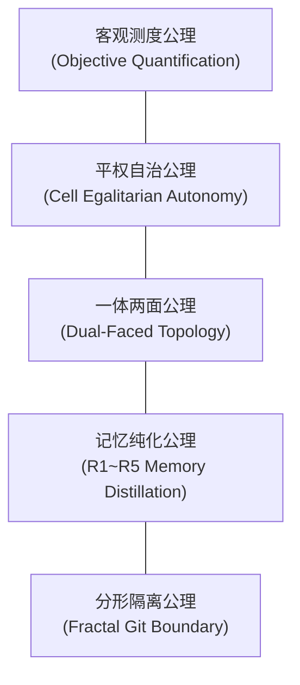

1. **客观求真与零注水公理**：全系统所有度量、评估与自治打分必须建立在纯客观统计数据之上，严禁保底伪造、倍数放大与主观赋分；
2. **Cell 平权自治公理**：系统的基本协作与调度单元为平权 Cell。单 Cell 内部由对等协作实体组成，动态分化，对等制衡；
3. **一体两面公理**：所有核心系统产出（Diff、日志、状态机、报表）一面面向智能体机器解析（高密度结构化数据），一面面向人类开发者透明审阅（直观交互视图）；
4. **记忆阶梯提纯公理**：会话上下文遵循严格的无损折叠、有损提纯与知识泛化阶梯（R1 瞬时 $\to$ R5 跨域图谱），杜绝上下文无界膨胀；
5. **分形工作树隔离公理**：代码改动生命周期与物理工作树严格绑定，门禁逐级守卫，按需瞬时物化，完成即物理回收。

### 2. 智能体自治能力等级定义（L0 ~ L5 演化矩阵）

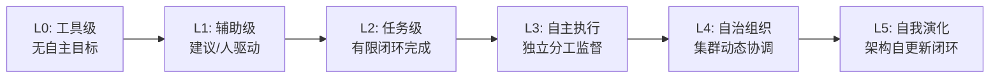

| 等级标识 | 等级名称 | 核心定义与行为边界 | 典型系统形态 | 跃迁判定要求 |
| :--- | :--- | :--- | :--- | :--- |
| **L0** | 非 Agent（工具） | 零自主目标，严格响应即时指令，无反馈闭环 | 传统代码补全、聊天对话模型 | 具备目标感知与多步行动能力 |
| **L1** | 辅助智能体 | 能理解复杂任务上下文并提供结构化建议，由人类主导决策与行动 | Copilot 模式交互助手 | 具备自主执行局部工具操作的能力 |
| **L2** | 任务智能体 | 在明确定义的静态边界内自主执行计划并根据测试反馈微调 | 单轮 Coding Agent | 具备多步骤长期规划与故障自愈能力 |
| **L3** | 自主执行智能体 | 独立负责大型复杂模块，自主建立任务拆分、独立测试与回审流程 | 高级软件工程代理（当前阶段） | 具备系统级自组织与长期状态持久化 |
| **L4** | 自治组织智能体 | 多个智能体基于动态拓扑自主建立部门分化、对等审查与仲裁网络 | 多 Cell 自治协同网络（目标架构） | 具备跨组织协调与动态拓扑重组能力 |
| **L5** | 自我演化智能体 | 系统能够自主度量缺陷，自我优化内部算法、规则目录与组织架构 | 假设阶段终极自治软件实体 | 具备全自动安全可控的架构迭代闭环 |

---

## 二、 Cell 平权自治体系与 AgentLoop 身份路由模型

### 1. Cell 的基本定义与平权三位一体

**Cell（计算与自治细胞）** 是系统可调度的基本自治资源单位，类似于生物学中的组织细胞，既具备独立的生命周期状态，又能在统一调度协议下协同运作。

在单 Cell 内部，天然共存三个平权的 **AgentLoop 执行实体**，三者构成闭环制衡：

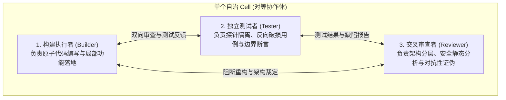

### 2. 负载驱动的部门动态分化拓扑

当系统的并发任务规模超出单 Cell 吞吐阈值时，系统依据分形拓扑原则启动**部门动态分化**：
- **构建部门（Builder Department）**：聚焦于高吞吐代码生产与局部原子回审；
- **独立测试部门（Testing Department）**：构建自动化回归矩阵，执行变异测试与压力测试；
- **专业审查部门（Review Department）**：挂接外部权威知识库，执行深度架构一致性、安全性与全量静态分析；
- **决策中枢（L3A Decision Center）**：从单一会话实体升级为意图解读与路线仲裁中枢，分化出秘书处（L3A-C）承担报表提取与协同派发。

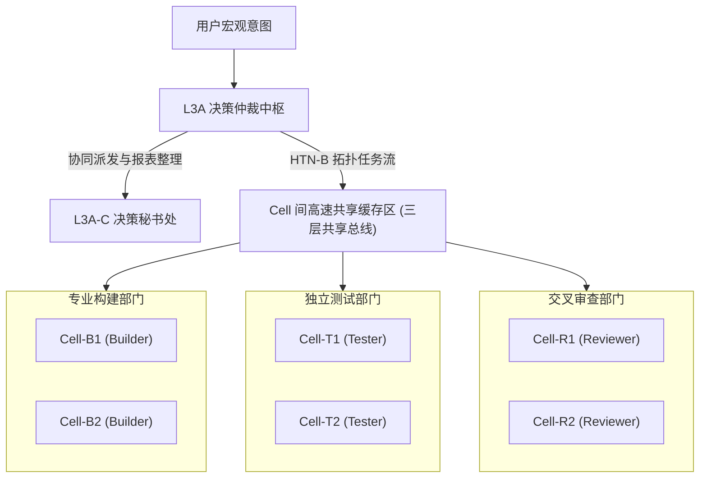

### 3. 身份与部门三维一体约束模型

为了杜绝智能体在分化后出现越权行为（如构建智能体私自编写越权测试用例掩盖自身缺陷），系统建立**三维一体身份约束架构**：

```
                ┌────────────────────────────────────────────────────────┐
                │             身份与部门三维一体约束模型                 │
                └───────────────────────────┬────────────────────────────┘
                                            │
        ┌───────────────────────────────────┼───────────────────────────────────┐
        ▼                                   ▼                                   ▼
┌──────────────────┐               ┌──────────────────┐               ┌──────────────────┐
│ 1. 声明式注册系统 │               │ 2. 行为限定系统  │               │ 3. 语义定义系统  │
│ (UID 分配与索引)  │               │ (Path Jail 与拦截│               │ (上下文与专业提示│
│ 全局唯一标识符    │               │ 越权行为即时中断)│               │ 动态精准注入)    │
└──────────────────┘               └──────────────────┘               └──────────────────┘
```

1. **注册系统（Registration System）**：由底层发放全局唯一实体 UID，建立清晰的部门归属索引；
2. **限定系统（Restriction System）**：
   - 注入 **Zero-Intersection Path Jail**（严格隔离读写路径权限）；
   - **越权行为监控（Behavior Guard）**：当构建部门私自修改测试套件，或审查智能体私自修改业务实现时，系统底层旁路守卫立即拦截并中断会话；
3. **定义系统（Definition System）**：对每个身份的行为边界、决策权重与退化路径进行严谨定义，动态注入上下文提示词。

---

## 三、 一体两面三层拓扑 Diff 差分系统

传统基于单行文本的 `git diff` 面对高并发智能体集群时存在巨大语义盲区（无法感知 AST 符号归属、无法向人类直观解释设计意图、无法承载跨 Cell 冲突仲裁）。为此，系统构建**一体两面三层拓扑 Diff 引擎**。

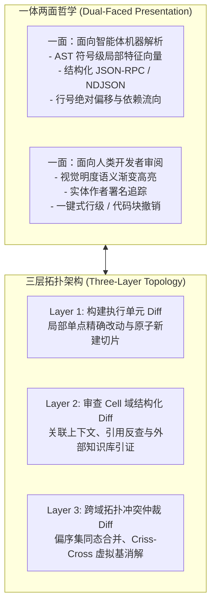

### 1. 结构化持久化缓存与崩溃恢复
为了防止大规模 Diff 拼接占用过多内存或突发宕机导致未落盘工作丢失，系统设计**环形持久化暂存系统（Ring Diff Buffer）**：
- **定频快照追加**：对正在进行的 Diff 流按定频节拍写入本地环形日志，避免实时高频小 I/O；
- **无损淘汰与压缩**：对于远离当前窗口的历史 Diff，自动转为轻量二进制压缩流沉淀入 R4 长期归档库；
- **状态通知总线**：当发生 Diff 归档或冲突淘汰时，通过事件总线即时同步 L3A 决策中枢与人类交互端。

---

## 四、 R1 ~ R5 五级记忆提纯管线与知识泛化拓扑

智能体集群在连续开发中产生海量瞬时对话、中间思绪、工具调用输出与测试断言。若直接将全量历史灌入上下文，必将导致注意力稀释与巨额计算成本。系统建立 **R1 ~ R5 五级记忆提纯管线**：

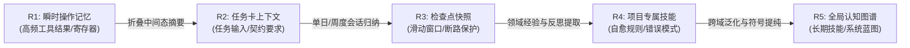

### 1. 记忆分层定义与流转契约

| 记忆等级 | 物理载体 | 留存周期 | 提纯算法与工程纪律 | 核心职责 |
| :--- | :--- | :--- | :--- | :--- |
| **`R1`** | 内存环形寄存器 | 秒级 ~ 单步骤 | 工具调用成功后立即擦除多余输出，只保留精确结构化返回值 | 满足极度高频的原子工具调用与单步反馈 |
| **`R2`** | 任务执行卡（Task Card） | 任务生命周期 | 剥离无意义聊天客套，仅保留输入规格、输出目标与边界断言 | 支撑单智能体在特定任务内的连贯注意力 |
| **`R3`** | 会话检查点（Checkpoint） | 工作区会话级 | 滑动窗口紧缩，超出 75% 预算时触发阶梯式脱水，保留关键决策树 | 保证会话可中断、可重启、支持崩溃自愈 |
| **`R4`** | 技能库（`.agents/skills/`） | 项目全生命周期 | 经过真实工程检验的故障排查模式、架构规约与重构手法 | 指导特定领域的专业开发与自动化代码审查 |
| **`R5`** | 知识图谱与顶层蓝图 | 仓库与组织级 | AST 符号依赖图谱、跨项目通用第一性原理、架构设计蓝图 | 驱动跨领域自治协作与模型离线微调语料提纯 |

### 2. 递归压缩阈值与熔断断路器机制
为了防止记忆压缩算法发生无限自我调用导致死锁或语义丢失：
- **递归压缩深度限制**：最大递归压缩轮数设定为阈值（默认 $\le 3$ 轮），超过阈值自动熔断；
- **前缀 KV 缓存保真度**：压缩时优先保留前缀与系统提示词不变，适配 LLM 厂商的服务端 KV 缓存加速机制；
- **敏感信息旁路脱敏**：所有沉淀入 R4/R5 的记忆数据，必须经由静态安全扫描器脱敏（清除 Token、密码、私有路径）。

---

## 五、 会话管理、多模态协议与工程/生产双模切换

### 1. 执行层与决策层解耦会话架构
系统彻底剥离**高频轻量执行体**与**宏观审议决策体**的会话管理机制：
- **执行层智能体**：采用 `进程 PID + 会话 SessionID` 双重物理绑定，无状态纯指令驱动，崩溃时依靠底层中断器瞬时重启；
- **决策层智能体（L3A）**：会话生命周期与人类长周期目标绑定，产出三类严格隔离的日志流：
  1. `对话上下文 JSON`：纯人类意图与最终仲裁结果；
  2. `思维链（CoT）JSON`：包含推理路径、假说演化与证伪分析；
  3. `工具调用结果 JSON`：记录工具调用参数、耗时与质性产出。

### 2. 工程调试模式与生产模式双模切换
系统通过环境标记或配置开关支持双模式平滑切换：

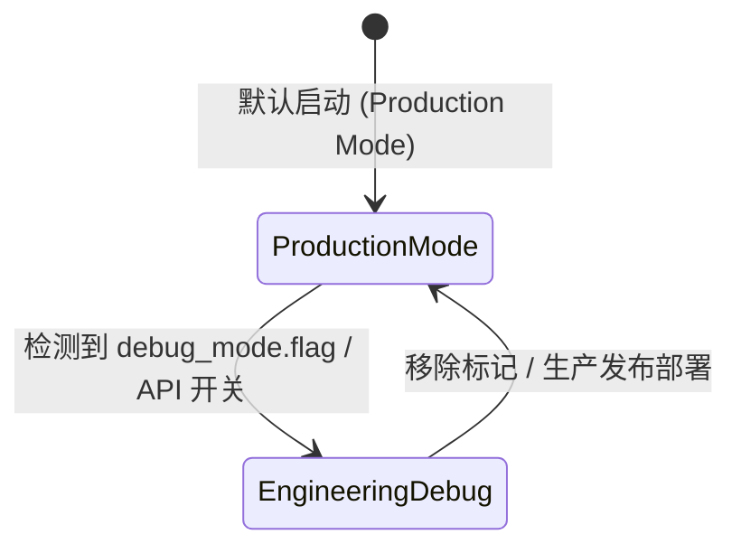

- **生产模式（Production Mode）**：关闭一切冗余调试跟踪，旁路监控静默运行，工具直接走高效二进制 IPC，保障毫秒级极致性能；
- **工程调试模式（Engineering Debug Mode）**：全量开启 AST 切片追踪、思维链旁路打标、每步状态快照落地与系统提示词使用率统计，为架构迭代与模型训练提供客观数据。

---

## 六、 分形 Git (Taxis) 多层工作树隔离与门禁生命周期

传统中心化 Git 单一工作区在多智能体并发提交时必然面临频繁的代码覆盖、锁争用与脏数据污染。系统落地**分形 Git 多层工作树隔离架构**：

```mermaid
flowchart TD
    MainTrunk["系统唯一主干 (main)"]

    subgraph CellWorktree ["Cell 主工作树分支 (cell/trunk)"]
        CellTrunk["Cell-Trunk 集成分支"]
    end

    subgraph AgentPrivate ["Agent 私有工作树 (agent/private)"]
        AgentBranch["Agent-Worktree 分支 (卡生命周期)"]
    end

    subgraph SubAgentWorktree ["SubAgent 临时工作树 (subagent/transient)"]
        SubBranch["SubAgent 瞬时分支 (任务级，完成即回收)"]
    end

    MainTrunk <==|"Tier 2 终审门禁 (audit-all)"| CellTrunk
    CellTrunk <==|"Tier 1 本地门禁 (pre-commit)"| AgentBranch
    AgentBranch <==|"父级审查与测试断言"| SubBranch
```

### 1. 分形工作树生命周期与物理空间回收
1. **瞬时派生（Instant Fork）**：当父 Agent 委派 SubAgent 执行任务时，系统通过轻量 CAS 引用快速创建专属于该 SubAgent 的物理隔离工作树；
2. **零污染提交（Zero-Pollution Commit）**：SubAgent 的所有改动仅发生在其自身的私有分支上，绝不直接碰触父级或 Cell 工作树；
3. **完成即回收（Reclaim on Completion）**：当 SubAgent 任务完成并通过前置断言后，其改动以原子补丁形式合入父分支，底层文件系统**立即物理回收**该临时工作树目录（释放磁盘空间，仅保留 Git DAG 拓扑历史存证），杜绝瞬态垃圾文件扩散。

### 2. 原位存储与磁盘受限自愈引擎 (TIPSE)
在容器化或并发智能体密集交互的低磁盘边缘环境中，传统归档解压与仓库打包面临 $S_{\text{archive}} + S_{\text{extracted}}$ 双倍峰值空间耗尽（`ENOSPC`）风险。Taxis 内化原位存储引擎：
1. **离散事件水位预审（SpacePlan）**：在触碰物理磁盘前，基于宽整型时序仿真计算最低槽位水位，空间不达标提前熔断；
2. **逆向就地截断与前向打洞（In-Place Extraction）**：逆向解压并动态回收 ZIP/TAR 物理尾部，结合 POSIX/Win32 稀疏文件打洞技术，空间动态反哺；
3. **微分型包递进轮转（Micro-Pack Slicing）**：流式切片打包松散对象，逐片校验并即时物理销毁旧对象，彻底消融 GC 死锁。

### 3. 双专属自动化预审提交区域、内核验证器与密码学遥测审计链
为了消解高频多智能体并发测试对 Git DAG 历史的污染、大模型自觉性不可靠导致的虚假测试及无效规避代码风险，Taxis 全量落地双专属自动化提交区域与内核形式化验证体系：
1. **Direct-Bypass 极速自动化测试缓存区**：建立基于 LayerVFS 内存分层与 Direct-Bypass Inode 直通回收机制的专用测试环境，高频测试物理回收延迟 $<20\text{ms}$，绝不向 Git ODB 写入未验证碎片；
2. **TKCV (Taxis Kernel Correctness Verifier) 形式化推导验证器**：纯内存静态形式化推导 5 维代码不变式（AST 闭包、符号可达、纯函数等价、内存生命周期单向性、类型错误穷尽），单次增量耗时 $<5\text{ms}$，刚性拦截虚构代码；
3. **IKCE (In-Kernel Canary Engine) 内核微变异击杀率验证**：纯内存注入金丝雀微变异体，强制要求测试用例变异击杀率 $K \ge 60\%$，彻底粉碎无效断言与指标规避行为；
4. **Jeffreys Beta(0.5, 0.5) 动态信用评级与检疫隔离**：基于客观共轭后验动态核算 Agent 信用分，分级自适应调度门禁；严重违规时工作树瞬间剥夺写权限并物理移送至 `.taxis/quarantine/` 隔离检疫；
5. **密码学不可篡改遥测审计链 (`refs/fractal/telemetry/*`)**：单向不可逆 SHA-256 哈希链，预审物化时双载荷锁定提交与审计块，并施加操作系统底层安全保护（Win32 只读锁 + Linux `chattr +a` 仅追加属性）。

---

## 七、 复合质量门禁与 27 专家 MoE 条件稀疏路由 (CED)

静态分析引擎如果对所有小步改动都执行数万行全量全规则扫描，会严重阻碍智能体的实时交互节拍。系统采用 **27 专家条件分发（CED）稀疏路由架构**：

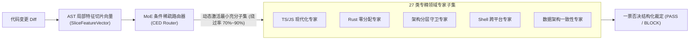

### 1. 单源规则全闭包治理
全工作区所有规则严格收口至单源目录（SSOT <!-- METRICS:BEGIN rule-total -->**516 条规则**<!-- METRICS:END rule-total -->）：
- `auto-refactor` 承载 <!-- METRICS:BEGIN rule-auto-refactor -->**375 条规则**<!-- METRICS:END rule-auto-refactor -->（静态重构与 AST 切片守卫）；
- `workspace-timing` 承载 <!-- METRICS:BEGIN rule-workspace-timing -->**49 条规则**<!-- METRICS:END rule-workspace-timing -->（VS Code 扩展分层与崩溃安全）；
- `WebGames` 承载 <!-- METRICS:BEGIN rule-webgames -->**50 条规则**<!-- METRICS:END rule-webgames -->（配置驱动与游戏对象池）；
- 全局基础设施承载 **35 项**基础设施守卫契约（物理卫生八维与脚本同构）；
- **防虚构红线**：严禁在提交信息、注释或审查结论中书写未经 SSOT 登记的虚构规则 ID（`RCFG-RULE-DRIFT`）。

---

## 八、 全工作区统一质量轨迹大盘与紧凑账本体系

为实现多智能体自治演化过程的完整留痕与可审计性，系统建立**紧凑账本与全生命周期质量轨迹大盘**：

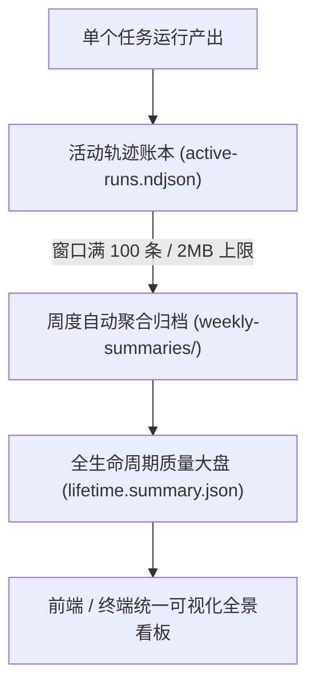

1. **紧凑账本（Compact Ledger）**：单条记录严格限制在 350B 以内，滚动窗口固定保留最近 100 次运行，总物理存储预算严格锁死在 2MB 以内；
2. **净收益与投资回报率（Net Yield & QED）**：量化追踪有效逻辑行（$\text{ELOC}$）、圈复杂度下降率（$\Delta\text{CC}$）、质量跃迁（$\Delta Q$）与技术债务净消除，坚决拦截虚假刷分行为（`BLOCK_GAMING_DETECTED`）。

---

## 九、 硬件事件流、多模态输入与前端呈现解耦

为了支撑不同开发者在不同场景下的终端偏好（从轻量极速的 TUI 终端，到沉浸式 Web 仪表盘，再到 VS Code / 桌面端大型开发环境），系统设计**中心化动作收集与多前端解耦协议**：

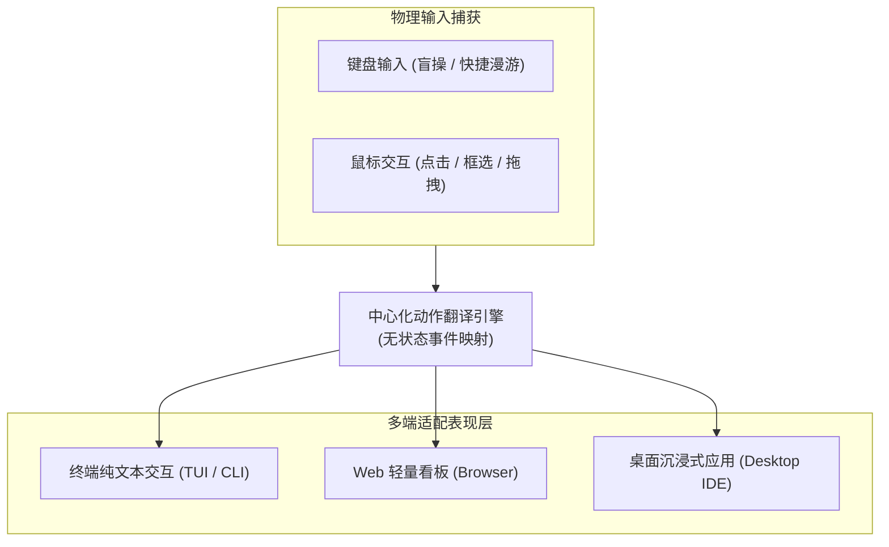

- **输入流统一翻译**：底层仅发射无状态的物理意图事件，禁止与任何特定 UI 控件硬绑定；
- **全键盘盲操支持**：在 TUI 模式下，所有导航、展开、回滚与确认均具备无障碍全键盘操作链路。

---

## 十、 系统状态大切换系统 (State Transition Engine)

系统原生支持在**多 Agent 自治集群态**与**单进程极速开发态**之间无缝切换：

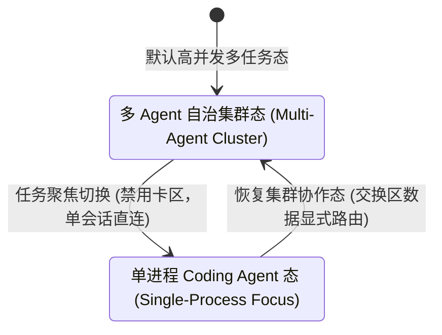

1. **单进程 Coding Agent 态**：当开发者仅需单点对话式微调时，系统退化为单会话直连模式，禁用多 Cell 分发开销，保持极速轻量；
2. **显式数据交换区（Data Exchange Sandbox）**：状态切换时产生的数据暂存于专用内存交换区，退出时安全清理，切回多 Agent 模式时由用户明确确认是否注入上下文，兼具敏捷性与严谨性。

---

## 十一、 附录：核心术语与概念权威定义

1. **Agent（智能体）**：以明确工程目标为驱动、能够感知代码与环境状态、进行独立决策推理、采取原子行动，并基于静态测试与门禁反馈闭环纠正自身的自治软件实体；
2. **Cell（自治细胞）**：系统最基本的资源调度与协作单元，封装了对等制衡的三位一体智能体（构建者、测试者、审查者）；
3. **SSOT（Single Source of Truth, 单一真源）**：全工作区针对特定元数据（如规则目录、文档度量指标、常量字典）设立的唯一权威文件，所有派生数据必须由其确定性生成；
4. **Zero-Intersection Path Jail**：为智能体分配的互不重叠的文件系统读写沙箱边界，从物理层面根除多智能体并发修改时的写入冲突。
