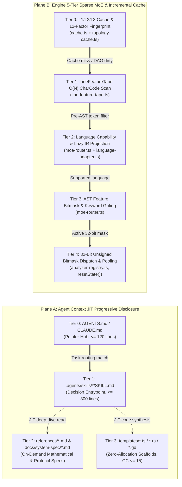

# JIT Progressive Disclosure & 5-Tier Sparse MoE Routing Specification (`docs/system-spec/jit-context-and-moe-routing-spec.md`)

> Normative architecture specification unifying **Plane A (Agent Context JIT Progressive Disclosure)** and **Plane B (Static Engine 5-Tier Sparse MoE Activation & L1/L2/L3 WAL Caching)**. Parent index: [docs/system-spec/README.md](./README.md) · Top-level hub: [docs/README.md](../README.md).

---

## 1. Dual-Plane On-Demand Architecture

To bound both LLM token consumption and static analysis CPU/heap budgets at $O(1)$ per active task, the workspace enforces a dual-plane on-demand architecture:



---

## 2. Plane A: Agent Context JIT Progressive Disclosure

1. **Four-Tier Prompt Budget Hierarchy**:
   - **Tier 0 (`AGENTS.md` / `CLAUDE.md`)**: Always-in-context routing matrix and non-negotiable axioms ($\le 120$ lines). Zero embedded tutorials or multi-page tables.
   - **Tier 1 (`.agents/skills/<skill>/SKILL.md`)**: Loaded only when task triggers match `scripts/common/skill-registry.json` across all <!-- METRICS:BEGIN skill-count -->**27 项**<!-- METRICS:END skill-count --> skills. Target window $50\text{–}200$ lines (hard ceiling $\le 300$ lines).
   - **Tier 2 (`references/*.md` & `docs/system-spec/*.md`)**: Loaded on demand when modifying specific mathematical models, wire protocols, or edge-case algorithms.
   - **Tier 3 (`templates/*`)**: Loaded on demand when scaffolding new analyzers, WAL checkpoints, or language modules ($\text{CC}\le 15$, $\text{Depth}\le 4$, 6-field JSDoc).
2. **Context Dehydration & AAS v1.0 Reporting**:
   - Trigger context dehydration when session utilization reaches **75%**, retaining only active file paths, failing gate IDs, and next-step checklists.
   - Gate and static-analysis diagnostics emit **AAS v1.0** (`L1_CONTRACT` $\to$ `L5_GOVERNANCE` topological aggregation with inline code anchors), achieving $\ge 70\%$ token compression (`auto-refactor/src/core/reporting/aas-reporter.ts`).

---

## 3. Plane B: 5-Tier Sparse MoE Routing & Lazy IR Projection

All <!-- METRICS:BEGIN analyzer-count -->**32 个**<!-- METRICS:END analyzer-count --> MoE expert analyzers in `auto-refactor/src/core/pipeline/` are governed by five cascading activation filters ([sparse-moe-and-ast-routing](../../.agents/skills/sparse-moe-and-ast-routing/SKILL.md)):

| Tier | Component | Complexity | Filtering Invariant |
| :--- | :--- | :--- | :--- |
| **Tier 0** | `IncrementalCache` & `TopologyCacheManager` | $O(1)$ lookup | Skips unchanged files whose 12-factor `FingerprintPayload` + `engineDigest` match and whose `dependedBy` reverse DAG is clean |
| **Tier 1** | `LineFeatureTape` (`line-feature-tape.ts`) | $O(N)$ charCode scan | Single-pass ASCII state machine populating `Uint16Array` line flags + `fileFeatureMask` before AST parsing; zero per-line RegExp allocation (`ADV-PRF-002`) |
| **Tier 2** | Language & Lazy IR Adapter (`language-adapter.ts`) | $O(1)$ capability bit | Routes 8 languages (`ts`/`tsx`/`js`/`jsx`, `rs`, `py`, `go`, `c`/`cpp`, `java`, `cs`, `gd`). Non-JS adapters expose lazy `NormalizedNode` and `SemanticGraph` (`cfg`/`dfg`/`callGraph`) getters materialized only on demand |
| **Tier 3** | `SparseMoERouter` (`moe-router.ts`) | $O(1)$ bitwise | Combines AST node presence, `SYNTAX_KEYWORDS`, `COMMENT_DIRECTIVES`, and `LineFeatureFlags` to prune inactive experts |
| **Tier 4** | `AnalyzerBit` Dispatch (`analyzer-registry.ts`) | $O(1)$ bitwise | 32-bit unsigned bitmask (`(1 << 0) >>> 0` through `(1 << 31) >>> 0`) dispatches pooled analyzer instances; every analyzer implements `resetState()` (`PRF-LEAK-001`) |

---

## 4. Virtual Sandbox Execution & Multi-Tier WAL Persistence

1. **LayerVFS CAS Sandbox & MCTS Refactoring (`praxis-vfs-and-trajectory-learning`)**:
   - Candidate refactorings fork `LayerVFS` in memory (`fork()` $\to$ `writeVirtualFile()` $\to$ `verifyInSandbox()` $\to$ `commitTransaction()` / `rollback()`), backed by FastCDC content-defined chunking and SQLite WAL CAS storage (`auto-refactor/src/core/vfs/`).
   - MCTS UCT search (`$c = 1.414$`, max 24 iterations, 5000 ms budget) and trajectory recipe extraction (`recipeExtractor.ts`) enforce the 5-stage `ReviewGateChain` (`GAT-SYN-001`, `GAT-TYP-001`, `GAT-SEM-001`, `GAT-SEC-001`, `GAT-PERF-001`).
   - Full contract: [praxis-vfs-and-trajectory-learning](../../.agents/skills/praxis-vfs-and-trajectory-learning/SKILL.md).
2. **L1/L2/L3 Cache & Crash-Safe WAL Checkpointing (`tiered-cache-and-wal-persistence`)**:
   - **4-Grade `l2LoadLevel` Degradation**: Scales L2 loading from `'full'` ($\le 5\text{k}$ files) $\to$ `'recent'` ($\le 20\text{k}$) $\to$ `'summary'` ($\le 50\text{k}$) $\to$ `'lazy'` ($> 50\text{k}$ or heap $> 512\text{ MB}$).
   - **Crash-Safe WAL & Atomic Rename**: Appends NDJSON entries to `.cache.wal`, checkpoints asynchronously via worker thread after threshold, and replaces target snapshots via PID-salted temporary files + `fs.renameSync`.
   - Full contract: [tiered-cache-and-wal-persistence](../../.agents/skills/tiered-cache-and-wal-persistence/SKILL.md).

---

## 5. Verification Commands

```bash
node scripts/common/validate-skills.js
node scripts/common/validate-docs-consistency.js
node scripts/common/validate-doc-reachability.js
cd auto-refactor && npm test
```
